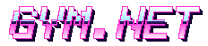

<h1 align="center">
  <a href="https://github.com/SciSharp/Gym.NET"></a>
</h1>

<p align="center">
  <strong>Reinforcement-learning environments framework for .NET</strong>
</p>

<p align="center">
  <a href="https://www.nuget.org/packages/Gym.NET.Environments"></a>
  <a href="https://www.nuget.org/packages/Gym.NET"></a>
  <a href="https://github.com/SciSharp/Gym.NET/actions/workflows/ci.yml"></a>
  <a href="https://scisharp.github.io/Gym.NET"></a>
  <a href="https://github.com/SciSharp/Gym.NET/blob/master/LICENSE"></a>
</p>

<p align="center">
  Gym.NET is a native .NET library for reinforcement learning: <a href="https://github.com/Farama-Foundation/Gymnasium">Gymnasium</a>'s environments and API, the same results for the same seed and actions, entirely in pure C#.
</p>

<p align="center">
  <a href="https://github.com/SciSharp/Gym.NET/blob/master/docs/media/gym-net-showreel.mp4"></a>
</p>

<p align="center">
  <sub>24 environments playing, <a href="https://scisharp.github.io/Gym.NET/#select-your-environment">see all environments</a></sub>
</p>

## What is Gym.NET?

Gym.NET gives .NET code the environments that Python's Gymnasium gives reinforcement-learning research, without embedding
CPython and without the GIL: the same `Env` contract (`Reset`, `Step`, spaces, wrappers, vector envs), the same 39
environment ids and the same numbers, with vector environments that step on worker threads instead of processes. It is for
training and evaluating agents in C#, for moving a Gymnasium experiment to .NET and checking that it still produces what it
produced, and for writing new environments against a contract that is already known.

The compatibility target is **Gymnasium v1.4.0**. Given the same seed and actions, Gym.NET returns the same observations,
rewards, `terminated`/`truncated` flags and infos as Gymnasium, bit for bit, and renders the same frames, pixel for pixel
(MuJoCo's within a measured margin, [below](#what-is-in-10)). When Gym.NET and Gymnasium differ, Gymnasium is treated as the
source of truth and Gym.NET aligns, except for the 14 deliberate differences the
[release notes](https://github.com/SciSharp/Gym.NET/blob/master/docs/releases/RELEASE_1.0.0.md) list. A test suite that
runs Gymnasium itself inside the test process checks this, call by call.

Gym.NET focuses on:

- Gymnasium's API and names: `Env<TObs, TAct>`, `Gymnasium.Make`, `Reset(seed)` returning `(observation, info)`, `Step`
  returning `(observation, reward, terminated, truncated, info)`.
- Bit-for-bit values: the same observations, rewards, flags and infos for the same seed and actions, checked by a live
  parity suite that runs Gymnasium inside the test process.
- Pixel-for-pixel frames: `rgb_array` frames equal to Gymnasium's (MuJoCo's within a measured margin).
- Managed code all the way down: Box2D 2.3.0 and a MuJoCo engine written in C#, so there is no native code to install.
- Threads, not processes: `AsyncVectorEnv` steps its sub-envs on worker threads, with Gymnasium's protocol and the same bits
  as `SyncVectorEnv`.
- .NET types where Gymnasium's shape allows them: generic envs, enums beside Gymnasium's strings, typed info records,
  `ValueTask` stepping.

[Getting started](https://github.com/SciSharp/Gym.NET/blob/master/docs/guides/getting_started.md) walks through making envs,
seeding, spaces, rendering, wrappers and vector envs.

## Installation

```sh
dotnet add package Gym.NET.Environments
```

| Package | What it brings |
|---|---|
| [Gym.NET.Environments](https://www.nuget.org/packages/Gym.NET.Environments) | The 39 environments with their Box2D and MuJoCo engines; brings Gym.NET and Gym.NET.Rendering |
| [Gym.NET](https://www.nuget.org/packages/Gym.NET) | The API alone, for writing your own environments: `Env<TObs, TAct>`, spaces, wrappers, the registry, vector envs, checkers |
| [Gym.NET.Rendering](https://www.nuget.org/packages/Gym.NET.Rendering) | pygame's drawing in managed C#: the rasterizer behind the `rgb_array` frames, and Gymnasium's `play` |
| [Gym.NET.Rendering.Avalonia](https://www.nuget.org/packages/Gym.NET.Rendering.Avalonia) | Optional: a window for `render_mode "human"` on Windows, Linux and macOS |
| [Gym.NET.Rendering.WinForm](https://www.nuget.org/packages/Gym.NET.Rendering.WinForm) | Optional: the same on Windows Forms |

Gym.NET 1.0 targets .NET 8, .NET 10 and .NET 11. Coming from 0.2: move every Gym.NET package to 1.0.0 at once and remove any
NumSharp.Lite reference ([migrating from 0.2](https://github.com/SciSharp/Gym.NET/blob/master/docs/guides/migrating_to_1.0.md)).

## Example

```csharp
using System;
using Gym;
using Gym.Envs;
using NumSharp;

// make builds the registered env inside Gymnasium's wrappers: TimeLimit(500), OrderEnforcing, PassiveEnvChecker.
using Env<NDArray, NDArray> env = Gymnasium.Make<NDArray, NDArray>("CartPole-v1");
env.ActionSpace.Seed(42);
NDArray observation = env.Reset(seed: 42).Observation;
double episodeReturn = 0;
while (true) {
    using NDArray action = env.ActionSpace.Sample();   // 0 (push left) or 1 (push right)
    var (next, reward, terminated, truncated, info) = env.Step(action);
    observation.Dispose();                            // the arrays an env returns belong to the caller
    observation = next;
    episodeReturn += reward;
    if (terminated || truncated)
        break;
}

observation.Dispose();
Console.WriteLine($"Episode return: {episodeReturn}");
```

`Reset(seed)` returns `(observation, info)`. `Step(action)` returns `(observation, reward, terminated, truncated, info)`:
`terminated` means the task ended (the pole fell), and `truncated` means a limit cut the episode short (`TimeLimit`'s 500
steps). The render mode is chosen when the env is built: `Gymnasium.Make("CartPole-v1", new { render_mode = "rgb_array" })`.

[examples/CartPole](https://github.com/SciSharp/Gym.NET/tree/master/examples/CartPole) trains a policy that balances
the pole, playing 100 carts at once through `Gymnasium.MakeVec`. [examples/](https://github.com/SciSharp/Gym.NET/tree/master/examples)
has one project for each of the 24 environments in the showreel above. Each plays its env with the same agent, a
hand-written controller, Gymnasium's heuristic, value iteration or a trained linear policy, headless, in a window
(`--render`) or from your keyboard (`--play`).

## Features

- **39 environment ids** - classic_control, box2d, toy_text and MuJoCo, with Gymnasium's names and versions, registered for
  `Gymnasium.Make` before `Main` runs. See [Environments](#environments).
- **Gymnasium's API in C#** - `Env<TObs, TAct>`, all ten spaces, `Gymnasium.Make`, `MakeVec` and `Register`, and every
  wrapper but Atari's and the JAX/PyTorch conversions. See
  [Getting started](https://github.com/SciSharp/Gym.NET/blob/master/docs/guides/getting_started.md).
- **Bit for bit, pixel for pixel** - a parity suite runs Gymnasium inside the test process and compares every value and
  every frame. See [Architecture](https://github.com/SciSharp/Gym.NET/blob/master/docs/architecture.md).
- **No native code, no CPython** - Box2D 2.3.0 and a MuJoCo engine that computes what MuJoCo 4.0.0 computes, both managed
  C# inside Gym.NET.Environments.
- **Vector environments** - `SyncVectorEnv` in every autoreset mode, `AsyncVectorEnv` and every vector wrapper, through
  `Gymnasium.MakeVec`.
- **Async, on threads** - `AsyncVectorEnv` steps its sub-envs on worker threads (the thread pool, dedicated threads, or a
  thread per env) with Gymnasium's protocol and the same bits as `SyncVectorEnv`, without processes or a GIL. `StepAsync`
  is a `ValueTask`, completing synchronously unless an environment has asynchronous work to do, and the viewers have an
  asynchronous contract (`IAsyncEnvViewer`).
- **.NET-typed** - `RenderMode`, `AutoresetMode` and `VectorizeMode` enums beside Gymnasium's strings, a typed info record
  per env, typed `Sample` masks.
- **Desktop windows** - `human` mode in an Avalonia (Windows, Linux, macOS) or Windows Forms window, with keyboard play
  through `play` and, for MuJoCo, Gymnasium's mouse and key controls.
- **Your own environments** - write an `Env<TObs, TAct>`, register it and check it with Gymnasium's checkers. See
  [Creating custom environments](https://github.com/SciSharp/Gym.NET/blob/master/docs/guides/creating_custom_environments.md).
- **Faster than Gymnasium** - per step, from `x1.4` (CartPole) to `x14.4` (Acrobot) in the nine environments measured. See
  [Performance](#performance).

## Environments

One still for each of the 24 visually distinct environments of the showreel; every still opens its example project. All 39
ids are listed in [What is in 1.0](#what-is-in-10).

| [**CartPole**][CartPole] | [**MountainCar**][MountainCar] | [**Pendulum**][Pendulum] | [**Acrobot**][Acrobot] | [**LunarLander**][LunarLander] | [**BipedalWalker**][BipedalWalker] |
|:---:|:---:|:---:|:---:|:---:|:---:|
| [![CartPole][CartPole-img]][CartPole] | [![MountainCar][MountainCar-img]][MountainCar] | [![Pendulum][Pendulum-img]][Pendulum] | [![Acrobot][Acrobot-img]][Acrobot] | [![LunarLander][LunarLander-img]][LunarLander] | [![BipedalWalker][BipedalWalker-img]][BipedalWalker] |
| [**BipedalWalkerHardcore**][BipedalWalkerHardcore] | [**CarRacing**][CarRacing] | [**FrozenLake**][FrozenLake] | [**FrozenLake8x8**][FrozenLake8x8] | [**CliffWalking**][CliffWalking] | [**Taxi**][Taxi] |
| [![BipedalWalkerHardcore][BipedalWalkerHardcore-img]][BipedalWalkerHardcore] | [![CarRacing][CarRacing-img]][CarRacing] | [![FrozenLake][FrozenLake-img]][FrozenLake] | [![FrozenLake8x8][FrozenLake8x8-img]][FrozenLake8x8] | [![CliffWalking][CliffWalking-img]][CliffWalking] | [![Taxi][Taxi-img]][Taxi] |
| [**Blackjack**][Blackjack] | [**Ant**][Ant] | [**HalfCheetah**][HalfCheetah] | [**Hopper**][Hopper] | [**Humanoid**][Humanoid] | [**HumanoidStandup**][HumanoidStandup] |
| [![Blackjack][Blackjack-img]][Blackjack] | [![Ant][Ant-img]][Ant] | [![HalfCheetah][HalfCheetah-img]][HalfCheetah] | [![Hopper][Hopper-img]][Hopper] | [![Humanoid][Humanoid-img]][Humanoid] | [![HumanoidStandup][HumanoidStandup-img]][HumanoidStandup] |
| [**InvertedDoublePendulum**][InvertedDoublePendulum] | [**InvertedPendulum**][InvertedPendulum] | [**Pusher**][Pusher] | [**Reacher**][Reacher] | [**Swimmer**][Swimmer] | [**Walker2d**][Walker2d] |
| [![InvertedDoublePendulum][InvertedDoublePendulum-img]][InvertedDoublePendulum] | [![InvertedPendulum][InvertedPendulum-img]][InvertedPendulum] | [![Pusher][Pusher-img]][Pusher] | [![Reacher][Reacher-img]][Reacher] | [![Swimmer][Swimmer-img]][Swimmer] | [![Walker2d][Walker2d-img]][Walker2d] |

[CartPole]: https://github.com/SciSharp/Gym.NET/tree/master/examples/CartPole
[MountainCar]: https://github.com/SciSharp/Gym.NET/tree/master/examples/MountainCar
[Pendulum]: https://github.com/SciSharp/Gym.NET/tree/master/examples/Pendulum
[Acrobot]: https://github.com/SciSharp/Gym.NET/tree/master/examples/Acrobot
[LunarLander]: https://github.com/SciSharp/Gym.NET/tree/master/examples/LunarLander
[BipedalWalker]: https://github.com/SciSharp/Gym.NET/tree/master/examples/BipedalWalker
[BipedalWalkerHardcore]: https://github.com/SciSharp/Gym.NET/tree/master/examples/BipedalWalkerHardcore
[CarRacing]: https://github.com/SciSharp/Gym.NET/tree/master/examples/CarRacing
[FrozenLake]: https://github.com/SciSharp/Gym.NET/tree/master/examples/FrozenLake
[FrozenLake8x8]: https://github.com/SciSharp/Gym.NET/tree/master/examples/FrozenLake8x8
[CliffWalking]: https://github.com/SciSharp/Gym.NET/tree/master/examples/CliffWalking
[Taxi]: https://github.com/SciSharp/Gym.NET/tree/master/examples/Taxi
[Blackjack]: https://github.com/SciSharp/Gym.NET/tree/master/examples/Blackjack
[Ant]: https://github.com/SciSharp/Gym.NET/tree/master/examples/Ant
[HalfCheetah]: https://github.com/SciSharp/Gym.NET/tree/master/examples/HalfCheetah
[Hopper]: https://github.com/SciSharp/Gym.NET/tree/master/examples/Hopper
[Humanoid]: https://github.com/SciSharp/Gym.NET/tree/master/examples/Humanoid
[HumanoidStandup]: https://github.com/SciSharp/Gym.NET/tree/master/examples/HumanoidStandup
[InvertedDoublePendulum]: https://github.com/SciSharp/Gym.NET/tree/master/examples/InvertedDoublePendulum
[InvertedPendulum]: https://github.com/SciSharp/Gym.NET/tree/master/examples/InvertedPendulum
[Pusher]: https://github.com/SciSharp/Gym.NET/tree/master/examples/Pusher
[Reacher]: https://github.com/SciSharp/Gym.NET/tree/master/examples/Reacher
[Swimmer]: https://github.com/SciSharp/Gym.NET/tree/master/examples/Swimmer
[Walker2d]: https://github.com/SciSharp/Gym.NET/tree/master/examples/Walker2d
[CartPole-img]: https://raw.githubusercontent.com/SciSharp/Gym.NET/master/docs/website-src/images/envs/CartPole-v1.png
[MountainCar-img]: https://raw.githubusercontent.com/SciSharp/Gym.NET/master/docs/website-src/images/envs/MountainCar-v0.png
[Pendulum-img]: https://raw.githubusercontent.com/SciSharp/Gym.NET/master/docs/website-src/images/envs/Pendulum-v1.png
[Acrobot-img]: https://raw.githubusercontent.com/SciSharp/Gym.NET/master/docs/website-src/images/envs/Acrobot-v1.png
[LunarLander-img]: https://raw.githubusercontent.com/SciSharp/Gym.NET/master/docs/website-src/images/envs/LunarLander-v3.png
[BipedalWalker-img]: https://raw.githubusercontent.com/SciSharp/Gym.NET/master/docs/website-src/images/envs/BipedalWalker-v3.png
[BipedalWalkerHardcore-img]: https://raw.githubusercontent.com/SciSharp/Gym.NET/master/docs/website-src/images/envs/BipedalWalkerHardcore-v3.png
[CarRacing-img]: https://raw.githubusercontent.com/SciSharp/Gym.NET/master/docs/website-src/images/envs/CarRacing-v3.png
[FrozenLake-img]: https://raw.githubusercontent.com/SciSharp/Gym.NET/master/docs/website-src/images/envs/FrozenLake-v1.png
[FrozenLake8x8-img]: https://raw.githubusercontent.com/SciSharp/Gym.NET/master/docs/website-src/images/envs/FrozenLake8x8-v1.png
[CliffWalking-img]: https://raw.githubusercontent.com/SciSharp/Gym.NET/master/docs/website-src/images/envs/CliffWalking-v1.png
[Taxi-img]: https://raw.githubusercontent.com/SciSharp/Gym.NET/master/docs/website-src/images/envs/Taxi-v4.png
[Blackjack-img]: https://raw.githubusercontent.com/SciSharp/Gym.NET/master/docs/website-src/images/envs/Blackjack-v1.png
[Ant-img]: https://raw.githubusercontent.com/SciSharp/Gym.NET/master/docs/website-src/images/envs/Ant-v5.png
[HalfCheetah-img]: https://raw.githubusercontent.com/SciSharp/Gym.NET/master/docs/website-src/images/envs/HalfCheetah-v5.png
[Hopper-img]: https://raw.githubusercontent.com/SciSharp/Gym.NET/master/docs/website-src/images/envs/Hopper-v5.png
[Humanoid-img]: https://raw.githubusercontent.com/SciSharp/Gym.NET/master/docs/website-src/images/envs/Humanoid-v5.png
[HumanoidStandup-img]: https://raw.githubusercontent.com/SciSharp/Gym.NET/master/docs/website-src/images/envs/HumanoidStandup-v5.png
[InvertedDoublePendulum-img]: https://raw.githubusercontent.com/SciSharp/Gym.NET/master/docs/website-src/images/envs/InvertedDoublePendulum-v5.png
[InvertedPendulum-img]: https://raw.githubusercontent.com/SciSharp/Gym.NET/master/docs/website-src/images/envs/InvertedPendulum-v5.png
[Pusher-img]: https://raw.githubusercontent.com/SciSharp/Gym.NET/master/docs/website-src/images/envs/Pusher-v5.png
[Reacher-img]: https://raw.githubusercontent.com/SciSharp/Gym.NET/master/docs/website-src/images/envs/Reacher-v5.png
[Swimmer-img]: https://raw.githubusercontent.com/SciSharp/Gym.NET/master/docs/website-src/images/envs/Swimmer-v5.png
[Walker2d-img]: https://raw.githubusercontent.com/SciSharp/Gym.NET/master/docs/website-src/images/envs/Walker2d-v5.png

## Performance

Steps per second of one environment stepped in a loop of sampled actions, Gymnasium v1.4.0 against Gym.NET on the same
machine. The ratio is Gym.NET's steps divided by Gymnasium's: `x2` is twice Gymnasium's speed.

| Family | Environment | Gymnasium (steps/s) | Gym.NET (steps/s) | Ratio | Gym.NET allocates per step |
|---|---|---:|---:|---:|---:|
| classic_control | Acrobot | 11,696 | 168,049 | x14.4 | 4,019 B |
| | Pendulum | 12,930 | 48,601 | x3.8 | 11,088 B |
| | MountainCar | 43,440 | 145,364 | x3.3 | 3,192 B |
| | CartPole | 65,464 | 93,898 | x1.4 | 3,266 B |
| toy_text | Taxi | 36,414 | 164,917 | x4.5 | 4,681 B |
| | FrozenLake | 59,436 | 213,280 | x3.6 | 4,283 B |
| box2d | BipedalWalker | 2,499 | 9,024 | x3.6 | 35,071 B |
| | CarRacing | 74 | 164 | x2.2 | 3,631,032 B |
| | LunarLander | 12,503 | 19,744 | x1.6 | 8,993 B |

Measured 2026-11-11, before the MuJoCo environments landed, with net10.0 Release builds against Gymnasium v1.4.0 on CPython
3.12.12 (NumPy 2.4.2, pygame-ce 2.5.8, Box2D 2.3.10): five rounds of Gym.NET and four of Gymnasium, interleaved, medians.
Single runs strayed up to 25% from the median and the machine's load moves the absolute numbers, so the ratio is the steadier
figure. Only these nine environments are measured. The method, the CarRacing and LunarLander profiles and the table are in
[the code review](https://github.com/SciSharp/Gym.NET/blob/master/docs/plans/CSHARP_CODE_REVIEW.md#4-measurements).

## What is in 1.0

| Area | Contents |
|---|---|
| Core | `Env<TObs, TAct>`, `IEnv`, `Wrapper` and the observation, action and reward wrapper bases, `StepResult`/`ResetResult`, `Info`, `Metadata`, `RenderResult`, every Gymnasium error |
| Spaces | `Box`, `Discrete`, `MultiBinary`, `MultiDiscrete`, `Tuple`, `Dict`, `Text`, `Sequence`, `Graph`, `OneOf`, and `SpaceUtils` (flatten, unflatten, flatdim) |
| Registry | `Gymnasium.Make`, `Gymnasium.MakeVec`, `Gymnasium.Register`, `Gymnasium.Spec`, `Gymnasium.PprintRegistry`; constructor arguments by Python name, from an anonymous object, a dictionary or a generated options record |
| Wrappers | Every Gymnasium wrapper but `AtariPreprocessing` and the JAX/PyTorch conversions: `TimeLimit`, `Autoreset`, `RecordEpisodeStatistics`, the observation, action and reward transforms (`ResizeObservation` over OpenCV's resize in C#, `FrameStackObservation`, `NormalizeObservation`, `ClipAction`, `NormalizeReward`, ...), `RecordVideo`, `HumanRendering` |
| Vector envs | `VectorEnv<TObs, TAct>`, `SyncVectorEnv` in every autoreset mode, `AsyncVectorEnv` on worker threads, every vector wrapper, `CartPoleVectorEnv` |
| Checkers | `EnvChecker.CheckEnv`, `PassiveChecker`, `EnvMatch` |
| Environments | classic_control: CartPole-v0/v1, MountainCar-v0, MountainCarContinuous-v0, Pendulum-v1, Acrobot-v1. box2d: LunarLander-v3, LunarLanderContinuous-v3, BipedalWalker-v3, BipedalWalkerHardcore-v3, CarRacing-v3 (on Box2D 2.3.0 in managed C#). toy_text: FrozenLake-v1, FrozenLake8x8-v1, CliffWalking-v1, CliffWalkingSlippery-v1, Taxi-v4, Blackjack-v1. mujoco: Ant, HalfCheetah, Hopper, Humanoid, HumanoidStandup, InvertedPendulum, InvertedDoublePendulum, Pusher, Reacher, Swimmer, Walker2d, each -v4 and -v5 (on Gym.NET's own engine, bit for bit with MuJoCo 4.0.0) |
| Rendering | `rgb_array` and `ansi` frames equal to Gymnasium's (MuJoCo's within one level, below); `human` mode in an Avalonia or Windows Forms window |

MuJoCo's environments step bit for bit with MuJoCo 4.0.0. Gym.NET draws their frames itself: against Gymnasium's GPU
frames, 0.07% (InvertedPendulum) to 16% (Humanoid) of the pixels differ, nearly all by one level. The release notes
list what 1.0 leaves out and every known difference from Gymnasium:
[docs/releases/RELEASE_1.0.0.md](https://github.com/SciSharp/Gym.NET/blob/master/docs/releases/RELEASE_1.0.0.md).

## Documentation

- [The documentation site](https://scisharp.github.io/Gym.NET): these pages, the API reference, and every environment
  playing in its 8-bit gallery (built from `docs/` by `.github/workflows/docs.yml`).
- [Getting started](https://github.com/SciSharp/Gym.NET/blob/master/docs/guides/getting_started.md): making envs,
  seeding, spaces, rendering, wrappers, vector envs.
- [Creating custom environments](https://github.com/SciSharp/Gym.NET/blob/master/docs/guides/creating_custom_environments.md):
  an `Env<TObs, TAct>`, its registration, and checking it.
- [Migrating from 0.2 to 1.0](https://github.com/SciSharp/Gym.NET/blob/master/docs/guides/migrating_to_1.0.md): the old
  calls and their replacements, and `Gym.Legacy` for code that cannot move yet.
- [Architecture](https://github.com/SciSharp/Gym.NET/blob/master/docs/architecture.md): the packages, and how Gym.NET
  is held to Gymnasium's behavior.
- [Development and testing](https://github.com/SciSharp/Gym.NET/blob/master/docs/guides/development_and_testing.md):
  building, the unit suite, and the live parity suite.

## Related projects

- [Gymnasium](https://github.com/Farama-Foundation/Gymnasium) - the Python library whose API and behavior Gym.NET is held
  to; v1.4.0 is the pinned reference.
- [NumSharp](https://github.com/SciSharp/NumSharp) - the arrays and NumPy-exact random generators under every Gym.NET
  environment.
- [SciSharp STACK](https://scisharp.github.io/SciSharp/) - the ecosystem Gym.NET belongs to.

## A note on SixLabors.ImageSharp

Gym.NET depends on SixLabors.ImageSharp 2.1.13, the last release under the Apache-2.0 license. GitHub published five
advisories against it on 2026-10-07, which NuGet reports in your restore as NU1902/NU1903 (and which fail it under
`TreatWarningsAsErrors`). None of them is reachable through Gym.NET: it never encodes or decodes TIFF, never runs
histogram equalization, and decodes only its own embedded PNG assets. If you don't use ImageSharp yourself on untrusted
input, you can suppress them; the release notes list the five advisories and the `NuGetAuditSuppress` lines.

## License

Apache-2.0, every package. Gymnasium's environment assets are used under Gymnasium's MIT license; the sources Gym.NET
translates (Box2D, SDL_gfx, SDL_ttf, OpenCV's resize, CPython's difflib, json and math routines, pygame-ce's
anti-aliased lines), the score glyphs CarRacing records from pygame, and MuJoCo's font and compiled models are credited
in [THIRD-PARTY-NOTICES.md](https://github.com/SciSharp/Gym.NET/blob/master/THIRD-PARTY-NOTICES.md), which every
package carries.
