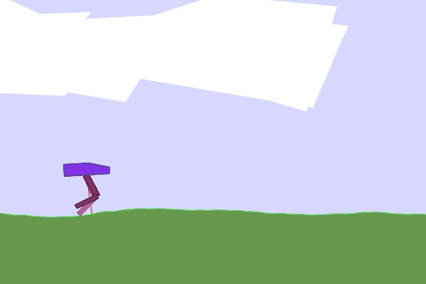
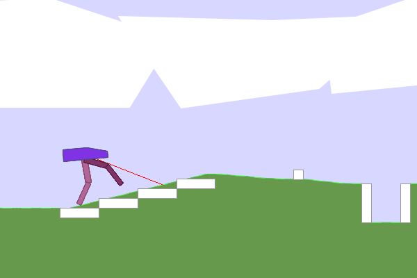

<h1 class="visually-hidden">Bipedal Walker</h1>
<div class="gn-env-banner">
<canvas class="gn-pixel" data-text="BIPEDAL WALKER" data-scale="6" data-color="#fcfcfc" data-shadow="#7f33e5"></canvas>
<canvas class="gn-pixel" data-text="BOX2D  4 MOTORS  24 OBSERVATIONS" data-scale="2" data-color="#f8b800"></canvas>
</div>

<p class="gn-env-lead">Walk a two-legged robot to the far end of a course, rolling grass or a run of stumps, stairs and pits, with a motor at each hip and knee and no map: it feels its joints, its feet and ten lidar rays. The physics is Box2D's, run in Gym.NET's own managed Box2D, float for float with what Gymnasium's pybox2d computes.</p>

<aside class="gn-infobox" aria-label="Bipedal Walker at a glance">
<video src="media/BipedalWalker-v3.episode.mp4" poster="media/BipedalWalker-v3.figure.png" autoplay muted loop playsinline disablepictureinpicture disableremoteplayback aria-label="BipedalWalker-v3, seed 0: Gymnasium's gait walks the whole course in 1,598 steps"></video>
<p class="gn-infobox-caption">The whole episode <code>examples/BipedalWalker</code> plays and records: Gymnasium's own gait, seed 0, 1,598 steps, return 314.5.</p>
<table>
<tr><td>Ids</td><td><code>BipedalWalker-v3</code> 1,600 steps<br><code>BipedalWalkerHardcore-v3</code> 2,000 steps</td></tr>
<tr><td>Action space</td><td><code>Box(-1.0, 1.0, (4,), float32)</code></td></tr>
<tr><td>Observation space</td><td><code>Box([-3.1415927 -5. -5. -5. -3.1415927 -5. -3.1415927 -5. -0. -3.1415927 -5. -3.1415927 -5. -0. -1. -1. -1. -1. -1. -1. -1. -1. -1. -1. ], [3.1415927 5. 5. 5. 3.1415927 5. 3.1415927 5. 5. 3.1415927 5. 3.1415927 5. 5. 1. 1. 1. 1. 1. 1. 1. 1. 1. 1. ], (24,), float32)</code></td></tr>
<tr><td>Reward</td><td>4.33 for every unit walked, less the hull's tilt and the motors' torque; −100 for a fall · solved at 300</td></tr>
<tr><td>Physics</td><td>Box2D 2.3.0 in managed C#, float32 as pybox2d 2.3.10 computes it: steps of 1/50 s, 180 velocity and 60 position iterations</td></tr>
<tr><td>Render modes</td><td><code>human</code>, <code>rgb_array</code> · 600×400 · 50 fps</td></tr>
<tr><td>Make</td><td><code>Gymnasium.Make("BipedalWalker-v3")</code></td></tr>
<tr><td>Class</td><td><a href="xref:Gym.Environments.Envs.Box2D.BipedalWalkerEnv"><code>BipedalWalkerEnv</code></a>, options <a href="xref:Gym.Environments.Envs.Box2D.BipedalWalkerEnvOptions"><code>BipedalWalkerEnvOptions</code></a></td></tr>
<tr><td>Vector env</td><td>none of its own: <code>MakeVec</code> builds sync or async</td></tr>
<tr><td>Parity</td><td><span class="gn-badge gn-badge-ok">bit for bit</span><span class="gn-badge gn-badge-ok">pixel for pixel</span><br>with Gymnasium 1.4.0</td></tr>
<tr><td>Gymnasium</td><td><a href="https://gymnasium.farama.org/v1.4.0/environments/box2d/bipedal_walker/">Bipedal Walker</a> in Gymnasium 1.4.0's docs</td></tr>
</table>
</aside>

## Description

The walker is a hull on two legs, each leg two segments joined at the knee, with a motor at both hips and both knees.
It starts on a flat pad at the left end of a course 200 terrain steps long, drawn anew at each reset, and has to walk to
the right until it passes the last ten steps' grass, 88.7 units on. On BipedalWalker-v3 the course is rolling grass with
gentle random slopes; on BipedalWalkerHardcore-v3 stumps, staircases and pits break it up (see
[Variants](#hardcore)). The episode ends with −100 when the hull touches the ground or the walker leaves the course's
left edge.

Each step the agent sets the four motors. A command's sign picks the motor's direction, at its full speed, and its size
the torque the motor may use, so a small command is a weak push and not a slow one. The agent gets no coordinates: it
feels the hull's angle and velocity, each joint's angle and speed, whether each foot is down, and how far ten lidar rays
from the hull reach before they meet the ground. The reward pays for progress to the right, 4.33 a unit, about 364
from the start pad to the end, less the hull's tilt and the torque spent; the registry counts 300 as solved.

The env was created by Oleg Klimov for OpenAI Gym. Gym.NET runs it on its own Box2D, written in managed C#, so every
float of every step is what Gymnasium computes with pybox2d: the same course, the same lidar, the same falls, frame for
frame.

## Quick start

# [C#](#tab/csharp)

[!code-csharp[](../../../tests/Gym.Tests/Docs/EnvPageSamples/BipedalWalkerSamples.cs?range=1-4,39-47&dedent=12)]

# [Python (Gymnasium)](#tab/python)

```python
import gymnasium as gym

env = gym.make("BipedalWalker-v3")
# the hull, 4 joints, 2 feet's contacts, 10 lidar readings
observation, info = env.reset(seed=42)
# hip, knee, hip, knee: the sign turns a motor, the size is its torque
action = env.action_space.sample()
observation, reward, terminated, truncated, info = env.step(action)
```

---

`dotnet add package Gym.NET.Environments`; the seven longer examples are in [Code examples](#code-examples).

### Play it, or watch the agent

```bash
# from a clone of the repository: Q/A and W/S drive one hip and knee, U/J and I/K the other
dotnet run --project examples/BipedalWalker -c Release -- --play
# the agent in the video plays it in a window
dotnet run --project examples/BipedalWalker -c Release -- --render
```

## How it works

<div class="gn-figure">

<svg viewBox="0 0 600 400" font-family="system-ui, sans-serif" role="img" aria-label="Labels: the hull, whose angle is the observation's item 0 (0.06 radians), its turning item 1 and its velocity items 2 and 3; the hips, items 4 and 9; the knees, items 6 and 11; leg 1's foot on the ground, item 8 at 1, and leg 2's foot in the air, item 13 at 0; and the ten lidar rays from the hull to the ground, items 14 to 23">
<line x1="120" y1="238.69" x2="120" y2="303.47" stroke="#ff6b6b" stroke-width="1" stroke-dasharray="3 3" opacity="0.9"/>
<circle cx="120" cy="303.47" r="2.4" fill="#ff6b6b" stroke="#000" stroke-width="1"/>
<line x1="120" y1="238.69" x2="129.52" y2="301.71" stroke="#ff6b6b" stroke-width="1" stroke-dasharray="3 3" opacity="0.9"/>
<circle cx="129.52" cy="301.71" r="2.4" fill="#ff6b6b" stroke="#000" stroke-width="1"/>
<line x1="120" y1="238.69" x2="138.94" y2="299.9" stroke="#ff6b6b" stroke-width="1" stroke-dasharray="3 3" opacity="0.9"/>
<circle cx="138.94" cy="299.9" r="2.4" fill="#ff6b6b" stroke="#000" stroke-width="1"/>
<line x1="120" y1="238.69" x2="148.75" y2="298.2" stroke="#ff6b6b" stroke-width="1" stroke-dasharray="3 3" opacity="0.9"/>
<circle cx="148.75" cy="298.2" r="2.4" fill="#ff6b6b" stroke="#000" stroke-width="1"/>
<line x1="120" y1="238.69" x2="160.71" y2="298.2" stroke="#ff6b6b" stroke-width="1" stroke-dasharray="3 3" opacity="0.9"/>
<circle cx="160.71" cy="298.2" r="2.4" fill="#ff6b6b" stroke="#000" stroke-width="1"/>
<line x1="120" y1="238.69" x2="173.62" y2="296.25" stroke="#ff6b6b" stroke-width="1" stroke-dasharray="3 3" opacity="0.9"/>
<circle cx="173.62" cy="296.25" r="2.4" fill="#ff6b6b" stroke="#000" stroke-width="1"/>
<line x1="120" y1="238.69" x2="190.49" y2="294.62" stroke="#ff6b6b" stroke-width="1" stroke-dasharray="3 3" opacity="0.9"/>
<circle cx="190.49" cy="294.62" r="2.4" fill="#ff6b6b" stroke="#000" stroke-width="1"/>
<line x1="120" y1="238.69" x2="217.24" y2="294.47" stroke="#ff6b6b" stroke-width="1" stroke-dasharray="3 3" opacity="0.9"/>
<circle cx="217.24" cy="294.47" r="2.4" fill="#ff6b6b" stroke="#000" stroke-width="1"/>
<line x1="120" y1="238.69" x2="268.74" y2="296.51" stroke="#ff6b6b" stroke-width="1" stroke-dasharray="3 3" opacity="0.9"/>
<circle cx="268.74" cy="296.51" r="2.4" fill="#ff6b6b" stroke="#000" stroke-width="1"/>
<line x1="120" y1="238.69" x2="276.12" y2="273.73" stroke="#ff6b6b" stroke-width="1" stroke-dasharray="3 3" opacity="0.9"/>
<circle cx="276.12" cy="273.73" r="2.4" fill="#ff6b6b" stroke="#000" stroke-width="1"/>
<line x1="279.12" y1="276.73" x2="318" y2="334" stroke="#000" stroke-width="3" stroke-linecap="round"/><line x1="279.12" y1="276.73" x2="318" y2="334" stroke="#ff6b6b" stroke-width="1.3" stroke-linecap="round"/>
<text x="322" y="338" text-anchor="start" fill="#ff6b6b" font-weight="700" paint-order="stroke" stroke="#000" stroke-width="3" stroke-linejoin="round" font-size="12.5">[14] … [23] the lidar: ten rays from the hull,</text>
<text x="322" y="355" text-anchor="start" fill="#ff6b6b" font-weight="600" paint-order="stroke" stroke="#000" stroke-width="3" stroke-linejoin="round" font-size="12">straight down (14) to 77° ahead (23), each the</text>
<text x="322" y="371" text-anchor="start" fill="#ff6b6b" font-weight="600" paint-order="stroke" stroke="#000" stroke-width="3" stroke-linejoin="round" font-size="12">fraction of its 5.33 units that is clear (1: no hit)</text>
<line x1="146" y1="228.69" x2="196" y2="168" stroke="#000" stroke-width="3" stroke-linecap="round"/><line x1="146" y1="228.69" x2="196" y2="168" stroke="#d0bfff" stroke-width="1.3" stroke-linecap="round"/>
<text x="200" y="156" text-anchor="start" fill="#d0bfff" font-weight="700" paint-order="stroke" stroke="#000" stroke-width="3" stroke-linejoin="round" font-size="13.5">the hull</text>
<text x="200" y="173" text-anchor="start" fill="#d0bfff" font-weight="600" paint-order="stroke" stroke="#000" stroke-width="3" stroke-linejoin="round" font-size="12">[0] angle 0.06 rad · [1] its turn rate</text>
<text x="200" y="189" text-anchor="start" fill="#d0bfff" font-weight="600" paint-order="stroke" stroke="#000" stroke-width="3" stroke-linejoin="round" font-size="12">[2] [3] velocity, 0.33 and 0.03</text>
<circle cx="120.5" cy="246.67" r="3" fill="#ffa8e0" stroke="#000" stroke-width="1"/>
<line x1="124.5" y1="244.67" x2="196" y2="216" stroke="#000" stroke-width="3" stroke-linecap="round"/><line x1="124.5" y1="244.67" x2="196" y2="216" stroke="#ffa8e0" stroke-width="1.3" stroke-linecap="round"/>
<text x="200" y="214" text-anchor="start" fill="#ffa8e0" font-weight="700" paint-order="stroke" stroke="#000" stroke-width="3" stroke-linejoin="round" font-size="12.5">[4] [9] hips, 0.42 and 0.40 rad</text>
<circle cx="134.88" cy="277.49" r="3" fill="#ffa8e0" stroke="#000" stroke-width="1"/>
<circle cx="137.04" cy="276.37" r="3" fill="#ffa8e0" stroke="#000" stroke-width="1"/>
<line x1="140.04" y1="274.37" x2="196" y2="238" stroke="#000" stroke-width="3" stroke-linecap="round"/><line x1="140.04" y1="274.37" x2="196" y2="238" stroke="#ffa8e0" stroke-width="1.3" stroke-linecap="round"/>
<text x="200" y="242" text-anchor="start" fill="#ffa8e0" font-weight="700" paint-order="stroke" stroke="#000" stroke-width="3" stroke-linejoin="round" font-size="12.5">[6] [11] knees, −0.22 and −0.63 (the angle + 1)</text>
<circle cx="110.88" cy="301.55" r="3" fill="#b2f2bb" stroke="#000" stroke-width="1"/>
<circle cx="106.42" cy="291.15" r="3" fill="#b2f2bb" stroke="#000" stroke-width="1"/>
<line x1="103.42" y1="293.15" x2="60" y2="334" stroke="#000" stroke-width="3" stroke-linecap="round"/><line x1="103.42" y1="293.15" x2="60" y2="334" stroke="#b2f2bb" stroke-width="1.3" stroke-linecap="round"/>
<line x1="109.88" y1="304.55" x2="74" y2="334" stroke="#000" stroke-width="3" stroke-linecap="round"/><line x1="109.88" y1="304.55" x2="74" y2="334" stroke="#b2f2bb" stroke-width="1.3" stroke-linecap="round"/>
<text x="14" y="350" text-anchor="start" fill="#b2f2bb" font-weight="700" paint-order="stroke" stroke="#000" stroke-width="3" stroke-linejoin="round" font-size="12.5">[8] [13] the lower legs' ground contact:</text>
<text x="14" y="367" text-anchor="start" fill="#b2f2bb" font-weight="600" paint-order="stroke" stroke="#000" stroke-width="3" stroke-linejoin="round" font-size="12">leg 1 on the ground, 1; leg 2 in the air, 0</text>
</svg>
</div>
<p class="gn-figure-caption">Step 400 of the episode in the video, exactly as <code>Render()</code> returns it: leg 1 (the lighter, drawn behind) stands on the ground and carries the walker while leg 2 swings forward, at 2.7 units a second (vx 0.33). The numbers in brackets are the observation's items. The dashed rays and their dots are the figure's: the env draws one lidar ray a frame, in turn, the thin red line under the hull. The view follows the walker, keeping its hull 120 pixels from the left edge; 30 pixels to a world unit.</p>

The course is 200 terrain steps of 14/30 unit, 93.3 units, and the frame shows 20 units of it at a time, scrolling
with the walker; the gravity is $g = -10$. Each step the env sets every joint's motor from the action $a$: the target speed
is the full speed, 4 rad/s at a hip and 6 at a knee, in the direction of $a_j$'s sign, and the torque the motor may use
to reach it is $80 \min(\lvert a_j\rvert, 1)$. Box2D then advances 1/50 s. The hips turn between −0.8 and 1.1 radians,
the knees between −1.6 and −0.1. The observation scales the hull's motion so that useful values lie near ±1:

$$
o_1 = \frac{2\,\dot\theta}{50},\quad o_2 = 0.12\,v_x,\quad o_3 = 0.08\,v_y,\quad o_{5,10} = \frac{\dot\phi_\text{hip}}{4},\quad o_{7,12} = \frac{\dot\phi_\text{knee}}{6}
$$

and the reward is the change in a potential, less the torque:

$$
\begin{aligned}
\Phi &= \frac{130\,x}{30} - 5\,\lvert\theta\rvert \\
r_t &= \Phi_t - \Phi_{t-1} - 0.028 \sum_{j=1}^{4} \min(\lvert a_{t,j}\rvert, 1)
\end{aligned}
$$

with $x$ the hull's position along the course and $\theta$ its angle. A fall sets the step's reward to −100.

| Constant | Gym.NET | Gymnasium | Value | Effect |
|---|---|---|--:|---|
| Pixels a unit | `Scale` | `SCALE` | 30 | The frame is 20 × 13.3 units |
| Steps a second | `Fps` | `FPS` | 50 | Box2D steps 1/50 s, and the observation's velocities divide by it |
| Motor torque | `MotorsTorque` | `MOTORS_TORQUE` | 80 | The most torque a motor may use, at a command of ±1 |
| Hip speed | `SpeedHip` | `SPEED_HIP` | 4 | A hip motor's target speed, rad/s |
| Knee speed | `SpeedKnee` | `SPEED_KNEE` | 6 | A knee motor's target speed, rad/s |
| Lidar range | `LidarRange` | `LIDAR_RANGE` | 160/30 | How far each ray looks, 5.33 units |
| The reset's push | `InitialRandom` | `INITIAL_RANDOM` | 5 | The random sideways force on the hull at the reset, up to ± this |
| Terrain step | `TerrainStep` | `TERRAIN_STEP` | 14/30 | The ground's segment length, and the unit of every obstacle's size |
| Course length | `TerrainLength` | `TERRAIN_LENGTH` | 200 | Terrain steps; the episode ends past step 190 |
| Start pad | `TerrainStartpad` | `TERRAIN_STARTPAD` | 20 | The flat steps the walker starts on |
| Friction | `Friction` | `FRICTION` | 2.5 | The ground's and the obstacles' friction |

> [!WARNING]
> The feet's contact flags (the observation's items 8 and 13) are not a reliable "on the ground": each is one boolean,
> set when a contact with the ground begins and cleared when one ends, and the ground is a chain of separate segments.
> A foot that crosses the joint between two segments ends its old contact after the new one began, and its flag reads
> 0 while the foot stands on the ground. In the video's episode, replayed in Gymnasium with pybox2d's contact lists,
> leg 2's flag reads 0 after 209 of the 923 steps its foot touches the ground, leg 1's after 18 of 777. And `Reset(seed)`
> alone does not decide an episode: the env keeps one Box2D world for its life, and the order of the new contacts
> depends on the episodes before, so an env that ran other episodes can drift from a fresh one after the same reset
> (Gymnasium's own BipedalWalker-v3 does, at step 96 of seed 0). Start from a new env to reproduce an episode exactly.

## Action space

`Box(-1.0, 1.0, (4,), float32)`: one command per motor.

| Index | Motor | Full speed |
|---|---|---|
| 0 | Leg 1's hip | 4 rad/s |
| 1 | Leg 1's knee | 6 rad/s |
| 2 | Leg 2's hip | 4 rad/s |
| 3 | Leg 2's knee | 6 rad/s |

The sign sets the direction and the size the torque, up to 80 at ±1; a command of 0 turns the motor off, torque 0, and
the joint swings free. Commands beyond ±1 count as ±1 for the torque and in the reward's cost.

## Observation space

24 float32 values:

| Index | Meaning | Unit or scale | Bounds |
|---|---|---|---|
| 0 | θ: the hull's angle | 1 radian | ±π |
| 1 | The hull's angular velocity | 25 rad/s | ±5 |
| 2 | vx: the horizontal velocity | 8.33 units a second | ±5 |
| 3 | vy: the vertical velocity | 12.5 units a second | ±5 |
| 4 | Leg 1's hip angle | 1 radian | ±π |
| 5 | Leg 1's hip speed | 4 rad/s | ±5 |
| 6 | Leg 1's knee angle + 1 | 1 radian | ±π |
| 7 | Leg 1's knee speed | 6 rad/s | ±5 |
| 8 | Leg 1's foot on the ground (the warning above) | 0 or 1 | 0 to 5 |
| 9 to 13 | The same for leg 2 | | |
| 14 to 23 | The lidar: ten rays from the hull's centre, from straight down (14) to 77° ahead (23), each the fraction of its 5.33 units that is clear of ground | 0 to 1 | ±1 |

Leg 1 is the leg drawn behind, in the lighter colour, `legs[0]` and `legs[1]` in the env; leg 2 is `legs[2]` and
`legs[3]`. There are no coordinates: the walker knows where it is on the course only from the lidar. The bounds are the
space's, wider than an episode goes.

## Rewards

The change in the potential $\Phi$ above, 130 for every 30 units walked less 5 a radian of the hull's tilt, minus 0.028
for each unit of torque command: about 364 from the start pad to the end, before the torque. A fall, the hull on the ground or the
walker past the left edge, sets the step's reward to −100. The reward's precision is the action's, as NumPy 2 computes
it: float32 commands (the action space's samples, the expert's) give float32 rewards, float64 commands (the gait's)
float64 ones, and Gym.NET returns either as the double it equals. The registry counts an average of 300 over 100
episodes as solved.

## Starting state

The walker stands on the start pad, its hull level at (4.67, 5.6) in world units, both legs nearly straight down, the
knees slightly bent, and a random sideways force of up to ±5 pushes the hull at the reset. The course's slopes, and on
the hardcore course its obstacles, are drawn from the env's generator, then ten clouds. The reset steps the world once
with every motor off and returns that step's observation, so the feet already touch the pad (items 8 and 13 are 1 for
seed 42).

## Episode end

| Ends by | When |
|---|---|
| Termination | The hull touches the ground, or the walker's x falls below 0 (−100 either way); or its x passes 88.7, the course's end |
| Truncation | 1,600 steps (BipedalWalker-v3) or 2,000 (BipedalWalkerHardcore-v3): the `TimeLimit` that `Make` wraps around the env |

## Arguments

By Gymnasium's name in `Make`'s kwargs, or by the C# name in the constructor and in
<xref:Gym.Environments.Envs.Box2D.BipedalWalkerEnvOptions>.

| Argument | Type and default | Effect |
|---|---|---|
| `render_mode`<br>`renderMode` | `string?` or `RenderMode`<br>`null` | `"human"` opens a window, `"rgb_array"` makes `Render()` return the frame |
| `hardcore`<br>`hardcore` | `bool`<br>`false` | The course with stumps, stairs and pits; BipedalWalkerHardcore-v3 sets it |
| (Gym.NET)<br>`viewerFactory` | `EnvViewerFactory?`<br>`null` | The window for `human`: Avalonia, WinForms, or headless |


# [C#](#tab/csharp)

[!code-csharp[](../../../tests/Gym.Tests/Docs/EnvPageSamples/BipedalWalkerSamples.cs#Arguments)]

# [Python (Gymnasium)](#tab/python)

```python
env = gym.make("BipedalWalker-v3", hardcore=True)
```

---

## Info

`{}` on every reset and step: Bipedal Walker sends no info.

## Rendering

| Mode | What you get |
|---|---|
| `rgb_array` | `Render()` returns the frame: `(400, 600, 3)` uint8, Gymnasium's pixels |
| `human` | A window from the viewer factory, drawn after every reset and step, paced at 50 frames a second |
| none | `Render()` warns and returns nothing, as Gymnasium's does |

The frame is drawn as Gymnasium draws it with pygame: a lavender sky with white clouds that scroll at half the walker's
speed, the grass in green, the obstacles in white with grey outlines, the walker in violet and pink, the start flag,
and one lidar ray in red. The rays take turns: each render draws the next one, sweeping out along the ten and back, and
then none for 80 frames, so render once a step to match Gymnasium's frames. In `human` mode the window shows the
scrolling frame as Gymnasium's does, never cleared: while the walker stands left of its start, the window's left
columns keep the previous frames' pixels.

## Episode anatomy

The whole episode, step by step: the walker's progress along the course, the hull's angle, the hips' and knees' angles
and the feet's contact flags, with a cursor following the video. The gait swaps its legs 49 times, every 33 steps
on average, and keeps the hull within 12° of level, walking at about 2.6 units a second (vx 0.32 on average). It
reaches the course's end at step 1,598, two steps before the time limit.

<div class="gn-anatomy" data-trace="media/BipedalWalker-v3.episode.json">
<div><video src="media/BipedalWalker-v3.episode.mp4" poster="media/BipedalWalker-v3.figure.png" autoplay muted loop playsinline disablepictureinpicture disableremoteplayback aria-label="BipedalWalker-v3, seed 0, the episode the chart follows"></video><div class="gn-anatomy-readout" aria-live="off"></div></div>
<div><div class="gn-anatomy-chart"></div><div class="gn-anatomy-legend"></div></div>
<script type="application/json" class="gn-anatomy-spec">{"label":"BipedalWalker-v3, seed 0: the walker's progress, the hull's angle, the hips' and knees' angles and the feet's contact flags","bands":[{"height":70,"range":[0,92],"ticks":[0,30,60,90],"series":[{"column":"x","color":"#f8b800","name":"x along the course, the end at 88.7"}]},{"height":60,"range":[-15,15],"scale":57.29577951308232,"ticks":[-10,0,10],"unit":"°","series":[{"column":"hull_angle","color":"#b8b8f8","name":"the hull's angle"}]},{"height":80,"range":[-0.9,1.25],"ticks":[-0.5,0,0.5,1],"series":[{"column":"hip1","color":"#3cbcfc","name":"leg 1's hip"},{"column":"hip2","color":"#ff7fe3","name":"leg 2's hip"}]},{"height":80,"range":[-1.8,0.8],"ticks":[-1.5,-1,-0.5,0,0.5],"series":[{"column":"knee1","color":"#3cbcfc","width":1.2,"dash":true,"name":"leg 1's knee"},{"column":"knee2","color":"#ff7fe3","width":1.2,"dash":true,"name":"leg 2's knee"}]},{"label":"foot 1","strip":{"column":"contact1","colors":{"0":"#343a40","1":"#3cbcfc"},"name":"leg 1's contact flag"}},{"label":"foot 2","strip":{"column":"contact2","colors":{"0":"#343a40","1":"#ff7fe3"},"name":"leg 2's contact flag"}}],"readout":[{"label":"step","column":"@step"},{"label":"x","column":"x","digits":1},{"label":"angle","column":"hull_angle","digits":0,"unit":"°","scale":57.29577951308232},{"label":"return so far","column":"@return","digits":1}]}</script>
</div>

## Code examples

### Run an episode

# [C#](#tab/csharp)

[!code-csharp[](../../../tests/Gym.Tests/Docs/EnvPageSamples/BipedalWalkerSamples.cs#RunAnEpisode)]

# [Python (Gymnasium)](#tab/python)

```python
import gymnasium as gym

env = gym.make("BipedalWalker-v3")
observation, info = env.reset(seed=42)
episode_return = 0.0
while True:
    action = env.action_space.sample()
    observation, reward, terminated, truncated, info = env.step(action)
    episode_return += reward
    if terminated or truncated:
        break
print(f"return {episode_return:.1f}")  # random motors: -98.9 on average
```

---

### Gymnasium's gait

# [C#](#tab/csharp)

[!code-csharp[](../../../tests/Gym.Tests/Docs/EnvPageSamples/BipedalWalkerSamples.cs#TheGait)]

# [Python (Gymnasium)](#tab/python)

```python
from gymnasium.envs.box2d.bipedal_walker import BipedalWalkerHeuristics

env = gym.make("BipedalWalker-v3")
observation, info = env.reset(seed=0)
# Gymnasium's own gait: a state machine with a phase, one per episode
gait = BipedalWalkerHeuristics()
steps, episode_return = 0, 0.0
while True:
    action = gait.step_heuristic(observation)
    observation, reward, terminated, truncated, info = env.step(action)
    steps, episode_return = steps + 1, episode_return + reward
    if terminated or truncated:
        break
# 1598 steps, return 314.5: the whole course
print(f"{steps} steps, return {episode_return:.1f}")
```

---

The gait is no solver: seed 0 is one of its lucky courses. Over seeds 0 to 99 it averages 48.8, reaches the end in 4
episodes (about 314 each), runs out of its 1,600 steps in 5, and falls in the other 91. Random motors average −98.9.

### The hardcore course

# [C#](#tab/csharp)

[!code-csharp[](../../../tests/Gym.Tests/Docs/EnvPageSamples/BipedalWalkerSamples.cs#TheHardcoreCourse)]

# [Python (Gymnasium)](#tab/python)

```python
# stumps, stairs and pits: the same gait, blind to them
env = gym.make("BipedalWalkerHardcore-v3")
observation, info = env.reset(seed=7)
gait = BipedalWalkerHeuristics()
steps, episode_return = 0, 0.0
while True:
    action = gait.step_heuristic(observation)
    observation, reward, terminated, truncated, info = env.step(action)
    steps, episode_return = steps + 1, episode_return + reward
    if terminated or truncated:
        break
# 248 steps, return -68.8: it falls on the first staircase
print(f"{steps} steps, return {episode_return:.1f}")
```

---

The gait never reads the lidar (it looks at items 0 to 13 only), so the obstacles take it by surprise: over seeds 0 to
99 of the hardcore course it averages −66.0 and gets no further than 33 units. The course needs an agent that reads
the lidar, such as the expert in [Variants](#hardcore).

### Read the lidar

# [C#](#tab/csharp)

[!code-csharp[](../../../tests/Gym.Tests/Docs/EnvPageSamples/BipedalWalkerSamples.cs#ReadTheLidar)]

# [Python (Gymnasium)](#tab/python)

```python
from gymnasium.envs.box2d.bipedal_walker import LIDAR_RANGE

env = gym.make("BipedalWalker-v3")
observation, info = env.reset(seed=42)
# items 14 to 23: ten rays from the hull, from straight down to
# 77° ahead, each the fraction of its range before it hits ground
for i in range(10):
    print(f"{observation[14 + i] * LIDAR_RANGE:.2f}", end=" ")
# 2.35 2.38 2.46 2.61 2.85 3.21 3.78 4.72 5.33 5.33: flat ground
# ahead, and nothing within 5.33 units for the last two rays
```

---

### Drive the motors by hand

# [C#](#tab/csharp)

[!code-csharp[](../../../tests/Gym.Tests/Docs/EnvPageSamples/BipedalWalkerSamples.cs#DriveTheMotors)]

# [Python (Gymnasium)](#tab/python)

```python
import numpy as np

env = gym.make("BipedalWalker-v3")
env.reset(seed=42)
# the first hip at full torque, forward; the other motors hold nothing
action = np.array([1.0, 0.0, 0.0, 0.0], dtype=np.float32)
observation, reward, terminated, truncated, info = env.step(action)
# 1.00, -0.1611: item 5, the hip's speed in units of its full 4 rad/s,
# there in one step; the reward pays 0.028 for the torque
print(f"{observation[5]:.2f}, {reward:.4f}")
```

---

### Save a frame

# [C#](#tab/csharp)

[!code-csharp[](../../../tests/Gym.Tests/Docs/EnvPageSamples/BipedalWalkerSamples.cs#SaveFrame)]

# [Python (Gymnasium)](#tab/python)

```python
from PIL import Image

env = gym.make("BipedalWalker-v3", render_mode="rgb_array")
env.reset(seed=42)
Image.fromarray(env.render()).save("bipedal_walker.png")
```

---

### Many walkers at once

# [C#](#tab/csharp)

[!code-csharp[](../../../tests/Gym.Tests/Docs/EnvPageSamples/BipedalWalkerSamples.cs#ManyWalkers)]

# [Python (Gymnasium)](#tab/python)

```python
# No vector env of its own: make_vec steps 8 envs in turn ("sync")
envs = gym.make_vec("BipedalWalker-v3", num_envs=8, vectorization_mode="sync")
observations, infos = envs.reset(seed=42)
for t in range(100):
    actions = envs.action_space.sample()  # 8 x 4 commands
    # fallen walkers reset themselves
    observations, rewards, terminations, truncations, infos = envs.step(actions)
```

---

Every C# example is a test in `tests/Gym.Tests/Docs/EnvPageSamples`, compiled and run by the unit gate; where a
comment states a number, the test checks it.

## Agents and examples

- **The video's agent** is Gymnasium's own gait, `BipedalWalkerHeuristics`, kept bit for bit: a state machine of three
  phases per leg, one leg straight to carry the body while the other lifts, swings forward and comes down, then they
  swap; a PD controller on the hips keeps the hull level. It times its phases by the joints' angles, the speed and the
  feet's contact flags, and never reads the lidar. It walks seed 0 to the end in 1,598 steps, for 314.5.
- **[examples/BipedalWalker](https://github.com/SciSharp/Gym.NET/tree/master/examples/BipedalWalker)**
  ([`BipedalWalkerProgram.cs`](https://github.com/SciSharp/Gym.NET/blob/master/examples/BipedalWalker/BipedalWalkerProgram.cs))
  plays that gait: `dotnet run --project examples/BipedalWalker -c Release` plays seed 0 headless, `--seed N` another
  seed, `--episodes N` that many seeds and their mean, `--render` in a window.
- **[examples/BipedalWalkerHardcore](https://github.com/SciSharp/Gym.NET/tree/master/examples/BipedalWalkerHardcore)**
  ([`BipedalWalkerHardcoreProgram.cs`](https://github.com/SciSharp/Gym.NET/blob/master/examples/BipedalWalkerHardcore/BipedalWalkerHardcoreProgram.cs))
  plays the hardcore course with RL Zoo's TQC expert, a published Stable-Baselines3 agent: see [Variants](#hardcore).
- **Play it yourself**: `--play` hands the motors to the keyboard: Q and A turn leg 1's hip one way or the other, W
  and S its knee, U and J leg 2's hip, I and K its knee; keys of different motors combine, and with no key held every
  motor is off.
- **This page's videos and charts** are the examples' own episodes: `--record docs/environments/box2d/media` records
  each with `RecordVideo` (one frame per step) and writes the step trace and the figure beside it.

## Vectorized environment

Bipedal Walker registers no vector env of its own. `Gymnasium.MakeVec("BipedalWalker-v3", n)` builds a `SyncVectorEnv`
that steps `n` separate envs in turn, and `VectorizeMode.Async` an `AsyncVectorEnv` that steps them on worker threads;
each env resets itself after its episode ends (next-step autoreset), as Gymnasium's. Each env has its own Box2D world.

## Variants

<a id="hardcore"></a>

### BipedalWalkerHardcore-v3

The same walker on a course with obstacles. After the start pad, every stretch of grass, 5 to 9 terrain steps long, ends
in a stump, a staircase or a pit, chosen with equal odds: a stump is a square block 1 or 2 steps on a side; a staircase
has 3 or 4 steps, each 4 terrain steps long and 1 high, going up or down; a pit is 2 or 3 steps wide and 4 deep, between
two walls. The time limit is 2,000 steps, and the registry's "solved" is the same 300. The same class builds it with
`hardcore = true`; Gymnasium's `BipedalWalkerHardcore` class refuses to be built directly, and so does Gym.NET's
`BipedalWalkerHardcoreEnv`, with Gymnasium's message.

<div class="gn-figure">

<svg viewBox="0 0 600 400" font-family="system-ui, sans-serif" role="img" aria-label="Labels: a staircase of 4 steps up, each 4 terrain steps long and 1 high; a stump 1 step square; a pit 3 steps wide and 4 deep between two walls; and the ten lidar rays from the walker's hull, items 14 to 23 of the observation, which stop on the first stair">
<line x1="120" y1="221.64" x2="120" y2="294.82" stroke="#ff6b6b" stroke-width="1" stroke-dasharray="3 3" opacity="0.9"/>
<circle cx="120" cy="294.82" r="2.4" fill="#ff6b6b" stroke="#000" stroke-width="1"/>
<line x1="120" y1="221.64" x2="130.66" y2="292.16" stroke="#ff6b6b" stroke-width="1" stroke-dasharray="3 3" opacity="0.9"/>
<circle cx="130.66" cy="292.16" r="2.4" fill="#ff6b6b" stroke="#000" stroke-width="1"/>
<line x1="120" y1="221.64" x2="141.01" y2="289.57" stroke="#ff6b6b" stroke-width="1" stroke-dasharray="3 3" opacity="0.9"/>
<circle cx="141.01" cy="289.57" r="2.4" fill="#ff6b6b" stroke="#000" stroke-width="1"/>
<line x1="120" y1="221.64" x2="151.09" y2="286" stroke="#ff6b6b" stroke-width="1" stroke-dasharray="3 3" opacity="0.9"/>
<circle cx="151.09" cy="286" r="2.4" fill="#ff6b6b" stroke="#000" stroke-width="1"/>
<line x1="120" y1="221.64" x2="162.75" y2="284.14" stroke="#ff6b6b" stroke-width="1" stroke-dasharray="3 3" opacity="0.9"/>
<circle cx="162.75" cy="284.14" r="2.4" fill="#ff6b6b" stroke="#000" stroke-width="1"/>
<line x1="120" y1="221.64" x2="175.3" y2="281" stroke="#ff6b6b" stroke-width="1" stroke-dasharray="3 3" opacity="0.9"/>
<circle cx="175.3" cy="281" r="2.4" fill="#ff6b6b" stroke="#000" stroke-width="1"/>
<line x1="120" y1="221.64" x2="190.13" y2="277.29" stroke="#ff6b6b" stroke-width="1" stroke-dasharray="3 3" opacity="0.9"/>
<circle cx="190.13" cy="277.29" r="2.4" fill="#ff6b6b" stroke="#000" stroke-width="1"/>
<line x1="120" y1="221.64" x2="207.79" y2="272" stroke="#ff6b6b" stroke-width="1" stroke-dasharray="3 3" opacity="0.9"/>
<circle cx="207.79" cy="272" r="2.4" fill="#ff6b6b" stroke="#000" stroke-width="1"/>
<line x1="120" y1="221.64" x2="234.56" y2="266.18" stroke="#ff6b6b" stroke-width="1" stroke-dasharray="3 3" opacity="0.9"/>
<circle cx="234.56" cy="266.18" r="2.4" fill="#ff6b6b" stroke="#000" stroke-width="1"/>
<line x1="120" y1="221.64" x2="274.24" y2="256.26" stroke="#ff6b6b" stroke-width="1" stroke-dasharray="3 3" opacity="0.9"/>
<circle cx="274.24" cy="256.26" r="2.4" fill="#ff6b6b" stroke="#000" stroke-width="1"/>
<line x1="139.01" y1="292.57" x2="96" y2="336" stroke="#000" stroke-width="3" stroke-linecap="round"/><line x1="139.01" y1="292.57" x2="96" y2="336" stroke="#ff6b6b" stroke-width="1.3" stroke-linecap="round"/>
<text x="14" y="350" text-anchor="start" fill="#ff6b6b" font-weight="700" paint-order="stroke" stroke="#000" stroke-width="3" stroke-linejoin="round" font-size="12.5">[14] … [23] the lidar: all the agent knows of the course</text>
<text x="14" y="366" text-anchor="start" fill="#ff6b6b" font-weight="600" paint-order="stroke" stroke="#000" stroke-width="3" stroke-linejoin="round" font-size="12">ahead is where these ten rays stop, within 5.33 units</text>
<line x1="225.3" y1="270" x2="232" y2="204" stroke="#000" stroke-width="3" stroke-linecap="round"/><line x1="225.3" y1="270" x2="232" y2="204" stroke="#ffd43b" stroke-width="1.3" stroke-linecap="round"/>
<text x="186" y="184" text-anchor="start" fill="#ffd43b" font-weight="700" paint-order="stroke" stroke="#000" stroke-width="3" stroke-linejoin="round" font-size="12.5">stairs: 4 steps up (3 or 4, up or down),</text>
<text x="186" y="200" text-anchor="start" fill="#ffd43b" font-weight="600" paint-order="stroke" stroke="#000" stroke-width="3" stroke-linejoin="round" font-size="12">each 4 terrain steps long and 1 high</text>
<line x1="428.3" y1="242.24" x2="428.3" y2="232" stroke="#000" stroke-width="3" stroke-linecap="round"/><line x1="428.3" y1="242.24" x2="428.3" y2="232" stroke="#ffd43b" stroke-width="1.3" stroke-linecap="round"/>
<text x="428.3" y="214" text-anchor="middle" fill="#ffd43b" font-weight="700" paint-order="stroke" stroke="#000" stroke-width="3" stroke-linejoin="round" font-size="12.5">a stump</text>
<text x="428.3" y="229" text-anchor="middle" fill="#ffd43b" font-weight="600" paint-order="stroke" stroke="#000" stroke-width="3" stroke-linejoin="round" font-size="12">1 step square (1 or 2)</text>
<line x1="554.3" y1="322.73" x2="554.3" y2="334" stroke="#000" stroke-width="3" stroke-linecap="round"/><line x1="554.3" y1="322.73" x2="554.3" y2="334" stroke="#ffd43b" stroke-width="1.3" stroke-linecap="round"/>
<text x="594" y="350" text-anchor="end" fill="#ffd43b" font-weight="700" paint-order="stroke" stroke="#000" stroke-width="3" stroke-linejoin="round" font-size="12.5">a pit, 3 steps wide (2 or 3),</text>
<text x="594" y="366" text-anchor="end" fill="#ffd43b" font-weight="600" paint-order="stroke" stroke="#000" stroke-width="3" stroke-linejoin="round" font-size="12">4 deep, between two walls</text>
</svg>
</div>
<p class="gn-figure-caption">Step 110 of the hardcore episode below, exactly as <code>Render()</code> returns it: the expert at the foot of a staircase, a stump and a pit ahead, all three kinds of obstacle in one frame. The obstacles are told apart by their sizes; the dashed rays are the lidar the agent reads, drawn by the figure.</p>

The episode below is RL Zoo's TQC expert (Truncated Quantile Critics), the agent RL Baselines3 Zoo trained and
published for this env: a network of two dense layers, 400 and 300 wide, that reads all 24 items, the lidar included.
From seed 7 it crosses the whole course, six staircases, three pits and a stump on the way, in 968 steps, for 308.4;
over seeds 0 to 9 it averages 243.8, six of the ten to the end (the model card reports 208.05 ± 121.38). It hops rather
than walks: leg 1, the lighter, pushes off while leg 2 reaches forward, and in 486 of the 968 steps neither foot is on
the ground; leg 2's touches it after only 46 (counted from Box2D's contacts, not from the flags).

<div class="gn-anatomy" data-trace="media/BipedalWalkerHardcore-v3.episode.json">
<div><video src="media/BipedalWalkerHardcore-v3.episode.mp4" poster="media/BipedalWalkerHardcore-v3.figure.png" autoplay muted loop playsinline disablepictureinpicture disableremoteplayback aria-label="BipedalWalkerHardcore-v3, seed 7: RL Zoo's TQC expert crosses the hardcore course in 968 steps"></video><div class="gn-anatomy-readout" aria-live="off"></div></div>
<div><div class="gn-anatomy-chart"></div><div class="gn-anatomy-legend"></div></div>
<script type="application/json" class="gn-anatomy-spec">{"label":"BipedalWalkerHardcore-v3, seed 7: the expert's progress, the hull's angle, the hips' and knees' angles and the feet's contact flags","bands":[{"height":70,"range":[0,92],"ticks":[0,30,60,90],"series":[{"column":"x","color":"#f8b800","name":"x along the course, the end at 88.7"}]},{"height":60,"range":[-15,20],"scale":57.29577951308232,"ticks":[-10,0,10],"unit":"°","series":[{"column":"hull_angle","color":"#b8b8f8","name":"the hull's angle"}]},{"height":80,"range":[-0.9,1.25],"ticks":[-0.5,0,0.5,1],"series":[{"column":"hip1","color":"#3cbcfc","name":"leg 1's hip"},{"column":"hip2","color":"#ff7fe3","name":"leg 2's hip"}]},{"height":80,"range":[-1.8,0.8],"ticks":[-1.5,-1,-0.5,0,0.5],"series":[{"column":"knee1","color":"#3cbcfc","width":1.2,"dash":true,"name":"leg 1's knee"},{"column":"knee2","color":"#ff7fe3","width":1.2,"dash":true,"name":"leg 2's knee"}]},{"label":"foot 1","strip":{"column":"contact1","colors":{"0":"#343a40","1":"#3cbcfc"},"name":"leg 1's contact flag"}},{"label":"foot 2","strip":{"column":"contact2","colors":{"0":"#343a40","1":"#ff7fe3"},"name":"leg 2's contact flag"}}],"readout":[{"label":"step","column":"@step"},{"label":"x","column":"x","digits":1},{"label":"angle","column":"hull_angle","digits":0,"unit":"°","scale":57.29577951308232},{"label":"return so far","column":"@return","digits":1}]}</script>
</div>
<p class="gn-figure-caption">The whole episode <code>examples/BipedalWalkerHardcore</code> plays and records: RL Zoo's TQC expert, seed 7, 968 steps, return 308.4.</p>

## Parity with Gymnasium

Gymnasium 1.4.0 runs inside the test process, pybox2d 2.3.10 under it, and both are compared value by value:

| What is compared | How | Result |
|---|---|---|
| Resets and the course | the observation after resets of both variants; every terrain height, ground polygon, obstacle, cloud and body a reset builds | ✓ bit for bit |
| Episodes | whole episodes of Gymnasium's gait and of sampled actions, both variants, several seeds; episodes after earlier ones in the same env (the world's reused contacts); `check_environments_match`'s loop | ✓ bit for bit |
| Actions | every form of action NumPy takes or refuses (lists, other dtypes, NaN, the wrong shapes), with Gymnasium's messages; stepping or rendering before a reset | ✓ same values, same messages |
| The gait | `BipedalWalkerHeuristics` along episodes, and on 1,500 random observations around every threshold of its state machine, NaNs included | ✓ the same actions and phases |
| Frames | `rgb_array` frames along the gait's and sampled episodes, the lidar's sweep included | ✓ pixel for pixel |
| Spaces, metadata, `make`'s stack | both spaces with seeded samples; the metadata; `make`'s stack for both ids; the refusing `BipedalWalkerHardcore` class | ✓ |

The tests: [BipedalWalkerLiveParityTests](https://github.com/SciSharp/Gym.NET/blob/master/tests/Gym.Tests.Parity/Tests/Envs/BipedalWalkerLiveParityTests.cs),
[EnvCoverageLiveParityTests](https://github.com/SciSharp/Gym.NET/blob/master/tests/Gym.Tests.Parity/Tests/Envs/EnvCoverageLiveParityTests.cs),
[GymnasiumToolsLiveParityTests](https://github.com/SciSharp/Gym.NET/blob/master/tests/Gym.Tests.Parity/Tests/Bridge/GymnasiumToolsLiveParityTests.cs).
Bit for bit holds on the reference machine, an x64 CPU with FMA: Box2D's rotations and the lidar's angles come from the
platform's math functions, whose last bits can differ on other CPUs.

## Performance

| | Steps a second | Bytes a step |
|---|--:|--:|
| Gym.NET | 9,024 | 35,071 |
| Gymnasium | 2,499 | |

3.6× faster, on BipedalWalker-v3. Random actions, observations disposed; .NET 10 in Release against CPython 3.12 with
the pinned NumPy and pybox2d; the medians of interleaved rounds on one machine (2026-11-11).

## Reference sources

- [gymnasium/envs/box2d/bipedal_walker.py](https://github.com/Farama-Foundation/Gymnasium/blob/8ba8c3a63bb4e000b7f33923f43d292acac07be1/gymnasium/envs/box2d/bipedal_walker.py),
  Gymnasium 1.4.0: the environment (the course and its obstacles, the walker and its motors, the lidar, the reward, the
  frame) and `BipedalWalkerHeuristics`, the gait.
- [pybox2d's Box2D](https://github.com/pybox2d/pybox2d/tree/ed9d7b04f7099a15984c727dbce46c13abd64409/Box2D), 2.3.10
  (Box2D 2.3.0 by Erin Catto): the physics, joints and ray casts, which `Gym.Box2D` reproduces in managed C# with its
  zlib notices.
- pygame-ce's [draw.c](https://github.com/pygame-community/pygame-ce/blob/2.5.8/src_c/draw.c) for `polygon`, `line`,
  `lines` and `aaline`, and SDL_gfx's anti-aliased polygon behind `gfxdraw.aapolygon`, in Gym.Rendering.
- [gymnasium/utils/seeding.py](https://github.com/Farama-Foundation/Gymnasium/blob/8ba8c3a63bb4e000b7f33923f43d292acac07be1/gymnasium/utils/seeding.py):
  the env's generator, NumPy's PCG64, which NumSharp reproduces for the course, the clouds and the push.

## Version history

| Version | Change |
|---|---|
| v3 | The lidar returns the closest hit instead of the furthest; faster video recording |
| v2 | The energy spent counted in the reward |
| v1 | The legs report their contact with the ground; stronger and faster motors; more friction on the ground; the lidar drawn less nervously |
| v0 | The first release |
| Gym.NET 1.0.0 | New: Gymnasium 1.4.0's BipedalWalker-v3 and BipedalWalkerHardcore-v3 on Gym.NET's own Box2D, bit for bit; 0.2.0 had no Bipedal Walker |

## References

1. E. Catto, Box2D 2.3.0, 2013: the physics engine, as pybox2d 2.3.10 wraps it. [box2d.org](https://box2d.org)
2. A. Kuznetsov, P. Shvechikov, A. Grishin and D. Vetrov, "Controlling Overestimation Bias with Truncated Mixture of
   Continuous Distributional Quantile Critics", *ICML*, 2020: TQC, the hardcore expert's algorithm.
   [arXiv:2005.04269](https://arxiv.org/abs/2005.04269)
3. A. Raffin, A. Hill, A. Gleave, A. Kanervisto, M. Ernestus and N. Dormann, "Stable-Baselines3: Reliable Reinforcement
   Learning Implementations", *Journal of Machine Learning Research* 22(268), 2021: the library the expert was trained
   with, by RL Baselines3 Zoo. [jmlr.org](https://jmlr.org/papers/v22/20-1364.html)

## External links

- [Bipedal Walker on Gymnasium's site](https://gymnasium.farama.org/v1.4.0/environments/box2d/bipedal_walker/) (1.4.0)
- [BipedalWalkerEnv.cs](https://github.com/SciSharp/Gym.NET/blob/master/src/Gym.Environments/Envs/Box2D/BipedalWalkerEnv.cs) on GitHub
- [examples/BipedalWalker](https://github.com/SciSharp/Gym.NET/tree/master/examples/BipedalWalker) and [examples/BipedalWalkerHardcore](https://github.com/SciSharp/Gym.NET/tree/master/examples/BipedalWalkerHardcore)
- [sb3/tqc-BipedalWalkerHardcore-v3](https://huggingface.co/sb3/tqc-BipedalWalkerHardcore-v3), the hardcore expert on Hugging Face

## API reference

<xref:Gym.Environments.Envs.Box2D.BipedalWalkerEnv> · <xref:Gym.Environments.Envs.Box2D.BipedalWalkerEnvOptions> · <xref:Gym.Environments.Envs.Box2D.BipedalWalkerHeuristics> · <xref:Gym.Environments.Envs.Box2D.BipedalWalkerHardcoreEnv>
