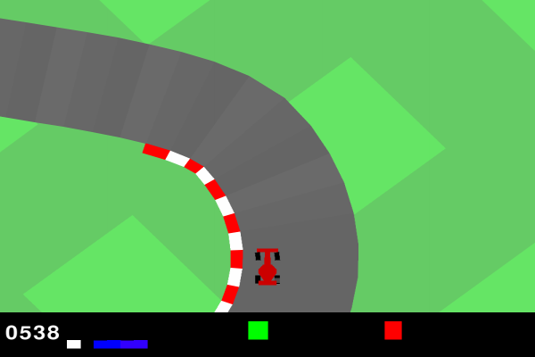
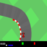

<h1 class="visually-hidden">Car Racing</h1>
<div class="gn-env-banner">
<canvas class="gn-pixel" data-text="CAR RACING" data-scale="6" data-color="#fcfcfc" data-shadow="#e40058"></canvas>
<canvas class="gn-pixel" data-text="BOX2D  3 CONTROLS  96X96 PIXELS" data-scale="2" data-color="#f8b800"></canvas>
</div>

<p class="gn-env-lead">Race a car around a track drawn anew at every reset, seen from above, steering, accelerating and braking from a 96×96 picture of the road ahead. The physics is Box2D's with Gymnasium's own car, run in Gym.NET's managed Box2D, and every picture is drawn as pygame draws it, pixel for pixel.</p>

<aside class="gn-infobox" aria-label="Car Racing at a glance">
<video src="media/CarRacing-v3.episode.mp4" poster="media/CarRacing-v3.figure.png" autoplay muted loop playsinline disablepictureinpicture disableremoteplayback aria-label="CarRacing-v3, seed 11: pure pursuit drives 254 of the track's 259 tiles in 1,000 steps"></video>
<p class="gn-infobox-caption">The whole episode <code>examples/CarRacing</code> plays and records: pure pursuit on the track's centre line, seed 11, 1,000 steps, return 880.7.</p>
<table>
<tr><td>Ids</td><td><code>CarRacing-v3</code> 1,000 steps</td></tr>
<tr><td>Action space</td><td><code>Box([-1. 0. 0.], 1.0, (3,), float32)</code></td></tr>
<tr><td>Observation space</td><td><code>Box(0, 255, (96, 96, 3), uint8)</code></td></tr>
<tr><td>Reward</td><td>−0.1 a frame, 1000/N for each of the track's N tiles first touched; −100 for leaving the playfield · solved at 900</td></tr>
<tr><td>Physics</td><td>Box2D 2.3.0 in managed C#, float32 as pybox2d 2.3.10 computes it, with Gymnasium's car: no gravity, steps of 1/50 s, 180 velocity and 60 position iterations</td></tr>
<tr><td>Render modes</td><td><code>human</code>, <code>rgb_array</code>, <code>state_pixels</code> · 600×400 · 50 fps</td></tr>
<tr><td>Make</td><td><code>Gymnasium.Make("CarRacing-v3")</code></td></tr>
<tr><td>Class</td><td><a href="xref:Gym.Environments.Envs.Box2D.CarRacingEnv"><code>CarRacingEnv</code></a>, options <a href="xref:Gym.Environments.Envs.Box2D.CarRacingEnvOptions"><code>CarRacingEnvOptions</code></a>, info <a href="xref:Gym.Environments.Envs.Box2D.CarRacingInfo"><code>CarRacingInfo</code></a></td></tr>
<tr><td>Vector env</td><td>none of its own: <code>MakeVec</code> builds sync or async</td></tr>
<tr><td>Parity</td><td><span class="gn-badge gn-badge-ok">bit for bit</span><span class="gn-badge gn-badge-ok">pixel for pixel</span><br>with Gymnasium 1.4.0</td></tr>
<tr><td>Gymnasium</td><td><a href="https://gymnasium.farama.org/v1.4.0/environments/box2d/car_racing/">Car Racing</a> in Gymnasium 1.4.0's docs</td></tr>
</table>
</aside>

## Description

A closed track winds across a field of grass: twelve random checkpoints around a circle, joined by a road that turns
toward each in turn, regenerated until its ends meet, so every reset draws a new track: 242 to 350 tiles over seeds 0
to 99, 295 on average. The car starts at rest on the first tile. Each step the agent sets the steering, the gas and the brake, and the observation
is a 96×96 RGB picture of the road ahead, with a strip of indicators along its bottom. The episode ends when the car has
touched every tile, or comes back to the first one after touching most of them, or leaves the playfield.

The reward pays 1000/N for each of the N tiles the first time a wheel touches it and charges 0.1 a frame, so a lap of
every tile in 732 frames scores 1000 − 73.2 = 926.8, Gymnasium's own example. The registry counts 900 as solved. The car
is Gymnasium's model of a rear-wheel-drive car with four wheels, each with its own grip and spin: powerful enough that
Gymnasium warns not to accelerate and turn at once.

Gymnasium calls it the easiest control task to learn from pixels. Gym.NET draws each picture as pygame does, the
polygons and their anti-aliased edges, the shrink to 96×96 and the score's font, so a policy trained on Gymnasium's
pictures sees the same pixels here.

## Quick start

# [C#](#tab/csharp)

[!code-csharp[](../../../tests/Gym.Tests/Docs/EnvPageSamples/CarRacingSamples.cs?range=1-4,45-52&dedent=12)]

# [Python (Gymnasium)](#tab/python)

```python
import gymnasium as gym

env = gym.make("CarRacing-v3")
# a 96x96 RGB picture of the car, the track and the indicators
observation, info = env.reset(seed=42)
# steer from -1 (left) to 1 (right), gas and brake from 0 to 1
action = env.action_space.sample()
observation, reward, terminated, truncated, info = env.step(action)
```

---

`dotnet add package Gym.NET.Environments`; the six longer examples are in [Code examples](#code-examples).

### Play it, or watch the agent

```bash
# from a clone of the repository: W gas, A and D steer, S brake
dotnet run --project examples/CarRacing -c Release -- --play
# the agent in the video plays it in a window
dotnet run --project examples/CarRacing -c Release -- --render
```

## How it works

<div class="gn-figure">

<svg viewBox="0 0 600 400" font-family="system-ui, sans-serif" role="img" aria-label="Labels: the car, which the view keeps in the same place, pointing up; the road of 259 tiles, each worth 3.86 the first time a wheel touches it; a red and white kerb on a sharp bend; the grass, with 60% of the road's grip; and along the black strip at the bottom, the return so far, the speed, the four wheels' ABS bars, the steering and the gyroscope">
<line x1="316" y1="296" x2="426" y2="286" stroke="#000" stroke-width="3" stroke-linecap="round"/><line x1="316" y1="296" x2="426" y2="286" stroke="#fff" stroke-width="1.3" stroke-linecap="round"/>
<text x="430" y="284" text-anchor="start" fill="#fff" font-weight="700" paint-order="stroke" stroke="#000" stroke-width="3" stroke-linejoin="round" font-size="12.5">the car, always here,</text>
<text x="430" y="300" text-anchor="start" fill="#fff" font-weight="600" paint-order="stroke" stroke="#000" stroke-width="3" stroke-linejoin="round" font-size="12">pointing up: the view</text>
<text x="430" y="315" text-anchor="start" fill="#fff" font-weight="600" paint-order="stroke" stroke="#000" stroke-width="3" stroke-linejoin="round" font-size="12">turns and follows it</text>
<text x="16" y="70" text-anchor="start" fill="#fff" font-weight="700" paint-order="stroke" stroke="#000" stroke-width="3" stroke-linejoin="round" font-size="12.5">the road: 259 tiles, each worth 3.86</text>
<text x="16" y="86" text-anchor="start" fill="#fff" font-weight="600" paint-order="stroke" stroke="#000" stroke-width="3" stroke-linejoin="round" font-size="12">the first time a wheel touches it</text>
<line x1="226" y1="202" x2="150" y2="236" stroke="#000" stroke-width="3" stroke-linecap="round"/><line x1="226" y1="202" x2="150" y2="236" stroke="#fff" stroke-width="1.3" stroke-linecap="round"/>
<text x="24" y="252" text-anchor="start" fill="#fff" font-weight="700" paint-order="stroke" stroke="#000" stroke-width="3" stroke-linejoin="round" font-size="12.5">a kerb on a sharp bend,</text>
<text x="24" y="268" text-anchor="start" fill="#fff" font-weight="600" paint-order="stroke" stroke="#000" stroke-width="3" stroke-linejoin="round" font-size="12">drawn only: no grip of its own</text>
<text x="436" y="146" text-anchor="start" fill="#fff" font-weight="700" paint-order="stroke" stroke="#000" stroke-width="3" stroke-linejoin="round" font-size="12.5">grass: 60% of</text>
<text x="436" y="162" text-anchor="start" fill="#fff" font-weight="600" paint-order="stroke" stroke="#000" stroke-width="3" stroke-linejoin="round" font-size="12">the road's grip</text>
<text x="4" y="344" text-anchor="start" fill="#fff" font-weight="700" paint-order="stroke" stroke="#000" stroke-width="3" stroke-linejoin="round" font-size="11.5">return</text>
<text x="82.5" y="344" text-anchor="middle" fill="#fff" font-weight="700" paint-order="stroke" stroke="#000" stroke-width="3" stroke-linejoin="round" font-size="11.5">speed</text>
<text x="135" y="344" text-anchor="middle" fill="#fff" font-weight="700" paint-order="stroke" stroke="#000" stroke-width="3" stroke-linejoin="round" font-size="11.5">ABS ×4</text>
<text x="289.23" y="344" text-anchor="middle" fill="#fff" font-weight="700" paint-order="stroke" stroke="#000" stroke-width="3" stroke-linejoin="round" font-size="11.5">steering</text>
<text x="440.98" y="344" text-anchor="middle" fill="#fff" font-weight="700" paint-order="stroke" stroke="#000" stroke-width="3" stroke-linejoin="round" font-size="11.5">gyroscope</text>
</svg>
</div>
<p class="gn-figure-caption">Step 640 of the episode in the video, exactly as <code>Render()</code> returns it in <code>rgb_array</code> mode: the car turning into a left bend at 44.8 units a second, 156 of the 259 tiles behind it. The steering bar extends left of its mark as the front wheels turn left, and the gyroscope's as the car turns. The agent sees this frame shrunk to 96×96 (<a href="#observation-space">Observation space</a>).</p>

The track is a loop of tiles 3.5 units long and 13.3 wide, inside a playfield 666.7 units square. The camera keeps the
car at the same point of the picture, pointing up, and turns and moves with it: the world turns around the car. During
the first second it zooms in from far above, the zoom growing from 0.6 to 16.2 pixels a unit (in the 1000×800 frame the
env draws before shrinking it). Each step the env passes the action to the car:

- **steering**, −1 to 1: the front wheels turn toward the angle the command names, in radians, at most 3 rad/s, and
  stop at their joints' limits of ±0.4 radians, so commands beyond ±0.4 turn them no further, only sooner;
- **gas**, 0 to 1: the rear wheels' throttle, which rises at most 0.1 a step and drops at once;
- **brake**, 0 to 1: every wheel slows by 15 × brake rad/s a step, and from 0.9 on the wheels lock.

Each wheel then pushes on the ground through its grip, full on a tile and 60% of it on grass, and skids beyond it, which
leaves marks on the frame. Box2D advances the car 1/50 s. The reward of a step is

$$
r_t = \frac{1000}{N}\,k_t - 0.1
$$

with $k_t$ the tiles first touched during the step, and −100 instead when the car leaves the playfield, $\lvert x\rvert$
or $\lvert y\rvert$ beyond 333.3.

| Constant | Gym.NET | Gymnasium | Value | Effect |
|---|---|---|--:|---|
| Track scale | `Scale` | `SCALE` | 6.0 | Every track length below is its pixel size over 6 |
| Track radius | `TrackRad` | `TRACK_RAD` | 900/6 | The circle the checkpoints scatter around, 150 units |
| Playfield | `Playfield` | `PLAYFIELD` | 2000/6 | Beyond ±333.3 on either axis the car is out, −100 |
| Steps a second | `Fps` | `FPS` | 50 | Box2D steps 1/50 s |
| Zoom | `Zoom` | `ZOOM` | 2.7 | The camera's zoom after the first second, times `Scale` |
| Tile length | `TrackDetailStep` | `TRACK_DETAIL_STEP` | 21/6 | Each tile's length, 3.5 units |
| Turn rate | `TrackTurnRate` | `TRACK_TURN_RATE` | 0.31 | How sharply the road may turn per tile |
| Road half-width | `TrackWidth` | `TRACK_WIDTH` | 40/6 | The road is twice this wide, 13.3 units |
| Kerb width | `Border` | `BORDER` | 8/6 | The red and white kerb drawn on sharp bends |
| Engine power | `Car.EnginePower` | `ENGINE_POWER` | 40,000 | The rear wheels' power at full gas |
| Grip | `Car.FrictionLimit` | `FRICTION_LIMIT` | 400 | A wheel's grip on a tile; 60% of it on grass |

> [!WARNING]
> The red and white kerbs are drawn only: they are no part of the physics, and a wheel on a kerb has the grip of the
> grass under it unless it also touches a tile. The −100 for leaving the playfield is the step's reward but not the
> score the frame shows, which is the sum of the other rewards. And, as on Bipedal Walker, `Reset(seed)` alone does not
> decide an episode: the env keeps one Box2D world for its life, and an episode after other episodes can differ from a
> fresh env's after the same reset. Start from a new env to reproduce an episode exactly.

## Action space

`Box([-1. 0. 0.], 1.0, (3,), float32)` by default:

| Index | Control | Range |
|---|---|---|
| 0 | Steering: −1 full left, 1 full right | −1 to 1 |
| 1 | Gas | 0 to 1 |
| 2 | Brake | 0 to 1 |

With `continuous = false` the action is `Discrete(5)`: 0 nothing, 1 steer right, 2 steer left, 3 gas, 4 brake, each a
fixed amount (steering ±0.6, gas 0.2, brake 0.8). A discrete action outside the space raises Gymnasium's
`InvalidAction`, with its message. Continuous actions are taken as float64 and not clipped by the env: the car clips the
gas to 0 to 1, and the front wheels stop at their joints' limits of ±0.4 radians, whatever the steering asks.

## Observation space

<div class="gn-figure gn-figure-art">

</div>
<p class="gn-figure-caption">The observation at step 640, the frame above as the agent sees it: 96×96, here at five times its size. The env draws it without the skid marks.</p>

`Box(0, 255, (96, 96, 3), uint8)`: a picture of the 1000×800 frame shrunk to 96×96 with pygame's `smoothscale`, the
indicators and the score included. The bottom 12 rows are the black strip: the speed (white), the four wheels' spin
from the ABS sensors (blue for the front wheels, blue-violet for the rear), the steering (green) and the turning rate (red),
and on the left the score. Nothing else is observed: no coordinates, no velocities, no track.

## Rewards

−0.1 a frame, and 1000/N for every tile the first time a wheel touches it, N being the track's tile count (1000/259 =
3.86 on seed 11's track). Leaving the playfield ends the episode with −100 for that step. A lap of every tile scores
1000 less 0.1 a frame; the registry counts an average of 900 over 100 episodes as solved, which needs a lap in fewer
than 1,000 frames.

## Starting state

The car stands still on the first tile, pointing along the road. The reset generates the track from the env's
generator (twelve checkpoints, retried until the loop closes) and with `domain_randomize` draws the road's, the
background's and the grass's colours. It steps once with no action and returns that step's picture; the camera starts
far above, so the first observation shows the playfield from far away, small and tilted, on black.

## Episode end

| Ends by | When |
|---|---|
| Termination | Every tile touched, or the first tile touched again after more than `lap_complete_percent` (95%) of them (`lap_finished` true); or the car beyond ±333.3 on either axis, −100 (`lap_finished` false) |
| Truncation | 1,000 steps: the `TimeLimit` that `Make` wraps around the env |

## Arguments

By Gymnasium's name in `Make`'s kwargs, or by the C# name in the constructor and in
<xref:Gym.Environments.Envs.Box2D.CarRacingEnvOptions>.

| Argument | Type and default | Effect |
|---|---|---|
| `render_mode`<br>`renderMode` | `string?` or `RenderMode`<br>`null` | `"human"` opens a window, `"rgb_array"` makes `Render()` return the 600×400 frame, `"state_pixels"` the 96×96 one |
| `verbose`<br>`verbose` | `bool`<br>`false` | Prints the track's generation, and a line whenever a track fails to close |
| `lap_complete_percent`<br>`lapCompletePercent` | `double`<br>`0.95` | The share of the tiles the car must have touched for a return to the first tile to finish the lap |
| `domain_randomize`<br>`domainRandomize` | `bool`<br>`false` | Random road, background and grass colours, drawn at each reset; a reset's `{"randomize": false}` option keeps the current ones |
| `continuous`<br>`continuous` | `bool`<br>`true` | `false`: the five discrete actions instead of steering, gas and brake |
| (Gym.NET)<br>`viewerFactory` | `EnvViewerFactory?`<br>`null` | The window for `human`: Avalonia, WinForms, or headless |


# [C#](#tab/csharp)

[!code-csharp[](../../../tests/Gym.Tests/Docs/EnvPageSamples/CarRacingSamples.cs#Arguments)]

# [Python (Gymnasium)](#tab/python)

```python
env = gym.make("CarRacing-v3", continuous=False, lap_complete_percent=0.9)
```

---

## Info

<xref:Gym.Environments.Envs.Box2D.CarRacingInfo>: `{}` on every reset and on most steps; `{"lap_finished": true}` on
the step that finishes the lap, and `{"lap_finished": false}` on the step that leaves the playfield. Read it as
`info.Get<bool>("lap_finished")` once the key is there, or through the typed record, whose `LapFinished` is null on the
other steps.

## Rendering

| Mode | What you get |
|---|---|
| `rgb_array` | `Render()` returns the frame: `(400, 600, 3)` uint8, Gymnasium's pixels |
| `state_pixels` | `Render()` returns the observation's picture again: `(96, 96, 3)` uint8 |
| `human` | A 1000×800 window from the viewer factory, drawn after every reset and step, paced at 50 frames a second |
| none | `Render()` warns and returns nothing, as Gymnasium's does |

Every step draws the 96×96 observation whatever the render mode, so every mode pays for a 1000×800 frame a step, and
`rgb_array` for a second one. The frame is drawn as Gymnasium draws it with pygame: the grass in a checkerboard of two
greens, the road in three shades of grey, which a tile loses for the plain road colour once the car has touched it, the
kerbs, the car with its skid marks, the indicators and the score, `f"{reward:04.0f}"` in pygame's default font, whose
glyphs Gym.NET carries as SDL_ttf lays them out.

## Episode anatomy

The whole episode, step by step: the tiles touched, the speed and the three controls, with a cursor following the
video. The agent reaches 44 units a second within its first second, 49 steps, and holds 43 on average from then on,
lifting off the gas in the bends and braking once, for six steps into the sharp bend at step 192. When the time limit
ends the episode it has touched 254 of the 259 tiles in order and is five tiles short of the line: the lap needs the
first tile again, so the return is 254 × 1000/259 − 100 = 880.7 rather than a finished lap's.

<div class="gn-anatomy" data-trace="media/CarRacing-v3.episode.json">
<div><video src="media/CarRacing-v3.episode.mp4" poster="media/CarRacing-v3.figure.png" autoplay muted loop playsinline disablepictureinpicture disableremoteplayback aria-label="CarRacing-v3, seed 11, the episode the chart follows"></video><div class="gn-anatomy-readout" aria-live="off"></div></div>
<div><div class="gn-anatomy-chart"></div><div class="gn-anatomy-legend"></div></div>
<script type="application/json" class="gn-anatomy-spec">{"label":"CarRacing-v3, seed 11: the tiles touched, the speed and the three controls","bands":[{"height":80,"range":[0,262],"ticks":[0,100,200],"series":[{"column":"tiles","color":"#f8b800","name":"tiles touched, of 259"}]},{"height":70,"range":[0,50],"ticks":[0,20,40],"series":[{"column":"speed","color":"#3cbcfc","name":"speed, units a second"}]},{"height":70,"range":[-1.05,1.05],"ticks":[-1,0,1],"series":[{"column":"steer","color":"#ff7fe3","width":1.2,"name":"steering: −1 left, 1 right"}]},{"label":"gas","strip":{"column":"gas","colors":{"0":"#343a40","0.6000000238418579":"#40c057"},"name":"gas at 0.6"}},{"label":"brake","strip":{"column":"brake","colors":{"0":"#343a40","0.4000000059604645":"#ff6b6b"},"name":"brake at 0.4"}}],"readout":[{"label":"step","column":"@step"},{"label":"tiles","column":"tiles","digits":0},{"label":"speed","column":"speed","digits":1},{"label":"return so far","column":"@return","digits":1}]}</script>
</div>

## Code examples

### Run an episode

# [C#](#tab/csharp)

[!code-csharp[](../../../tests/Gym.Tests/Docs/EnvPageSamples/CarRacingSamples.cs#RunAnEpisode)]

# [Python (Gymnasium)](#tab/python)

```python
import gymnasium as gym

env = gym.make("CarRacing-v3")
observation, info = env.reset(seed=42)
episode_return = 0.0
while True:
    action = env.action_space.sample()
    observation, reward, terminated, truncated, info = env.step(action)
    episode_return += reward
    if terminated or truncated:
        break
print(f"return {episode_return:.1f}")  # random driving: -31.8 on average
```

---

### Drive from the track's geometry

# [C#](#tab/csharp)

[!code-csharp[](../../../tests/Gym.Tests/Docs/EnvPageSamples/CarRacingSamples.cs#PurePursuit)]

# [Python (Gymnasium)](#tab/python)

```python
import math
import numpy as np

env = gym.make("CarRacing-v3")
race = env.unwrapped  # the track and the car
env.reset(seed=11)
episode_return = 0.0
while True:
    hull = race.car.hull
    (px, py), angle = hull.position, hull.angle
    track = race.track
    # aim at the centre-line point five tiles past the nearest one
    nearest = min(range(len(track)),
                  key=lambda i: (track[i][2] - px) ** 2 + (track[i][3] - py) ** 2)
    _, _, tx, ty = track[(nearest + 5) % len(track)]
    # the car's nose is its local +y: the angle from it to the target
    error = math.atan2(-math.sin(angle) * (ty - py) - math.cos(angle) * (tx - px),
                       -math.sin(angle) * (tx - px) + math.cos(angle) * (ty - py))
    vx, vy = hull.linearVelocity
    speed = math.sqrt(vx * vx + vy * vy)
    action = np.array([
        min(max(-2.5 * error, -1), 1),                           # steer
        0.6 if speed < 45 - 30 * min(1, abs(error)) else 0,      # gas
        0.4 if abs(error) > 0.6 and speed > 30 else 0,           # brake
    ], dtype=np.float32)
    observation, reward, terminated, truncated, info = env.step(action)
    episode_return += reward
    if terminated or truncated:
        break
print(f"return {episode_return:.1f}")  # 880.7: 254 of 259 tiles in 1,000 steps
```

---

The agent reads the track and the car from the unwrapped env, not from the pixels, so it shows what driving well
takes rather than how to learn it. Over seeds 0 to 19 it averages 752.2 and never finishes a lap within the 1,000
steps; seed 11, the video's, is its best. Random driving averages −31.8 over seeds 0 to 9: with the brake pressed
half-way on average, the car barely moves.

### Discrete actions

# [C#](#tab/csharp)

[!code-csharp[](../../../tests/Gym.Tests/Docs/EnvPageSamples/CarRacingSamples.cs#DiscreteActions)]

# [Python (Gymnasium)](#tab/python)

```python
# 0 nothing, 1 steer right, 2 steer left, 3 gas, 4 brake
env = gym.make("CarRacing-v3", continuous=False)
env.reset(seed=42)
episode_return = 0.0
for t in range(50):
    observation, reward, terminated, truncated, info = env.step(3)
    episode_return += reward
race = env.unwrapped
vx, vy = race.car.hull.linearVelocity
speed, tiles = math.sqrt(vx * vx + vy * vy), race.tile_visited_count
# speed 28.9, 7 tiles, return 19.7: a discrete gas is 0.2 of the pedal
print(f"speed {speed:.1f}, {tiles} tiles, return {episode_return:.1f}")
```

---

### Domain randomization

# [C#](#tab/csharp)

[!code-csharp[](../../../tests/Gym.Tests/Docs/EnvPageSamples/CarRacingSamples.cs#DomainRandomization)]

# [Python (Gymnasium)](#tab/python)

```python
env = gym.make("CarRacing-v3", domain_randomize=True)
race = env.unwrapped

def colours():
    return " ".join(",".join(f"{v:.0f}" for v in c)
                    for c in (race.road_color, race.bg_color, race.grass_color))

env.reset(seed=42)  # new colours at every reset
print(colours())  # road 163,92,180 background 146,20,205 grass 146,20,225
env.reset(options={"randomize": False})
print(colours())  # the same three
```

---

### Save a frame

# [C#](#tab/csharp)

[!code-csharp[](../../../tests/Gym.Tests/Docs/EnvPageSamples/CarRacingSamples.cs#SaveFrame)]

# [Python (Gymnasium)](#tab/python)

```python
from PIL import Image

env = gym.make("CarRacing-v3", render_mode="rgb_array")
env.reset(seed=42)
for t in range(50):  # the camera zooms in over the first second
    env.step(np.array([0.0, 0.3, 0.0], dtype=np.float32))
Image.fromarray(env.render()).save("car_racing.png")
```

---

### Many cars at once

# [C#](#tab/csharp)

[!code-csharp[](../../../tests/Gym.Tests/Docs/EnvPageSamples/CarRacingSamples.cs#ManyCars)]

# [Python (Gymnasium)](#tab/python)

```python
# No vector env of its own: make_vec steps 4 envs in turn ("sync")
envs = gym.make_vec("CarRacing-v3", num_envs=4, vectorization_mode="sync")
observations, infos = envs.reset(seed=42)  # 4 x 96 x 96 x 3 pictures
for t in range(100):
    actions = envs.action_space.sample()  # 4 x 3
    observations, rewards, terminations, truncations, infos = envs.step(actions)
```

---

Every C# example is a test in `tests/Gym.Tests/Docs/EnvPageSamples`, compiled and run by the unit gate; where a
comment states a number, the test checks it.

## Agents and examples

- **The video's agent** is pure pursuit on the track's centre line: it finds the centre-line point nearest the car,
  aims at the one five tiles further on, steers by the angle between the car's heading and that point, keeps the gas
  at 0.6 while the speed is under a limit that falls from 45 as the angle grows, and brakes into sharp bends. It reads
  the track from the unwrapped env rather than the pixels. Seed 11: 254 of the 259 tiles in 1,000 steps, for 880.7.
- **[examples/CarRacing](https://github.com/SciSharp/Gym.NET/tree/master/examples/CarRacing)**
  ([`CarRacingProgram.cs`](https://github.com/SciSharp/Gym.NET/blob/master/examples/CarRacing/CarRacingProgram.cs))
  plays it: `dotnet run --project examples/CarRacing -c Release` plays seed 11 headless, `--seed N` another seed,
  `--episodes N` that many seeds and their mean, `--render` in a window.
- **Play it yourself**: `--play` hands the car to the keyboard with the key map of Gymnasium's own `play`
  documentation: W gas at 0.7, A and D full steering, S full brake, and the four two-key combinations.
- **This page's video and chart** are the example's own episode: `--record docs/environments/box2d/media` records it
  with `RecordVideo` (one frame per step) and writes the step trace, the figure and the agent's view beside it.

## Vectorized environment

Car Racing registers no vector env of its own. `Gymnasium.MakeVec("CarRacing-v3", n)` builds a `SyncVectorEnv` that
steps `n` separate envs in turn, and `VectorizeMode.Async` an `AsyncVectorEnv` that steps them on worker threads; each env resets itself after its episode ends (next-step autoreset), as
Gymnasium's. Each env has its own Box2D world.

## Variants

None in Gymnasium 1.4.0: CarRacing-v3 is the only id. The discrete actions and the random colours are arguments
(`continuous`, `domain_randomize`), and the CarRacingDiscrete-v1 id of 2022 is gone.

## Parity with Gymnasium

Gymnasium 1.4.0 runs inside the test process, pybox2d 2.3.10 and pygame-ce 2.5.8 under it, and both are compared value
by value:

| What is compared | How | Result |
|---|---|---|
| Resets and the track | the observation after resets of both action kinds; every checkpoint, centre-line point, tile, kerb and colour a reset builds, with and without domain randomization | ✓ bit for bit |
| Episodes | sampled episodes of both action kinds, and episodes of a follower that drives the track; leaving the playfield | ✓ bit for bit |
| Actions | every form of action NumPy takes or refuses, discrete and continuous, with Gymnasium's messages; stepping before a reset, rendering before a reset (None) | ✓ same values, same messages |
| Frames | the 96×96 observation at every step of every episode; `rgb_array` frames along the follower's and sampled episodes, skid marks included; both modes after resets | ✓ pixel for pixel |
| The score | its glyphs against the ones recorded from pygame, and the score box for every kind of value, NaN and the infinities included | ✓ |
| Spaces, metadata, `make`'s stack | both action spaces with seeded samples; the metadata; `make`'s stack | ✓ |

The tests: [CarRacingLiveParityTests](https://github.com/SciSharp/Gym.NET/blob/master/tests/Gym.Tests.Parity/Tests/Envs/CarRacingLiveParityTests.cs),
[EnvCoverageLiveParityTests](https://github.com/SciSharp/Gym.NET/blob/master/tests/Gym.Tests.Parity/Tests/Envs/EnvCoverageLiveParityTests.cs),
[GymnasiumToolsLiveParityTests](https://github.com/SciSharp/Gym.NET/blob/master/tests/Gym.Tests.Parity/Tests/Bridge/GymnasiumToolsLiveParityTests.cs).
Bit for bit holds on the reference machine, an x64 CPU with FMA: Box2D's rotations, the track's curves and the camera
come from the platform's math functions, whose last bits can differ on other CPUs.

## Performance

| | Steps a second | Bytes a step |
|---|--:|--:|
| Gym.NET | 164 | 3,631,032 |
| Gymnasium | 74 | |

2.2× faster. Random actions, observations disposed; .NET 10 in Release against CPython 3.12 with the pinned NumPy,
pygame-ce and pybox2d; the medians of interleaved rounds on one machine (2026-11-11). Most of a step is the 1000×800
frame and its shrink to 96×96, which every step draws.

## Reference sources

- [gymnasium/envs/box2d/car_racing.py](https://github.com/Farama-Foundation/Gymnasium/blob/8ba8c3a63bb4e000b7f33923f43d292acac07be1/gymnasium/envs/box2d/car_racing.py),
  Gymnasium 1.4.0: the environment (the track, the tiles and their contact listener, the reward, the camera, the
  indicators and the frame).
- [gymnasium/envs/box2d/car_dynamics.py](https://github.com/Farama-Foundation/Gymnasium/blob/8ba8c3a63bb4e000b7f33923f43d292acac07be1/gymnasium/envs/box2d/car_dynamics.py),
  Gymnasium 1.4.0: the car, its wheels, their grip, skids and marks.
- [pybox2d's Box2D](https://github.com/pybox2d/pybox2d/tree/ed9d7b04f7099a15984c727dbce46c13abd64409/Box2D), 2.3.10
  (Box2D 2.3.0 by Erin Catto): the physics, which `Gym.Box2D` reproduces in managed C# with its zlib notices.
- pygame-ce's [draw.c](https://github.com/pygame-community/pygame-ce/blob/2.5.8/src_c/draw.c) for `polygon` and
  `lines`, its [transform.c](https://github.com/pygame-community/pygame-ce/blob/2.5.8/src_c/transform.c) for `smoothscale`, and
  SDL_gfx's anti-aliased and filled polygons behind `gfxdraw`, in Gym.Rendering.
- SDL_ttf 2.24's layout of the score in pygame's default font, from glyphs recorded from pygame (`ScoreFont`).
- [gymnasium/utils/seeding.py](https://github.com/Farama-Foundation/Gymnasium/blob/8ba8c3a63bb4e000b7f33923f43d292acac07be1/gymnasium/utils/seeding.py):
  the env's generator, NumPy's PCG64, which NumSharp reproduces for the track and the colours.

## Version history

| Version | Change |
|---|---|
| v3 | Gymnasium 1.0.0: finishing the lap terminates the episode instead of truncating it (Gymnasium's docstring lists this under v2) |
| v2 | gym, July 2022: the separate CarRacingDiscrete-v1 id dropped; the discrete actions stay as `continuous=False` |
| v1 | gym, February 2022: the lap's completion rule (`lap_complete_percent`) and a steadier camera; domain randomization followed in April (gym 0.24.0) |
| v0 | The first release, by Oleg Klimov |
| Gym.NET 1.0.0 | New: Gymnasium 1.4.0's CarRacing-v3 on Gym.NET's own Box2D and pygame-compatible rendering, bit for bit and pixel for pixel; 0.2.0 had no Car Racing |

## References

1. C. Campbell, "Top-down car physics", iforce2d's Box2D tutorials, 2014: the car model's starting point.
   [iforce2d.net](http://www.iforce2d.net/b2dtut/top-down-car)
2. E. Catto, Box2D 2.3.0, 2013: the physics engine, as pybox2d 2.3.10 wraps it. [box2d.org](https://box2d.org)
3. R. C. Coulter, "Implementation of the Pure Pursuit Path Tracking Algorithm", Carnegie Mellon University, CMU-RI-TR-92-01,
   1992: the agent in the video.

## External links

- [Car Racing on Gymnasium's site](https://gymnasium.farama.org/v1.4.0/environments/box2d/car_racing/) (1.4.0)
- [CarRacingEnv.cs](https://github.com/SciSharp/Gym.NET/blob/master/src/Gym.Environments/Envs/Box2D/CarRacingEnv.cs) and [CarDynamics.cs](https://github.com/SciSharp/Gym.NET/blob/master/src/Gym.Environments/Envs/Box2D/CarDynamics.cs) on GitHub
- [examples/CarRacing](https://github.com/SciSharp/Gym.NET/tree/master/examples/CarRacing)

## API reference

<xref:Gym.Environments.Envs.Box2D.CarRacingEnv> · <xref:Gym.Environments.Envs.Box2D.CarRacingEnvOptions> · <xref:Gym.Environments.Envs.Box2D.CarRacingInfo> · <xref:Gym.Environments.Envs.Box2D.Car>
