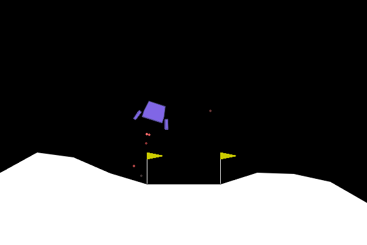

<h1 class="visually-hidden">Lunar Lander</h1>
<div class="gn-env-banner">
<canvas class="gn-pixel" data-text="LUNAR LANDER" data-scale="6" data-color="#fcfcfc" data-shadow="#f83800"></canvas>
<canvas class="gn-pixel" data-text="BOX2D  4 ACTIONS  8 OBSERVATIONS" data-scale="2" data-color="#f8b800"></canvas>
</div>

<p class="gn-env-lead">Bring a lander down between two flags on the Moon, firing its main engine and two side engines, gently enough that it rests on its legs. The physics is Box2D's, run in Gym.NET's own managed Box2D, float for float with what Gymnasium's pybox2d computes.</p>

<aside class="gn-infobox" aria-label="Lunar Lander at a glance">
<video src="media/LunarLander-v3.episode.mp4" poster="media/LunarLander-v3.figure.png" autoplay muted loop playsinline disablepictureinpicture disableremoteplayback aria-label="LunarLander-v3, seed 7: Gymnasium's heuristic brakes the fall, steers the lander onto the pad and lets it rest in 299 steps"></video>
<p class="gn-infobox-caption">The whole episode <code>examples/LunarLander</code> plays and records: Gymnasium's own heuristic, seed 7, 299 steps, return 248.6.</p>
<table>
<tr><td>Ids</td><td><code>LunarLander-v3</code> 1,000 steps<br><code>LunarLanderContinuous-v3</code> 1,000 steps</td></tr>
<tr><td>Action space</td><td><code>Discrete(4)</code></td></tr>
<tr><td>Observation space</td><td><code>Box([ -2.5 -2.5 -10. -10. -6.2831855 -10. -0. -0. ], [ 2.5 2.5 10. 10. 6.2831855 10. 1. 1. ], (8,), float32)</code></td></tr>
<tr><td>Reward</td><td>shaped by distance, speed, tilt and legs, less the fuel; −100 for a crash, +100 for coming to rest · solved at 200</td></tr>
<tr><td>Physics</td><td>Box2D 2.3.0 in managed C#, float32 as pybox2d 2.3.10 computes it: steps of 1/50 s, 180 velocity and 60 position iterations</td></tr>
<tr><td>Render modes</td><td><code>human</code>, <code>rgb_array</code> · 600×400 · 50 fps</td></tr>
<tr><td>Make</td><td><code>Gymnasium.Make("LunarLander-v3")</code></td></tr>
<tr><td>Class</td><td><a href="xref:Gym.Environments.Envs.Box2D.LunarLanderEnv"><code>LunarLanderEnv</code></a>, options <a href="xref:Gym.Environments.Envs.Box2D.LunarLanderEnvOptions"><code>LunarLanderEnvOptions</code></a></td></tr>
<tr><td>Vector env</td><td>none of its own: <code>MakeVec</code> builds sync or async</td></tr>
<tr><td>Parity</td><td><span class="gn-badge gn-badge-ok">bit for bit</span><span class="gn-badge gn-badge-ok">pixel for pixel</span><br>with Gymnasium 1.4.0</td></tr>
<tr><td>Gymnasium</td><td><a href="https://gymnasium.farama.org/v1.4.0/environments/box2d/lunar_lander/">Lunar Lander</a> in Gymnasium 1.4.0's docs</td></tr>
</table>
</aside>

## Description

The lander starts at the top of the screen with a random push and falls toward a ridged moonscape, drawn anew at each
reset, with a flat pad between two flags in the middle. Each step the agent fires one engine or none: the main engine
under the hull, or one of the two orientation engines on its sides, which turn it and push it sideways. The episode
ends when the hull touches the ground (a crash), when the lander drifts off the screen's side, or when it comes to rest
on its legs, which Box2D tells by letting its body fall asleep.

The reward follows the lander's progress step by step: closer to the pad, slower and more upright is better, each leg
on the ground is worth 10, and every frame of an engine costs fuel. A crash ends with −100, coming to rest with +100.
Landing off the pad is allowed, only worth less, and the fuel never runs out.

Gymnasium's description gives the reason for the discrete actions: by Pontryagin's maximum principle the best use of an
engine is full throttle or off. The continuous variant (LunarLanderContinuous-v3) throttles both. Gym.NET runs the env
on its own Box2D, written in managed C#, so every float of every step is what Gymnasium computes with pybox2d: the
same moonscape, the same engine dispersion, the same landing, frame for frame.

## Quick start

# [C#](#tab/csharp)

[!code-csharp[](../../../tests/Gym.Tests/Docs/EnvPageSamples/LunarLanderSamples.cs?range=1-4,40-47&dedent=12)]

# [Python (Gymnasium)](#tab/python)

```python
import gymnasium as gym

env = gym.make("LunarLander-v3")
# x, y, vx, vy, angle, angular velocity, right leg, left leg
observation, info = env.reset(seed=42)
# 0 nothing, 1 left engine, 2 main engine, 3 right engine
action = env.action_space.sample()
observation, reward, terminated, truncated, info = env.step(action)
```

---

`dotnet add package Gym.NET.Environments`; the six longer examples are in [Code examples](#code-examples).

### Play it, or watch the agent

```bash
# from a clone of the repository: W fires the main engine, A and D the side engines
dotnet run --project examples/LunarLander -c Release -- --play
# the agent in the video plays it in a window
dotnet run --project examples/LunarLander -c Release -- --render
```

## How it works

<div class="gn-figure">

<svg viewBox="0 0 600 400" font-family="system-ui, sans-serif" role="img" aria-label="Labels: the observation's origin, (0, 0), at the pad's centre at the legs' height; the lander's x, −0.16, and y, 0.48, from it; the lander's angle, −0.30 radians; the right leg, the observation's item 6, and the left leg, item 7; the pad between the flags">
<circle cx="300" cy="282" r="3.5" fill="#f8b800"/>
<text x="308" y="295" fill="#fff" font-weight="700" paint-order="stroke" stroke="#000" stroke-width="3" stroke-linejoin="round" font-size="13">(0, 0)</text>
<path d="M 300 282 L 251.32 282 L 251.32 186.15" fill="none" stroke="#f8b800" stroke-width="1.6" stroke-dasharray="5 4"/>
<text x="275.65999999999997" y="276" text-anchor="middle" fill="#f8b800" font-weight="700" paint-order="stroke" stroke="#000" stroke-width="3" stroke-linejoin="round" font-size="13">x −0.16</text>
<text x="243.32" y="250.075" text-anchor="end" fill="#f8b800" font-weight="700" paint-order="stroke" stroke="#000" stroke-width="3" stroke-linejoin="round" font-size="13">y 0.48</text>
<text x="285.32" y="164.15" fill="#fff" font-weight="700" paint-order="stroke" stroke="#000" stroke-width="3" stroke-linejoin="round" font-size="13">the lander, angle −0.30 rad</text>
<text x="284.09" y="217.25" fill="#c0b6f2" font-weight="700" paint-order="stroke" stroke="#000" stroke-width="3" stroke-linejoin="round" font-size="12">[6] right leg</text>
<text x="212.5" y="208.34" text-anchor="end" fill="#c0b6f2" font-weight="700" paint-order="stroke" stroke="#000" stroke-width="3" stroke-linejoin="round" font-size="12">[7] left leg</text>
<text x="300" y="324" text-anchor="middle" fill="#1f2328" font-weight="700" font-size="13">the pad, between the flags</text>
<text x="300" y="342" text-anchor="middle" fill="#495057" font-size="12">the rest of the ground is drawn anew each reset</text>
</svg>
</div>
<p class="gn-figure-caption">Step 60 of the episode in the video, exactly as <code>Render()</code> returns it: the lander left of the pad and tilted 17°, falling at 5.2 world units a second (vy −0.69), while the heuristic fires its left orientation engine to turn it back. The observation measures x and y from the pad's centre at the legs' height. The red dots are exhaust from earlier firings, drawn only in a render mode and no part of the physics. 30 pixels to a world unit.</p>

The world is 20 units wide and 13.3 high (the 600×400 frame at 30 pixels a unit), with gravity $g = -10$ along y. Each
step applies the chosen engine's impulse to the hull and advances Box2D by 1/50 s. The main engine pushes along the
hull's axis with power 13, from a point just below its centre; the side engines push sideways with power 0.6, from
points beside it, turning the lander as they push. Both impulses carry a random dispersion, two numbers drawn from the
env's generator each step, fired or not. The observation scales the state so that useful values lie near ±1:

$$
x = \frac{p_x - 10}{10},\quad y = \frac{p_y - (y_\text{pad} + 0.6)}{6.67},\quad v_x = \frac{\dot p_x}{5},\quad v_y = \frac{\dot p_y}{7.5},\quad \omega = \frac{\dot\theta}{2.5}
$$

and the reward is the change in a potential, less the fuel:

$$
\begin{aligned}
\Phi &= -100\sqrt{x^2 + y^2} - 100\sqrt{v_x^2 + v_y^2} - 100\,\lvert\theta\rvert + 10\,c_\text{right} + 10\,c_\text{left} \\
r_t &= \Phi_t - \Phi_{t-1} - 0.3\,m_t - 0.03\,s_t
\end{aligned}
$$

with $m_t$ and $s_t$ the main and side engines' power this step (1 when fired, 0.5 to 1 throttled). A crash sets the
step's reward to −100 and coming to rest to +100.

| Constant | Gym.NET | Gymnasium | Value | Effect |
|---|---|---|--:|---|
| Pixels a unit | `Scale` | `SCALE` | 30 | The frame is 20 × 13.3 units |
| Steps a second | `Fps` | `FPS` | 50 | Box2D steps 1/50 s, and the observation's velocities divide by it |
| Main engine | `MainEnginePower` | `MAIN_ENGINE_POWER` | 13.0 | The main engine's impulse |
| Side engines | `SideEnginePower` | `SIDE_ENGINE_POWER` | 0.6 | Each side engine's impulse |
| The reset's push | `InitialRandom` | `INITIAL_RANDOM` | 1000.0 | The random force on the lander at the reset, up to ± this on each axis |
| Leg springs | `LegSpringTorque` | `LEG_SPRING_TORQUE` | 40 | The legs' joint motor torque |
| Gravity | `Gravity` | `gravity` | −10.0 | An argument, between −12 and 0 |

> [!WARNING]
> The legs' contact flags (the observation's items 6 and 7) are not a reliable "on the ground": each is one boolean,
> set when a contact with the ground begins and cleared when one ends, and the ground is a chain of edges. A leg that
> slides across the joint between two edges ends its old contact after the new one began, and its flag reads 0 while
> the leg stands on the ground. In the video's episode both flags are 0 by step 267, the lander resting on both legs.
> Two more of Gymnasium's own notes hold here too: the side engines' thrust point moves with the lander's orientation
> (the code adds 17/30 where `SIDE_ENGINE_HEIGHT` is 14), and the angular velocity is in units of 2.5 rad/s.

## Action space

`Discrete(4)` on LunarLander-v3: one engine per step, or none.

| Action | Fires |
|---|---|
| 0 | Nothing |
| 1 | The left orientation engine |
| 2 | The main engine |
| 3 | The right orientation engine |

LunarLanderContinuous-v3 takes `Box(-1.0, 1.0, (2,), float32)`, throttles instead: see [Variants](#lunarlandercontinuous-v3).
A discrete action outside the space raises Gymnasium's `AssertionError`, with its message.

## Observation space

Eight float32 values:

| Index | Meaning | One unit is | Bounds |
|---|---|---|---|
| 0 | x: the horizontal position from the pad's centre | 10 world units, half the screen | ±2.5 |
| 1 | y: the height above the pad, at the legs' height | 6.67 world units | ±2.5 |
| 2 | vx: the horizontal velocity | 5 world units a second | ±10 |
| 3 | vy: the vertical velocity | 7.5 world units a second | ±10 |
| 4 | θ: the hull's angle | 1 radian | ±2π |
| 5 | ω: the angular velocity | 2.5 radians a second | ±10 |
| 6 | The right leg's contact flag (the env's `legs[0]`) | 0 or 1 | 0 to 1 |
| 7 | The left leg's contact flag (`legs[1]`) | 0 or 1 | 0 to 1 |

The bounds are the space's, wider than an episode goes: the episode ends long before x reaches ±1.

## Rewards

The change in the potential $\Phi$ above, less 0.3 for each frame of the main engine and 0.03 for each frame of a side
engine; −100 for a crash or for leaving the screen, +100 for coming to rest. Gymnasium's heuristic lands at about 250, of
which the engines cost around 30. The registry counts an average of 200 over 100 episodes as solved.

## Starting state

The lander appears at the top centre, (10, 13.3) in world units, upright, and a random force of up to ±1,000 on each
axis pushes it at the reset; the moonscape's twelve heights are drawn at random and smoothed, flat around the pad. The reset steps
the world once with no engine, so the first observation already moves (y = 1.418 for seed 42). With wind on, the reset
draws two more numbers, the wind's and the turbulence's starting phases.

## Episode end

| Ends by | When |
|---|---|
| Termination | The hull touches the ground (−100), the lander leaves the screen's side, $\lvert x\rvert \ge 1$ (−100), or its body falls asleep at rest (+100) |
| Truncation | 1,000 steps: the `TimeLimit` that `Make` wraps around the env |

## Arguments

By Gymnasium's name in `Make`'s kwargs, or by the C# name in the constructor and in
<xref:Gym.Environments.Envs.Box2D.LunarLanderEnvOptions>.

| Argument | Type and default | Effect |
|---|---|---|
| `render_mode`<br>`renderMode` | `string?` or `RenderMode`<br>`null` | `"human"` opens a window, `"rgb_array"` makes `Render()` return the frame |
| `continuous`<br>`continuous` | `bool`<br>`false` | Throttles, `Box(-1, 1, (2,))`, instead of four discrete actions; LunarLanderContinuous-v3 sets it |
| `gravity`<br>`gravity` | `double`<br>`-10.0` | The world's gravity, which must lie between −12 and 0 (an `AssertionError` otherwise) |
| `enable_wind`<br>`enableWind` | `bool`<br>`false` | A sideways wind and a turning turbulence, both following `tanh(sin(2kt) + sin(πkt))` from a random phase, until a leg touches down |
| `wind_power`<br>`windPower` | `double`<br>`15.0` | The wind's strongest force; outside 0 to 20 it warns, as Gymnasium does, and is kept |
| `turbulence_power`<br>`turbulencePower` | `double`<br>`1.5` | The turbulence's strongest torque; outside 0 to 2 it warns and is kept |
| (Gym.NET)<br>`viewerFactory` | `EnvViewerFactory?`<br>`null` | The window for `human`: Avalonia, WinForms, or headless |


# [C#](#tab/csharp)

[!code-csharp[](../../../tests/Gym.Tests/Docs/EnvPageSamples/LunarLanderSamples.cs#Arguments)]

# [Python (Gymnasium)](#tab/python)

```python
env = gym.make("LunarLander-v3", enable_wind=True, wind_power=10.0,
               turbulence_power=1.0)
```

---

## Info

`{}` on every reset and step: Lunar Lander sends no info.

## Rendering

| Mode | What you get |
|---|---|
| `rgb_array` | `Render()` returns the frame: `(400, 600, 3)` uint8, Gymnasium's pixels |
| `human` | A window from the viewer factory, drawn after every reset and step, paced at 50 frames a second |
| none | `Render()` warns and returns nothing, as Gymnasium's does |

The frame is drawn as Gymnasium draws it with pygame: the sky's polygons in black over a white frame, which leaves the
ground white, the hull and legs
in violet with anti-aliased outlines, the yellow flags, and the exhaust. The exhaust particles are Box2D bodies the
engines emit only in a render mode, and each render shortens their lives and destroys the spent ones, as in Gymnasium:
render once a step to match its frames.

## Episode anatomy

The whole episode, step by step: the lander's x and height, its velocities and angle, the engine fired and the legs'
contact flags, with a cursor following the video. The reset's push sends the lander left; the heuristic tilts it back
toward the pad with the side engines and brakes the fall with the main engine, which fires in 72 of the 299 steps. The
left leg touches down at step 117 and the right at 123, and the lander rests, for the +100, at step 299. The legs'
flags drop to 0 before the end though the lander stands on both: see the warning above.

<div class="gn-anatomy" data-trace="media/LunarLander-v3.episode.json">
<div><video src="media/LunarLander-v3.episode.mp4" poster="media/LunarLander-v3.figure.png" autoplay muted loop playsinline disablepictureinpicture disableremoteplayback aria-label="LunarLander-v3, seed 7, the episode the chart follows"></video><div class="gn-anatomy-readout" aria-live="off"></div></div>
<div><div class="gn-anatomy-chart"></div><div class="gn-anatomy-legend"></div></div>
<script type="application/json" class="gn-anatomy-spec">{"label":"LunarLander-v3, seed 7: the lander's x and height, its velocities and angle, the engine fired and the legs' contact flags","bands":[{"height":100,"range":[-0.3,1.5],"ticks":[0,0.5,1],"series":[{"column":"y","color":"#3cbcfc","name":"the height y"},{"column":"x","color":"#f8b800","name":"x from the pad"}]},{"height":70,"range":[-1.1,0.6],"ticks":[-1,0,0.5],"series":[{"column":"vy","color":"#3cbcfc","width":1.2,"dash":true,"name":"vy"},{"column":"vx","color":"#f8b800","width":1.2,"dash":true,"name":"vx"}]},{"height":60,"range":[-20,10],"scale":57.29577951308232,"ticks":[-15,0],"unit":"°","series":[{"column":"angle","color":"#ff7fe3","name":"the angle"}]},{"label":"engine","strip":{"column":"action","colors":{"0":"#343a40","1":"#ff7fe3","2":"#f8b800","3":"#3cbcfc"},"name":"the engine: main gold, left pink, right blue"}},{"label":"right leg","strip":{"column":"right_leg","colors":{"0":"#343a40","1":"#40c057"},"name":"the right leg's flag"}},{"label":"left leg","strip":{"column":"left_leg","colors":{"0":"#343a40","1":"#2f9e44"},"name":"the left leg's flag"}}],"readout":[{"label":"step","column":"@step"},{"label":"x","column":"x","digits":2},{"label":"y","column":"y","digits":2},{"label":"angle","column":"angle","digits":0,"unit":"°","scale":57.29577951308232},{"label":"engine","column":"action","map":{"0":"none","1":"left","2":"main","3":"right"}},{"label":"return so far","column":"@return","digits":1}]}</script>
</div>

## Code examples

### Run an episode

# [C#](#tab/csharp)

[!code-csharp[](../../../tests/Gym.Tests/Docs/EnvPageSamples/LunarLanderSamples.cs#RunAnEpisode)]

# [Python (Gymnasium)](#tab/python)

```python
import gymnasium as gym

env = gym.make("LunarLander-v3")
observation, info = env.reset(seed=42)
episode_return = 0.0
while True:
    action = env.action_space.sample()
    observation, reward, terminated, truncated, info = env.step(action)
    episode_return += reward
    if terminated or truncated:
        break
print(f"return {episode_return:.1f}")  # random engines crash: -191 on average
```

---

### The heuristic

# [C#](#tab/csharp)

[!code-csharp[](../../../tests/Gym.Tests/Docs/EnvPageSamples/LunarLanderSamples.cs#TheHeuristic)]

# [Python (Gymnasium)](#tab/python)

```python
from gymnasium.envs.box2d.lunar_lander import heuristic

env = gym.make("LunarLander-v3")
observation, info = env.reset(seed=7)
steps, episode_return = 0, 0.0
while True:
    # Gymnasium's own controller: lean toward the pad, slow the fall
    action = heuristic(env.unwrapped, observation)
    observation, reward, terminated, truncated, info = env.step(action)
    steps, episode_return = steps + 1, episode_return + reward
    if terminated or truncated:
        break
# 299 steps, return 248.6: landed and at rest, +100
print(f"{steps} steps, return {episode_return:.1f}")
```

---

### Continuous engines, wind, the Moon's gravity

# [C#](#tab/csharp)

[!code-csharp[](../../../tests/Gym.Tests/Docs/EnvPageSamples/LunarLanderSamples.cs#Variations)]

# [Python (Gymnasium)](#tab/python)

```python
# continuous engines, wind and turbulence, the Moon's own gravity
variations = [
    ("LunarLanderContinuous-v3", {}),
    ("LunarLander-v3", {"enable_wind": True}),
    ("LunarLander-v3", {"gravity": -1.62}),
]
for env_id, kwargs in variations:
    env = gym.make(env_id, **kwargs)
    observation, info = env.reset(seed=7)
    steps, episode_return = 0, 0.0
    while True:
        action = heuristic(env.unwrapped, observation)
        observation, reward, terminated, truncated, info = env.step(action)
        steps, episode_return = steps + 1, episode_return + reward
        if terminated or truncated:
            break
    # 187 steps, 273.5; 379 steps, 197.8; 564 steps, 285.7
    print(f"{env_id}: {steps} steps, return {episode_return:.1f}")
```

---

The heuristic drives every variation, and Gym.NET's numbers are Gymnasium's for the same seed. Over seeds 0 to 99 it
averages 250.8 on LunarLander-v3 (90 episodes of 100 at 200 or more), 280.3 with continuous engines (99), 93.4 in the
wind (43), and 190.9 under the Moon's gravity (75), where it falls slowly enough to need 517 steps on average.

### Throttle the engines by hand

# [C#](#tab/csharp)

[!code-csharp[](../../../tests/Gym.Tests/Docs/EnvPageSamples/LunarLanderSamples.cs#Throttles)]

# [Python (Gymnasium)](#tab/python)

```python
import numpy as np

env = gym.make("LunarLanderContinuous-v3")
env.reset(seed=7)
# main 0.5: 75% (0 to 1 maps to 50% to 100%); side -0.8: the left
# engine at 80% (beyond -0.5 the left fires, beyond 0.5 the right)
action = np.array([0.5, -0.8], dtype=np.float32)
observation, reward, terminated, truncated, info = env.step(action)
print(f"{reward:.4f}")  # -0.1445, the fall slowed, the fuel paid
```

---

### Save a frame

# [C#](#tab/csharp)

[!code-csharp[](../../../tests/Gym.Tests/Docs/EnvPageSamples/LunarLanderSamples.cs#SaveFrame)]

# [Python (Gymnasium)](#tab/python)

```python
from PIL import Image

env = gym.make("LunarLander-v3", render_mode="rgb_array")
env.reset(seed=42)
Image.fromarray(env.render()).save("lunar_lander.png")
```

---

### Many landers at once

# [C#](#tab/csharp)

[!code-csharp[](../../../tests/Gym.Tests/Docs/EnvPageSamples/LunarLanderSamples.cs#ManyLanders)]

# [Python (Gymnasium)](#tab/python)

```python
# No vector env of its own: make_vec steps 8 envs in turn ("sync")
envs = gym.make_vec("LunarLander-v3", num_envs=8, vectorization_mode="sync")
observations, infos = envs.reset(seed=42)
for t in range(100):
    actions = envs.action_space.sample()  # one per lander
    # finished landers reset themselves
    observations, rewards, terminations, truncations, infos = envs.step(actions)
```

---

Every C# example is a test in `tests/Gym.Tests/Docs/EnvPageSamples`, compiled and run by the unit gate; where a
comment states a number, the test checks it.

## Agents and examples

- **The video's agent** is Gymnasium's own heuristic, `LunarLanderEnv.Heuristic`, kept bit for bit: a PD controller
  aims the hull at an angle that leans it toward the pad, fires the main engine to hold a descent rate that slows with
  height, and once a leg touches only brakes the fall. It lands seed 7 in 299 steps, for 248.6. Over seeds 0 to 99 it
  averages 250.8, and random engines −191.0.
- **[examples/LunarLander](https://github.com/SciSharp/Gym.NET/tree/master/examples/LunarLander)**
  ([`LunarLanderProgram.cs`](https://github.com/SciSharp/Gym.NET/blob/master/examples/LunarLander/LunarLanderProgram.cs))
  plays that heuristic: `dotnet run --project examples/LunarLander -c Release` plays seed 7 headless, `--seed N`
  another seed, `--episodes N` that many seeds and their mean, `--render` in a window.
- **Play it yourself**: `--play` hands the engines to the keyboard: W fires the main engine, A the left one and D the
  right one; with no key held, no engine fires.
- **This page's video and chart** are the example's own episode: `--record docs/environments/box2d/media` records it
  with `RecordVideo` (one frame per step) and writes the step trace and the figure beside it.

## Vectorized environment

Lunar Lander registers no vector env of its own. `Gymnasium.MakeVec("LunarLander-v3", n)` builds a `SyncVectorEnv`
that steps `n` separate envs in turn, and `VectorizeMode.Async` an `AsyncVectorEnv` that steps them on worker threads;
each env resets itself after its episode ends (next-step autoreset), as Gymnasium's. Each env has its own Box2D world.

## Variants

### LunarLanderContinuous-v3

The same lander with throttles: the action is `Box(-1.0, 1.0, (2,), float32)`. Its first value drives the main engine,
off below 0 and from 50% to 100% power between 0 and 1; its second the side engines, off between −0.5 and 0.5, the left
one from 50% to 100% between −0.5 and −1 and the right one between 0.5 and 1. Throttled engines cost fuel in
proportion. The same class builds it with `continuous = true`, and it looks the same; Gymnasium's heuristic lands it
from seed 7 in 187 steps for 273.5.

## Parity with Gymnasium

Gymnasium 1.4.0 runs inside the test process, pybox2d 2.3.10 under it, and both are compared value by value:

| What is compared | How | Result |
|---|---|---|
| Reset and episodes: observations, rewards, flags | whole episodes of Gymnasium's heuristic through the landing and the sleep, and of sampled actions through termination, both variants | ✓ bit for bit |
| Wind and turbulence | the reset's two extra draws, the force and torque every step until touchdown, at several powers | ✓ bit for bit |
| Actions | every refused discrete action with Gymnasium's message; continuous actions of every form (inside and beyond the clip, NaN, three values, the refused shapes) | ✓ same values, same messages |
| The constructor | gravities outside (−12, 0) with Gymnasium's assertion; wind and turbulence powers outside their ranges warned through `gymnasium.logger` and kept | ✓ |
| The heuristic | `heuristic(env, s)` on 2,000 observations of both variants, with and without contact, NaNs included | ✓ the same actions |
| Frames | `rgb_array` frames along heuristic and sampled episodes, the exhaust particles fading and destroyed as Gymnasium's | ✓ pixel for pixel |
| Spaces, `make`'s stack, goldens | both spaces with seeded samples; `make`'s stack for both ids through termination; a golden | ✓ |

The tests: [LunarLanderLiveParityTests](https://github.com/SciSharp/Gym.NET/blob/master/tests/Gym.Tests.Parity/Tests/Envs/LunarLanderLiveParityTests.cs),
[EnvCoverageLiveParityTests](https://github.com/SciSharp/Gym.NET/blob/master/tests/Gym.Tests.Parity/Tests/Envs/EnvCoverageLiveParityTests.cs),
[GymnasiumToolsLiveParityTests](https://github.com/SciSharp/Gym.NET/blob/master/tests/Gym.Tests.Parity/Tests/Bridge/GymnasiumToolsLiveParityTests.cs).
Bit for bit holds on the reference machine, an x64 CPU with FMA: Box2D's sines and cosines come from the platform's
math functions, whose last bits can differ on other CPUs.

## Performance

| | Steps a second | Bytes a step |
|---|--:|--:|
| Gym.NET | 19,744 | 8,993 |
| Gymnasium | 12,503 | |

1.6× faster. Random actions, observations disposed; .NET 10 in Release against CPython 3.12 with the pinned NumPy and
pybox2d; the medians of interleaved rounds on one machine (2026-11-11).

## Reference sources

- [gymnasium/envs/box2d/lunar_lander.py](https://github.com/Farama-Foundation/Gymnasium/blob/8ba8c3a63bb4e000b7f33923f43d292acac07be1/gymnasium/envs/box2d/lunar_lander.py),
  Gymnasium 1.4.0: the environment (the moonscape, the lander and its legs, the engines, the wind, the reward, the
  heuristic and the frame).
- [pybox2d's Box2D](https://github.com/pybox2d/pybox2d/tree/ed9d7b04f7099a15984c727dbce46c13abd64409/Box2D), 2.3.10
  (Box2D 2.3.0 by Erin Catto): the physics, which `Gym.Box2D` reproduces in managed C# with its zlib notices.
- pygame-ce's [draw.c](https://github.com/pygame-community/pygame-ce/blob/2.5.8/src_c/draw.c) for `polygon`, `line`
  and `aalines`, and SDL_gfx's anti-aliased polygon behind `gfxdraw.aapolygon`, in Gym.Rendering.
- [gymnasium/utils/seeding.py](https://github.com/Farama-Foundation/Gymnasium/blob/8ba8c3a63bb4e000b7f33923f43d292acac07be1/gymnasium/utils/seeding.py):
  the env's generator, NumPy's PCG64, which NumSharp reproduces for the moonscape, the push and the dispersion.

## Version history

| Version | Change |
|---|---|
| v3 | The wind's and turbulence's phases drawn anew at each reset; the world rebuilt at each reset, which fixed a non-determinism; the observation's bounds widened (±2.5, ±10, ±2π) |
| v2 | The fuel counted in the reward; from Gymnasium 0.24, wind and turbulence |
| v1 | The legs' contacts in the observation, +10 a leg; the reward renormalised to 200; a harder push at the reset |
| v0 | The first release |
| Gym.NET 1.0.0 | New: Gymnasium 1.4.0's LunarLander-v3 and LunarLanderContinuous-v3 on Gym.NET's own Box2D, bit for bit; 0.2.0's Lunar Lander ran on another engine, Aether.Physics2D, and did not reproduce Gymnasium's numbers |

## References

1. E. Catto, Box2D 2.3.0, 2013: the physics engine, as pybox2d 2.3.10 wraps it. [box2d.org](https://box2d.org)
2. L. S. Pontryagin, V. G. Boltyanskii, R. V. Gamkrelidze and E. F. Mishchenko, *The Mathematical Theory of Optimal
   Processes*, Interscience, 1962: the maximum principle behind the full-or-off engines.

## External links

- [Lunar Lander on Gymnasium's site](https://gymnasium.farama.org/v1.4.0/environments/box2d/lunar_lander/) (1.4.0)
- [LunarLanderEnv.cs](https://github.com/SciSharp/Gym.NET/blob/master/src/Gym.Environments/Envs/Box2D/LunarLanderEnv.cs) on GitHub
- [examples/LunarLander](https://github.com/SciSharp/Gym.NET/tree/master/examples/LunarLander)

## API reference

<xref:Gym.Environments.Envs.Box2D.LunarLanderEnv> · <xref:Gym.Environments.Envs.Box2D.LunarLanderEnvOptions>
