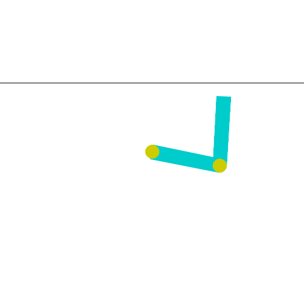

<h1 class="visually-hidden">Acrobot</h1>
<div class="gn-env-banner">
<canvas class="gn-pixel" data-text="ACROBOT" data-scale="6" data-color="#fcfcfc" data-shadow="#f83800"></canvas>
<canvas class="gn-pixel" data-text="CLASSIC CONTROL  3 ACTIONS  6 OBSERVATIONS" data-scale="2" data-color="#f8b800"></canvas>
</div>

<p class="gn-env-lead">Swing the tip of a hanging two-link chain above a line, with a motor only at the joint between the links: the shoulder swings free. The agent must pump energy into both links through the one joint it controls, like a gymnast on a high bar, and every step scores −1 until the tip is over the line.</p>

<aside class="gn-infobox" aria-label="Acrobot at a glance">
<video src="media/Acrobot-v1.episode.mp4" poster="media/Acrobot-v1.figure.png" autoplay muted loop playsinline disablepictureinpicture disableremoteplayback aria-label="Acrobot-v1, seed 1: torquing the elbow the way it turns swings the tip over the line in 65 steps"></video>
<p class="gn-infobox-caption">The whole episode <code>examples/Acrobot</code> plays and records: torque the elbow the way it turns, seed 1, 65 steps, return −64.</p>
<table>
<tr><td>Ids</td><td><code>Acrobot-v1</code> 500 steps</td></tr>
<tr><td>Action space</td><td><code>Discrete(3)</code></td></tr>
<tr><td>Observation space</td><td><code>Box([ -1. -1. -1. -1. -12.566371 -28.274334], [ 1. 1. 1. 1. 12.566371 28.274334], (6,), float32)</code></td></tr>
<tr><td>Reward</td><td>−1 every step, 0 on the last · solved at −100</td></tr>
<tr><td>Physics</td><td>one Runge-Kutta step of 0.2 s (5 a second), float64</td></tr>
<tr><td>Render modes</td><td><code>human</code>, <code>rgb_array</code> · 500×500 · 15 fps</td></tr>
<tr><td>Make</td><td><code>Gymnasium.Make("Acrobot-v1")</code></td></tr>
<tr><td>Class</td><td><a href="xref:Gym.Environments.Envs.Classic.AcrobotEnv"><code>AcrobotEnv</code></a>, options <a href="xref:Gym.Environments.Envs.Classic.AcrobotEnvOptions"><code>AcrobotEnvOptions</code></a></td></tr>
<tr><td>Vector env</td><td>none of its own: <code>MakeVec</code> builds sync or async</td></tr>
<tr><td>Parity</td><td><span class="gn-badge gn-badge-ok">bit for bit</span><span class="gn-badge gn-badge-ok">pixel for pixel</span><br>with Gymnasium 1.4.0</td></tr>
<tr><td>Gymnasium</td><td><a href="https://gymnasium.farama.org/v1.4.0/environments/classic_control/acrobot/">Acrobot</a> in Gymnasium 1.4.0's docs</td></tr>
</table>
</aside>

## Description

Two links of 1 m and 1 kg hang in a chain from a fixed pivot. The pivot turns freely; a motor at the joint between the
links, the elbow, applies a torque of −1, 0 or +1 N·m. The chain starts hanging nearly straight down, and the episode
ends as soon as the free end, the tip, rises more than 1 m above the pivot: higher than the first link can reach on its
own.

The motor cannot lift the chain: it can only bend the elbow, and the shoulder follows through the coupled dynamics,
as a gymnast swings from a bar by bending at the hips. The agent has to pump energy into the swing, timing each push
with the motion, until the tip whips over the line. Every step scores −1 but the last, which scores 0, so an episode of
65 steps returns −64. Random actions reached the line in only 18 of 1,000 seeded episodes within their 500 steps.

The Acrobot is a classic underactuated robot of control theory (Spong, 1995). Reinforcement learning took it up as
one of Sutton's examples of learning with sparse coarse coding (1996), and Sutton and Barto's book gave the equations
Gymnasium uses. Gym.NET's Acrobot computes exactly what Gymnasium's does: the same float64 Runge-Kutta step in the same
operation order, the float32 starting state, the same float32 observations, rewards, warnings and errors, and the same
pixels.

## Quick start

# [C#](#tab/csharp)

[!code-csharp[](../../../tests/Gym.Tests/Docs/EnvPageSamples/AcrobotSamples.cs?range=1-4,37-44&dedent=12)]

# [Python (Gymnasium)](#tab/python)

```python
import gymnasium as gym

env = gym.make("Acrobot-v1")
# cos and sin of both joint angles, then both speeds: float32
observation, info = env.reset(seed=42)
# 0: -1 N m on the elbow, 1: none, 2: +1 N m
action = env.action_space.sample()
observation, reward, terminated, truncated, info = env.step(action)
```

---

`dotnet add package Gym.NET.Environments`; the six longer examples are in [Code examples](#code-examples).

### Play it, or watch the agent

```bash
# from a clone of the repository: you drive the elbow, A pushes one way and D the other
dotnet run --project examples/Acrobot -c Release -- --play
# the agent in the video plays it in a window
dotnet run --project examples/Acrobot -c Release -- --render
```

## How it works

<div class="gn-figure gn-figure-narrow">

<svg viewBox="0 0 500 500" font-family="system-ui, sans-serif" font-size="14" role="img" aria-label="Labels: the line 1 m above the pivot that the tip must pass, the free pivot, the motor at the elbow, theta1 = 78° from straight down, theta2 = 98° from the first link, the tip 0.80 m above the pivot, both links 1 m and 1 kg, both speeds">
<text x="8" y="128.4" fill="#777">the tip above this line ends it: 1 m over the pivot</text>
<line x1="250" y1="250" x2="250" y2="342" stroke="#999" stroke-dasharray="5 4"/>
<path d="M 250,310 A 60 60 0 0 0 308.8,262" fill="none" stroke="#1971c2" stroke-width="2.5"/>
<text x="240" y="332" fill="#1971c2" text-anchor="end">θ1 = 78°</text>
<line x1="361.4" y1="272.7" x2="422.1" y2="285" stroke="#999" stroke-dasharray="4 3"/>
<path d="M 394.7,279.5 A 34 34 0 0 0 363.4,238.7" fill="none" stroke="#c2189b" stroke-width="2.5"/>
<text x="404.6" y="239" fill="#c2189b">θ2 = 98°</text>
<text x="234" y="236" fill="#777" text-anchor="end">the pivot: free</text>
<text x="361.4" y="320.7" fill="#2f9e44" text-anchor="middle">the motor: −1, 0 or +1 N·m</text>
<line x1="250" y1="250" x2="484" y2="250" stroke="#bbb" stroke-dasharray="3 3"/><line x1="368.1" y1="159.2" x2="484" y2="159.2" stroke="#bbb" stroke-dasharray="3 3"/>
<line x1="478" y1="250" x2="478" y2="159.2" stroke="#e8590c" stroke-width="2.5"/>
<text x="472" y="181.2" fill="#e8590c" text-anchor="end">h = 0.80 m</text>
<text x="250" y="410" fill="#777" text-anchor="middle">both links: 1 m, 1 kg</text>
<text x="250" y="430" fill="#777" text-anchor="middle">dθ1/dt = 2.05, dθ2/dt = −2.19 rad/s</text>
</svg>
</div>
<p class="gn-figure-caption">Step 64 of the episode in the video, exactly as <code>Render()</code> returns it: the first link is 78° from hanging, the second bent 98° further, and the tip is 0.80 m above the pivot and rising; the next step carries it over the line. 113.6 pixels to the metre, the frame spanning ±2.2 m around the pivot.</p>

The state is the two joint angles and their speeds: $\theta_1$, the first link's angle from straight down, and
$\theta_2$, the second link's angle relative to the first, both counterclockwise positive. With the elbow's torque
$\tau$, link masses $m_i$, the first link's length $l_1$, the distances $l_{c i}$ from each joint to its link's centre
of mass, the moments of inertia $I_i$ and $g = 9.8$ m/s², the accelerations are the book's equations:

$$
\begin{aligned}
d_1 &= m_1 l_{c1}^2 + m_2\big(l_1^2 + l_{c2}^2 + 2 l_1 l_{c2}\cos\theta_2\big) + I_1 + I_2\\
d_2 &= m_2\big(l_{c2}^2 + l_1 l_{c2}\cos\theta_2\big) + I_2\\
\phi_2 &= m_2 l_{c2}\,g\cos(\theta_1 + \theta_2 - \pi/2)\\
\phi_1 &= -m_2 l_1 l_{c2}\,\dot\theta_2^2\sin\theta_2 - 2 m_2 l_1 l_{c2}\,\dot\theta_2\dot\theta_1\sin\theta_2\\
&\qquad + (m_1 l_{c1} + m_2 l_1)\,g\cos(\theta_1 - \pi/2) + \phi_2\\
\ddot\theta_2 &= \frac{\tau + \frac{d_2}{d_1}\phi_1 - m_2 l_1 l_{c2}\,\dot\theta_1^2\sin\theta_2 - \phi_2}{m_2 l_{c2}^2 + I_2 - d_2^2/d_1}\\
\ddot\theta_1 &= -\frac{d_2\,\ddot\theta_2 + \phi_1}{d_1}
\end{aligned}
$$

Each step integrates them over $\Delta t = 0.2$ s with one classical fourth-order Runge-Kutta step, then wraps both
angles into $[-\pi, \pi]$ and clips the speeds to $\pm 4\pi$ and $\pm 9\pi$ rad/s. The episode ends when the tip's
height above the pivot passes 1 m:

$$
h = -\cos\theta_1 - \cos(\theta_1 + \theta_2) > 1
$$

Gym.NET computes every term in float64 in Gymnasium's operation order, every square through the C runtime's `pow` as
NumPy does, so each state is bit for bit Gymnasium's. The starting state is float32 (Gymnasium draws it and converts it
with `astype(np.float32)`), so the first step starts from those rounded values; after a step the state is float64.

| Symbol | Property | Gymnasium | Default | Unit |
|---|---|---|--:|---|
| $m_1$, $m_2$ | `LinkMass1`, `LinkMass2` | `LINK_MASS_1`, `LINK_MASS_2` | 1.0 | kg |
| $l_1$, $l_2$ | `LinkLength1`, `LinkLength2` | `LINK_LENGTH_1`, `LINK_LENGTH_2` | 1.0 | m |
| $l_{c1}$, $l_{c2}$ | `LinkComPos1`, `LinkComPos2` | `LINK_COM_POS_1`, `LINK_COM_POS_2` | 0.5 | m |
| $I_1$, $I_2$ | `LinkMoi` | `LINK_MOI` | 1.0 | kg·m² |
| $\Delta t$ | `Dt` | `dt` | 0.2 | s |
| | `MaxVel1`, `MaxVel2` | `MAX_VEL_1`, `MAX_VEL_2` | 4π, 9π | rad/s |
| | `AvailTorque` | `AVAIL_TORQUE` | [−1, 0, +1] | N·m |
| | `TorqueNoiseMax` | `torque_noise_max` | 0.0 | N·m |
| | `BookOrNips` | `book_or_nips` | "book" | |

> [!WARNING]
> $l_2$ is drawn but never enters the dynamics, and the termination test is written for two 1 m links: changing the
> lengths changes the frame and $l_1$'s terms, not the line. $g$ is the literal 9.8 of Gymnasium's source, not a
> property. Any `BookOrNips` but `"nips"` means the book's equations. A positive `TorqueNoiseMax` adds a uniform draw
> from the env's generator to every torque.

## Action space

`Discrete(3)`: the elbow's torque.

| Action | Torque |
|---|---|
| 0 | −1 N·m |
| 1 | 0 |
| 2 | +1 N·m |

The action is not checked against the space, as in Gymnasium: it indexes `AvailTorque` the way a Python list is
indexed, so −1, −2 and −3 are accepted too (the torques of actions 2, 1 and 0), and anything else raises Python's
`IndexError` or `TypeError`.

## Observation space

A float32 `NDArray` of shape `(6,)`:

| Index | Observation | Min | Max | Unit |
|---|---|--:|--:|---|
| 0 | $\cos\theta_1$ | −1 | 1 | |
| 1 | $\sin\theta_1$ | −1 | 1 | |
| 2 | $\cos\theta_2$ | −1 | 1 | |
| 3 | $\sin\theta_2$ | −1 | 1 | |
| 4 | $\dot\theta_1$ | −4π (−12.566) | 4π | rad/s |
| 5 | $\dot\theta_2$ | −9π (−28.274) | 9π | rad/s |

`[1, 0, 1, 0, …]` is the chain hanging straight down. [The tip's height](#the-tips-height) computes $h$ from
the observation.

## Rewards

−1 for every step that leaves the tip below the line, 0 for the step that lifts it over: the return is one more than
minus the episode's length, from −500 when the time limit stops it first. The registry counts an average of −100 over
100 episodes as solved.

## Starting state

Both angles and both speeds are drawn uniformly from [−0.1, 0.1) by the env's generator (NumPy's PCG64, so a seed
gives Gymnasium's starting state), then rounded to float32: the chain hangs nearly still and nearly straight down.
Reset options move the range: `low` and `high`, anything Python's `float()` accepts. The episode in the video starts at
$\theta_1 = 0.14°$, $\theta_2 = 5.16°$ (seed 1).

## Episode end

| Ends by | When |
|---|---|
| Termination | The tip passes the line: $-\cos\theta_1 - \cos(\theta_1 + \theta_2) > 1$ |
| Truncation | 500 steps: the `TimeLimit` that `Make` wraps around the env; `AcrobotEnv` itself never truncates |

## Arguments

By Gymnasium's name in `Make`'s kwargs, or by the C# name in the constructor and in
<xref:Gym.Environments.Envs.Classic.AcrobotEnvOptions>.

| Argument | Type and default | Effect |
|---|---|---|
| `render_mode`<br>`renderMode` | `string?` or `RenderMode`<br>`null` | `"human"` opens a window; `"rgb_array"` makes `Render()` return the frame |
| (Gym.NET)<br>`viewerFactory` | `EnvViewerFactory?`<br>`null` | The window for `human`: Avalonia, WinForms, or headless |


# [C#](#tab/csharp)

[!code-csharp[](../../../tests/Gym.Tests/Docs/EnvPageSamples/AcrobotSamples.cs#Arguments)]

# [Python (Gymnasium)](#tab/python)

```python
env = gym.make("Acrobot-v1", render_mode="rgb_array")
```

---

Everything else is a settable property of the unwrapped env (the table in [How it works](#how-it-works)).

## Info

Always empty, `{}`, as Gymnasium's; Acrobot has no typed info record.

## Rendering

| Mode | What you get |
|---|---|
| `rgb_array` | `Render()` returns the frame: `(500, 500, 3)` uint8, Gymnasium's pixels; `(Image)result` converts it |
| `human` | A window from the viewer factory, drawn after every reset and step, paced at 15 frames a second |
| none | `Render()` warns and returns nothing, as Gymnasium's does |

The frame: white, a black line 1 m above the pivot across the whole frame, the two links 0.2 m wide in (0, 204, 204),
and yellow joints at the pivot and the elbow. 113.6 pixels to the metre: the frame spans the links' 2 m and 0.2 m more
either side of the pivot at its centre. Drawn with SDL_gfx's anti-aliased polygons and circles and pygame's line, as
pygame draws them.

## Episode anatomy

The whole episode, step by step: the tip's height against the line, both joint speeds, and which way each step
torqued the elbow. The video has one frame per step, and the cursor follows it. Pushing the way the second link turns,
the rule lifts the top of every swing higher: the tip's height peaks at −1.95 m (step 6), then −1.81, −1.70, −1.66,
−1.49, −1.21, −0.87 and −0.38 m (step 52), and at step 65 the tip goes over the line, 1.08 m above the pivot. The
elbow's speed reaches 6.66 rad/s, under a quarter of its limit; 34 steps pushed +1 and 31 pushed −1.

<div class="gn-anatomy" data-trace="media/Acrobot-v1.episode.json">
<div><video src="media/Acrobot-v1.episode.mp4" poster="media/Acrobot-v1.figure.png" autoplay muted loop playsinline disablepictureinpicture disableremoteplayback aria-label="Acrobot-v1, seed 1, the episode the chart follows"></video><div class="gn-anatomy-readout" aria-live="off"></div></div>
<div><div class="gn-anatomy-chart"></div><div class="gn-anatomy-legend"></div></div>
<script type="application/json" class="gn-anatomy-spec">{"label":"Acrobot-v1, seed 1: the tip's height above the pivot against the line at 1 m, both joint speeds, and each push","bands":[{"height":110,"range":[-2.1,1.2],"ticks":[-2,-1,0,1],"unit":" m","series":[{"column":"height","color":"#3cbcfc","name":"the tip's height (the line at 1 m)"}]},{"height":70,"range":[-7,7],"ticks":[-6,0,6],"series":[{"column":"theta1_dot","color":"#adb5bd","width":1.2,"name":"the shoulder's speed"},{"column":"theta2_dot","color":"#ff7fe3","name":"the elbow's speed"}]},{"label":"push","strip":{"column":"action","colors":{"0":"#5c636a","1":"#343a40","2":"#f8b800"},"name":"each push: +1 in gold, −1 in grey"}}],"readout":[{"label":"step","column":"@step"},{"label":"h","column":"height","digits":2,"unit":" m"},{"label":"θ1","column":"theta1","digits":0,"unit":"°","scale":57.29577951308232},{"label":"θ2","column":"theta2","digits":0,"unit":"°","scale":57.29577951308232},{"label":"next push","column":"action","map":{"0":"−1","1":"0","2":"+1"}},{"label":"return so far","column":"@return","digits":0}]}</script>
</div>

## Code examples

### Run an episode

# [C#](#tab/csharp)

[!code-csharp[](../../../tests/Gym.Tests/Docs/EnvPageSamples/AcrobotSamples.cs#RunAnEpisode)]

# [Python (Gymnasium)](#tab/python)

```python
import gymnasium as gym

env = gym.make("Acrobot-v1")
observation, info = env.reset(seed=1)
episode_return = 0.0
while True:
    # torque the elbow the way the second link turns: +1 (2) or -1 (0)
    action = 2 if observation[5] > 0 else 0
    observation, reward, terminated, truncated, info = env.step(action)
    episode_return += reward
    if terminated or truncated:
        break
print(f"return {episode_return}")  # -64.0: over the line in 65 steps
```

---

### Start elsewhere

# [C#](#tab/csharp)

[!code-csharp[](../../../tests/Gym.Tests/Docs/EnvPageSamples/AcrobotSamples.cs#StartElsewhere)]

# [Python (Gymnasium)](#tab/python)

```python
# both angles and both speeds from [-0.2, 0.2) instead of [-0.1, 0.1)
observation, info = env.reset(seed=123, options={"low": -0.2, "high": 0.2})
```

---

### Change the physics

# [C#](#tab/csharp)

[!code-csharp[](../../../tests/Gym.Tests/Docs/EnvPageSamples/AcrobotSamples.cs#ChangePhysics)]

# [Python (Gymnasium)](#tab/python)

```python
env.unwrapped.book_or_nips = "nips"  # the NIPS paper's equations, not the book's
env.unwrapped.dt = 0.05  # RK4 over 0.05 s a step, not 0.2
```

---

Either change alone alters the episode above: with the paper's equations the same rule needs 352 steps from seed 1,
with steps of 0.05 s 305 (15.25 s of simulated time, against 13 s at 0.2).

### Save a frame

# [C#](#tab/csharp)

[!code-csharp[](../../../tests/Gym.Tests/Docs/EnvPageSamples/AcrobotSamples.cs#SaveFrame)]

# [Python (Gymnasium)](#tab/python)

```python
from PIL import Image

env = gym.make("Acrobot-v1", render_mode="rgb_array")
env.reset(seed=1)
Image.fromarray(env.render()).save("acrobot.png")
```

---

### The tip's height

# [C#](#tab/csharp)

[!code-csharp[](../../../tests/Gym.Tests/Docs/EnvPageSamples/AcrobotSamples.cs#TheTipsHeight)]

# [Python (Gymnasium)](#tab/python)

```python
c1, s1, c2, s2 = observation[:4]
# cos(theta1 + theta2) = c1 c2 - s1 s2; the episode ends when height > 1
height = -c1 - (c1 * c2 - s1 * s2)  # -2.00: hanging straight down
```

---

### Many acrobots at once

# [C#](#tab/csharp)

[!code-csharp[](../../../tests/Gym.Tests/Docs/EnvPageSamples/AcrobotSamples.cs#ManyAcrobots)]

# [Python (Gymnasium)](#tab/python)

```python
# No vector env of its own: make_vec steps 8 envs in turn ("sync")
envs = gym.make_vec("Acrobot-v1", num_envs=8, vectorization_mode="sync")
observations, infos = envs.reset(seed=42)
for t in range(200):
    actions = envs.action_space.sample()  # one per acrobot
    # finished ones reset themselves
    observations, rewards, terminations, truncations, infos = envs.step(actions)
```

---

Every C# example is a test in `tests/Gym.Tests/Docs/EnvPageSamples`, compiled and run by the unit gate; where a
comment or this page states a number, the test checks it.

## Agents and examples

- **The video's agent** is one rule: torque the elbow the way the second link already turns, +1 (action 2) when
  $\dot\theta_2 > 0$ and −1 (action 0) otherwise. Each push adds energy to the swing, as a gymnast's kick does. Seed 1:
  65 steps, return −64. From seeds 0 to 99 it always gets over the line, in 65 to 211 steps, a mean return of −84.35:
  better than the registry's −100.
- **[examples/Acrobot](https://github.com/SciSharp/Gym.NET/tree/master/examples/Acrobot)**
  ([`AcrobotProgram.cs`](https://github.com/SciSharp/Gym.NET/blob/master/examples/Acrobot/AcrobotProgram.cs))
  plays that rule: `dotnet run --project examples/Acrobot -c Release` plays seed 1 headless, `--seed N` another seed,
  `--episodes N` that many seeds and their mean, `--render` in a window.
- **Play it yourself**: `--play` hands the elbow to the keyboard: <kbd>A</kbd> pushes −1, <kbd>D</kbd> +1, and with
  no key held the elbow is free.
- **This page's video and chart** are the example's own episode:
  `--record docs/environments/classic_control/media` records it with `RecordVideo` (one frame per step, at the env's
  15 frames a second) and writes the step trace and the figure beside it.

## Vectorized environment

Acrobot registers no vector env of its own. `Gymnasium.MakeVec("Acrobot-v1", n)` builds a `SyncVectorEnv` that steps
`n` separate envs in turn, and `VectorizeMode.Async` an `AsyncVectorEnv` that steps them on worker threads; each env
resets itself after its episode ends (next-step autoreset), as Gymnasium's.

## Variants

None in Gymnasium 1.4.0: Acrobot-v1 is the only id. (Gymnasium's v0, with 200 steps and the angles themselves in the
observation, is gone.)

## Parity with Gymnasium

Gymnasium 1.4.0 runs inside the test process and both are compared value by value:

| What is compared | How | Result |
|---|---|---|
| Reset: observations, generator state | seeded resets (the float32 state and its float32 trigonometry), reset options and their errors | ✓ equal |
| Dynamics: observations, rewards, flags | episodes of sampled actions; the pumping rule through termination | ✓ bit for bit |
| The other dynamics | the NIPS equations, torque noise | ✓ bit for bit |
| Actions and errors | Python's list indexing of the action, invalid actions | ✓ same values, same messages |
| Injected states | states written into both envs; malformed states | ✓ same values, same errors |
| Spaces, metadata | both spaces, render modes, fps | ✓ |
| Frames | `rgb_array` along episodes and at injected states | ✓ pixel for pixel |
| `make`'s stack, registration, goldens | the wrapper order through truncation, the spec, a golden episode replayed without Python | ✓ |
| Gymnasium's own checkers on Gym.NET's env | `check_env`, `check_environments_match` | ✓ |
| Wrappers over it | `DiscretizeObservation` (3 bins over its 6 elements) | ✓ |

The tests: [AcrobotLiveParityTests](https://github.com/SciSharp/Gym.NET/blob/master/tests/Gym.Tests.Parity/Tests/Envs/AcrobotLiveParityTests.cs),
[EnvCoverageLiveParityTests](https://github.com/SciSharp/Gym.NET/blob/master/tests/Gym.Tests.Parity/Tests/Envs/EnvCoverageLiveParityTests.cs),
[GymnasiumToolsLiveParityTests](https://github.com/SciSharp/Gym.NET/blob/master/tests/Gym.Tests.Parity/Tests/Bridge/GymnasiumToolsLiveParityTests.cs),
[TransformWrappersLiveParityTests](https://github.com/SciSharp/Gym.NET/blob/master/tests/Gym.Tests.Parity/Tests/Wrappers/TransformWrappersLiveParityTests.cs).

## Performance

| | Steps a second | Bytes a step |
|---|--:|--:|
| Gym.NET | 168,049 | 4,019 |
| Gymnasium | 11,696 | |

14.4× faster. Random actions, observations disposed;
.NET 10 in Release against CPython 3.12 with the pinned NumPy; the medians of interleaved rounds on one machine
(2026-11-11).

## Reference sources

- [gymnasium/envs/classic_control/acrobot.py](https://github.com/Farama-Foundation/Gymnasium/blob/8ba8c3a63bb4e000b7f33923f43d292acac07be1/gymnasium/envs/classic_control/acrobot.py),
  Gymnasium 1.4.0: the environment (spaces, dynamics, the Runge-Kutta step, `wrap` and `bound`, reward, termination,
  reset, rendering). The file carries RLPy's notice: Copyright 2013, RLPy, BSD 3-Clause, written by Christoph Dann,
  from [rlpy/Domains/Acrobot.py](https://github.com/rlpy/rlpy).
- [gymnasium/envs/classic_control/utils.py](https://github.com/Farama-Foundation/Gymnasium/blob/8ba8c3a63bb4e000b7f33923f43d292acac07be1/gymnasium/envs/classic_control/utils.py):
  `maybe_parse_reset_bounds`, the reset options.
- [SDL_gfxPrimitives.c](https://github.com/pygame-community/pygame-ce/blob/2.5.8/src_c/SDL_gfx/SDL_gfxPrimitives.c)
  (SDL_gfx 2.0.26 as pygame-ce 2.5.8 ships it): `aapolygon`, `filled_polygon`, `aacircle`, `filled_circle`, in
  Gym.Rendering's `GfxDraw`; pygame-ce's [draw.c](https://github.com/pygame-community/pygame-ce/blob/2.5.8/src_c/draw.c)
  for the line and [transform.c](https://github.com/pygame-community/pygame-ce/blob/2.5.8/src_c/transform.c) for `flip`.
- [gymnasium/utils/seeding.py](https://github.com/Farama-Foundation/Gymnasium/blob/8ba8c3a63bb4e000b7f33923f43d292acac07be1/gymnasium/utils/seeding.py):
  the env's generator, NumPy's PCG64, which NumSharp reproduces for the starting state.

## Version history

| Version | Change |
|---|---|
| Acrobot-v1 | The limit raised from 200 steps to 500; the observation gives each angle's cosine and sine instead of the angle |
| Acrobot-v0 | The first release |
| Gym.NET 1.0.0 | New: Gymnasium 1.4.0's Acrobot-v1, bit for bit; 0.2.0 had no Acrobot |

## References

1. M. W. Spong, "The swing up control problem for the Acrobot", *IEEE Control Systems Magazine* 15(1), 1995,
   pp. 49–55. [doi:10.1109/37.341864](https://doi.org/10.1109/37.341864)
2. R. S. Sutton, "Generalization in reinforcement learning: successful examples using sparse coarse coding",
   *Advances in Neural Information Processing Systems 8*, MIT Press, 1996, pp. 1038–1044: the Acrobot as a learning
   task, and the equations `book_or_nips = "nips"` selects.
   [NeurIPS](https://proceedings.neurips.cc/paper_files/paper/1995/hash/8f1d43620bc6bb580df6e80b0dc05c48-Abstract.html)
3. R. S. Sutton and A. G. Barto, *Reinforcement Learning: An Introduction*, MIT Press, 1998, section 11.3, "The
   Acrobot": the equations Gymnasium uses by default. [Section 11.3](http://incompleteideas.net/book/11/node4.html)
4. A. Geramifard, C. Dann, R. H. Klein, W. Dabney and J. P. How, "RLPy: a value-function-based reinforcement learning
   framework for education and research", *Journal of Machine Learning Research* 16(46), 2015, pp. 1573–1578: the
   library Gymnasium's Acrobot comes from. [JMLR](https://www.jmlr.org/papers/v16/geramifard15a.html)

## External links

- [Acrobot on Gymnasium's site](https://gymnasium.farama.org/v1.4.0/environments/classic_control/acrobot/) (1.4.0)
- [AcrobotEnv.cs](https://github.com/SciSharp/Gym.NET/blob/master/src/Gym.Environments/Envs/Classic/AcrobotEnv.cs) on GitHub
- [examples/Acrobot](https://github.com/SciSharp/Gym.NET/tree/master/examples/Acrobot)
- [Double pendulum](https://en.wikipedia.org/wiki/Double_pendulum) on Wikipedia: the Acrobot is one with a motor at its
  middle joint

## API reference

<xref:Gym.Environments.Envs.Classic.AcrobotEnv> · <xref:Gym.Environments.Envs.Classic.AcrobotEnvOptions>
