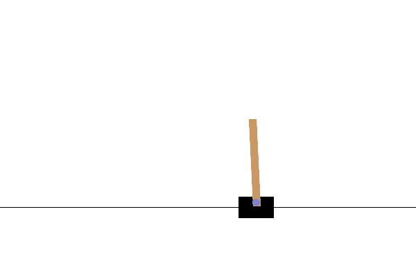

<h1 class="visually-hidden">CartPole</h1>
<div class="gn-env-banner">
<canvas class="gn-pixel" data-text="CARTPOLE" data-scale="6" data-color="#fcfcfc" data-shadow="#f83800"></canvas>
<canvas class="gn-pixel" data-text="CLASSIC CONTROL  2 ACTIONS  4 OBSERVATIONS" data-scale="2" data-color="#f8b800"></canvas>
</div>

<p class="gn-env-lead">Balance a pole on a moving cart by pushing the cart left or right. The cart-pole problem of reinforcement learning's early days, and still its first benchmark: four numbers in, two actions out, solved by a linear policy.</p>

<aside class="gn-infobox" aria-label="CartPole at a glance">
<video src="media/CartPole-v1.episode.mp4" poster="media/CartPole-v1.figure.png" autoplay muted loop playsinline disablepictureinpicture disableremoteplayback aria-label="CartPole-v1, seed 3: the swaying controller keeps the pole up for all 500 steps"></video>
<p class="gn-infobox-caption">The whole episode <code>examples/CartPole</code> plays and records: the swaying controller, seed 3, 500 steps, return 500.</p>
<table>
<tr><td>Ids</td><td><code>CartPole-v1</code> 500 steps<br><code>CartPole-v0</code> 200 steps</td></tr>
<tr><td>Action space</td><td><code>Discrete(2)</code></td></tr>
<tr><td>Observation space</td><td><code>Box([-4.8 -inf -0.41887903 -inf], [4.8 inf 0.41887903 inf], (4,), float32)</code></td></tr>
<tr><td>Reward</td><td>+1 every step · solved at 475 (v1), 195 (v0)</td></tr>
<tr><td>Physics</td><td>Euler steps of 0.02 s (50 a second), float64</td></tr>
<tr><td>Render modes</td><td><code>human</code>, <code>rgb_array</code> · 600×400 · 50 fps</td></tr>
<tr><td>Make</td><td><code>Gymnasium.Make("CartPole-v1")</code></td></tr>
<tr><td>Class</td><td><a href="xref:Gym.Environments.Envs.Classic.CartPoleEnv"><code>CartPoleEnv</code></a>, options <a href="xref:Gym.Environments.Envs.Classic.CartPoleEnvOptions"><code>CartPoleEnvOptions</code></a></td></tr>
<tr><td>Vector env</td><td><a href="xref:Gym.Environments.Envs.Classic.CartPoleVectorEnv"><code>CartPoleVectorEnv</code></a></td></tr>
<tr><td>Parity</td><td><span class="gn-badge gn-badge-ok">bit for bit</span><span class="gn-badge gn-badge-ok">pixel for pixel</span><br>with Gymnasium 1.4.0</td></tr>
<tr><td>Gymnasium</td><td><a href="https://gymnasium.farama.org/v1.4.0/environments/classic_control/cart_pole/">CartPole</a> in Gymnasium 1.4.0's docs</td></tr>
</table>
</aside>

## Description

A pole stands on a cart, hinged by a joint that has no motor, and the cart rolls along a frictionless track. The agent
cannot touch the pole: it can only push the cart, left or right, with a fixed force, and must keep the pole upright by
moving the cart under it. The episode ends when the pole falls past 12° or the cart runs off the track.

This is the cart-pole problem as Barto, Sutton and Anderson posed it in 1983, where two neuron-like adaptive elements
learned to balance the pole from a failure signal alone. It became the first benchmark of reinforcement learning: small
enough to solve in seconds, unstable enough that random pushes keep the pole up for only 22.6 steps on average
(measured over 1,000 seeded episodes), and a fair first test of any algorithm, from random search to deep Q-learning.

Gym.NET's CartPole computes exactly what Gymnasium's does: the same float64 dynamics in the same operation order, the
same float32 observations, rewards, flags, warnings and errors, and the same pixels.

## Quick start

# [C#](#tab/csharp)

[!code-csharp[](../../../tests/Gym.Tests/Docs/EnvPageSamples/CartPoleSamples.cs?range=1-4,34-39&dedent=12)]

# [Python (Gymnasium)](#tab/python)

```python
import gymnasium as gym

env = gym.make("CartPole-v1")
# [x, x_dot, theta, theta_dot], float32
observation, info = env.reset(seed=42)
# 0 pushes the cart left, 1 right
action = env.action_space.sample()
observation, reward, terminated, truncated, info = env.step(action)
```

---

`dotnet add package Gym.NET.Environments`; the six longer examples are in [Code examples](#code-examples).

### Play it, or watch the agent

```bash
# from a clone of the repository: you push the cart, A left and D right
dotnet run --project examples/CartPole -c Release -- --play
# the agent in the video plays it in a window
dotnet run --project examples/CartPole -c Release -- --controller --render
```

## How it works

<div class="gn-figure">

<svg viewBox="0 0 600 400" font-family="system-ui, sans-serif" font-size="14" role="img" aria-label="Labels: x = 0.56 m, θ = −2.5°, the pushes of plus and minus 10 N, the 12° and ±2.4 m limits">
<defs><marker id="gn-cp-ax" viewBox="0 0 10 10" refX="9" refY="5" markerWidth="6" markerHeight="6" orient="auto-start-reverse"><path d="M0,0 L10,5 L0,10 z" fill="#c2189b"/></marker><marker id="gn-cp-ar" viewBox="0 0 10 10" refX="9" refY="5" markerWidth="6" markerHeight="6" orient="auto-start-reverse"><path d="M0,0 L10,5 L0,10 z" fill="#2f9e44"/></marker><marker id="gn-cp-al" viewBox="0 0 10 10" refX="9" refY="5" markerWidth="6" markerHeight="6" orient="auto-start-reverse"><path d="M0,0 L10,5 L0,10 z" fill="#e8590c"/></marker></defs>
<line x1="300" y1="318" x2="300" y2="372" stroke="#666" stroke-dasharray="3 3"/><text x="296" y="388" fill="#666">0</text>
<line x1="300" y1="360" x2="369.9" y2="360" stroke="#c2189b" stroke-width="2" marker-end="url(#gn-cp-ax)"/>
<text x="377.9" y="365" fill="#c2189b">x = 0.56 m</text>
<line x1="369.9" y1="292.5" x2="338.7" y2="145.8" stroke="#999" stroke-dasharray="5 4"/><line x1="369.9" y1="292.5" x2="401.1" y2="145.8" stroke="#999" stroke-dasharray="5 4"/>
<text x="407.1" y="149.8" fill="#777">12° ends it</text>
<line x1="369.9" y1="292.5" x2="369.9" y2="142.5" stroke="#bbb" stroke-width="1"/>
<path d="M 369.9,232.5 A 60 60 0 0 0 367.3,232.6" fill="none" stroke="#1971c2" stroke-width="2.5"/>
<text x="257.9" y="196.5" fill="#1971c2">θ = −2.5°</text>
<line x1="401.9" y1="300" x2="451.9" y2="300" stroke="#2f9e44" stroke-width="3" marker-end="url(#gn-cp-ar)"/><text x="405.9" y="288" fill="#2f9e44">1: +10 N</text>
<line x1="337.9" y1="300" x2="287.9" y2="300" stroke="#e8590c" stroke-width="3" marker-end="url(#gn-cp-al)"/><text x="277.9" y="288" fill="#e8590c">0: −10 N</text>
<text x="8" y="22" fill="#777">−2.4 m ends it</text><text x="496" y="22" fill="#777">+2.4 m ends it</text>
<line x1="1" y1="0" x2="1" y2="400" stroke="#aaa" stroke-dasharray="6 5"/><line x1="599" y1="0" x2="599" y2="400" stroke="#aaa" stroke-dasharray="6 5"/>
</svg>
</div>
<p class="gn-figure-caption">Step 125 of the episode in the video, exactly as <code>Render()</code> returns it: the cart is 0.56 m right of the centre and moving right at 0.15 m/s; the pole leans 2.5° left and is swinging back at 0.08 rad/s. 125 pixels to the metre, so the frame's edges are the ±2.4 m limits.</p>

Each step applies a force $F = \pm 10$ N for $\tau = 0.02$ s. With $g = 9.8$, cart mass $m_c = 1.0$ kg, pole mass
$m_p = 0.1$ kg and $l = 0.5$ m (half the pole's length, as Gymnasium's `length` is), the accelerations are those of
Florian's corrected cart-pole equations, without friction:

$$
\ddot\theta = \frac{g\sin\theta - \cos\theta\,\dfrac{F + m_p l\,\dot\theta^2\sin\theta}{m_c + m_p}}{l\left(\dfrac{4}{3} - \dfrac{m_p\cos^2\theta}{m_c + m_p}\right)}
\qquad
\ddot x = \frac{F + m_p l\,\dot\theta^2\sin\theta}{m_c + m_p} - \frac{m_p l\,\ddot\theta\cos\theta}{m_c + m_p}
$$

and the state moves by one explicit Euler step (positions first, from the old velocities):

$$
x \leftarrow x + \tau\dot x,\quad \dot x \leftarrow \dot x + \tau\ddot x,\quad \theta \leftarrow \theta + \tau\dot\theta,\quad \dot\theta \leftarrow \dot\theta + \tau\ddot\theta
$$

Gym.NET computes every term in float64, in Gymnasium's operation order, so each state is bit for bit Gymnasium's; the
observation is that state rounded to float32. Set `KinematicsIntegrator` to anything but `"euler"` for the
semi-implicit variant (velocities first).

| Symbol | Property | Gymnasium | Default | Unit |
|---|---|---|--:|---|
| $g$ | `Gravity` | `gravity` | 9.8 | m/s² |
| $m_c$ | `Masscart` | `masscart` | 1.0 | kg |
| $m_p$ | `Masspole` | `masspole` | 0.1 | kg |
| $l$ | `Length` | `length` | 0.5 | m (half the pole) |
| $\lvert F\rvert$ | `ForceMag` | `force_mag` | 10.0 | N |
| $\tau$ | `Tau` | `tau` | 0.02 | s |
| | `KinematicsIntegrator` | `kinematics_integrator` | "euler" | |
| | `ThetaThresholdRadians` | `theta_threshold_radians` | 0.2094 | rad (12°) |
| | `XThreshold` | `x_threshold` | 2.4 | m |

> [!WARNING]
> `TotalMass` and `PolemassLength` are computed once, in the constructor, as in Gymnasium. After changing `Masscart`,
> `Masspole` or `Length`, set them too, or the dynamics keep the old values.

## Action space

`Discrete(2)`: the direction of the push. Its strength is always 10 N.

| Action | Push | Force |
|---|---|---|
| 0 | Left | −10 N |
| 1 | Right | +10 N |

An action `Discrete(2)` does not contain raises `AssertionError`, as Gymnasium's `assert` does.

## Observation space

A float32 `NDArray` of shape `(4,)`, the state rounded to float32:

| Index | Observation | Symbol | Min | Max | Ends the episode at |
|---|---|---|--:|--:|---|
| 0 | Cart position | $x$ | −4.8 m | 4.8 m | ±2.4 m |
| 1 | Cart velocity | $\dot x$ | −∞ | ∞ | |
| 2 | Pole angle | $\theta$ | −0.419 rad (−24°) | 0.419 rad (24°) | ±0.2095 rad (12°) |
| 3 | Pole angular velocity | $\dot\theta$ | −∞ | ∞ | |

The space is twice as wide as an episode allows, so the observation on the terminating step is still inside it.

## Rewards

+1 for every step, the step that ends the episode included: the return is the number of steps the pole stayed up. A
perfect CartPole-v1 episode returns 500; the registry counts 475 as solved (195 for v0).

With `sutton_barto_reward: true` the reward is the original paper's: 0 for every step and −1 for the step that ends it,
so the best return is 0. Stepping past the end without a reset returns 0 (−1 with Sutton and Barto's reward) and warns
once, as Gymnasium does.

## Starting state

All four values are drawn uniformly from (−0.05, 0.05) by the env's generator (NumPy's PCG64, so a seed gives
Gymnasium's starting state). Reset options move the bounds: `low` and `high`, anything Python's `float()` accepts. The
episode in the video starts at x = −0.041 m, θ = 0.030 rad (seed 3).

## Episode end

| Ends by | When |
|---|---|
| Termination | The pole leans more than 12° (0.2095 rad) either way |
| Termination | The cart's centre leaves ±2.4 m (the frame's edge) |
| Truncation | 500 steps (v1) or 200 (v0): the `TimeLimit` that `Make` wraps around the env; `CartPoleEnv` itself never truncates |

## Arguments

By Gymnasium's name in `Make`'s kwargs, or by the C# name in the constructor and in
<xref:Gym.Environments.Envs.Classic.CartPoleEnvOptions>.

| Argument | Type and default | Effect |
|---|---|---|
| `render_mode`<br>`renderMode` | `string?` or `RenderMode`<br>`null` | `"human"` opens a window; `"rgb_array"` makes `Render()` return the frame |
| `sutton_barto_reward`<br>`suttonBartoReward` | `bool`<br>`false` | The original paper's reward (see [Rewards](#rewards)) |
| (Gym.NET)<br>`viewerFactory` | `EnvViewerFactory?`<br>`null` | The window for `human`: Avalonia, WinForms, or headless |

[!code-csharp[](../../../tests/Gym.Tests/Docs/EnvPageSamples/CartPoleSamples.cs#Arguments)]

The physics constants are settable properties of the unwrapped env (the table in [How it works](#how-it-works)).

## Info

Always empty, `{}`, as Gymnasium's; CartPole has no typed info record.

## Rendering

| Mode | What you get |
|---|---|
| `rgb_array` | `Render()` returns the frame: `(400, 600, 3)` uint8, Gymnasium's pixels; `(Image)result` converts it |
| `human` | A window from the viewer factory, drawn after every reset and step, paced at 50 frames a second |
| none | `Render()` warns and returns nothing, as Gymnasium's does |

The frame: white, a black track line, a black 50×30 px cart, a 10×125 px pole in (202, 152, 101), a blue axle; 125
pixels to the metre, centred, so the frame's edges are the ±2.4 m limits. Drawn with SDL_gfx's anti-aliased polygons
and circles, as pygame draws them.

## Episode anatomy

The whole episode, step by step: where the cart is, how far the pole leans, which way each step pushed. The video has
one frame per step, and the cursor follows it. The controller drags the cart toward a set point that sways ±1.2 m
every 250 steps; the cart reaches 0.62 m right of the centre and 0.47 m left of it, and the pole never leans past
4.4°.

<div class="gn-anatomy" data-trace="media/CartPole-v1.episode.json">
<div><video src="media/CartPole-v1.episode.mp4" poster="media/CartPole-v1.figure.png" autoplay muted loop playsinline disablepictureinpicture disableremoteplayback aria-label="CartPole-v1, seed 3, the episode the chart follows"></video><div class="gn-anatomy-readout" aria-live="off"></div></div>
<div><div class="gn-anatomy-chart"></div><div class="gn-anatomy-legend"></div></div>
<script type="application/json" class="gn-anatomy-spec">{"label":"CartPole-v1, seed 3: the cart's position and the controller's set point, the pole's angle, and each push","bands":[{"height":110,"range":[-1.3,1.3],"ticks":[-1.2,0,1.2],"unit":" m","series":[{"column":"target","color":"#868e96","dash":true,"width":1.2,"name":"the controller's set point"},{"column":"x","color":"#3cbcfc","name":"the cart's position"}]},{"height":70,"range":[-6,6],"ticks":[-5,0,5],"unit":"°","scale":57.29577951308232,"series":[{"column":"theta","color":"#ff7fe3","name":"the pole's angle"}]},{"label":"push","strip":{"column":"action","colors":{"0":"#5c636a","1":"#f8b800"},"name":"each push: right in gold, left in grey"}}],"readout":[{"label":"step","column":"@step"},{"label":"x","column":"x","digits":3,"unit":" m"},{"label":"θ","column":"theta","digits":2,"unit":"°","scale":57.29577951308232},{"label":"next push","column":"action","map":{"0":"left","1":"right"}},{"label":"return so far","column":"@return","digits":0}]}</script>
</div>

## Code examples

### Run an episode

# [C#](#tab/csharp)

[!code-csharp[](../../../tests/Gym.Tests/Docs/EnvPageSamples/CartPoleSamples.cs#RunAnEpisode)]

# [Python (Gymnasium)](#tab/python)

```python
import gymnasium as gym

env = gym.make("CartPole-v1")
observation, info = env.reset(seed=42)
episode_return = 0.0
while True:
    action = env.action_space.sample()
    observation, reward, terminated, truncated, info = env.step(action)
    episode_return += reward
    if terminated or truncated:
        break
print(f"return {episode_return}")
```

---

### Start from wider bounds

# [C#](#tab/csharp)

[!code-csharp[](../../../tests/Gym.Tests/Docs/EnvPageSamples/CartPoleSamples.cs#WiderBounds)]

# [Python (Gymnasium)](#tab/python)

```python
observation, info = env.reset(seed=7, options={"low": -0.2, "high": 0.2})
```

---

### Change the physics

# [C#](#tab/csharp)

[!code-csharp[](../../../tests/Gym.Tests/Docs/EnvPageSamples/CartPoleSamples.cs#ChangePhysics)]

# [Python (Gymnasium)](#tab/python)

```python
env.unwrapped.gravity = 1.62  # the Moon: the pole falls slower
```

---

### Save a frame

# [C#](#tab/csharp)

[!code-csharp[](../../../tests/Gym.Tests/Docs/EnvPageSamples/CartPoleSamples.cs#SaveFrame)]

# [Python (Gymnasium)](#tab/python)

```python
from PIL import Image

env = gym.make("CartPole-v1", render_mode="rgb_array")
env.reset(seed=42)
Image.fromarray(env.render()).save("cartpole.png")
```

---

### Many carts at once

# [C#](#tab/csharp)

[!code-csharp[](../../../tests/Gym.Tests/Docs/EnvPageSamples/CartPoleSamples.cs#ManyCarts)]

# [Python (Gymnasium)](#tab/python)

```python
# CartPole's own vector env: eight carts in one env
envs = gym.make_vec("CartPole-v1", num_envs=8,
                    vectorization_mode="vector_entry_point")
observations, infos = envs.reset(seed=42)
for t in range(1000):
    actions = envs.action_space.sample()  # one per cart
    # finished carts reset themselves
    observations, rewards, terminations, truncations, infos = envs.step(actions)
```

---

### Episode statistics

# [C#](#tab/csharp)

[!code-csharp[](../../../tests/Gym.Tests/Docs/EnvPageSamples/CartPoleSamples.cs#EpisodeStatistics)]

# [Python (Gymnasium)](#tab/python)

```python
env = gym.wrappers.RecordEpisodeStatistics(gym.make("CartPole-v1"))
env.reset(seed=42)
while True:
    action = env.action_space.sample()
    observation, reward, terminated, truncated, info = env.step(action)
    if terminated or truncated:
        # r: the return, l: the length, t: the seconds it took
        print(info["episode"])
        break
```

---

Every C# example is a test in `tests/Gym.Tests/Docs/EnvPageSamples`, compiled and run by the unit gate.

## Agents and examples

- **The video's controller**: linear feedback around a set point that sways ±1.2 m every 250 steps; it pushes right
  when $0.6\,(x - x^*) + 1.2\,\dot x + 12\,\theta + 2\,\dot\theta > 0$. The angle term dominates, so the cart moves
  under the pole; the position term drags it after the set point. Seed 3: 500 steps, return 500.
- **[examples/CartPole](https://github.com/SciSharp/Gym.NET/tree/master/examples/CartPole)**
  ([`CartPoleProgram.cs`](https://github.com/SciSharp/Gym.NET/blob/master/examples/CartPole/CartPoleProgram.cs)) learns a
  linear policy with the cross-entropy method, 100 carts at once through `MakeVec`, and solves CartPole-v1 in 7
  generations: `dotnet run --project examples/CartPole -c Release`. `--controller` plays the controller above,
  `--render` in a window.
- **Play it yourself**: `--play` hands the cart to the keyboard: <kbd>A</kbd> pushes left, <kbd>D</kbd> right.
- **This page's video and chart** are the example's own episode:
  `--record docs/environments/classic_control/media` records it with `RecordVideo` (one frame per step) and writes the
  step trace and the figure beside it.

## Vectorized environment

`Gymnasium.MakeVec("CartPole-v1", n)` builds <xref:Gym.Environments.Envs.Classic.CartPoleVectorEnv>, CartPole's own
vectorized env: all `n` carts in one array, stepped by one call, each resetting itself after it ends (next-step
autoreset), as Gymnasium's. `VectorizeMode.Sync` or `Async` builds n separate envs instead.

## Variants

### CartPole-v0

The same env with a 200-step limit and a threshold of 195. Same class, same dynamics, same frames: measured from the
same seed, its frames equal CartPole-v1's.

## Parity with Gymnasium

Gymnasium 1.4.0 runs inside the test process and both are compared value by value:

| What is compared | How | Result |
|---|---|---|
| Reset: observations, generator state | seeded and unseeded resets, reset options | ✓ equal |
| Dynamics: observations, rewards, flags | episodes of random and fixed actions, both integrators, a changed `tau`, an injected state, both rewards | ✓ bit for bit |
| Actions and errors | invalid actions, stepping after the end, the warning | ✓ same messages |
| Spaces and metadata | both spaces, render modes, fps, spec | ✓ |
| Frames | `rgb_array`, `human`, `rgb_array_list` | ✓ pixel for pixel |
| `make`'s stack, registration, goldens | the wrapper order, the spec, replays without Python | ✓ |
| Gymnasium's own checkers on Gym.NET's env | `check_env`, `check_environments_match` | ✓ |
| Vector envs | `CartPoleVectorEnv`, sync, async | ✓ |

The tests: [CartPoleLiveParityTests](https://github.com/SciSharp/Gym.NET/blob/master/tests/Gym.Tests.Parity/Tests/Envs/CartPoleLiveParityTests.cs),
[EnvCoverageLiveParityTests](https://github.com/SciSharp/Gym.NET/blob/master/tests/Gym.Tests.Parity/Tests/Envs/EnvCoverageLiveParityTests.cs),
[GymnasiumToolsLiveParityTests](https://github.com/SciSharp/Gym.NET/blob/master/tests/Gym.Tests.Parity/Tests/Bridge/GymnasiumToolsLiveParityTests.cs).

## Performance

| | Steps a second | Bytes a step |
|---|--:|--:|
| Gym.NET | 93,898 | 3,266 |
| Gymnasium | 65,464 | |

1.4× faster. Random actions, observations disposed; .NET 10 in Release against CPython 3.12 with the pinned NumPy; the
medians of interleaved rounds on one machine (2026-11-11).

## Reference sources

- [gymnasium/envs/classic_control/cartpole.py](https://github.com/Farama-Foundation/Gymnasium/blob/8ba8c3a63bb4e000b7f33923f43d292acac07be1/gymnasium/envs/classic_control/cartpole.py),
  Gymnasium 1.4.0: the environment (spaces, dynamics, reward, termination, reset, rendering) and `CartPoleVectorEnv`.
- [SDL_gfxPrimitives.c](https://github.com/pygame-community/pygame-ce/blob/2.5.8/src_c/SDL_gfx/SDL_gfxPrimitives.c)
  (SDL_gfx 2.0.26 as pygame-ce 2.5.8 ships it): `aapolygon`, `filled_polygon`, `aacircle`, `filled_circle`, `hline`,
  in Gym.Rendering's `GfxDraw`; pygame-ce's [transform.c](https://github.com/pygame-community/pygame-ce/blob/2.5.8/src_c/transform.c) for `flip`.
- [gymnasium/utils/seeding.py](https://github.com/Farama-Foundation/Gymnasium/blob/8ba8c3a63bb4e000b7f33923f43d292acac07be1/gymnasium/utils/seeding.py):
  the env's generator, NumPy's PCG64, which NumSharp reproduces for the starting state.

## Version history

| Version | Change |
|---|---|
| CartPole-v1 | The limit raised to 500 steps, the threshold to 475; Gymnasium 1.0.0a2 added `sutton_barto_reward` |
| CartPole-v0 | The first release: 200 steps, threshold 195 |
| Gym.NET 1.0.0 | Rewritten to Gymnasium 1.4.0's behaviour, bit for bit; 0.2.0 had a CartPole of its own (see [Migrating from 0.2 to 1.0](../../guides/migrating_to_1.0.md)) |

## References

1. A. G. Barto, R. S. Sutton and C. W. Anderson, "Neuronlike adaptive elements that can solve difficult learning
   control problems", *IEEE Transactions on Systems, Man, and Cybernetics*, SMC-13(5), 1983.
   [doi:10.1109/TSMC.1983.6313077](https://doi.org/10.1109/TSMC.1983.6313077)
2. R. V. Florian, "Correct equations for the dynamics of the cart-pole system", Center for Cognitive and Neural Studies
   (Coneural), Romania; the equations Gymnasium's `cartpole.py` cites.
   [PDF](https://coneural.org/florian/papers/05_cart_pole.pdf)

## External links

- [CartPole on Gymnasium's site](https://gymnasium.farama.org/v1.4.0/environments/classic_control/cart_pole/) (1.4.0)
- [CartPoleEnv.cs](https://github.com/SciSharp/Gym.NET/blob/master/src/Gym.Environments/Envs/Classic/CartPoleEnv.cs) and
  [CartPoleVectorEnv.cs](https://github.com/SciSharp/Gym.NET/blob/master/src/Gym.Environments/Envs/Classic/CartPoleVectorEnv.cs) on GitHub
- [examples/CartPole](https://github.com/SciSharp/Gym.NET/tree/master/examples/CartPole)
- [Inverted pendulum](https://en.wikipedia.org/wiki/Inverted_pendulum) on Wikipedia

## API reference

<xref:Gym.Environments.Envs.Classic.CartPoleEnv> · <xref:Gym.Environments.Envs.Classic.CartPoleEnvOptions> ·
<xref:Gym.Environments.Envs.Classic.CartPoleVectorEnv>
