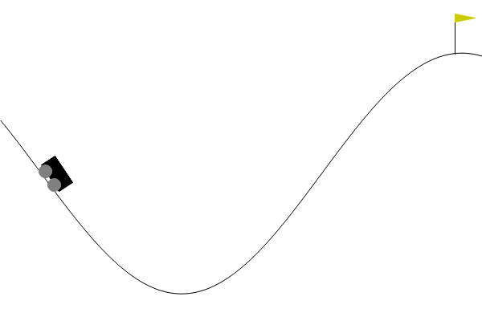

<h1 class="visually-hidden">Mountain Car</h1>
<div class="gn-env-banner">
<canvas class="gn-pixel" data-text="MOUNTAIN CAR" data-scale="6" data-color="#fcfcfc" data-shadow="#f83800"></canvas>
<canvas class="gn-pixel" data-text="CLASSIC CONTROL  3 ACTIONS  2 OBSERVATIONS" data-scale="2" data-color="#f8b800"></canvas>
</div>

<p class="gn-env-lead">Drive an underpowered car out of a valley to the flag on the right hill. The engine is too weak to climb the slope, so the car must rock back and forth to gather speed, and every step scores −1 until it arrives: a reward that says nothing about progress, which makes Mountain Car a classic test of exploration.</p>

<aside class="gn-infobox" aria-label="Mountain Car at a glance">
<video src="media/MountainCar-v0.episode.mp4" poster="media/MountainCar-v0.figure.png" autoplay muted loop playsinline disablepictureinpicture disableremoteplayback aria-label="MountainCar-v0, seed 4: the pumping rule swings the car back once and reaches the flag in 122 steps"></video>
<p class="gn-infobox-caption">The whole episode <code>examples/MountainCar</code> plays and records: the pumping rule, seed 4, 122 steps, return −122.</p>
<table>
<tr><td>Ids</td><td><code>MountainCar-v0</code> 200 steps</td></tr>
<tr><td>Action space</td><td><code>Discrete(3)</code></td></tr>
<tr><td>Observation space</td><td><code>Box([-1.2 -0.07], [0.6 0.07], (2,), float32)</code></td></tr>
<tr><td>Reward</td><td>−1 every step · solved at −110</td></tr>
<tr><td>Physics</td><td>the velocity, then the position, once a step (no time unit), float64</td></tr>
<tr><td>Render modes</td><td><code>human</code>, <code>rgb_array</code> · 600×400 · 30 fps</td></tr>
<tr><td>Make</td><td><code>Gymnasium.Make("MountainCar-v0")</code></td></tr>
<tr><td>Class</td><td><a href="xref:Gym.Environments.Envs.Classic.MountainCarEnv"><code>MountainCarEnv</code></a>, options <a href="xref:Gym.Environments.Envs.Classic.MountainCarEnvOptions"><code>MountainCarEnvOptions</code></a></td></tr>
<tr><td>Vector env</td><td>none of its own: <code>MakeVec</code> builds sync or async</td></tr>
<tr><td>Parity</td><td><span class="gn-badge gn-badge-ok">bit for bit</span><span class="gn-badge gn-badge-ok">pixel for pixel</span><br>with Gymnasium 1.4.0</td></tr>
<tr><td>Gymnasium</td><td><a href="https://gymnasium.farama.org/v1.4.0/environments/classic_control/mountain_car/">Mountain Car</a> in Gymnasium 1.4.0's docs</td></tr>
</table>
</aside>

## Description

A car sits at the bottom of a valley between two hills, and a flag stands on top of the right one. The agent drives
the car's engine: each step it accelerates left, right, or not at all. The engine is weak. Where a slope is steepest
the hill pulls the car back two and a half times harder than the engine can push, so a car driven straight at the
flag stalls low on the right slope. The car has to back up the left slope first and let the hill swing it across,
accelerating the way it already moves, as one pumps a swing.

Every step scores −1 until the car reaches the flag, and nothing tells the agent it is getting closer: it learns
something only once it has arrived. Random actions do not arrive: none of 1,000 seeded episodes of random actions
reached the flag within its 200 steps, so an agent that explores by acting at random sees the same −1 every step.

Andrew Moore studied a similar task in his 1990 PhD thesis. This exact form, with its constants, is Richard Sutton's
(1996), and Sutton and Barto's textbook made it the standard one (Example 10.1). Gym.NET's MountainCar computes
exactly what Gymnasium's does: the same float64 dynamics in the same operation order, the same float32 observations,
rewards, flags, warnings and errors, and the same pixels.

## Quick start

# [C#](#tab/csharp)

[!code-csharp[](../../../tests/Gym.Tests/Docs/EnvPageSamples/MountainCarSamples.cs?range=1-4,38-45&dedent=12)]

# [Python (Gymnasium)](#tab/python)

```python
import gymnasium as gym

env = gym.make("MountainCar-v0")
# [position, velocity], float32
observation, info = env.reset(seed=42)
# 0 accelerates left, 1 not at all, 2 right
action = env.action_space.sample()
observation, reward, terminated, truncated, info = env.step(action)
```

---

`dotnet add package Gym.NET.Environments`; the six longer examples are in [Code examples](#code-examples).

### Play it, or watch the agent

```bash
# from a clone of the repository: you drive, the arrow keys accelerate left and right
dotnet run --project examples/MountainCar -c Release -- --play
# the agent in the video plays it in a window
dotnet run --project examples/MountainCar -c Release -- --render
```

## How it works

<div class="gn-figure">

<svg viewBox="0 0 600 400" font-family="system-ui, sans-serif" font-size="14" role="img" aria-label="Labels: the car at x = −1.01 with velocity 0.0010, the hill's pull of 0.0025 and the pushes of plus and minus 0.001 a step, the flag at 0.5, the starting range from −0.6 to −0.4, the wall at −1.2, the hill's equation">
<defs><marker id="gn-mc-ag" viewBox="0 0 10 10" refX="9" refY="5" markerWidth="6" markerHeight="6" orient="auto-start-reverse"><path d="M0,0 L10,5 L0,10 z" fill="#1971c2"/></marker><marker id="gn-mc-ar" viewBox="0 0 10 10" refX="9" refY="5" markerWidth="6" markerHeight="6" orient="auto-start-reverse"><path d="M0,0 L10,5 L0,10 z" fill="#2f9e44"/></marker><marker id="gn-mc-al" viewBox="0 0 10 10" refX="9" refY="5" markerWidth="6" markerHeight="6" orient="auto-start-reverse"><path d="M0,0 L10,5 L0,10 z" fill="#e8590c"/></marker></defs>
<text x="48.8" y="176.6" fill="#c2189b">x = −1.01, v = 0.0010</text>
<line x1="100" y1="206" x2="159.7" y2="206" stroke="#1971c2" stroke-width="3" marker-end="url(#gn-mc-ag)"/><text x="167.7" y="211" fill="#1971c2">gravity: +0.0025</text>
<line x1="100" y1="230" x2="124" y2="230" stroke="#2f9e44" stroke-width="3" marker-end="url(#gn-mc-ar)"/><text x="132" y="235" fill="#2f9e44">2: +0.001</text>
<line x1="124" y1="254" x2="100" y2="254" stroke="#e8590c" stroke-width="3" marker-end="url(#gn-mc-al)"/><text x="132" y="259" fill="#e8590c">0: −0.001</text>
<line x1="566" y1="68" x2="566" y2="392" stroke="#999" stroke-dasharray="5 4"/><text x="416" y="34" fill="#777">x ≥ 0.5 ends it</text>
<path d="M 200,372 L 200,378 L 266.67,378 L 266.67,372" fill="none" stroke="#777" stroke-width="1.5"/><text x="233.3" y="394" fill="#777" text-anchor="middle">starts in [−0.6, −0.4], at rest</text>
<line x1="1" y1="0" x2="1" y2="400" stroke="#aaa" stroke-dasharray="6 5"/><text x="8" y="22" fill="#777">x = −1.2: the wall stops it</text>
<text x="350" y="330" fill="#868e96">the hill: y = 0.45 sin(3x) + 0.55</text>
</svg>
</div>
<p class="gn-figure-caption">Step 80 of the episode in the video, exactly as <code>Render()</code> returns it: the car has just turned at the top of its back-swing, x = −1.01, and starts to roll right. Here the hill pulls it right by 0.0025 a step, two and a half times what the engine adds. 333 pixels to a unit of x: the frame spans the track from −1.2 to 0.6.</p>

Each step first changes the velocity $v$ by the push of action $a \in \{0, 1, 2\}$ and the hill's pull, then moves the
position $x$ by the new velocity. With $F = 0.001$ (the force) and $g = 0.0025$ (the gravity):

$$
\begin{aligned}
v_{t+1} &= \operatorname{clip}\big(v_t + (a_t - 1)\,F - g\cos(3x_t),\ -0.07,\ 0.07\big)\\
x_{t+1} &= \operatorname{clip}\big(x_t + v_{t+1},\ -1.2,\ 0.6\big)
\end{aligned}
$$

When the car hits the left wall, $x_{t+1} = -1.2$ with $v_{t+1} < 0$, its velocity becomes 0: the collision is
inelastic. The right edge, 0.6, only clips the position, and the flag at 0.5 ends the episode before the car gets
there.

The hill is $y = 0.45\sin(3x) + 0.55$, but the dynamics never read its height, only its slope: the pull
$-g\cos(3x)$ is proportional to it. The pull is 0 at the valley's floor, $x = -\pi/6 \approx -0.52$, and at the top
of the right hill, $x = \pi/6 \approx 0.52$, just past the flag; it is strongest, $g$, where the hill is steepest: at
$x = 0$ on the right slope and at $x = -\pi/3 \approx -1.05$ on the left. The engine's $F$ is 40% of that, so from
rest the engine alone gets the car only partway up either slope: it has to swing. Gym.NET computes every term in float64, in Gymnasium's operation
order, so each state is bit for bit Gymnasium's; the observation is that state rounded to float32.

| Symbol | Property | Gymnasium | Default | Meaning |
|---|---|---|--:|---|
| $F$ | `Force` | `force` | 0.001 | The push of actions 0 and 2, a step |
| $g$ | `Gravity` | `gravity` | 0.0025 | The hill's pull where it is steepest, a step |
| | `MinPosition` | `min_position` | −1.2 | The left wall |
| | `MaxPosition` | `max_position` | 0.6 | The right edge |
| | `MaxSpeed` | `max_speed` | 0.07 | The velocity's limit, either way |
| | `GoalPosition` | `goal_position` | 0.5 | The flag |
| | `GoalVelocity` | `goal_velocity` | 0 | The speed needed at the flag (see [Arguments](#arguments)) |

> [!WARNING]
> `MountainCarEnv` is both MountainCars: `Power`, `MinAction` and `MaxAction` belong to MountainCarContinuous-v0's
> dynamics, and MountainCar-v0's steps never read them. The observation space keeps the bounds the constructor built
> from `MinPosition`, `MaxPosition` and `MaxSpeed`: changing them later moves the walls, the clip and the frame's scale,
> but not `ObservationSpace`, as in Gymnasium.

## Action space

`Discrete(3)`: which way the engine pushes. Its strength is always $F$.

| Action | Push | Change of velocity |
|---|---|---|
| 0 | Left | −0.001 |
| 1 | None | 0 |
| 2 | Right | +0.001 |

An action `Discrete(3)` does not contain raises `AssertionError`, as Gymnasium's `assert` does. Pass actions as
`Sample()` returns them, 0-d int64 arrays: in an unsigned type, 0 wraps around in $a - 1$ (a `uint8` 0 gives 255) and
pushes right 255 times as hard; Gymnasium's does the same, through NumPy.

## Observation space

A float32 `NDArray` of shape `(2,)`, the state rounded to float32:

| Index | Observation | Symbol | Min | Max | Ends the episode at |
|---|---|---|--:|--:|---|
| 0 | Position along the track | $x$ | −1.2 | 0.6 | ≥ 0.5, the flag |
| 1 | Velocity | $v$ | −0.07 | 0.07 | |

The bounds are the dynamics' clips, so from the default starting range every observation lies inside the space.

## Rewards

−1 for every step, the step that reaches the flag included: the return is minus the episode's length, from −200 when
the time limit cuts it short up to the fastest arrival. Nothing rewards height or speed, so only arriving sooner scores
better. The registry counts an average of −110 over 100 episodes as solved.

## Starting state

The position is drawn uniformly from [−0.6, −0.4) by the env's generator (NumPy's PCG64, so a seed gives Gymnasium's
starting state); the velocity is always 0. Reset options move the range: `low` and `high`, anything Python's
`float()` accepts. A range outside the track puts the car outside the observation space, as in Gymnasium. The
episode in the video starts at x = −0.411 (seed 4).

## Episode end

| Ends by | When |
|---|---|
| Termination | The car reaches the flag: $x \ge 0.5$ with $v \ge$ `goal_velocity` (0 by default) |
| Truncation | 200 steps: the `TimeLimit` that `Make` wraps around the env; `MountainCarEnv` itself never truncates |

## Arguments

By Gymnasium's name in `Make`'s kwargs, or by the C# name in the constructor and in
<xref:Gym.Environments.Envs.Classic.MountainCarEnvOptions>.

| Argument | Type and default | Effect |
|---|---|---|
| `render_mode`<br>`renderMode` | `string?` or `RenderMode`<br>`null` | `"human"` opens a window; `"rgb_array"` makes `Render()` return the frame |
| `goal_velocity`<br>`goalVelocity` | `double`<br>`0` | The speed the car must have at the flag to end the episode; above 0 it must arrive moving |
| (Gym.NET)<br>`continuous` | `bool`<br>`false` | MountainCarContinuous-v0's dynamics, flag and reward: `Make("MountainCarContinuous-v0")` sets it |
| (Gym.NET)<br>`viewerFactory` | `EnvViewerFactory?`<br>`null` | The window for `human`: Avalonia, WinForms, or headless |


# [C#](#tab/csharp)

[!code-csharp[](../../../tests/Gym.Tests/Docs/EnvPageSamples/MountainCarSamples.cs#Arguments)]

# [Python (Gymnasium)](#tab/python)

```python
env = gym.make("MountainCar-v0", render_mode="rgb_array", goal_velocity=0.05)
```

---

The constants are settable properties of the unwrapped env (the table in [How it works](#how-it-works)).

## Info

Always empty, `{}`, as Gymnasium's; MountainCar has no typed info record.

## Rendering

| Mode | What you get |
|---|---|
| `rgb_array` | `Render()` returns the frame: `(400, 600, 3)` uint8, Gymnasium's pixels; `(Image)result` converts it |
| `human` | A window from the viewer factory, drawn after every reset and step, paced at 30 frames a second |
| none | `Render()` warns and returns nothing, as Gymnasium's does |

The frame: white, the hill as a black anti-aliased line through 100 points, a black 40×20 px car tilted by
$\cos(3x)$ radians (Gymnasium's stand-in for the slope's angle) on two grey wheels, and a yellow flag on a 50 px pole
at x = 0.5; 333 pixels to a unit of x, so the frame spans the track from −1.2 to 0.6. Drawn with SDL_gfx's
anti-aliased polygons and circles and pygame's anti-aliased lines, as pygame draws them.

## Episode anatomy

The whole episode, step by step: where the car is, how fast it moves, which way each step pushed. The video has one
frame per step, and the cursor follows it. Pushing right from the start, the car climbs only to −0.361 before the
hill stops it (step 38). The rule turns with it, and the car swings up the left slope to −1.014 (step 79). From there
the engine and the hill pull the same way: the car crosses the valley's floor at step 97, reaches its top speed,
0.051, at step 100, and carries over the right hill to the flag after 122 steps.

<div class="gn-anatomy" data-trace="media/MountainCar-v0.episode.json">
<div><video src="media/MountainCar-v0.episode.mp4" poster="media/MountainCar-v0.figure.png" autoplay muted loop playsinline disablepictureinpicture disableremoteplayback aria-label="MountainCar-v0, seed 4, the episode the chart follows"></video><div class="gn-anatomy-readout" aria-live="off"></div></div>
<div><div class="gn-anatomy-chart"></div><div class="gn-anatomy-legend"></div></div>
<script type="application/json" class="gn-anatomy-spec">{"label":"MountainCar-v0, seed 4: the car's position and velocity, and each push","bands":[{"height":110,"range":[-1.25,0.65],"ticks":[-1.2,-0.5,0.5],"series":[{"column":"position","color":"#3cbcfc","name":"the car's position (the flag at 0.5)"}]},{"height":70,"range":[-0.07,0.07],"ticks":[-0.07,0,0.07],"series":[{"column":"velocity","color":"#ff7fe3","name":"its velocity"}]},{"label":"push","strip":{"column":"action","colors":{"0":"#5c636a","1":"#343a40","2":"#f8b800"},"name":"each push: right in gold, left in grey"}}],"readout":[{"label":"step","column":"@step"},{"label":"x","column":"position","digits":3},{"label":"v","column":"velocity","digits":4},{"label":"next push","column":"action","map":{"0":"left","1":"none","2":"right"}},{"label":"return so far","column":"@return","digits":0}]}</script>
</div>

## Code examples

### Run an episode

# [C#](#tab/csharp)

[!code-csharp[](../../../tests/Gym.Tests/Docs/EnvPageSamples/MountainCarSamples.cs#RunAnEpisode)]

# [Python (Gymnasium)](#tab/python)

```python
import gymnasium as gym

env = gym.make("MountainCar-v0")
observation, info = env.reset(seed=4)
episode_return = 0.0
while True:
    # accelerate the way the car moves: right (2) or left (0)
    action = 2 if observation[1] >= 0 else 0
    observation, reward, terminated, truncated, info = env.step(action)
    episode_return += reward
    if terminated or truncated:
        break
print(f"return {episode_return}")  # -122.0: the flag in 122 steps
```

---

### Start elsewhere

# [C#](#tab/csharp)

[!code-csharp[](../../../tests/Gym.Tests/Docs/EnvPageSamples/MountainCarSamples.cs#StartElsewhere)]

# [Python (Gymnasium)](#tab/python)

```python
observation, info = env.reset(seed=123, options={"low": -0.7, "high": 0.5})
# [0.11882224, 0.]: the position drawn from [-0.7, 0.5)
```

---

### Change the physics

# [C#](#tab/csharp)

[!code-csharp[](../../../tests/Gym.Tests/Docs/EnvPageSamples/MountainCarSamples.cs#ChangePhysics)]

# [Python (Gymnasium)](#tab/python)

```python
env.unwrapped.force = 0.003  # stronger than the hill: it drives straight up
```

---

### Save a frame

# [C#](#tab/csharp)

[!code-csharp[](../../../tests/Gym.Tests/Docs/EnvPageSamples/MountainCarSamples.cs#SaveFrame)]

# [Python (Gymnasium)](#tab/python)

```python
from PIL import Image

env = gym.make("MountainCar-v0", render_mode="rgb_array")
env.reset(seed=4)
Image.fromarray(env.render()).save("mountaincar.png")
```

---

### A grid for tabular learning

# [C#](#tab/csharp)

[!code-csharp[](../../../tests/Gym.Tests/Docs/EnvPageSamples/MountainCarSamples.cs#TabularGrid)]

# [Python (Gymnasium)](#tab/python)

```python
from gymnasium.wrappers import DiscretizeObservation

# 10 bins of position times 10 of velocity: one of 100 cells
env = DiscretizeObservation(gym.make("MountainCar-v0"), bins=10)
print(env.observation_space)  # Discrete(100)
cell, info = env.reset(seed=42)  # 45
```

---

### Many cars at once

# [C#](#tab/csharp)

[!code-csharp[](../../../tests/Gym.Tests/Docs/EnvPageSamples/MountainCarSamples.cs#ManyCars)]

# [Python (Gymnasium)](#tab/python)

```python
# No vector env of its own: make_vec steps 8 envs in turn ("sync")
envs = gym.make_vec("MountainCar-v0", num_envs=8, vectorization_mode="sync")
observations, infos = envs.reset(seed=42)
for t in range(200):
    actions = envs.action_space.sample()  # one per car
    # finished cars reset themselves
    observations, rewards, terminations, truncations, infos = envs.step(actions)
```

---

Every C# example is a test in `tests/Gym.Tests/Docs/EnvPageSamples`, compiled and run by the unit gate; where a
comment states a number, the test checks it.

## Agents and examples

- **The video's agent** is one rule: accelerate the way the car moves, right (2) when $v \ge 0$ and left (0)
  otherwise. Each push adds energy, as pumping a swing does. Seed 4: 122 steps, return −122. From seeds 0 to 99 it
  always reaches the flag, in 113 to 124 steps (a mean return of −120.02), short of the registry's −110.
- **[examples/MountainCar](https://github.com/SciSharp/Gym.NET/tree/master/examples/MountainCar)**
  ([`MountainCarProgram.cs`](https://github.com/SciSharp/Gym.NET/blob/master/examples/MountainCar/MountainCarProgram.cs))
  plays that rule: `dotnet run --project examples/MountainCar -c Release` plays seed 4 headless, `--seed N` another
  seed, `--episodes N` that many seeds and their mean, `--render` in a window.
- **Play it yourself**: `--play` hands the car to the keyboard: <kbd>←</kbd> accelerates left, <kbd>→</kbd> right,
  and with no key held the car coasts.
- **This page's video and chart** are the example's own episode:
  `--record docs/environments/classic_control/media` records it with `RecordVideo` (one frame per step) and writes the
  step trace and the figure beside it.

## Vectorized environment

MountainCar registers no vector env of its own. `Gymnasium.MakeVec("MountainCar-v0", n)` builds a `SyncVectorEnv`
that steps `n` separate envs in turn, and `VectorizeMode.Async` an `AsyncVectorEnv` that steps them on worker threads;
each env resets itself after its episode ends (next-step autoreset), as Gymnasium's.

## Variants

[Mountain Car Continuous](mountain_car_continuous.md), MountainCarContinuous-v0, has its own page, as in Gymnasium:
the same valley with a continuous engine, a force in [−1, 1], the flag at 0.45 and a reward of 100 for reaching it,
less 0.1 times the squared force every step. Gym.NET builds both ids from one class, `MountainCarEnv`, whose
`Continuous` tells them apart.

## Parity with Gymnasium

Gymnasium 1.4.0 runs inside the test process and both are compared value by value:

| What is compared | How | Result |
|---|---|---|
| Reset: observations, generator state | seeded resets, reset options and their errors | ✓ equal |
| Dynamics: observations, rewards, flags | episodes of sampled actions; the pumping rule through the flag and past it; `goal_velocity`; unsigned actions | ✓ bit for bit |
| Injected states | both walls, the flag, the speed limits, −0.0, NaN; malformed states | ✓ same values, same errors |
| Actions and errors | invalid actions, a step or a render before the first reset | ✓ same messages |
| Spaces, metadata, `repr` | both spaces, render modes, fps, `<MountainCarEnv<MountainCar-v0>>` | ✓ |
| Frames | `rgb_array` along episodes and at injected states | ✓ pixel for pixel |
| `make`'s stack, registration, goldens | the wrapper order through truncation, the spec, a golden episode replayed without Python | ✓ |
| Gymnasium's own checkers on Gym.NET's env | `check_env`, `check_environments_match` | ✓ |
| Wrappers over it | `DiscretizeObservation`, `RescaleObservation`, `MaxAndSkipObservation`, `play`'s key mapping | ✓ |

The tests: [MountainCarLiveParityTests](https://github.com/SciSharp/Gym.NET/blob/master/tests/Gym.Tests.Parity/Tests/Envs/MountainCarLiveParityTests.cs),
[EnvCoverageLiveParityTests](https://github.com/SciSharp/Gym.NET/blob/master/tests/Gym.Tests.Parity/Tests/Envs/EnvCoverageLiveParityTests.cs),
[GymnasiumToolsLiveParityTests](https://github.com/SciSharp/Gym.NET/blob/master/tests/Gym.Tests.Parity/Tests/Bridge/GymnasiumToolsLiveParityTests.cs),
[TransformWrappersLiveParityTests](https://github.com/SciSharp/Gym.NET/blob/master/tests/Gym.Tests.Parity/Tests/Wrappers/TransformWrappersLiveParityTests.cs).

## Performance

| | Steps a second | Bytes a step |
|---|--:|--:|
| Gym.NET | 145,364 | 3,192 |
| Gymnasium | 43,440 | |

3.3× faster. Random actions, observations disposed; .NET 10 in Release against CPython 3.12 with the pinned NumPy; the
medians of interleaved rounds on one machine (2026-11-11).

## Reference sources

- [gymnasium/envs/classic_control/mountain_car.py](https://github.com/Farama-Foundation/Gymnasium/blob/8ba8c3a63bb4e000b7f33923f43d292acac07be1/gymnasium/envs/classic_control/mountain_car.py),
  Gymnasium 1.4.0: the environment (spaces, dynamics, reward, termination, reset, rendering, the key mapping).
- [gymnasium/envs/classic_control/utils.py](https://github.com/Farama-Foundation/Gymnasium/blob/8ba8c3a63bb4e000b7f33923f43d292acac07be1/gymnasium/envs/classic_control/utils.py):
  `maybe_parse_reset_bounds`, the reset options.
- [SDL_gfxPrimitives.c](https://github.com/pygame-community/pygame-ce/blob/2.5.8/src_c/SDL_gfx/SDL_gfxPrimitives.c)
  (SDL_gfx 2.0.26 as pygame-ce 2.5.8 ships it): `aapolygon`, `filled_polygon`, `aacircle`, `filled_circle`, `vline`,
  in Gym.Rendering's `GfxDraw`; pygame-ce's [draw.c](https://github.com/pygame-community/pygame-ce/blob/2.5.8/src_c/draw.c)
  for `aalines`, the hill, and [transform.c](https://github.com/pygame-community/pygame-ce/blob/2.5.8/src_c/transform.c) for `flip`.
- [gymnasium/utils/seeding.py](https://github.com/Farama-Foundation/Gymnasium/blob/8ba8c3a63bb4e000b7f33923f43d292acac07be1/gymnasium/utils/seeding.py):
  the env's generator, NumPy's PCG64, which NumSharp reproduces for the starting state.

## Version history

| Version | Change |
|---|---|
| MountainCar-v0 | Gymnasium's only version, the first release |
| Gym.NET 1.0.0 | New: Gymnasium 1.4.0's MountainCar, bit for bit; 0.2.0 had no MountainCar |

## References

1. A. W. Moore, *Efficient Memory-based Learning for Robot Control*, PhD thesis, University of Cambridge, 1990;
   Computer Laboratory Technical Report UCAM-CL-TR-209.
   [PDF](https://www.cl.cam.ac.uk/techreports/UCAM-CL-TR-209.pdf)
2. R. S. Sutton, "Generalization in reinforcement learning: successful examples using sparse coarse coding",
   *Advances in Neural Information Processing Systems 8*, MIT Press, 1996, pp. 1038–1044: the form Gymnasium uses.
   [NeurIPS](https://proceedings.neurips.cc/paper_files/paper/1995/hash/8f1d43620bc6bb580df6e80b0dc05c48-Abstract.html)
3. R. S. Sutton and A. G. Barto, *Reinforcement Learning: An Introduction*, 2nd edition, MIT Press, 2018,
   Example 10.1, "Mountain Car Task". [The book](http://incompleteideas.net/book/the-book-2nd.html)

## External links

- [Mountain Car on Gymnasium's site](https://gymnasium.farama.org/v1.4.0/environments/classic_control/mountain_car/) (1.4.0)
- [MountainCarEnv.cs](https://github.com/SciSharp/Gym.NET/blob/master/src/Gym.Environments/Envs/Classic/MountainCarEnv.cs) on GitHub
- [examples/MountainCar](https://github.com/SciSharp/Gym.NET/tree/master/examples/MountainCar)
- [Mountain car problem](https://en.wikipedia.org/wiki/Mountain_car_problem) on Wikipedia

## API reference

<xref:Gym.Environments.Envs.Classic.MountainCarEnv> · <xref:Gym.Environments.Envs.Classic.MountainCarEnvOptions>
