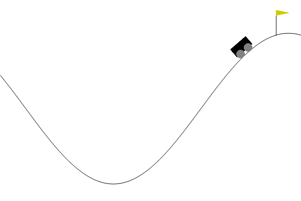

<h1 class="visually-hidden">Mountain Car Continuous</h1>
<div class="gn-env-banner">
<canvas class="gn-pixel" data-text="MOUNTAIN CAR&#10;CONTINUOUS" data-scale="6" data-color="#fcfcfc" data-shadow="#f83800"></canvas>
<canvas class="gn-pixel" data-text="CLASSIC CONTROL  1 ACTION  2 OBSERVATIONS" data-scale="2" data-color="#f8b800"></canvas>
</div>

<p class="gn-env-lead">Mountain Car with a throttle: each step sets the engine's force anywhere between −1 and 1. Reaching the flag pays 100 and every push costs fuel, so the agent must swing the car up the slopes without burning the reward away, and an agent that never finds the flag learns that standing still costs least.</p>

<aside class="gn-infobox" aria-label="Mountain Car Continuous at a glance">
<video src="media/MountainCarContinuous-v0.episode.mp4" poster="media/MountainCarContinuous-v0.figure.png" autoplay muted loop playsinline disablepictureinpicture disableremoteplayback aria-label="MountainCarContinuous-v0, seed 4: the left-first pumping rule backs the car into the left wall and reaches the flag in 78 steps"></video>
<p class="gn-infobox-caption">The whole episode <code>examples/MountainCarContinuous</code> plays and records: the left-first pumping rule at full force, seed 4, 78 steps, return 92.2.</p>
<table>
<tr><td>Ids</td><td><code>MountainCarContinuous-v0</code> 999 steps</td></tr>
<tr><td>Action space</td><td><code>Box(-1.0, 1.0, (1,), float32)</code></td></tr>
<tr><td>Observation space</td><td><code>Box([-1.2 -0.07], [0.6 0.07], (2,), float32)</code></td></tr>
<tr><td>Reward</td><td>100 at the flag, −0.1 × force² every step · solved at 90</td></tr>
<tr><td>Physics</td><td>the velocity, then the position, once a step (no time unit); float32 after the first step, as NumPy computes it</td></tr>
<tr><td>Render modes</td><td><code>human</code>, <code>rgb_array</code> · 600×400 · 30 fps</td></tr>
<tr><td>Make</td><td><code>Gymnasium.Make(<wbr>"MountainCarContinuous-v0")</code></td></tr>
<tr><td>Class</td><td><a href="xref:Gym.Environments.Envs.Classic.MountainCarEnv"><code>MountainCarEnv</code></a> with <code>continuous: true</code>, options <a href="xref:Gym.Environments.Envs.Classic.MountainCarEnvOptions"><code>MountainCarEnvOptions</code></a></td></tr>
<tr><td>Vector env</td><td>none of its own: <code>MakeVec</code> builds sync or async</td></tr>
<tr><td>Parity</td><td><span class="gn-badge gn-badge-ok">bit for bit</span><span class="gn-badge gn-badge-ok">pixel for pixel</span><br>with Gymnasium 1.4.0</td></tr>
<tr><td>Gymnasium</td><td><a href="https://gymnasium.farama.org/v1.4.0/environments/classic_control/mountain_car_continuous/">Mountain Car Continuous</a> in Gymnasium 1.4.0's docs</td></tr>
</table>
</aside>

## Description

The valley of [Mountain Car](mountain_car.md), with three changes. The engine takes a force anywhere in [−1, 1]
instead of three choices; the flag stands at 0.45 instead of 0.5; and the reward is 100 for reaching the flag, less
0.1 times the squared force for every step. A full push changes the velocity by 0.0015 a step, half again as much as
Mountain Car's 0.001, but the hill still pulls back by up to 0.0025, so the car still has to swing.

The reward turns the task into a trade. A car that never moves scores 0 over the 999 steps; one that reaches the flag
scores 100 less its fuel. Random forces reached the flag in only 2 of 1,000 seeded episodes and averaged −33.10, so
an agent that explores at random and has not found the flag yet learns that the best thing to do is nothing.

The task is Andrew Moore's (1990) in the form Richard Sutton gave it (1996). Olivier Sigaud wrote this continuous
version for Gym, merging Gym's Mountain Car with José Antonio Martín H.'s from his FAReinforcement library, as Tom Schaul
and then Arnaud de Broissia adapted it; the flag at 0.45 is de Broissia's. Gym.NET's MountainCarContinuous computes
exactly what Gymnasium's does, down to NumPy's float32 arithmetic: the same observations, rewards, flags, warnings and
errors, and the same pixels.

## Quick start

# [C#](#tab/csharp)

[!code-csharp[](../../../tests/Gym.Tests/Docs/EnvPageSamples/MountainCarContinuousSamples.cs?range=1-4,38-44&dedent=12)]

# [Python (Gymnasium)](#tab/python)

```python
import gymnasium as gym

env = gym.make("MountainCarContinuous-v0")
# [position, velocity], float32
observation, info = env.reset(seed=42)
# one float32 force in [-1, 1]
action = env.action_space.sample()
observation, reward, terminated, truncated, info = env.step(action)
```

---

`dotnet add package Gym.NET.Environments`; the six longer examples are in [Code examples](#code-examples).

### Play it, or watch the agent

```bash
# from a clone of the repository: you drive, the arrow keys push left and right at full force
dotnet run --project examples/MountainCarContinuous -c Release -- --play
# the agent in the video plays it in a window
dotnet run --project examples/MountainCarContinuous -c Release -- --render
```

## How it works

<div class="gn-figure">

<svg viewBox="0 0 600 400" font-family="system-ui, sans-serif" font-size="14" role="img" aria-label="Labels: the car at x = 0.26 with velocity 0.0630, the hill's pull of −0.0018 and the full push of plus 0.0015 a step, the flag at 0.45 paying 100, the wall at −1.2 that stopped this car at step 44, the starting range, the hill's equation and the fuel's cost">
<defs><marker id="gn-mcc-ag" viewBox="0 0 10 10" refX="9" refY="5" markerWidth="6" markerHeight="6" orient="auto-start-reverse"><path d="M0,0 L10,5 L0,10 z" fill="#1971c2"/></marker><marker id="gn-mcc-ar" viewBox="0 0 10 10" refX="9" refY="5" markerWidth="6" markerHeight="6" orient="auto-start-reverse"><path d="M0,0 L10,5 L0,10 z" fill="#2f9e44"/></marker></defs>
<text x="330.8" y="64" fill="#c2189b">x = 0.26, v = 0.0630</text>
<line x1="452" y1="96" x2="409.6" y2="96" stroke="#1971c2" stroke-width="3" marker-end="url(#gn-mcc-ag)"/><text x="401.6" y="101" fill="#1971c2" text-anchor="end">gravity: −0.0018</text>
<line x1="416" y1="120" x2="452" y2="120" stroke="#2f9e44" stroke-width="3" marker-end="url(#gn-mcc-ar)"/><text x="408" y="125" fill="#2f9e44" text-anchor="end">a = +1: +0.0015</text>
<line x1="550" y1="71" x2="550" y2="392" stroke="#999" stroke-dasharray="5 4"/><text x="540" y="34" fill="#777" text-anchor="end">x ≥ 0.45 ends it: +100</text>
<path d="M 200,372 L 200,378 L 266.67,378 L 266.67,372" fill="none" stroke="#777" stroke-width="1.5"/><text x="233.3" y="394" fill="#777" text-anchor="middle">starts in [−0.6, −0.4], at rest</text>
<line x1="1" y1="0" x2="1" y2="400" stroke="#aaa" stroke-dasharray="6 5"/><text x="8" y="22" fill="#777">x = −1.2: the wall stopped this car at step 44</text>
<text x="350" y="330" fill="#868e96">the hill: y = 0.45 sin(3x) + 0.55</text>
<text x="350" y="352" fill="#868e96">every step costs 0.1 a²</text>
</svg>
</div>
<p class="gn-figure-caption">Step 75 of the episode in the video, exactly as <code>Render()</code> returns it: the car climbs the right slope at 0.063 a step, three steps from the flag. The full push adds 0.0015 a step while the hill takes 0.0018, so the car slows a little, but its speed carries it over. 333 pixels to a unit of x: the frame spans the track from −1.2 to 0.6.</p>

Each step clips the action $a$ to a force $f$, changes the velocity $v$ by the push and the hill's pull, then moves the
position $x$ by the new velocity. With $P = 0.0015$ (the power) and the hill's $0.0025$:

$$
\begin{aligned}
f_t &= \operatorname{clip}(a_t,\ -1,\ 1)\\
v_{t+1} &= \operatorname{clip}\big(v_t + P f_t - 0.0025\cos(3x_t),\ -0.07,\ 0.07\big)\\
x_{t+1} &= \operatorname{clip}\big(x_t + v_{t+1},\ -1.2,\ 0.6\big)
\end{aligned}
$$

and the reward charges the action as given, before the clip:

$$
r_t = 100\,[\,x_{t+1} \ge 0.45 \text{ and } v_{t+1} \ge v_{\text{goal}}\,] - 0.1\,a_t^2
$$

When the car hits the left wall, $x_{t+1} = -1.2$ with $v_{t+1} < 0$, its velocity becomes 0, as in Mountain Car.
The pull is the same hill's: 0 at the valley's floor, $x = -\pi/6 \approx -0.52$, and strongest, 0.0025, at $x = 0$ on
the right slope and $x = -\pi/3 \approx -1.05$ on the left. A full push is 60% of that.

The arithmetic follows NumPy's types. After a reset the state is float64; after a step Gymnasium stores it as a
float32 array, and each operation of the next step promotes by NumPy's rules (NEP 50): a float32 state with a Python
float stays float32, so the velocity's sum and the test $x \ge 0.45$ are float32. Gym.NET keeps the state as the
scalars Python holds and computes every operation in the precision Gymnasium's does, so each state is bit for bit
Gymnasium's.

| Symbol | Property | Gymnasium | Default | Meaning |
|---|---|---|--:|---|
| $P$ | `Power` | `power` | 0.0015 | The velocity a full push adds, a step |
| | `MinAction` | `min_action` | −1.0 | The force's lower clip |
| | `MaxAction` | `max_action` | 1.0 | The force's upper clip |
| | `MinPosition` | `min_position` | −1.2 | The left wall |
| | `MaxPosition` | `max_position` | 0.6 | The right edge |
| | `MaxSpeed` | `max_speed` | 0.07 | The velocity's limit, either way |
| | `GoalPosition` | `goal_position` | 0.45 | The flag |
| | `GoalVelocity` | `goal_velocity` | 0 | The speed needed at the flag (see [Arguments](#arguments)) |

> [!WARNING]
> The hill's 0.0025 is a literal in Gymnasium's continuous step, not its `gravity`: `Gravity` and `Force` belong to
> MountainCar-v0, and setting them changes nothing here. The spaces keep the bounds the constructor built: changing
> `MinAction` or `MaxAction` moves the clip but not `ActionSpace`, and changing the positions or `MaxSpeed` moves the
> walls, the clip and the frame but not `ObservationSpace`, as in Gymnasium.

## Action space

`Box(-1.0, 1.0, (1,), float32)`: one force. Positive pushes right.

| Index | Action | Min | Max | Change of velocity |
|---|---|--:|--:|---|
| 0 | The engine's force | −1 | 1 | The clipped force × 0.0015 |

A force outside [−1, 1] is clipped for the push but charged in full: a force of 2 pushes like 1 and costs 0.4, four
times as much ([Clip the force](#clip-the-force) shows the wrapper that prevents it). Like Gymnasium's, the env
checks nothing: a float32 or float64 force keeps its precision through the arithmetic and an integer or boolean one
computes in float64, as NumPy's scalars do; only the first element counts. A 0-d or empty action raises `IndexError`
with NumPy's message. Gym.NET refuses with `NotSupportedException` what it does not model, an action of more than one
dimension or of a float16 or complex dtype, where Gymnasium would compute something else.

## Observation space

A float32 `NDArray` of shape `(2,)`, the state rounded to float32 (after a step, the state itself):

| Index | Observation | Symbol | Min | Max | Ends the episode at |
|---|---|---|--:|--:|---|
| 0 | Position along the track | $x$ | −1.2 | 0.6 | ≥ 0.45, the flag |
| 1 | Velocity | $v$ | −0.07 | 0.07 | |

The bounds are the dynamics' clips, so from the default starting range every observation lies inside the space.

## Rewards

Every step costs 0.1 times the square of the force as given, the step that reaches the flag included, and that step
also pays 100. The return is 100 less the fuel when the car arrives, and minus the fuel when the time limit stops it
first. At full force every step costs 0.1, so the registry's "solved", an average of 90 over 100 episodes, means
arriving within 100 steps; gentler pushes cost less but take longer.

## Starting state

The position is drawn uniformly from [−0.6, −0.4) by the env's generator (NumPy's PCG64, so a seed gives Gymnasium's
starting state), with the velocity 0: the same draw as Mountain Car's, so a seed starts both cars at the same place.
Reset options move the range: `low` and `high`, anything Python's `float()` accepts. A range outside the track puts
the car outside the observation space, as in Gymnasium. The episode in the video starts at x = −0.411 (seed 4).

## Episode end

| Ends by | When |
|---|---|
| Termination | The car reaches the flag: $x \ge 0.45$ with $v \ge$ `goal_velocity` (0 by default) |
| Truncation | 999 steps: the `TimeLimit` that `Make` wraps around the env; `MountainCarEnv` itself never truncates |

## Arguments

By Gymnasium's name in `Make`'s kwargs, or by the C# name in the constructor and in
<xref:Gym.Environments.Envs.Classic.MountainCarEnvOptions>.

| Argument | Type and default | Effect |
|---|---|---|
| `render_mode`<br>`renderMode` | `string?` or `RenderMode`<br>`null` | `"human"` opens a window; `"rgb_array"` makes `Render()` return the frame |
| `goal_velocity`<br>`goalVelocity` | `double`<br>`0` | The speed the car must have at the flag to end the episode; above 0 it must arrive moving |
| (Gym.NET)<br>`continuous` | `bool`<br>`false` | This env's dynamics, flag and reward; the id's registration sets it to `true`, and `false` builds MountainCar-v0 |
| (Gym.NET)<br>`viewerFactory` | `EnvViewerFactory?`<br>`null` | The window for `human`: Avalonia, WinForms, or headless |

[!code-csharp[](../../../tests/Gym.Tests/Docs/EnvPageSamples/MountainCarContinuousSamples.cs#Arguments)]

An options record given to `Make` need not set `Continuous`: the id's registered `continuous: true` stays. The
constants are settable properties of the unwrapped env (the table in [How it works](#how-it-works)).

## Info

Always empty, `{}`, as Gymnasium's; MountainCarContinuous has no typed info record.

## Rendering

| Mode | What you get |
|---|---|
| `rgb_array` | `Render()` returns the frame: `(400, 600, 3)` uint8, Gymnasium's pixels; `(Image)result` converts it |
| `human` | A window from the viewer factory, drawn after every reset and step, paced at 30 frames a second |
| none | `Render()` warns and returns nothing, as Gymnasium's does |

Mountain Car's frame, with the flag at x = 0.45: white, the hill as a black anti-aliased line through 100 points, a
black 40×20 px car tilted by $\cos(3x)$ radians on two grey wheels, and a yellow flag on a 50 px pole; 333 pixels to a
unit of x. After a step the car's coordinates are computed from the float32 state in float32, as in Gymnasium. Drawn
with SDL_gfx's anti-aliased polygons and circles and pygame's anti-aliased lines, as pygame draws them.

## Episode anatomy

The whole episode, step by step: where the car is, how fast it moves, which way each step pushed. The video has one
frame per step, and the cursor follows it. The rule pushes left from rest, and the car rolls back across the valley and
up the left slope until the wall stops it at step 44. From there it pushes right: the car crosses the valley's floor
at step 64, reaches 0.069 at step 67, near the speed limit, and carries over to the flag after 78 steps. Every step
costs 0.1; the last one also pays 100, so the return is 92.2.

<div class="gn-anatomy" data-trace="media/MountainCarContinuous-v0.episode.json">
<div><video src="media/MountainCarContinuous-v0.episode.mp4" poster="media/MountainCarContinuous-v0.figure.png" autoplay muted loop playsinline disablepictureinpicture disableremoteplayback aria-label="MountainCarContinuous-v0, seed 4, the episode the chart follows"></video><div class="gn-anatomy-readout" aria-live="off"></div></div>
<div><div class="gn-anatomy-chart"></div><div class="gn-anatomy-legend"></div></div>
<script type="application/json" class="gn-anatomy-spec">{"label":"MountainCarContinuous-v0, seed 4: the car's position and velocity, and each push","bands":[{"height":110,"range":[-1.25,0.65],"ticks":[-1.2,-0.5,0.45],"series":[{"column":"position","color":"#3cbcfc","name":"the car's position (the flag at 0.45)"}]},{"height":70,"range":[-0.07,0.07],"ticks":[-0.07,0,0.07],"series":[{"column":"velocity","color":"#ff7fe3","name":"its velocity"}]},{"label":"force","strip":{"column":"force","colors":{"-1":"#5c636a","1":"#f8b800"},"name":"each force: +1 in gold, −1 in grey"}}],"readout":[{"label":"step","column":"@step"},{"label":"x","column":"position","digits":3},{"label":"v","column":"velocity","digits":4},{"label":"next force","column":"force","digits":1},{"label":"return so far","column":"@return","digits":1}]}</script>
</div>

## Code examples

### Run an episode

# [C#](#tab/csharp)

[!code-csharp[](../../../tests/Gym.Tests/Docs/EnvPageSamples/MountainCarContinuousSamples.cs#RunAnEpisode)]

# [Python (Gymnasium)](#tab/python)

```python
import gymnasium as gym
import numpy as np

env = gym.make("MountainCarContinuous-v0")
observation, info = env.reset(seed=4)
episode_return = 0.0
steps = 0
while True:
    # full force the way the car moves; left while it is at rest
    force = 1.0 if observation[1] > 0 else -1.0
    action = np.array([force], dtype=np.float32)
    observation, reward, terminated, truncated, info = env.step(action)
    episode_return += reward
    steps += 1
    if terminated or truncated:
        break
# 78 steps, return 92.2: the flag's 100 less 0.1 a step for fuel
print(f"{steps} steps, return {episode_return:.1f}")
```

---

### Start elsewhere

# [C#](#tab/csharp)

[!code-csharp[](../../../tests/Gym.Tests/Docs/EnvPageSamples/MountainCarContinuousSamples.cs#StartElsewhere)]

# [Python (Gymnasium)](#tab/python)

```python
observation, info = env.reset(seed=123, options={"low": -0.7, "high": -0.5})
# [-0.5635296, 0.]: the position drawn from [-0.7, -0.5)
```

---

### Change the physics

# [C#](#tab/csharp)

[!code-csharp[](../../../tests/Gym.Tests/Docs/EnvPageSamples/MountainCarContinuousSamples.cs#ChangePhysics)]

# [Python (Gymnasium)](#tab/python)

```python
env.unwrapped.power = 0.003  # stronger than the hill: it drives straight up
```

---

### Save a frame

# [C#](#tab/csharp)

[!code-csharp[](../../../tests/Gym.Tests/Docs/EnvPageSamples/MountainCarContinuousSamples.cs#SaveFrame)]

# [Python (Gymnasium)](#tab/python)

```python
from PIL import Image

env = gym.make("MountainCarContinuous-v0", render_mode="rgb_array")
env.reset(seed=4)
Image.fromarray(env.render()).save("mountaincarcontinuous.png")
```

---

### Clip the force

# [C#](#tab/csharp)

[!code-csharp[](../../../tests/Gym.Tests/Docs/EnvPageSamples/MountainCarContinuousSamples.cs#ClipTheForce)]

# [Python (Gymnasium)](#tab/python)

```python
from gymnasium.wrappers import ClipAction

env = gym.make("MountainCarContinuous-v0")
clipped = ClipAction(gym.make("MountainCarContinuous-v0"))
too_strong = np.array([2.0], dtype=np.float32)
env.reset(seed=42)
clipped.reset(seed=42)
raw = env.step(too_strong)  # pushes as 1, costs as 2
fixed_up = clipped.step(too_strong)  # clipped to 1 first
print(raw[1], fixed_up[1])  # -0.4 -0.1
```

---

### Many cars at once

# [C#](#tab/csharp)

[!code-csharp[](../../../tests/Gym.Tests/Docs/EnvPageSamples/MountainCarContinuousSamples.cs#ManyCars)]

# [Python (Gymnasium)](#tab/python)

```python
# No vector env of its own: make_vec steps 8 envs in turn ("sync")
envs = gym.make_vec("MountainCarContinuous-v0", num_envs=8,
                    vectorization_mode="sync")
observations, infos = envs.reset(seed=42)
for t in range(200):
    actions = envs.action_space.sample()  # (8, 1) forces
    # finished cars reset themselves
    observations, rewards, terminations, truncations, infos = envs.step(actions)
```

---

Every C# example is a test in `tests/Gym.Tests/Docs/EnvPageSamples`, compiled and run by the unit gate; where a
comment states a number, the test checks it.

## Agents and examples

- **The video's agent** is one rule: full force the way the car moves, +1 when $v > 0$ and −1 otherwise, so a car at
  rest is pushed left, away from the flag, where the slope gives it room to gather speed. Seed 4: 78 steps, return
  92.2. From seeds 0 to 99 it always reaches the flag, in 75 to 86 steps, a mean return of 92.03: above the registry's
  90. Pushing right from rest instead, as Mountain Car's rule does, wastes the first swing: 105 to 111 steps, a mean
  of 89.37. Gentler pushes pay: at force 0.5 the same rule takes about twice as many steps and averages 96.10.
- **[examples/MountainCarContinuous](https://github.com/SciSharp/Gym.NET/tree/master/examples/MountainCarContinuous)**
  ([`MountainCarContinuousProgram.cs`](https://github.com/SciSharp/Gym.NET/blob/master/examples/MountainCarContinuous/MountainCarContinuousProgram.cs))
  plays that rule: `dotnet run --project examples/MountainCarContinuous -c Release` plays seed 4 headless, `--seed N`
  another seed, `--episodes N` that many seeds and their mean, `--force F` pushes with F in (0, 1], `--render` in a
  window; `--force 0.5 --episodes 100 --seed 0` prints the 96.10 above.
- **Play it yourself**: `--play` hands the car to the keyboard: <kbd>←</kbd> pushes left at full force, <kbd>→</kbd>
  right, and with no key held the engine is off, which costs nothing.
- **This page's video and chart** are the example's own episode:
  `--record docs/environments/classic_control/media` records it with `RecordVideo` (one frame per step) and writes the
  step trace and the figure beside it.

## Vectorized environment

MountainCarContinuous registers no vector env of its own. `Gymnasium.MakeVec("MountainCarContinuous-v0", n)` builds a
`SyncVectorEnv` that steps `n` separate envs in turn, and `VectorizeMode.Async` an `AsyncVectorEnv` that steps them on
worker threads; each env resets itself after its episode ends (next-step autoreset), as Gymnasium's.

## Variants

[Mountain Car](mountain_car.md), MountainCar-v0, is the discrete original, on its own page as in Gymnasium: three
actions, the flag at 0.5, −1 a step. Gym.NET builds both ids from one class, `MountainCarEnv`, whose `Continuous` tells
them apart.

## Parity with Gymnasium

Gymnasium 1.4.0 runs inside the test process and both are compared value by value:

| What is compared | How | Result |
|---|---|---|
| Reset: observations, generator state | seeded resets, reset options and their errors | ✓ equal |
| Dynamics: observations, rewards, flags | episodes of sampled forces; the pumping rule through the flag and past it; `goal_velocity` | ✓ bit for bit |
| NumPy's typing of the force | float32 and float64 forces inside and beyond the clip, integer and boolean ones, two elements, NaN, `math.pow`'s overflow | ✓ bit for bit, same errors |
| Injected states | both walls, the flag, the speed limits, −0.0, NaN; malformed states | ✓ same values, same errors |
| Actions and errors | 0-d and empty actions, a step or a render before the first reset | ✓ same messages |
| Spaces, metadata, `repr` | both spaces, render modes, fps, `<Continuous_MountainCarEnv<MountainCarContinuous-v0>>` | ✓ |
| Frames | `rgb_array` along episodes and at injected states | ✓ pixel for pixel |
| `make`'s stack, registration, goldens | the wrapper order through truncation, the spec, a golden episode of sampled forces replayed without Python | ✓ |
| Gymnasium's own checkers on Gym.NET's env | `check_env`, `check_environments_match` | ✓ |

One difference is accepted: the registry's spec names `MountainCarEnv` with `continuous: true` as its entry point and
kwargs, where Gymnasium's names `Continuous_MountainCarEnv` with none. The env prints and fails as Gymnasium's class
does.

The tests: [MountainCarLiveParityTests](https://github.com/SciSharp/Gym.NET/blob/master/tests/Gym.Tests.Parity/Tests/Envs/MountainCarLiveParityTests.cs),
[EnvCoverageLiveParityTests](https://github.com/SciSharp/Gym.NET/blob/master/tests/Gym.Tests.Parity/Tests/Envs/EnvCoverageLiveParityTests.cs),
[GymnasiumToolsLiveParityTests](https://github.com/SciSharp/Gym.NET/blob/master/tests/Gym.Tests.Parity/Tests/Bridge/GymnasiumToolsLiveParityTests.cs),
[RegistrationLiveParityTests](https://github.com/SciSharp/Gym.NET/blob/master/tests/Gym.Tests.Parity/Tests/Registration/RegistrationLiveParityTests.cs).

## Performance

| | Steps a second | Bytes a step |
|---|--:|--:|
| Gym.NET | 92,571 | 11,193 |
| Gymnasium | 28,942 | |

3.2× faster. Gymnasium's own `benchmark_step` on both sides (Gym.NET's `Performance.BenchmarkStep`, DR-36):
random actions, a reset at each episode's end, after a 2-second warm-up; .NET 10 in Release against CPython 3.12
with the pinned NumPy; the medians of three interleaved rounds of 5 seconds on one machine (2026-11-24).

## Reference sources

- [gymnasium/envs/classic_control/continuous_mountain_car.py](https://github.com/Farama-Foundation/Gymnasium/blob/8ba8c3a63bb4e000b7f33923f43d292acac07be1/gymnasium/envs/classic_control/continuous_mountain_car.py),
  Gymnasium 1.4.0: the environment (spaces, dynamics, reward, termination, reset, rendering).
- [gymnasium/envs/classic_control/utils.py](https://github.com/Farama-Foundation/Gymnasium/blob/8ba8c3a63bb4e000b7f33923f43d292acac07be1/gymnasium/envs/classic_control/utils.py):
  `maybe_parse_reset_bounds`, the reset options.
- [NEP 50](https://numpy.org/neps/nep-0050-scalar-promotion.html), NumPy's promotion rules for scalars: why the
  state's arithmetic is float32 after a step.
- [SDL_gfxPrimitives.c](https://github.com/pygame-community/pygame-ce/blob/2.5.8/src_c/SDL_gfx/SDL_gfxPrimitives.c)
  (SDL_gfx 2.0.26 as pygame-ce 2.5.8 ships it): `aapolygon`, `filled_polygon`, `aacircle`, `filled_circle`, `vline`,
  in Gym.Rendering's `GfxDraw`; pygame-ce's [draw.c](https://github.com/pygame-community/pygame-ce/blob/2.5.8/src_c/draw.c)
  for `aalines`, the hill, and [transform.c](https://github.com/pygame-community/pygame-ce/blob/2.5.8/src_c/transform.c) for `flip`.
- [gymnasium/utils/seeding.py](https://github.com/Farama-Foundation/Gymnasium/blob/8ba8c3a63bb4e000b7f33923f43d292acac07be1/gymnasium/utils/seeding.py):
  the env's generator, NumPy's PCG64, which NumSharp reproduces for the starting state.

## Version history

| Version | Change |
|---|---|
| MountainCarContinuous-v0 | Gymnasium's only version, the first release |
| Gym.NET 1.0.0 | New: Gymnasium 1.4.0's MountainCarContinuous, bit for bit, as `MountainCarEnv` with `continuous: true`; 0.2.0 had none |

## References

1. A. W. Moore, *Efficient Memory-based Learning for Robot Control*, PhD thesis, University of Cambridge, 1990;
   Computer Laboratory Technical Report UCAM-CL-TR-209.
   [PDF](https://www.cl.cam.ac.uk/techreports/UCAM-CL-TR-209.pdf)
2. R. S. Sutton, "Generalization in reinforcement learning: successful examples using sparse coarse coding",
   *Advances in Neural Information Processing Systems 8*, MIT Press, 1996, pp. 1038–1044: the discrete form this
   version starts from.
   [NeurIPS](https://proceedings.neurips.cc/paper_files/paper/1995/hash/8f1d43620bc6bb580df6e80b0dc05c48-Abstract.html)
3. R. S. Sutton and A. G. Barto, *Reinforcement Learning: An Introduction*, 2nd edition, MIT Press, 2018,
   Example 10.1, "Mountain Car Task". [The book](http://incompleteideas.net/book/the-book-2nd.html)

## External links

- [Mountain Car Continuous on Gymnasium's site](https://gymnasium.farama.org/v1.4.0/environments/classic_control/mountain_car_continuous/) (1.4.0)
- [MountainCarEnv.cs](https://github.com/SciSharp/Gym.NET/blob/master/src/Gym.Environments/Envs/Classic/MountainCarEnv.cs) on GitHub
- [examples/MountainCarContinuous](https://github.com/SciSharp/Gym.NET/tree/master/examples/MountainCarContinuous)
- [Mountain car problem](https://en.wikipedia.org/wiki/Mountain_car_problem) on Wikipedia

## API reference

<xref:Gym.Environments.Envs.Classic.MountainCarEnv> · <xref:Gym.Environments.Envs.Classic.MountainCarEnvOptions>
