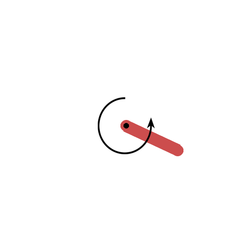

<h1 class="visually-hidden">Pendulum</h1>
<div class="gn-env-banner">
<canvas class="gn-pixel" data-text="PENDULUM" data-scale="6" data-color="#fcfcfc" data-shadow="#f83800"></canvas>
<canvas class="gn-pixel" data-text="CLASSIC CONTROL  1 ACTION  3 OBSERVATIONS" data-scale="2" data-color="#f8b800"></canvas>
</div>

<p class="gn-env-lead">Swing a pendulum up from hanging and hold it upright, with a motor too weak to lift it directly. The torque is continuous, nothing ends the episode early, and every step scores how far the pendulum is from upright and at rest: a classic first test of continuous control.</p>

<aside class="gn-infobox" aria-label="Pendulum at a glance">
<video src="media/Pendulum-v1.episode.mp4" poster="media/Pendulum-v1.figure.png" autoplay muted loop playsinline disablepictureinpicture disableremoteplayback aria-label="Pendulum-v1, seed 5: the controller swings the pendulum up and holds it upright for the rest of the 200 steps"></video>
<p class="gn-infobox-caption">The whole episode <code>examples/Pendulum</code> plays and records: energy pumping, then a PD controller, seed 5, 200 steps, return −114.1.</p>
<table>
<tr><td>Ids</td><td><code>Pendulum-v1</code> 200 steps</td></tr>
<tr><td>Action space</td><td><code>Box(-2.0, 2.0, (1,), float32)</code></td></tr>
<tr><td>Observation space</td><td><code>Box([-1. -1. -8.], [1. 1. 8.], (3,), float32)</code></td></tr>
<tr><td>Reward</td><td>−(angle² + 0.1 speed² + 0.001 torque²) every step, from −16.27 to 0 · no threshold</td></tr>
<tr><td>Physics</td><td>semi-implicit Euler steps of 0.05 s (20 a second), float64</td></tr>
<tr><td>Render modes</td><td><code>human</code>, <code>rgb_array</code> · 500×500 · 30 fps</td></tr>
<tr><td>Make</td><td><code>Gymnasium.Make("Pendulum-v1")</code></td></tr>
<tr><td>Class</td><td><a href="xref:Gym.Environments.Envs.Classic.PendulumEnv"><code>PendulumEnv</code></a>, options <a href="xref:Gym.Environments.Envs.Classic.PendulumEnvOptions"><code>PendulumEnvOptions</code></a></td></tr>
<tr><td>Vector env</td><td>none of its own: <code>MakeVec</code> builds sync or async</td></tr>
<tr><td>Parity</td><td><span class="gn-badge gn-badge-ok">bit for bit</span><span class="gn-badge gn-badge-ok">pixel for pixel</span><br>with Gymnasium 1.4.0</td></tr>
<tr><td>Gymnasium</td><td><a href="https://gymnasium.farama.org/v1.4.0/environments/classic_control/pendulum/">Pendulum</a> in Gymnasium 1.4.0's docs</td></tr>
</table>
</aside>

## Description

A rod of 1 m and 1 kg hangs from a pivot, and a motor at the pivot turns it with a torque between −2 and 2 N·m. The
pendulum starts at a random angle with a small random speed, and the agent must bring it upright and keep it there.
Every step is scored by the angle from upright, the speed and the torque, for 200 steps; no state ends the episode
early.

The motor cannot lift the pendulum directly: held horizontal, the rod's weight turns it with 5 N·m (its mass times
gravity times half its length), more than twice what the motor gives. The agent has to swing it up, adding energy on
each swing, and then catch and balance it at the top, two problems with one policy. Random torques average a return of
−1,218.90 over 1,000 seeded episodes; the controller below averages −144.77 over seeds 0 to 99.

The swing-up with a limited torque is a classic of control theory and of reinforcement learning in continuous time and
space (Doya, 2000). Gym.NET's Pendulum computes exactly what Gymnasium's does: the same float64 dynamics in the same
operation order, the torque in the action's own precision, the same float32 observations, rewards, warnings and
errors, and the same pixels.

## Quick start

# [C#](#tab/csharp)

[!code-csharp[](../../../tests/Gym.Tests/Docs/EnvPageSamples/PendulumSamples.cs?range=1-4,38-45&dedent=12)]

# [Python (Gymnasium)](#tab/python)

```python
import gymnasium as gym

env = gym.make("Pendulum-v1")
# [cos(theta), sin(theta), theta_dot], float32
observation, info = env.reset(seed=42)
# one float32 torque in [-2, 2]
action = env.action_space.sample()
observation, reward, terminated, truncated, info = env.step(action)
```

---

`dotnet add package Gym.NET.Environments`; the six longer examples are in [Code examples](#code-examples).

### Play it, or watch the agent

```bash
# from a clone of the repository: you drive the motor, A turns it one way and D the other
dotnet run --project examples/Pendulum -c Release -- --play
# the agent in the video plays it in a window
dotnet run --project examples/Pendulum -c Release -- --render
```

## How it works

<div class="gn-figure gn-figure-narrow">

<svg viewBox="0 0 500 500" font-family="system-ui, sans-serif" font-size="14" role="img" aria-label="Labels: theta = −115° from upright, angular velocity 5.84 rad/s, the last torque of +2 N·m counterclockwise, the rod of 1 m and 1 kg, gravity of 10 m/s² down">
<defs><marker id="gn-pd-ag" viewBox="0 0 10 10" refX="9" refY="5" markerWidth="6" markerHeight="6" orient="auto-start-reverse"><path d="M0,0 L10,5 L0,10 z" fill="#777"/></marker></defs>
<line x1="250" y1="250" x2="250" y2="100" stroke="#999" stroke-dasharray="5 4"/><text x="258" y="112" fill="#777">θ = 0: upright</text><text x="258" y="130" fill="#777">θ grows counterclockwise</text>
<path d="M 250,180 A 70 70 0 0 1 313.4,279.6" fill="none" stroke="#1971c2" stroke-width="2.5"/>
<text x="333.6" y="200.6" fill="#1971c2">θ = −115°</text>
<text x="342.9" y="338.1" fill="#c2189b">dθ/dt = 5.84 rad/s</text>
<text x="186" y="246" fill="#2f9e44" text-anchor="end">u = +2 N·m</text><text x="186" y="264" fill="#2f9e44" text-anchor="end">the last step's torque</text>
<text x="370.9" y="303.1" fill="#777">l = 1 m, m = 1 kg</text>
<line x1="250" y1="370" x2="250" y2="430" stroke="#777" stroke-width="3" marker-end="url(#gn-pd-ag)"/><text x="260" y="420" fill="#777">g = 10 m/s²</text>
</svg>
</div>
<p class="gn-figure-caption">Step 10 of the episode in the video, exactly as <code>Render()</code> returns it: the rod points 115° clockwise from upright and swings back counterclockwise at 5.84 rad/s, pushed by the motor's full counterclockwise torque. The arrow shows the torque of the step before (Gymnasium's <code>last_u</code>), scaled with its size and mirrored by its sign; 113.6 pixels to the metre, the frame spanning ±2.2 m around the pivot.</p>

The rod is a uniform bar pivoting at one end, so its angular acceleration under gravity $g$ and the clipped torque $u$
is $\ddot\theta = \frac{3g}{2l}\sin\theta + \frac{3}{ml^2}u$, with $\theta$ measured from upright, counterclockwise
positive. Each step of $\Delta t = 0.05$ s updates the speed first and moves the angle by the new speed (semi-implicit
Euler):

$$
\begin{aligned}
u_t &= \operatorname{clip}(a_t,\ -2,\ 2)\\
\dot\theta_{t+1} &= \operatorname{clip}\Big(\dot\theta_t + \big(\tfrac{3g}{2l}\sin\theta_t + \tfrac{3}{ml^2}\,u_t\big)\,\Delta t,\ -8,\ 8\Big)\\
\theta_{t+1} &= \theta_t + \dot\theta_{t+1}\,\Delta t
\end{aligned}
$$

and the reward is the negative cost of the state the step started from:

$$
r_t = -\big(\bar\theta_t^{\,2} + 0.1\,\dot\theta_t^{\,2} + 0.001\,u_t^2\big), \qquad \bar\theta = \big((\theta + \pi) \bmod 2\pi\big) - \pi
$$

The state's angle is never wrapped: it keeps counting turns, and only the reward folds it into $[-\pi, \pi)$. The
observation gives it as $\cos\theta$ and $\sin\theta$, which do not jump where the angle passes the bottom. Gym.NET
computes the dynamics in float64 in Gymnasium's operation order, so each state is bit for bit Gymnasium's; the torque
keeps the action's precision, as NumPy's scalar does, so a float32 action is clipped, squared and scaled in float32
before it joins the float64 sums.

| Symbol | Property | Gymnasium | Default | Unit |
|---|---|---|--:|---|
| $g$ | `Gravity` | `g` | 10.0 | m/s² |
| $m$ | `Mass` | `m` | 1.0 | kg |
| $l$ | `Length` | `l` | 1.0 | m |
| $\Delta t$ | `Dt` | `dt` | 0.05 | s |
| | `MaxSpeed` | `max_speed` | 8 | rad/s |
| | `MaxTorque` | `max_torque` | 2.0 | N·m |

> [!WARNING]
> The spaces keep the bounds the constructor built: changing `MaxTorque` moves the step's clip but not `ActionSpace`,
> and changing `MaxSpeed` moves the speed's clip but not `ObservationSpace`, as in Gymnasium. The reward's constants
> (0.1 and 0.001) are not properties.

## Action space

`Box(-2.0, 2.0, (1,), float32)`: one torque. Positive turns counterclockwise.

| Index | Action | Min | Max | Unit |
|---|---|--:|--:|---|
| 0 | The motor's torque | −2.0 | 2.0 | N·m |

A torque outside [−2, 2] is clipped, for the dynamics and for the reward. Gymnasium's env checker warns that the space
is not symmetric around 0 with bounds of 1; [A torque in \[−1, 1\]](#a-torque-in-1-1) shows the wrapper that maps it.

## Observation space

A float32 `NDArray` of shape `(3,)`:

| Index | Observation | Min | Max | Unit |
|---|---|--:|--:|---|
| 0 | $\cos\theta$, the rod's end along the vertical | −1.0 | 1.0 | |
| 1 | $\sin\theta$, the rod's end along the horizontal | −1.0 | 1.0 | |
| 2 | $\dot\theta$, the angular velocity | −8.0 | 8.0 | rad/s |

The angle is `Math.Atan2(observation[1], observation[0])`, in (−π, π], 0 upright.

## Rewards

Every step costs $\bar\theta^2 + 0.1\,\dot\theta^2 + 0.001\,u^2$, measured before the step: the angle from upright
(at most $\pi^2 \approx 9.87$), the speed (at most 6.4) and the torque (at most 0.004). The reward is that cost
negated, from −16.2736044 to 0, and 0 only upright, at rest and without torque. Pendulum is registered without a
threshold: no return counts as solved.

## Starting state

The angle is drawn uniformly from [−π, π) and the angular velocity from [−1, 1) by the env's generator (NumPy's PCG64,
so a seed gives Gymnasium's starting state). Reset options move the bounds, symmetrically: `x_init` for the angle and
`y_init` for the speed, anything Python's `float()` accepts. The episode in the video starts at θ = 109.8°, 0.62 rad/s
(seed 5).

## Episode end

| Ends by | When |
|---|---|
| Termination | Never: `PendulumEnv` always returns `terminated = false` |
| Truncation | 200 steps: the `TimeLimit` that `Make` wraps around the env |

## Arguments

By Gymnasium's name in `Make`'s kwargs, or by the C# name in the constructor and in
<xref:Gym.Environments.Envs.Classic.PendulumEnvOptions>.

| Argument | Type and default | Effect |
|---|---|---|
| `render_mode`<br>`renderMode` | `string?` or `RenderMode`<br>`null` | `"human"` opens a window; `"rgb_array"` makes `Render()` return the frame |
| `g`<br>`g` | `double`<br>`10.0` | The gravity, in m/s²; the property is `Gravity` |
| (Gym.NET)<br>`viewerFactory` | `EnvViewerFactory?`<br>`null` | The window for `human`: Avalonia, WinForms, or headless |


# [C#](#tab/csharp)

[!code-csharp[](../../../tests/Gym.Tests/Docs/EnvPageSamples/PendulumSamples.cs#Arguments)]

# [Python (Gymnasium)](#tab/python)

```python
env = gym.make("Pendulum-v1", render_mode="rgb_array", g=9.81)
```

---

The generated options record names the keyword `G`. The constants are settable properties of the unwrapped env (the
table in [How it works](#how-it-works)).

## Info

Always empty, `{}`, as Gymnasium's; Pendulum has no typed info record.

## Rendering

| Mode | What you get |
|---|---|
| `rgb_array` | `Render()` returns the frame: `(500, 500, 3)` uint8, Gymnasium's pixels; `(Image)result` converts it |
| `human` | A window from the viewer factory, drawn after every reset and step, paced at 30 frames a second |
| none | `Render()` warns and returns nothing, as Gymnasium's does |

The frame: white, the rod 1 m long and 0.2 m wide in (204, 77, 77) with rounded ends, a black axle, and after a step
Gymnasium's curved arrow image around the pivot, shrunk with pygame's `smoothscale` to $113.6\,|u|/2$ pixels and
mirrored for a counterclockwise torque. 113.6 pixels to the metre: the frame spans ±2.2 m around the pivot at its
centre. Drawn with SDL_gfx's anti-aliased polygons and circles, as pygame draws them; the arrow image is Gymnasium's
own, embedded.

## Episode anatomy

The whole episode, step by step: the angle from upright, the speed, the torque, and which of the controller's three
regimes chose it. The video has one frame per step, and the cursor follows it. From 109.8° the controller pumps at full
torque and swings the pendulum through the bottom (step 7) and up the other side, at up to 6.18 rad/s (step 8). From
step 13 to 17 the energy hovers around the upright rest's, and pumping and braking alternate. At step 18, 30° from the
top, the PD law takes over; from step 31 the pendulum stays within 1° of upright, and from step 35 the torque stays
under 0.071 N·m. The return, −114.1, is all but the last 0.01 earned in the first 30 steps.

<div class="gn-anatomy" data-trace="media/Pendulum-v1.episode.json">
<div><video src="media/Pendulum-v1.episode.mp4" poster="media/Pendulum-v1.figure.png" autoplay muted loop playsinline disablepictureinpicture disableremoteplayback aria-label="Pendulum-v1, seed 5, the episode the chart follows"></video><div class="gn-anatomy-readout" aria-live="off"></div></div>
<div><div class="gn-anatomy-chart"></div><div class="gn-anatomy-legend"></div></div>
<script type="application/json" class="gn-anatomy-spec">{"label":"Pendulum-v1, seed 5: the angle from upright, the angular velocity, the torque, and the controller's regime","bands":[{"height":100,"range":[-190,190],"ticks":[-180,0,180],"unit":"°","scale":57.29577951308232,"series":[{"column":"theta","color":"#3cbcfc","name":"the angle from upright"}]},{"height":60,"range":[-8,8],"ticks":[-8,0,8],"series":[{"column":"theta_dot","color":"#ff7fe3","name":"the angular velocity"}]},{"height":60,"range":[-2.2,2.2],"ticks":[-2,0,2],"series":[{"column":"torque","color":"#f8b800","name":"the torque"}]},{"label":"regime","strip":{"column":"phase","colors":{"0":"#f8b800","1":"#5c636a","2":"#2f9e44"},"name":"pump in gold, brake in grey, hold in green"}}],"readout":[{"label":"step","column":"@step"},{"label":"θ","column":"theta","digits":1,"unit":"°","scale":57.29577951308232},{"label":"dθ/dt","column":"theta_dot","digits":2},{"label":"next torque","column":"torque","digits":2},{"label":"regime","column":"phase","map":{"0":"pump","1":"brake","2":"hold"}},{"label":"return so far","column":"@return","digits":1}]}</script>
</div>

## Code examples

### Run an episode

# [C#](#tab/csharp)

[!code-csharp[](../../../tests/Gym.Tests/Docs/EnvPageSamples/PendulumSamples.cs#RunAnEpisode)]

# [Python (Gymnasium)](#tab/python)

```python
import math

import gymnasium as gym
import numpy as np

env = gym.make("Pendulum-v1")
observation, info = env.reset(seed=5)
episode_return = 0.0
while True:
    theta = math.atan2(observation[1], observation[0])
    w = float(observation[2])
    energy = 0.5 * w * w + 15 * math.cos(theta)  # upright rest: 15
    if math.cos(theta) > 0.85:
        u = -(12 * theta + 2.5 * w)  # hold
    elif energy < 15:
        u = 2.0 if w >= 0 else -2.0  # pump
    else:
        u = -0.5 * float(np.sign(w))  # brake
    action = np.array([min(max(u, -2.0), 2.0)], dtype=np.float32)
    observation, reward, terminated, truncated, info = env.step(action)
    episode_return += reward
    if terminated or truncated:
        break
print(f"return {episode_return:.1f}")  # -114.1
```

---

### Start elsewhere

# [C#](#tab/csharp)

[!code-csharp[](../../../tests/Gym.Tests/Docs/EnvPageSamples/PendulumSamples.cs#StartElsewhere)]

# [Python (Gymnasium)](#tab/python)

```python
# theta from [-pi/2, pi/2), theta_dot from [-0.5, 0.5)
options = {"x_init": np.pi / 2, "y_init": 0.5}
observation, info = env.reset(seed=123, options=options)
# [0.8403459, 0.54205054, -0.44617897]
```

---

### Change the physics

# [C#](#tab/csharp)

[!code-csharp[](../../../tests/Gym.Tests/Docs/EnvPageSamples/PendulumSamples.cs#ChangePhysics)]

# [Python (Gymnasium)](#tab/python)

```python
env.unwrapped.g = 9.81  # the default is 10
env.unwrapped.max_torque = 3.0  # a stronger motor: clips at 3, not 2
```

---

### Save a frame

# [C#](#tab/csharp)

[!code-csharp[](../../../tests/Gym.Tests/Docs/EnvPageSamples/PendulumSamples.cs#SaveFrame)]

# [Python (Gymnasium)](#tab/python)

```python
from PIL import Image

env = gym.make("Pendulum-v1", render_mode="rgb_array")
env.reset(seed=5)
Image.fromarray(env.render()).save("pendulum.png")
```

---

### A torque in [−1, 1]

# [C#](#tab/csharp)

[!code-csharp[](../../../tests/Gym.Tests/Docs/EnvPageSamples/PendulumSamples.cs#RescaleTheTorque)]

# [Python (Gymnasium)](#tab/python)

```python
from gymnasium.wrappers import RescaleAction

env = RescaleAction(gym.make("Pendulum-v1"),
                    min_action=np.float32(-1), max_action=np.float32(1))
print(env.action_space)  # Box(-1.0, 1.0, (1,), float32)
env.reset(seed=42)
full = np.array([1.0], dtype=np.float32)  # the motor's full 2 N m
step = env.step(full)
```

---

### Many pendulums at once

# [C#](#tab/csharp)

[!code-csharp[](../../../tests/Gym.Tests/Docs/EnvPageSamples/PendulumSamples.cs#ManyPendulums)]

# [Python (Gymnasium)](#tab/python)

```python
# No vector env of its own: make_vec steps 8 envs in turn ("sync")
envs = gym.make_vec("Pendulum-v1", num_envs=8, vectorization_mode="sync")
observations, infos = envs.reset(seed=42)
for t in range(200):
    actions = envs.action_space.sample()  # (8, 1) torques
    # only the time limit ends one
    observations, rewards, terminations, truncations, infos = envs.step(actions)
```

---

Every C# example is a test in `tests/Gym.Tests/Docs/EnvPageSamples`, compiled and run by the unit gate; where a
comment states a number, the test checks it.

## Agents and examples

- **The video's agent** is energy control, then balance. The pendulum's energy, $\tfrac12\dot\theta^2 + 15\cos\theta$
  for Gymnasium's constants, is 15 upright at rest, and a torque along the swing raises it by $3u\dot\theta$ a second.
  So far from the top the controller pumps with the full 2 N·m along the swing while the energy is below 15 and brakes
  gently (0.5 N·m against the swing) once it is above; within about 32° of the top ($\cos\theta > 0.85$) a PD law,
  $u = -(12\theta + 2.5\dot\theta)$, catches the pendulum and holds it: a swing-up by energy control, in the manner
  of Åström and Furuta's. Seed 5: 200 steps, return −114.1. Over seeds 0 to 99 it averages −144.77, from about 0 for
  a pendulum that starts near the top to −373.11.
- **[examples/Pendulum](https://github.com/SciSharp/Gym.NET/tree/master/examples/Pendulum)**
  ([`PendulumProgram.cs`](https://github.com/SciSharp/Gym.NET/blob/master/examples/Pendulum/PendulumProgram.cs))
  plays that controller: `dotnet run --project examples/Pendulum -c Release` plays seed 5 headless, `--seed N` another
  seed, `--episodes N` that many seeds and their mean, `--render` in a window.
- **Play it yourself**: `--play` hands the motor to the keyboard: <kbd>A</kbd> turns it clockwise at full torque,
  <kbd>D</kbd> counterclockwise, and with no key held the motor is off.
- **This page's video and chart** are the example's own episode:
  `--record docs/environments/classic_control/media` records it with `RecordVideo` (one frame per step) and writes the
  step trace and the figure beside it.

## Vectorized environment

Pendulum registers no vector env of its own: `Gymnasium.MakeVec("Pendulum-v1", n)` builds a `SyncVectorEnv` that steps
`n` separate envs in turn, and `VectorizeMode.Async` an `AsyncVectorEnv` that steps them on worker threads; each env
resets itself after its 200 steps (next-step autoreset), as Gymnasium's. Asking for `"vector_entry_point"` raises
Gymnasium's error, as it does in Gymnasium.

## Variants

None: Pendulum-v1 is the only id. (Gymnasium's v0 is gone; v1 only simplified the math, with no difference in
behaviour.)

## Parity with Gymnasium

Gymnasium 1.4.0 runs inside the test process and both are compared value by value:

| What is compared | How | Result |
|---|---|---|
| Reset: observations, generator state | seeded resets, reset options and their errors | ✓ equal |
| Dynamics: observations, rewards | episodes of sampled and fixed torques, torques beyond the clip, a changed `g` | ✓ bit for bit |
| NumPy's typing of the torque | float32 and float64 torques inside and beyond the clip, integer and boolean ones, two elements, NaN | ✓ bit for bit, same errors |
| Injected states | upright, hanging, past ±π, wound up 100 rad, beyond the speed limit, −0.0, NaN; malformed states | ✓ same values, same errors |
| Actions and errors | 0-d and empty torques, a step or a render before the first reset | ✓ same messages |
| Spaces, metadata | both spaces, render modes, fps | ✓ |
| Frames | `rgb_array` with and without the arrow, at every torque's size | ✓ pixel for pixel |
| `make`'s stack, registration, goldens | the wrapper order through truncation, the spec, a golden episode replayed without Python | ✓ |
| Gymnasium's own checkers on Gym.NET's env | `check_env` (with its warning about the action space), `check_environments_match` | ✓ |
| Wrappers over it | `RescaleObservation`, `DiscretizeObservation`, `MaxAndSkipObservation` | ✓ |

The tests: [PendulumLiveParityTests](https://github.com/SciSharp/Gym.NET/blob/master/tests/Gym.Tests.Parity/Tests/Envs/PendulumLiveParityTests.cs),
[EnvCoverageLiveParityTests](https://github.com/SciSharp/Gym.NET/blob/master/tests/Gym.Tests.Parity/Tests/Envs/EnvCoverageLiveParityTests.cs),
[GymnasiumToolsLiveParityTests](https://github.com/SciSharp/Gym.NET/blob/master/tests/Gym.Tests.Parity/Tests/Bridge/GymnasiumToolsLiveParityTests.cs),
[TransformWrappersLiveParityTests](https://github.com/SciSharp/Gym.NET/blob/master/tests/Gym.Tests.Parity/Tests/Wrappers/TransformWrappersLiveParityTests.cs).

## Performance

| | Steps a second | Bytes a step |
|---|--:|--:|
| Gym.NET | 48,601 | 11,088 |
| Gymnasium | 12,930 | |

3.8× faster. Random actions, observations disposed; .NET 10 in Release against CPython 3.12 with the pinned NumPy; the
medians of interleaved rounds on one machine (2026-11-11).

## Reference sources

- [gymnasium/envs/classic_control/pendulum.py](https://github.com/Farama-Foundation/Gymnasium/blob/8ba8c3a63bb4e000b7f33923f43d292acac07be1/gymnasium/envs/classic_control/pendulum.py),
  Gymnasium 1.4.0: the environment (spaces, dynamics, reward, reset, rendering).
- [gymnasium/envs/classic_control/assets/clockwise.png](https://github.com/Farama-Foundation/Gymnasium/blob/8ba8c3a63bb4e000b7f33923f43d292acac07be1/gymnasium/envs/classic_control/assets/clockwise.png):
  the torque's arrow, embedded in Gym.NET.Environments.
- [gymnasium/envs/classic_control/utils.py](https://github.com/Farama-Foundation/Gymnasium/blob/8ba8c3a63bb4e000b7f33923f43d292acac07be1/gymnasium/envs/classic_control/utils.py):
  `verify_number_and_cast`, the reset options.
- [SDL_gfxPrimitives.c](https://github.com/pygame-community/pygame-ce/blob/2.5.8/src_c/SDL_gfx/SDL_gfxPrimitives.c)
  (SDL_gfx 2.0.26 as pygame-ce 2.5.8 ships it): `aapolygon`, `filled_polygon`, `aacircle`, `filled_circle`, in
  Gym.Rendering's `GfxDraw`; pygame-ce's [transform.c](https://github.com/pygame-community/pygame-ce/blob/2.5.8/src_c/transform.c)
  for `smoothscale` and `flip`.
- [gymnasium/utils/seeding.py](https://github.com/Farama-Foundation/Gymnasium/blob/8ba8c3a63bb4e000b7f33923f43d292acac07be1/gymnasium/utils/seeding.py):
  the env's generator, NumPy's PCG64, which NumSharp reproduces for the starting state.

## Version history

| Version | Change |
|---|---|
| Pendulum-v1 | Simplified the math, with no difference in behaviour |
| Pendulum-v0 | The first release |
| Gym.NET 1.0.0 | New: Gymnasium 1.4.0's Pendulum-v1, bit for bit; 0.2.0 had no Pendulum |

## References

1. K. Doya, "Reinforcement learning in continuous time and space", *Neural Computation* 12(1), 2000, pp. 219–245: the
   pendulum swing-up with a limited torque as a test of continuous reinforcement learning.
   [PubMed](https://pubmed.ncbi.nlm.nih.gov/10636940/)
2. K. J. Åström and K. Furuta, "Swinging up a pendulum by energy control", *Automatica* 36(2), 2000, pp. 287–295: the
   energy-based swing-up the video's agent uses. [doi:10.1016/S0005-1098(99)00140-5](https://doi.org/10.1016/S0005-1098(99)00140-5)

## External links

- [Pendulum on Gymnasium's site](https://gymnasium.farama.org/v1.4.0/environments/classic_control/pendulum/) (1.4.0)
- [PendulumEnv.cs](https://github.com/SciSharp/Gym.NET/blob/master/src/Gym.Environments/Envs/Classic/PendulumEnv.cs) on GitHub
- [examples/Pendulum](https://github.com/SciSharp/Gym.NET/tree/master/examples/Pendulum)
- [Inverted pendulum](https://en.wikipedia.org/wiki/Inverted_pendulum) on Wikipedia

## API reference

<xref:Gym.Environments.Envs.Classic.PendulumEnv> · <xref:Gym.Environments.Envs.Classic.PendulumEnvOptions>
