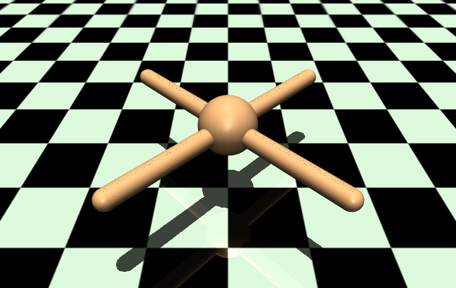

<h1 class="visually-hidden">Ant</h1>
<div class="gn-env-banner">
<canvas class="gn-pixel" data-text="ANT" data-scale="6" data-color="#fcfcfc" data-shadow="#e45c10"></canvas>
<canvas class="gn-pixel" data-text="MUJOCO  8 ACTIONS  105 OBSERVATIONS" data-scale="2" data-color="#f8b800"></canvas>
</div>

<p class="gn-env-lead">Make a four-legged robot run forward as fast as it can while its torso stays between 0.2 and 1 m up, with a motor at each of its four hips and four ankles. The physics is MuJoCo's, run in Gym.NET's own engine, written from scratch in C# and bit for bit with MuJoCo 4.0.0.</p>

<aside class="gn-infobox" aria-label="Ant at a glance">
<video src="media/Ant-v5.episode.mp4" poster="media/Ant-v5.figure.png" autoplay muted loop playsinline disablepictureinpicture disableremoteplayback aria-label="Ant-v5, seed 0: Farama's SAC expert runs for all 1,000 steps"></video>
<p class="gn-infobox-caption">The whole episode <code>examples/Ant</code> plays and records: Farama's SAC expert through the model's <code>track</code> camera, seed 0, 1,000 steps, return 5,705.8.</p>
<table>
<tr><td>Ids</td><td><code>Ant-v5</code> 1,000 steps<br><code>Ant-v4</code> 1,000 steps</td></tr>
<tr><td>Action space</td><td><code>Box(-1.0, 1.0, (8,), float32)</code></td></tr>
<tr><td>Observation space</td><td><code>Box(-inf, inf, (105,), float64)</code></td></tr>
<tr><td>Reward</td><td>1 a step while healthy, plus the forward speed, less 0.5 × the torques squared and a contact cost · solved at 6,000</td></tr>
<tr><td>Physics</td><td>MuJoCo 4.0.0 in Gym.NET's own engine, bit for bit: 5 Runge-Kutta steps of 0.01 s per env step</td></tr>
<tr><td>Render modes</td><td><code>human</code>, <code>rgb_array</code>, <code>depth_array</code>, <code>rgbd_tuple</code> · 480×480 · 20 fps</td></tr>
<tr><td>Make</td><td><code>Gymnasium.Make(<wbr>"Ant-v5")</code></td></tr>
<tr><td>Class</td><td><a href="xref:Gym.Environments.Envs.MuJoCo.AntEnvV5"><code>AntEnvV5</code></a>, options <a href="xref:Gym.Environments.Envs.MuJoCo.AntEnvV5Options"><code>AntEnvV5Options</code></a>, info <a href="xref:Gym.Environments.Envs.MuJoCo.AntInfoV5"><code>AntInfoV5</code></a></td></tr>
<tr><td>Vector env</td><td>none of its own: <code>MakeVec</code> builds sync or async</td></tr>
<tr><td>Parity</td><td><span class="gn-badge gn-badge-ok">physics bit for bit</span><span class="gn-badge gn-badge-warn">frames: 2.5% of pixels differ</span><br>with Gymnasium 1.4.0 on MuJoCo 4.0.0</td></tr>
<tr><td>Gymnasium</td><td><a href="https://gymnasium.farama.org/v1.4.0/environments/mujoco/ant/">Ant</a> in Gymnasium 1.4.0's docs</td></tr>
</table>
</aside>

## Description

The ant is a ball of a torso with four legs, each leg two capsules: the first joined to the torso by a hip that swings
it in the floor's plane, the second to the first by an ankle that bends it down. That makes eight hinges, each with a
motor. Unlike the planar walkers, the ant moves in three dimensions: its torso is a free body that can turn, roll and
drift sideways. Each step the agent sets the eight torques; the reward pays a fixed amount for every step the torso
stays between 0.2 and 1 m up, and for speed along x, and charges for torque and for hard contacts. The episode ends as
soon as the torso leaves that band, and random torques usually end it by throwing the torso above 1 m, not by a fall.

The env comes from J. Schulman, P. Moritz, S. Levine, M. Jordan and P. Abbeel's work on generalized advantage
estimation, and Gymnasium keeps it as one of its standard locomotion tasks. Gym.NET runs it on its own MuJoCo engine,
a C# reimplementation of MuJoCo 4.0.0 that computes every float of every step as MuJoCo does on the reference machine,
so the episodes are Gymnasium's, value for value. Gym.NET also draws MuJoCo's frames itself, in software, close to
Gymnasium's but not yet equal (see [Parity](#parity-with-gymnasium)).

## Quick start

# [C#](#tab/csharp)

[!code-csharp[](../../../tests/Gym.Tests/Docs/EnvPageSamples/AntSamples.cs?range=1-4,37-43&dedent=12)]

# [Python (Gymnasium)](#tab/python)

```python
import gymnasium as gym

env = gym.make("Ant-v5")
# 105 numbers: the torso's height and orientation, 8 joint angles, 14 velocities, 78 contact forces
observation, info = env.reset(seed=42)
# eight torques, each from -1 to 1: a hip and an ankle per leg
action = env.action_space.sample()
observation, reward, terminated, truncated, info = env.step(action)
```

---

`dotnet add package Gym.NET.Environments`; the six longer examples are in [Code examples](#code-examples).

### Watch the agent

```bash
# from a clone of the repository: the agent in the video runs in MuJoCo's window
dotnet run --project examples/Ant -c Release -- --render
```

Keyboard play is not offered: the ant's eight motors would need 16 keys held in combinations, too many to play.

## How it works

<div class="gn-figure gn-figure-wide">

<svg viewBox="0 0 760 480" font-family="system-ui, sans-serif" role="img" aria-label="Labels: the torso, whose height and orientation are the observation's items 0 to 4, its velocities items 13 to 18 and the contact forces items 27 to 104; leg 1's hip and ankle, items 5, 6, 19 and 20, driven by actions 2 and 3; leg 2's, items 7, 8, 21 and 22, actions 4 and 5; leg 3's, items 9, 10, 23 and 24, actions 6 and 7; leg 4's, items 11, 12, 25 and 26, actions 0 and 1; every motor at gear 150">
<line x1="380" y1="209.08" x2="380" y2="410" stroke="#000" stroke-width="3" stroke-linecap="round"/><line x1="380" y1="209.08" x2="380" y2="410" stroke="#ffffff" stroke-width="1.3" stroke-linecap="round"/>
<line x1="452.93" y1="165.19" x2="474" y2="40" stroke="#000" stroke-width="3" stroke-linecap="round"/><line x1="452.93" y1="165.19" x2="474" y2="40" stroke="#ffd43b" stroke-width="1.3" stroke-linecap="round"/>
<line x1="418.31" y1="186.02" x2="474" y2="40" stroke="#000" stroke-width="3" stroke-linecap="round"/><line x1="418.31" y1="186.02" x2="474" y2="40" stroke="#ffd43b" stroke-width="1.3" stroke-linecap="round"/>
<line x1="307.07" y1="165.19" x2="286" y2="40" stroke="#000" stroke-width="3" stroke-linecap="round"/><line x1="307.07" y1="165.19" x2="286" y2="40" stroke="#ffd43b" stroke-width="1.3" stroke-linecap="round"/>
<line x1="341.69" y1="186.02" x2="286" y2="40" stroke="#000" stroke-width="3" stroke-linecap="round"/><line x1="341.69" y1="186.02" x2="286" y2="40" stroke="#ffd43b" stroke-width="1.3" stroke-linecap="round"/>
<line x1="289.64" y1="263.47" x2="266" y2="356" stroke="#000" stroke-width="3" stroke-linecap="round"/><line x1="289.64" y1="263.47" x2="266" y2="356" stroke="#ffd43b" stroke-width="1.3" stroke-linecap="round"/>
<line x1="337.37" y1="234.75" x2="266" y2="356" stroke="#000" stroke-width="3" stroke-linecap="round"/><line x1="337.37" y1="234.75" x2="266" y2="356" stroke="#ffd43b" stroke-width="1.3" stroke-linecap="round"/>
<line x1="470.36" y1="263.47" x2="494" y2="356" stroke="#000" stroke-width="3" stroke-linecap="round"/><line x1="470.36" y1="263.47" x2="494" y2="356" stroke="#ffd43b" stroke-width="1.3" stroke-linecap="round"/>
<line x1="422.63" y1="234.75" x2="494" y2="356" stroke="#000" stroke-width="3" stroke-linecap="round"/><line x1="422.63" y1="234.75" x2="494" y2="356" stroke="#ffd43b" stroke-width="1.3" stroke-linecap="round"/>
<circle cx="380" cy="209.08" r="4" fill="#ffffff" stroke="#000" stroke-width="1.2"/>
<text x="380" y="424" text-anchor="middle" fill="#ffffff" font-weight="700" paint-order="stroke" stroke="#000" stroke-width="3" stroke-linejoin="round" font-size="13">torso: height [0], orientation [1] to [4]</text>
<text x="380" y="440" text-anchor="middle" fill="#ffffff" font-weight="600" paint-order="stroke" stroke="#000" stroke-width="3" stroke-linejoin="round" font-size="12">speeds [13] to [18], contacts [27] to [104]</text>
<text x="380" y="456" text-anchor="middle" fill="#ffffff" font-weight="600" paint-order="stroke" stroke="#000" stroke-width="3" stroke-linejoin="round" font-size="12">x and y not observed</text>
<circle cx="452.93" cy="165.19" r="4" fill="#ffd43b" stroke="#000" stroke-width="1.2"/>
<text x="478" y="44" text-anchor="start" fill="#ffd43b" font-weight="700" paint-order="stroke" stroke="#000" stroke-width="3" stroke-linejoin="round" font-size="13">leg 1 · front_left_leg</text>
<text x="478" y="60" text-anchor="start" fill="#ffd43b" font-weight="600" paint-order="stroke" stroke="#000" stroke-width="3" stroke-linejoin="round" font-size="12">hip · action 2 · angle [5], speed [19]</text>
<text x="478" y="76" text-anchor="start" fill="#ffd43b" font-weight="600" paint-order="stroke" stroke="#000" stroke-width="3" stroke-linejoin="round" font-size="12">ankle · action 3 · angle [6], speed [20]</text>
<circle cx="418.31" cy="186.02" r="4" fill="#ffd43b" stroke="#000" stroke-width="1.2"/>
<circle cx="307.07" cy="165.19" r="4" fill="#ffd43b" stroke="#000" stroke-width="1.2"/>
<text x="282" y="44" text-anchor="end" fill="#ffd43b" font-weight="700" paint-order="stroke" stroke="#000" stroke-width="3" stroke-linejoin="round" font-size="13">leg 2 · front_right_leg</text>
<text x="282" y="60" text-anchor="end" fill="#ffd43b" font-weight="600" paint-order="stroke" stroke="#000" stroke-width="3" stroke-linejoin="round" font-size="12">hip · action 4 · angle [7], speed [21]</text>
<text x="282" y="76" text-anchor="end" fill="#ffd43b" font-weight="600" paint-order="stroke" stroke="#000" stroke-width="3" stroke-linejoin="round" font-size="12">ankle · action 5 · angle [8], speed [22]</text>
<circle cx="341.69" cy="186.02" r="4" fill="#ffd43b" stroke="#000" stroke-width="1.2"/>
<circle cx="289.64" cy="263.47" r="4" fill="#ffd43b" stroke="#000" stroke-width="1.2"/>
<text x="262" y="360" text-anchor="end" fill="#ffd43b" font-weight="700" paint-order="stroke" stroke="#000" stroke-width="3" stroke-linejoin="round" font-size="13">leg 3 · back_leg</text>
<text x="262" y="376" text-anchor="end" fill="#ffd43b" font-weight="600" paint-order="stroke" stroke="#000" stroke-width="3" stroke-linejoin="round" font-size="12">hip · action 6 · angle [9], speed [23]</text>
<text x="262" y="392" text-anchor="end" fill="#ffd43b" font-weight="600" paint-order="stroke" stroke="#000" stroke-width="3" stroke-linejoin="round" font-size="12">ankle · action 7 · angle [10], speed [24]</text>
<circle cx="337.37" cy="234.75" r="4" fill="#ffd43b" stroke="#000" stroke-width="1.2"/>
<circle cx="470.36" cy="263.47" r="4" fill="#ffd43b" stroke="#000" stroke-width="1.2"/>
<text x="498" y="360" text-anchor="start" fill="#ffd43b" font-weight="700" paint-order="stroke" stroke="#000" stroke-width="3" stroke-linejoin="round" font-size="13">leg 4 · right_back_leg</text>
<text x="498" y="376" text-anchor="start" fill="#ffd43b" font-weight="600" paint-order="stroke" stroke="#000" stroke-width="3" stroke-linejoin="round" font-size="12">hip · action 0 · angle [11], speed [25]</text>
<text x="498" y="392" text-anchor="start" fill="#ffd43b" font-weight="600" paint-order="stroke" stroke="#000" stroke-width="3" stroke-linejoin="round" font-size="12">ankle · action 1 · angle [12], speed [26]</text>
<circle cx="422.63" cy="234.75" r="4" fill="#ffd43b" stroke="#000" stroke-width="1.2"/>
</svg>
</div>
<p class="gn-figure-caption">The reset pose without noise (<code>reset_noise_scale</code> 0), rendered by Gym.NET with MuJoCo's free camera 3 m from a point 0.55 m above the floor, at azimuth 90° and elevation −40°: x runs to the right, the direction the reward pays for, and y away from the camera. The torso floats 0.75 m up with the legs straight out along the diagonals, every ankle at 0°, outside its range of 30° to 70° of bend, which the joints' limits push it into within two steps. Each dot is a joint projected through MuJoCo's camera geometry; each leg's label names its hip's and ankle's items in the observation and their motors, all at gear 150. Gymnasium's frame of the same pose differs in 9,253 of its 364,800 pixels, by 1 or 2 of 255 levels in all but 52, nine in ten on the floor's checkers; the 52, by up to 142, are single texels of the legs' speckled texture.</p>

MuJoCo steps the model with the fourth-order Runge-Kutta integrator every 0.01 s, and an env step holds the action for
five of those steps, 0.05 s, hence 20 steps and frames a second. Each motor applies its gear, 150, times its control;
the hips swing up to ±30° and the ankles bend between 30° and 70°. The torso hangs on a free joint: its position and its
orientation, a quaternion, are seven numbers of `qpos`, its velocity and angular velocity six of `qvel`.

The reward of a step is a healthy bonus while the ant is healthy, plus the torso's average forward speed over the step,
less a cost on the controls and one on the external forces, mostly the floor's contacts, that act on the bodies:

$$
r_t = h\,[\text{healthy}] + w_f\,\frac{x_{t+1} - x_t}{\Delta t} - w_c \sum_{j=1}^{8} a_{t,j}^2 - w_k \sum_{b} \lVert \operatorname{clip}(F_b, -1, 1) \rVert^2
$$

with $\Delta t = 0.05$ s, $h = 1$, $w_f = 1$, $w_c = 0.5$ and $w_k = 0.0005$; $F_b$ is the six numbers of MuJoCo's
`cfrc_ext` for body $b$, a torque and a force, each clipped to ±1. The ant is healthy while every value of its state is
finite and its torso's height is between 0.2 and 1 m; the step that leaves that band ends the episode.

| Constant | Gym.NET | Gymnasium | Value | Effect |
|---|---|---|--:|---|
| Physics step | `Model.Opt.Timestep` | `model.opt.timestep` | 0.01 s | MuJoCo's step, Runge-Kutta 4 |
| Frame skip | `FrameSkip` | `frame_skip` | 5 | Physics steps per env step: an env step is 0.05 s |
| Healthy reward | `HealthyRewardWeight` | `_healthy_reward` | 1.0 | Paid for every step the ant is healthy |
| Forward weight | `ForwardRewardWeight` | `_forward_reward_weight` | 1.0 | Multiplies the speed in the reward |
| Control cost | `CtrlCostWeight` | `_ctrl_cost_weight` | 0.5 | Multiplies the controls squared |
| Contact cost | `ContactCostWeight` | `_contact_cost_weight` | 0.0005 | Multiplies the clipped external forces squared |
| Force clip | `ContactForceRange` | `_contact_force_range` | −1 to 1 | Each external force's clip, in the cost and the observation |
| Healthy height | `HealthyZRange` | `_healthy_z_range` | 0.2 to 1.0 | The torso's height while healthy, m |
| Reset noise | `ResetNoiseScale` | `_reset_noise_scale` | 0.1 | The starting state's spread |

> [!NOTE]
> Torque is dear here: a step at full torque on every motor costs 4, four times the healthy bonus, and the expert's
> torques cost 1,020 over its episode, a little more than its healthy bonus pays. Ant-v4 paid the bonus on the step that ends
> the episode too, and left the contact cost out unless `use_contact_forces`; v5 fixed the first (Gymnasium's issue
> 526) and always charges the second. The reward's speed is the torso's average over the step, while the observation's
> item 13 is MuJoCo's velocity at the step's end. The floor collides everywhere but is drawn only 40 m to each side of the
> start: the expert in the video passes x = 40 m at step 154, and from there its frames show no floor, only the
> sky's grey.

## Action space

`Box(-1.0, 1.0, (8,), float32)`: one control per motor, its torque the control times the gear, 150. The model lists leg
4's motors first, so the actions run legs 4, 1, 2, 3, while the observation runs 1, 2, 3, 4.

| Index | Motor | Leg (the model's name, where it points) | Joint range |
|---|---|---|---|
| 0 | Hip (`hip_4`) | 4 (`right_back_leg`, +x −y) | −30° to 30° |
| 1 | Ankle (`ankle_4`) | 4 | 30° to 70° |
| 2 | Hip (`hip_1`) | 1 (`front_left_leg`, +x +y) | −30° to 30° |
| 3 | Ankle (`ankle_1`) | 1 | 30° to 70° |
| 4 | Hip (`hip_2`) | 2 (`front_right_leg`, −x +y) | −30° to 30° |
| 5 | Ankle (`ankle_2`) | 2 | −70° to −30° |
| 6 | Hip (`hip_3`) | 3 (`back_leg`, −x −y) | −30° to 30° |
| 7 | Ankle (`ankle_3`) | 3 | −70° to −30° |

MuJoCo clamps each control to the motor's range of −1 to 1 before it acts; the control cost reads the action as given.
The model's leg names do not all follow the +x direction the reward uses: `front_right_leg` points back and left,
`right_back_leg` forward and right.

## Observation space

`Box(-inf, inf, (105,), float64)`: `qpos` without the torso's x and y, `qvel`, then the clipped external forces.

| Index | Meaning | Unit |
|---|---|---|
| 0 | The torso's height | m |
| 1 to 4 | The torso's orientation, a quaternion (w, x, y, z) | |
| 5 to 12 | The joints' angles: legs 1 to 4, each hip then ankle | rad |
| 13 to 15 | The torso's velocity along x, y and z | m/s |
| 16 to 18 | Its angular velocity | rad/s |
| 19 to 26 | The joints' angular velocities, in the same order | rad/s |
| 27 to 104 | MuJoCo's `cfrc_ext` on the 13 bodies other than the world, a torque and a force each, clipped to ±1 | |

`exclude_current_positions_from_observation` false puts the torso's x and y first, making 107 items;
`include_cfrc_ext_in_observation` false leaves the 78 forces out, making 27. The x and y positions are always in the
info.

## Rewards

`healthy_reward` for every step the ant is healthy, plus the forward speed times `forward_reward_weight`, less
`ctrl_cost_weight` times the sum of the squared controls and `contact_cost_weight` times the sum of the squared clipped
external forces; the info splits the four as `reward_survive`, `reward_forward`, `reward_ctrl` and `reward_contact`.
Moving sideways pays nothing. The registry counts an average of 6,000 over 100 episodes as solved; the expert in the
video makes 5,705.8.

## Starting state

The model's pose, the torso 0.75 m up and unrotated with the legs straight out and every joint at 0°, plus noise: every
position, the quaternion's four numbers included, gets a uniform draw from ±`reset_noise_scale` (0.1), and every
velocity a normal draw with that standard deviation. The ankles at 0° are outside their ranges: in the first two steps
the joints' limits bend them in while the ant drops onto its feet. With `reset_noise_scale` 0 every seed starts from
the pose in the figure, at rest.

## Episode end

| Ends by | When |
|---|---|
| Termination | The ant is unhealthy, if `terminate_when_unhealthy` (the default): its torso's height outside 0.2 to 1 m, or a value of its state not finite |
| Truncation | 1,000 steps: the `TimeLimit` that `Make` wraps around the env |

## Arguments

By Gymnasium's name in `Make`'s kwargs, or by the C# name in the constructor and in
<xref:Gym.Environments.Envs.MuJoCo.AntEnvV5Options>.

| Argument | Type and default | Effect |
|---|---|---|
| `xml_file`<br>`xmlFile` | `string`<br>`"ant.xml"` | The model: the bundled one by name, or a path to your own MJCF file |
| `frame_skip`<br>`frameSkip` | `int`<br>`5` | Physics steps per env step; changes the step's duration and the frame rate |
| `default_camera_config`<br>`defaultCameraConfig` | `IReadOnlyDictionary<string, object?>?`<br>`null` | The free camera's `distance`, `azimuth`, `elevation`, `lookat` or `trackbodyid`; null takes the env's own, 4 m off, not following the ant |
| `forward_reward_weight`<br>`forwardRewardWeight` | `double`<br>`1.0` | The weight of the speed in the reward |
| `ctrl_cost_weight`<br>`ctrlCostWeight` | `double`<br>`0.5` | The weight of the control cost |
| `contact_cost_weight`<br>`contactCostWeight` | `double`<br>`5e-4` | The weight of the contact cost; 0 leaves it out |
| `healthy_reward`<br>`healthyReward` | `double`<br>`1.0` | The reward for each healthy step |
| `main_body`<br>`mainBody` | `object?`<br>`null` | The body whose speed the reward pays for, by index (`long`) or name (`string`); null is 1, the torso |
| `terminate_when_unhealthy`<br>`terminateWhenUnhealthy` | `bool`<br>`true` | End the episode when the ant is unhealthy |
| `healthy_z_range`<br>`healthyZRange` | `(double Low, double High)?`<br>`null` | The torso's healthy height; null is (0.2, 1.0) |
| `contact_force_range`<br>`contactForceRange` | `(double Low, double High)?`<br>`null` | The clip of each external force; null is (−1.0, 1.0) |
| `reset_noise_scale`<br>`resetNoiseScale` | `double`<br>`0.1` | The starting state's noise; 0 starts from the model's pose |
| `exclude_current_positions_from_observation`<br>`excludeCurrentPositionsFromObservation` | `bool`<br>`true` | Leave the torso's x and y out of the observation |
| `include_cfrc_ext_in_observation`<br>`includeCfrcExtInObservation` | `bool`<br>`true` | Put the 78 clipped external forces in the observation |
| `render_mode`<br>`renderMode` | `string?` or `RenderMode`<br>`null` | `"human"` opens MuJoCo's window; `"rgb_array"`, `"depth_array"` and `"rgbd_tuple"` make `Render()` return frames |
| `width`<br>`width` | `int`<br>`480` | The frame's width in pixels |
| `height`<br>`height` | `int`<br>`480` | The frame's height in pixels |
| `camera_id`<br>`cameraId` | `int?`<br>`null` | A camera by index (−1 the free camera); not with `camera_name` |
| `camera_name`<br>`cameraName` | `string?`<br>`null` | A camera by name: the model's `"track"` follows the body's centre of mass |
| `max_geom`<br>`maxGeom` | `int`<br>`1000` | The renderer's scene capacity |
| `visual_options`<br>`visualOptions` | `IReadOnlyDictionary<int, bool>?`<br>`null` | MuJoCo's visualization flags by index (contact points, forces, ...) |
| (Gym.NET)<br>`viewerFactory` | `EnvViewerFactory?`<br>`null` | The window for `human`: Avalonia, WinForms, or headless |

[!code-csharp[](../../../tests/Gym.Tests/Docs/EnvPageSamples/AntSamples.cs#Arguments)]

## Info

<xref:Gym.Environments.Envs.MuJoCo.AntInfoV5>: `x_position`, `y_position` and `distance_from_origin` on every reset and
step; `x_velocity`, `y_velocity`, `reward_forward`, `reward_ctrl`, `reward_contact` and `reward_survive` on every step.

## Rendering

| Mode | What you get |
|---|---|
| `rgb_array` | `Render()` returns the frame: `(480, 480, 3)` uint8 by default, `width` by `height` |
| `depth_array` | `Render()` returns MuJoCo's depth buffer, `(480, 480)` float32: 0 at the near plane, 1 at the far one, not metres |
| `rgbd_tuple` | `Render()` returns both, `RenderResult.RgbDepth`, as Python's `(rgb, depth)` |
| `human` | MuJoCo's window from the viewer factory, drawn after every reset and step, with Gymnasium's controls |
| none | `Render()` warns and returns nothing, as Gymnasium's does |

With no camera named, Gymnasium 1.4 renders through MuJoCo's free camera with the env's `default_camera_config`, which
for Ant sets only the distance, 4 m: the camera stays where the ant starts, and a running ant leaves the frame.
`camera_name = "track"` takes the model's own camera, 3 m to the side and 0.3 m up, looking across the direction of
travel and following the body's centre of mass, as the video does. In `human` mode, Tab cycles the cameras, the mouse
orbits, pans and zooms, and H lists Gymnasium's other keys. Gym.NET draws this model's frames in software in about
0.25 s each; by default every frame is drawn, and D switches to skipping frames.

## Episode anatomy

The whole episode, step by step: the distance run, the speed, the torso's height and its sideways drift, with a cursor
following the video. The expert runs 286.4 m in the 50 s, at 5.8 m/s on average after its first 100 steps and up to 8.2 m/s, drifting to its right as it goes, 18.5 m off the x axis by the end. It strides with one diagonal pair of legs, 2 and 4, whose hips swing through a stride every 0.54 s (11 steps), while leg 3's ankle stays pressed near its 30° limit; its torso bounces between 0.40 and 0.91 m, never nearer than 0.09 m to the healthy band's top.

<div class="gn-anatomy" data-trace="media/Ant-v5.episode.json">
<div><video src="media/Ant-v5.episode.mp4" poster="media/Ant-v5.figure.png" autoplay muted loop playsinline disablepictureinpicture disableremoteplayback aria-label="Ant-v5, seed 0, the episode the chart follows"></video><div class="gn-anatomy-readout" aria-live="off"></div></div>
<div><div class="gn-anatomy-chart"></div><div class="gn-anatomy-legend"></div></div>
<script type="application/json" class="gn-anatomy-spec">{"label":"Ant-v5, seed 0: the distance run, the speed, the torso's height and its sideways drift","bands":[{"height":70,"range":[-5,300],"ticks":[0,100,200,300],"series":[{"column":"x","color":"#f8b800","name":"x, the distance run (m)"}]},{"height":70,"range":[-0.5,8.6],"ticks":[0,4,8],"series":[{"column":"vx","color":"#3cbcfc","name":"the forward speed (m/s)"}]},{"height":70,"range":[0.15,1.05],"ticks":[0.2,0.6,1],"series":[{"column":"z","color":"#40c057","name":"the torso's height (m); healthy from 0.2 to 1"}]},{"height":60,"range":[-20,3],"ticks":[-15,-10,-5,0],"series":[{"column":"y","color":"#b8b8f8","name":"y, the sideways drift (m)"}]}],"readout":[{"label":"step","column":"@step"},{"label":"x","column":"x","digits":1,"unit":" m"},{"label":"height","column":"z","digits":2,"unit":" m"},{"label":"return so far","column":"@return","digits":1}]}</script>
</div>

## Code examples

### Run an episode

# [C#](#tab/csharp)

[!code-csharp[](../../../tests/Gym.Tests/Docs/EnvPageSamples/AntSamples.cs#RunAnEpisode)]

# [Python (Gymnasium)](#tab/python)

```python
import gymnasium as gym

env = gym.make("Ant-v5")
observation, info = env.reset(seed=42)
episode_return, steps = 0.0, 0
while True:
    action = env.action_space.sample()
    observation, reward, terminated, truncated, info = env.step(action)
    episode_return, steps = episode_return + reward, steps + 1
    if terminated or truncated:
        break
# random torques mostly throw the torso above 1 m: 193 steps, -76.5 on average
print(f"{steps} steps, return {episode_return:.1f}")
```

---

### The reward's terms

# [C#](#tab/csharp)

[!code-csharp[](../../../tests/Gym.Tests/Docs/EnvPageSamples/AntSamples.cs#RewardTerms)]

# [Python (Gymnasium)](#tab/python)

```python
import numpy as np

env = gym.make("Ant-v5")
env.reset(seed=42)
action = np.full(8, 0.5, dtype=np.float32)  # every motor at half torque
for t in range(9):
    env.step(action)  # the ant drops onto its feet
observation, reward, terminated, truncated, info = env.step(action)
forward, healthy = info["reward_forward"], info["reward_survive"]
control, contact = info["reward_ctrl"], info["reward_contact"]
# the tenth step: 0.0051 = 0.0083 forward + 1.0000 healthy - 1.0000 control - 0.0031 contact
print(f"{reward:.4f} = {forward:.4f} forward + {healthy:.4f} healthy {control:.4f} control {contact:.4f} contact")
```

---

### Start without noise

# [C#](#tab/csharp)

[!code-csharp[](../../../tests/Gym.Tests/Docs/EnvPageSamples/AntSamples.cs#ResetWithoutNoise)]

# [Python (Gymnasium)](#tab/python)

```python
env = gym.make("Ant-v5", reset_noise_scale=0.0)
observation, info = env.reset(seed=42)
# 0.75, 1.00, True: the torso 0.75 m up, unrotated (its quaternion 1, 0, 0, 0), every other value 0
print(f"{observation[0]:.2f}, {observation[1]:.2f}, {bool(np.all(observation[2:] == 0))}")
```

---

### Keep going outside the healthy heights

# [C#](#tab/csharp)

[!code-csharp[](../../../tests/Gym.Tests/Docs/EnvPageSamples/AntSamples.cs#KeepGoing)]

# [Python (Gymnasium)](#tab/python)

```python
env = gym.make("Ant-v5", terminate_when_unhealthy=False)
ant = env.unwrapped
env.reset(seed=0)
env.action_space.seed(0)
steps, healthy, episode_return = 0, 0, 0.0
while True:
    observation, reward, terminated, truncated, info = env.step(env.action_space.sample())
    steps, episode_return = steps + 1, episode_return + reward
    healthy += 1 if ant.is_healthy else 0
    if terminated or truncated:
        break
# 1000 steps, healthy for 988, return -342.0: the torso first above 1 m at step 45
print(f"{steps} steps, healthy for {healthy}, return {episode_return:.1f}")
```

---

### Cameras and depth

# [C#](#tab/csharp)

[!code-csharp[](../../../tests/Gym.Tests/Docs/EnvPageSamples/AntSamples.cs#CamerasAndDepth)]

# [Python (Gymnasium)](#tab/python)

```python
# the model's "track" camera follows the ant from the side; rgbd_tuple draws colour and depth together
env = gym.make("Ant-v5", render_mode="rgbd_tuple", camera_name="track")
env.reset(seed=42)
rgb, depth = env.render()
print(rgb.shape, depth.shape)  # (480, 480, 3) (480, 480)
# MuJoCo's raw depth buffer, 0 at the near plane and 1 at the far one,
# not metres: the nearest point, on the near left leg, is 0.96
print(f"{depth.min():.2f}")  # 0.96
```

---

### Many ants at once

# [C#](#tab/csharp)

[!code-csharp[](../../../tests/Gym.Tests/Docs/EnvPageSamples/AntSamples.cs#ManyAnts)]

# [Python (Gymnasium)](#tab/python)

```python
# No vector env of its own: make_vec steps 8 envs in turn ("sync")
envs = gym.make_vec("Ant-v5", num_envs=8, vectorization_mode="sync")
observations, infos = envs.reset(seed=42)  # 8 x 105 observations
for t in range(100):
    actions = envs.action_space.sample()  # 8 x 8 torques
    # ants out of the healthy heights reset themselves
    observations, rewards, terminations, truncations, infos = envs.step(actions)
```

---

Every C# example is a test in `tests/Gym.Tests/Docs/EnvPageSamples`, compiled and run by the unit gate; where a
comment states a number, the test checks it.

## Agents and examples

- **The video's agent** is Farama's SAC expert (Soft Actor-Critic), the agent the Farama Foundation, Gymnasium's
  maintainers, trained on Ant-v5 to record the Minari datasets, imported from Hugging Face
  (`farama-minari/Ant-v5-SAC-expert`): two dense layers of 256 with ReLU that read the 105 observations and squash
  their output into the motors' range with tanh. Seed 0 returns 5,705.8; over seeds 0 to 9 it averages 5,661.2 in
  Gym.NET, every seed running all 1,000 steps, and its model card reports 5,846.28 ± 138.52.
- **[examples/Ant](https://github.com/SciSharp/Gym.NET/tree/master/examples/Ant)**
  ([`AntProgram.cs`](https://github.com/SciSharp/Gym.NET/blob/master/examples/Ant/AntProgram.cs))
  plays it: `dotnet run --project examples/Ant -c Release` plays seed 0 headless, `--seed N` another seed,
  `--episodes N` that many seeds and their mean, `--render` in MuJoCo's window.
- **This page's video and chart** are the example's own episode: `--record docs/environments/mujoco/media` records it
  with `RecordVideo` (one frame per step, through the `track` camera) and writes the step trace and the figure beside
  it.

## Vectorized environment

Ant registers no vector env of its own. `Gymnasium.MakeVec("Ant-v5", n)` builds a `SyncVectorEnv` that steps `n`
separate envs in turn, and `VectorizeMode.Async` an `AsyncVectorEnv` that steps them on worker threads; each env resets
itself after its episode ends (next-step autoreset), as Gymnasium's. Each env has its own simulation.

## Variants

<a id="v4"></a>

### Ant-v4

The same ant with Gymnasium's previous arguments: no `xml_file`, `frame_skip`, `default_camera_config`, `main_body`,
`forward_reward_weight` or `include_cfrc_ext_in_observation`, but `use_contact_forces`, false by default, which puts the
external forces into the observation and their cost into the reward together; 27 observations by default; an empty
info at reset, its positions read from the torso body's `xpos`, one physics step behind the `qpos` v5 reports; and the
healthy bonus paid on every step, the one that ends the episode included. With `use_contact_forces`, v4's
`reward_ctrl` holds the contact cost instead of the control cost, a bug v5 fixed. From the same seed and actions, v4's
27 observations are v5's first 27; the rewards differ wherever v5's contact cost is not 0 (80 of the 285 steps of one
sampled episode) and on the step that ends the episode. Gymnasium warns that v4 is out of date, and Gym.NET does the
same. The class is <xref:Gym.Environments.Envs.MuJoCo.AntEnvV4>, its info <xref:Gym.Environments.Envs.MuJoCo.AntInfoV4>.

## Parity with Gymnasium

Gymnasium 1.4.0 runs inside the test process, MuJoCo 4.0.0 under it, and both are compared value by value:

| What is compared | How | Result |
|---|---|---|
| Episodes | sampled episodes of both versions from several seeds, three in a row in one env through their ends, every observation (the contact forces included), reward, flag and info value with its NumPy type | ✓ bit for bit |
| Arguments | Gymnasium's keyword variants (the positions in the observation, the forces out of it, `use_contact_forces`, `main_body` by name and index, the contact cost's weight and clip, the healthy heights, no termination, another frame skip) | ✓ bit for bit |
| Actions | every form of action NumPy takes or refuses, with Gymnasium's messages | ✓ same values, same messages |
| Frames | `rgb_array` and `depth_array` frames against Gymnasium's on the reference GPU, within a measured baseline | 5,759 of 230,400 pixels differ |
| Spaces, metadata, `make`'s stack, the window | both spaces; the metadata; `make`'s stacks and warnings; the human window's controls and overlay | ✓ |

The tests: [MujocoLiveParityTests](https://github.com/SciSharp/Gym.NET/blob/master/tests/Gym.Tests.Parity/Tests/Envs/MujocoLiveParityTests.cs),
[MujocoFrameLiveParityTests](https://github.com/SciSharp/Gym.NET/blob/master/tests/Gym.Tests.Parity/Tests/Envs/MujocoFrameLiveParityTests.cs),
[MujocoWindowLiveParityTests](https://github.com/SciSharp/Gym.NET/blob/master/tests/Gym.Tests.Parity/Tests/Envs/MujocoWindowLiveParityTests.cs).
Bit for bit holds on the reference machine, an x64 CPU with FMA: the engine calls the platform's math functions, whose
last bits differ on a CPU without FMA. The frames are Gym.NET's own drawing of MuJoCo's renderer: this model's differ in
about 2.5% of the pixels, mostly by a level or two on the floor's checkers; Gymnasium's own frames of one state can
differ between renders on the reference GPU for this model, by a few pixels, so "equal" means one of the frames it
draws (DR-98).

## Performance

| | Steps a second | Bytes a step |
|---|--:|--:|
| Gym.NET | 4,011 | 21,032 |
| Gymnasium | 2,937 | |

1.4× faster. Gymnasium's own `benchmark_step` on both sides (Gym.NET's `Performance.BenchmarkStep`, DR-36): random actions, a reset at each episode's end, after a 2-second warm-up; .NET 10 in Release against CPython 3.12 with MuJoCo 4.0.0's own bindings; the medians of three interleaved rounds of 5 seconds on one machine (2026-11-24). Gym.NET's engine is managed C#, MuJoCo's is native C; the step is the physics, the observation and the reward, no rendering.

## Reference sources

- [gymnasium/envs/mujoco/ant_v5.py](https://github.com/Farama-Foundation/Gymnasium/blob/8ba8c3a63bb4e000b7f33923f43d292acac07be1/gymnasium/envs/mujoco/ant_v5.py)
  and [ant_v4.py](https://github.com/Farama-Foundation/Gymnasium/blob/8ba8c3a63bb4e000b7f33923f43d292acac07be1/gymnasium/envs/mujoco/ant_v4.py),
  Gymnasium 1.4.0: the environment; [mujoco_env.py](https://github.com/Farama-Foundation/Gymnasium/blob/8ba8c3a63bb4e000b7f33923f43d292acac07be1/gymnasium/envs/mujoco/mujoco_env.py),
  the base class; [mujoco_rendering.py](https://github.com/Farama-Foundation/Gymnasium/blob/8ba8c3a63bb4e000b7f33923f43d292acac07be1/gymnasium/envs/mujoco/mujoco_rendering.py),
  the cameras and the window.
- [ant.xml](https://github.com/Farama-Foundation/Gymnasium/blob/8ba8c3a63bb4e000b7f33923f43d292acac07be1/gymnasium/envs/mujoco/assets/ant.xml),
  the model, embedded as MuJoCo 4.0.0 compiles it (`src/Gym.Environments/Assets/mujoco`).
- [MuJoCo 4.0.0](https://github.com/google-deepmind/mujoco/tree/4.0.0/src/engine), the engine Gym.NET's `Gym.MuJoCo`
  reproduces, and its classic renderer (`src/render/classic`), which Gym.NET draws in software.

## Version history

| Version | Change |
|---|---|
| v5 | MuJoCo 2.3.3 or later; custom models through `xml_file`; `default_camera_config`, `frame_skip`, `main_body`, `forward_reward_weight`, `include_cfrc_ext_in_observation` and `observation_structure`; a non-empty info at reset; the healthy bonus only while healthy; the contact cost always in the reward; the world body's forces out of the observation; `use_contact_forces` removed; `reward_ctrl` always the control cost; the info's positions from `qpos`; `forward_reward` removed from the info |
| v4 | The `mujoco` bindings (MuJoCo 2.1.3 or later) instead of mujoco-py; the external forces out of the default observation (`use_contact_forces` brings them back) |
| v3 | `make` kwargs such as `xml_file`, `ctrl_cost_weight` and `reset_noise_scale`; frames from the tracking camera; now raises `ImportError` in Gymnasium (mujoco-py), and in Gym.NET |
| v2 | mujoco-py 1.50; likewise refused today |
| v1 | Episodes of 1,000 steps; the reward threshold |
| v0 | The first release |
| Gym.NET 1.0.0 | New: Gymnasium 1.4.0's Ant-v5 and Ant-v4 on Gym.NET's own MuJoCo engine, bit for bit; 0.2.0 had no MuJoCo |

## References

1. J. Schulman, P. Moritz, S. Levine, M. Jordan and P. Abbeel, "High-Dimensional Continuous Control Using Generalized
   Advantage Estimation", *ICLR*, 2016: the ant. [arXiv:1506.02438](https://arxiv.org/abs/1506.02438)
2. E. Todorov, T. Erez and Y. Tassa, "MuJoCo: A physics engine for model-based control", *IROS*, 2012: the engine.
   [mujoco.org](https://mujoco.org)
3. T. Haarnoja, A. Zhou, P. Abbeel and S. Levine, "Soft Actor-Critic: Off-Policy Maximum Entropy Deep Reinforcement
   Learning with a Stochastic Actor", *ICML*, 2018: SAC, the expert's algorithm. [arXiv:1801.01290](https://arxiv.org/abs/1801.01290)

## External links

- [Ant on Gymnasium's site](https://gymnasium.farama.org/v1.4.0/environments/mujoco/ant/) (1.4.0)
- [AntEnvV5.cs](https://github.com/SciSharp/Gym.NET/blob/master/src/Gym.Environments/Envs/MuJoCo/AntEnvV5.cs) on GitHub
- [examples/Ant](https://github.com/SciSharp/Gym.NET/tree/master/examples/Ant)
- [farama-minari/Ant-v5-SAC-expert](https://huggingface.co/farama-minari/Ant-v5-SAC-expert), the expert on Hugging Face

## API reference

<xref:Gym.Environments.Envs.MuJoCo.AntEnvV5> · <xref:Gym.Environments.Envs.MuJoCo.AntEnvV5Options> · <xref:Gym.Environments.Envs.MuJoCo.AntInfoV5> · <xref:Gym.Environments.Envs.MuJoCo.AntEnvV4> · <xref:Gym.Environments.Envs.MuJoCo.MujocoEnv>
