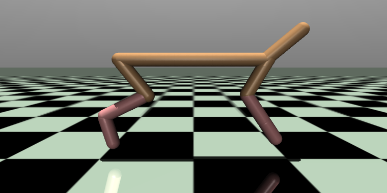

<h1 class="visually-hidden">Half Cheetah</h1>
<div class="gn-env-banner">
<canvas class="gn-pixel" data-text="HALF CHEETAH" data-scale="6" data-color="#fcfcfc" data-shadow="#e45c10"></canvas>
<canvas class="gn-pixel" data-text="MUJOCO  6 ACTIONS  17 OBSERVATIONS" data-scale="2" data-color="#f8b800"></canvas>
</div>

<p class="gn-env-lead">Make a two-legged cheetah, cut in half lengthwise so that it lives in a plane, run forward as fast as it can, with a motor at each hip, knee and ankle. The physics is MuJoCo's, run in Gym.NET's own engine, written from scratch in C# and bit for bit with MuJoCo 4.0.0.</p>

<aside class="gn-infobox" aria-label="Half Cheetah at a glance">
<video src="media/HalfCheetah-v5.episode.mp4" poster="media/HalfCheetah-v5.figure.png" autoplay muted loop playsinline disablepictureinpicture disableremoteplayback aria-label="HalfCheetah-v5, seed 0: Farama's TQC expert gallops 900 metres in 1,000 steps"></video>
<p class="gn-infobox-caption">The whole episode <code>examples/HalfCheetah</code> plays and records: Farama's TQC expert through the model's <code>track</code> camera, seed 0, 1,000 steps, return 17,648.0.</p>
<table>
<tr><td>Ids</td><td><code>HalfCheetah-v5</code> 1,000 steps<br><code>HalfCheetah-v4</code> 1,000 steps</td></tr>
<tr><td>Action space</td><td><code>Box(-1.0, 1.0, (6,), float32)</code></td></tr>
<tr><td>Observation space</td><td><code>Box(-inf, inf, (17,), float64)</code></td></tr>
<tr><td>Reward</td><td>the forward speed, less 0.1 × the torques squared · solved at 4,800</td></tr>
<tr><td>Physics</td><td>MuJoCo 4.0.0 in Gym.NET's own engine, bit for bit: 5 Euler steps of 0.01 s per env step</td></tr>
<tr><td>Render modes</td><td><code>human</code>, <code>rgb_array</code>, <code>depth_array</code>, <code>rgbd_tuple</code> · 480×480 · 20 fps</td></tr>
<tr><td>Make</td><td><code>Gymnasium.Make(<wbr>"HalfCheetah-v5")</code></td></tr>
<tr><td>Class</td><td><a href="xref:Gym.Environments.Envs.MuJoCo.HalfCheetahEnvV5"><code>HalfCheetahEnvV5</code></a>, options <a href="xref:Gym.Environments.Envs.MuJoCo.HalfCheetahEnvV5Options"><code>HalfCheetahEnvV5Options</code></a>, info <a href="xref:Gym.Environments.Envs.MuJoCo.HalfCheetahInfoV5"><code>HalfCheetahInfoV5</code></a></td></tr>
<tr><td>Vector env</td><td>none of its own: <code>MakeVec</code> builds sync or async</td></tr>
<tr><td>Parity</td><td><span class="gn-badge gn-badge-ok">physics bit for bit</span><span class="gn-badge gn-badge-warn">frames: 1.8% of pixels a level off</span><br>with Gymnasium 1.4.0 on MuJoCo 4.0.0</td></tr>
<tr><td>Gymnasium</td><td><a href="https://gymnasium.farama.org/v1.4.0/environments/mujoco/half_cheetah/">Half Cheetah</a> in Gymnasium 1.4.0's docs</td></tr>
</table>
</aside>

## Description

The cheetah is a torso with a head and two legs, a back one and a front one, each of three segments: thigh, shin and
foot. It moves only in the vertical plane along the x axis: its torso slides forward and up and pitches, and six hinges
join the segments, each with a spring, a damper and a motor. The agent sets the six motors' torques each step, and the
reward pays for forward speed and charges for torque. Nothing ends the episode early, neither a fall nor a flip: it
always runs for the 1,000 steps of the time limit, 50 seconds of simulated time.

The env comes from P. Wawrzyński's cat-like robot that learned to run in real time, and Gymnasium keeps it as one of its
standard locomotion tasks. Gym.NET runs it on its own MuJoCo engine, a C# reimplementation of MuJoCo 4.0.0 that
computes every float of every step as MuJoCo does on the reference machine, so the episodes are Gymnasium's, value for
value. Gym.NET also draws MuJoCo's frames itself, in software, close to Gymnasium's but not yet equal (see
[Parity](#parity-with-gymnasium)).

## Quick start

# [C#](#tab/csharp)

[!code-csharp[](../../../tests/Gym.Tests/Docs/EnvPageSamples/HalfCheetahSamples.cs?range=1-4,37-43&dedent=12)]

# [Python (Gymnasium)](#tab/python)

```python
import gymnasium as gym

env = gym.make("HalfCheetah-v5")
# 17 numbers: the torso's height and pitch, 6 joint angles, 9 velocities
observation, info = env.reset(seed=42)
# six torques, each from -1 to 1: back thigh, shin, foot, then the front's
action = env.action_space.sample()
observation, reward, terminated, truncated, info = env.step(action)
```

---

`dotnet add package Gym.NET.Environments`; the six longer examples are in [Code examples](#code-examples).

### Play it, or watch the agent

```bash
# from a clone of the repository: the playable HalfCheetah, Q/A W/S E/D the back leg, U/J I/K O/L the front, Tab the autopilot
dotnet run --project examples/HalfCheetah -c Release -- --play
# the agent in the video runs in MuJoCo's window
dotnet run --project examples/HalfCheetah -c Release -- --render
```

## How it works

<div class="gn-figure gn-figure-wide">

<svg viewBox="0 0 760 380" font-family="system-ui, sans-serif" role="img" aria-label="Labels: the torso, whose height and pitch are the observation's items 0 and 1 and their velocities, with the forward speed, items 8 to 10; the back leg's thigh, shin and foot joints, items 2 to 4 for their angles and 11 to 13 for their speeds, driven by actions 0 to 2 at gears 120, 90 and 60; the front leg's, items 5 to 7 and 14 to 16, actions 3 to 5 at gears 120, 60 and 30">
<line x1="380" y1="117.45" x2="380" y2="52" stroke="#000" stroke-width="3" stroke-linecap="round"/><line x1="380" y1="117.45" x2="380" y2="52" stroke="#ffffff" stroke-width="1.3" stroke-linecap="round"/>
<line x1="233.47" y1="117.45" x2="182" y2="62" stroke="#000" stroke-width="3" stroke-linecap="round"/><line x1="233.47" y1="117.45" x2="182" y2="62" stroke="#ffd43b" stroke-width="1.3" stroke-linecap="round"/>
<line x1="282.53" y1="190" x2="326" y2="201" stroke="#000" stroke-width="3" stroke-linecap="round"/><line x1="282.53" y1="190" x2="326" y2="201" stroke="#ffd43b" stroke-width="1.3" stroke-linecap="round"/>
<line x1="204.39" y1="229.27" x2="130" y2="312" stroke="#000" stroke-width="3" stroke-linecap="round"/><line x1="204.39" y1="229.27" x2="130" y2="312" stroke="#ffd43b" stroke-width="1.3" stroke-linecap="round"/>
<line x1="526.53" y1="117.45" x2="586" y2="62" stroke="#000" stroke-width="3" stroke-linecap="round"/><line x1="526.53" y1="117.45" x2="586" y2="62" stroke="#ffd43b" stroke-width="1.3" stroke-linecap="round"/>
<line x1="483.3" y1="187.16" x2="434" y2="264" stroke="#000" stroke-width="3" stroke-linecap="round"/><line x1="483.3" y1="187.16" x2="434" y2="264" stroke="#ffd43b" stroke-width="1.3" stroke-linecap="round"/>
<line x1="518.43" y1="237.56" x2="576" y2="296" stroke="#000" stroke-width="3" stroke-linecap="round"/><line x1="518.43" y1="237.56" x2="576" y2="296" stroke="#ffd43b" stroke-width="1.3" stroke-linecap="round"/>
<circle cx="380" cy="117.45" r="4" fill="#ffffff" stroke="#000" stroke-width="1.2"/>
<text x="380" y="30" text-anchor="middle" fill="#ffffff" font-weight="700" paint-order="stroke" stroke="#000" stroke-width="3" stroke-linejoin="round" font-size="13">torso: height [0], pitch [1]</text>
<text x="380" y="46" text-anchor="middle" fill="#ffffff" font-weight="600" paint-order="stroke" stroke="#000" stroke-width="3" stroke-linejoin="round" font-size="12">speeds [8] forward, [9] up, [10] pitch; x not observed</text>
<circle cx="233.47" cy="117.45" r="4" fill="#ffd43b" stroke="#000" stroke-width="1.2"/>
<text x="178" y="66" text-anchor="end" fill="#ffd43b" font-weight="700" paint-order="stroke" stroke="#000" stroke-width="3" stroke-linejoin="round" font-size="13">back thigh · action 0</text>
<text x="178" y="82" text-anchor="end" fill="#ffd43b" font-weight="600" paint-order="stroke" stroke="#000" stroke-width="3" stroke-linejoin="round" font-size="12">angle [2], speed [11], gear 120</text>
<circle cx="282.53" cy="190" r="4" fill="#ffd43b" stroke="#000" stroke-width="1.2"/>
<text x="330" y="205" text-anchor="start" fill="#ffd43b" font-weight="700" paint-order="stroke" stroke="#000" stroke-width="3" stroke-linejoin="round" font-size="13">back shin · action 1</text>
<text x="330" y="221" text-anchor="start" fill="#ffd43b" font-weight="600" paint-order="stroke" stroke="#000" stroke-width="3" stroke-linejoin="round" font-size="12">angle [3], speed [12], gear 90</text>
<circle cx="204.39" cy="229.27" r="4" fill="#ffd43b" stroke="#000" stroke-width="1.2"/>
<text x="14" y="330" text-anchor="start" fill="#ffd43b" font-weight="700" paint-order="stroke" stroke="#000" stroke-width="3" stroke-linejoin="round" font-size="13">back foot · action 2</text>
<text x="14" y="346" text-anchor="start" fill="#ffd43b" font-weight="600" paint-order="stroke" stroke="#000" stroke-width="3" stroke-linejoin="round" font-size="12">angle [4], speed [13], gear 60</text>
<circle cx="526.53" cy="117.45" r="4" fill="#ffd43b" stroke="#000" stroke-width="1.2"/>
<text x="590" y="66" text-anchor="start" fill="#ffd43b" font-weight="700" paint-order="stroke" stroke="#000" stroke-width="3" stroke-linejoin="round" font-size="13">front thigh · action 3</text>
<text x="590" y="82" text-anchor="start" fill="#ffd43b" font-weight="600" paint-order="stroke" stroke="#000" stroke-width="3" stroke-linejoin="round" font-size="12">angle [5], speed [14], gear 120</text>
<circle cx="483.3" cy="187.16" r="4" fill="#ffd43b" stroke="#000" stroke-width="1.2"/>
<text x="430" y="268" text-anchor="end" fill="#ffd43b" font-weight="700" paint-order="stroke" stroke="#000" stroke-width="3" stroke-linejoin="round" font-size="13">front shin · action 4</text>
<text x="430" y="284" text-anchor="end" fill="#ffd43b" font-weight="600" paint-order="stroke" stroke="#000" stroke-width="3" stroke-linejoin="round" font-size="12">angle [6], speed [15], gear 60</text>
<circle cx="518.43" cy="237.56" r="4" fill="#ffd43b" stroke="#000" stroke-width="1.2"/>
<text x="580" y="300" text-anchor="start" fill="#ffd43b" font-weight="700" paint-order="stroke" stroke="#000" stroke-width="3" stroke-linejoin="round" font-size="13">front foot · action 5</text>
<text x="580" y="316" text-anchor="start" fill="#ffd43b" font-weight="600" paint-order="stroke" stroke="#000" stroke-width="3" stroke-linejoin="round" font-size="12">angle [7], speed [16], gear 30</text>
</svg>
</div>
<p class="gn-figure-caption">The reset pose without noise (<code>reset_noise_scale</code> 0), rendered by Gym.NET with MuJoCo's free camera 1.6 m from a point 0.45 m above the floor, at azimuth 90° and elevation −8°. Each dot is a joint's body projected through MuJoCo's camera geometry, labelled with its items in the observation and its motor. Gymnasium's frame of the same pose differs in 14,628 of its 288,800 pixels, by at most 3 of 255 levels and by 1 in all but 1,079, almost all on the floor's checkers.</p>

MuJoCo steps the model with the Euler integrator every 0.01 s, and an env step holds the action for five of those
steps, 0.05 s, hence 20 steps and frames a second. Each motor applies its gear times its control, so a control of 1
on the back thigh is a torque of 120 N·m; each hinge also has a spring toward its rest angle and a damper, and the
joints stop at their ranges. The torso's own three degrees of freedom are free: x and z slide, the pitch turns.

The reward of a step is the torso's average forward speed over it, less a cost on the controls:

$$
r_t = w_f\,\frac{x_{t+1} - x_t}{\Delta t} - w_c \sum_{j=1}^{6} a_{t,j}^2
$$

with $\Delta t = 0.05$ s, $w_f = 1$ and $w_c = 0.1$. A full-torque step costs at most 0.6; the expert in the video
runs at 18 m/s on average, so its reward is almost all speed.

| Constant | Gym.NET | Gymnasium | Value | Effect |
|---|---|---|--:|---|
| Physics step | `Model.Opt.Timestep` | `model.opt.timestep` | 0.01 s | MuJoCo's step, Euler |
| Frame skip | `FrameSkip` | `frame_skip` | 5 | Physics steps per env step: an env step is 0.05 s |
| Forward weight | `ForwardRewardWeight` | `_forward_reward_weight` | 1.0 | Multiplies the speed in the reward |
| Control cost | `CtrlCostWeight` | `_ctrl_cost_weight` | 0.1 | Multiplies the controls squared |
| Reset noise | `ResetNoiseScale` | `_reset_noise_scale` | 0.1 | The starting state's spread |
| Gears | the model's | `actuator_gear` | 120, 90, 60, 120, 60, 30 | Torque per unit of control, thighs to feet |

> [!NOTE]
> The reward's speed is the torso's average over the step, the displacement over 0.05 s, while the observation's item
> 8 is MuJoCo's velocity at the step's end: the two differ. Nothing penalizes a fall or a flip, and the episode never
> ends early. The floor collides everywhere but is drawn only 40 m to each side of the start: the expert in the video
> passes x = 40 m at step 96, and from there its frames show the checkers ending behind it.

## Action space

`Box(-1.0, 1.0, (6,), float32)`: one control per motor, its torque the control times the motor's gear.

| Index | Motor | Gear (N·m) | Joint range (rad) |
|---|---|--:|---|
| 0 | Back thigh (`bthigh`) | 120 | −0.52 to 1.05 |
| 1 | Back shin (`bshin`) | 90 | −0.785 to 0.785 |
| 2 | Back foot (`bfoot`) | 60 | −0.4 to 0.785 |
| 3 | Front thigh (`fthigh`) | 120 | −1 to 0.7 |
| 4 | Front shin (`fshin`) | 60 | −1.2 to 0.87 |
| 5 | Front foot (`ffoot`) | 30 | −0.5 to 0.5 |

MuJoCo clamps each control to the motor's range of −1 to 1 before it acts; the control cost reads the action as given,
so a control of 2 costs as 2 but pushes as 1.

## Observation space

`Box(-inf, inf, (17,), float64)`: the joint positions and velocities, `qpos` without the torso's x, then `qvel`.

| Index | Meaning | Unit |
|---|---|---|
| 0 | The torso's height relative to its start (`rootz`) | m |
| 1 | The torso's pitch (`rooty`) | rad |
| 2 to 4 | The back thigh's, shin's and foot's angles | rad |
| 5 to 7 | The front thigh's, shin's and foot's angles | rad |
| 8 | The torso's forward velocity (`rootx`) | m/s |
| 9 | Its vertical velocity (`rootz`) | m/s |
| 10 | Its pitch rate (`rooty`) | rad/s |
| 11 to 16 | The six joints' angular velocities, in the order of items 2 to 7 | rad/s |

The torso's x is left out so that a policy cannot depend on where it is; `exclude_current_positions_from_observation`
false puts it first, making 18 items. The x position is always in the info.

## Rewards

The forward speed times `forward_reward_weight`, less `ctrl_cost_weight` times the sum of the squared controls; the
info splits the two as `reward_forward` and `reward_ctrl`. Moving backward pays a negative speed. The registry counts
an average of 4,800 over 100 episodes as solved; the expert in the video makes 17,648.0.

## Starting state

The model's pose, the torso level 0.7 m above the floor with both legs bent under it, plus noise: every position
coordinate gets a uniform draw from ±`reset_noise_scale` (0.1), every velocity a normal draw with that standard
deviation. With `reset_noise_scale` 0 every seed starts from the pose in the figure, at rest.

## Episode end

| Ends by | When |
|---|---|
| Termination | Never |
| Truncation | 1,000 steps: the `TimeLimit` that `Make` wraps around the env |

## Arguments

By Gymnasium's name in `Make`'s kwargs, or by the C# name in the constructor and in
<xref:Gym.Environments.Envs.MuJoCo.HalfCheetahEnvV5Options>.

| Argument | Type and default | Effect |
|---|---|---|
| `xml_file`<br>`xmlFile` | `string`<br>`"half_cheetah.xml"` | The model: the bundled one by name, or a path to your own MJCF file |
| `frame_skip`<br>`frameSkip` | `int`<br>`5` | Physics steps per env step; changes the step's duration and the frame rate |
| `default_camera_config`<br>`defaultCameraConfig` | `IReadOnlyDictionary<string, object?>?`<br>`null` | The free camera's `distance`, `azimuth`, `elevation`, `lookat` or `trackbodyid`; null takes the env's own, a distance of 4 m |
| `forward_reward_weight`<br>`forwardRewardWeight` | `double`<br>`1.0` | The weight of the speed in the reward |
| `ctrl_cost_weight`<br>`ctrlCostWeight` | `double`<br>`0.1` | The weight of the control cost |
| `reset_noise_scale`<br>`resetNoiseScale` | `double`<br>`0.1` | The starting state's noise; 0 starts from the model's pose |
| `exclude_current_positions_from_observation`<br>`excludeCurrentPositionsFromObservation` | `bool`<br>`true` | Leave the torso's x out of the observation |
| `render_mode`<br>`renderMode` | `string?` or `RenderMode`<br>`null` | `"human"` opens MuJoCo's window; `"rgb_array"`, `"depth_array"` and `"rgbd_tuple"` make `Render()` return frames |
| `width`<br>`width` | `int`<br>`480` | The frame's width in pixels |
| `height`<br>`height` | `int`<br>`480` | The frame's height in pixels |
| `camera_id`<br>`cameraId` | `int?`<br>`null` | A camera by index (−1 the free camera); not with `camera_name` |
| `camera_name`<br>`cameraName` | `string?`<br>`null` | A camera by name: the model's `"track"` follows the torso |
| `max_geom`<br>`maxGeom` | `int`<br>`1000` | The renderer's scene capacity |
| `visual_options`<br>`visualOptions` | `IReadOnlyDictionary<int, bool>?`<br>`null` | MuJoCo's visualization flags by index (contact points, forces, ...) |
| (Gym.NET)<br>`viewerFactory` | `EnvViewerFactory?`<br>`null` | The window for `human`: Avalonia, WinForms, or headless |

[!code-csharp[](../../../tests/Gym.Tests/Docs/EnvPageSamples/HalfCheetahSamples.cs#Arguments)]

## Info

<xref:Gym.Environments.Envs.MuJoCo.HalfCheetahInfoV5>: `{"x_position": ...}` on every reset; `x_position`,
`x_velocity` (the step's average speed), `reward_forward` and `reward_ctrl` on every step. Read them as
`info.Get<double>("x_velocity")`, or through the typed record.

## Rendering

| Mode | What you get |
|---|---|
| `rgb_array` | `Render()` returns the frame: `(480, 480, 3)` uint8 by default, `width` by `height` |
| `depth_array` | `Render()` returns MuJoCo's depth buffer, `(480, 480)` float32: 0 at the near plane, 1 at the far one, not metres |
| `rgbd_tuple` | `Render()` returns both, `RenderResult.RgbDepth`, as Python's `(rgb, depth)` |
| `human` | MuJoCo's window from the viewer factory, drawn after every reset and step, with Gymnasium's controls |
| none | `Render()` warns and returns nothing, as Gymnasium's does |

The camera matters here more than anywhere: with no camera named, Gymnasium 1.4 renders through MuJoCo's free camera,
4 m from where the cheetah starts, and it does not follow: at the expert's speed the cheetah leaves the frame within a
second.
`camera_name = "track"` takes the model's own camera, 3 m to the side, which follows the body's centre of mass, as the
video does; `default_camera_config` places the free camera, as the figure does. In `human` mode, Tab cycles the
cameras, the mouse orbits, pans and zooms, and H lists Gymnasium's other keys.

Gym.NET draws MuJoCo's frames in software, about 0.2 s each for this model: the classic renderer's passes (the
reflective floor, shadows, the skybox and the haze), reproduced in C#. By default every frame is drawn, so the window
runs slower than real time; D switches to skipping frames.

## Episode anatomy

The whole episode, step by step: the distance run, the speed, the torso's pitch and the control cost, with a cursor
following the video. The expert accelerates for about five seconds, past 15 m/s at step 86, then holds 18 to 19 m/s,
up to 19.9, for 900.8 m in all; its torso stays within 9° of level, and each leg swings through a stride every 6 steps,
0.3 s. From step 96 it runs past the floor's drawn edge, and its frames show it against grey.

<div class="gn-anatomy" data-trace="media/HalfCheetah-v5.episode.json">
<div><video src="media/HalfCheetah-v5.episode.mp4" poster="media/HalfCheetah-v5.figure.png" autoplay muted loop playsinline disablepictureinpicture disableremoteplayback aria-label="HalfCheetah-v5, seed 0, the episode the chart follows"></video><div class="gn-anatomy-readout" aria-live="off"></div></div>
<div><div class="gn-anatomy-chart"></div><div class="gn-anatomy-legend"></div></div>
<script type="application/json" class="gn-anatomy-spec">{"label":"HalfCheetah-v5, seed 0: the distance run, the speed, the torso's pitch and the control cost","bands":[{"height":70,"range":[0,920],"ticks":[0,300,600,900],"series":[{"column":"x","color":"#f8b800","name":"x, the distance run (m)"}]},{"height":70,"range":[-1,21],"ticks":[0,10,20],"series":[{"column":"vx","color":"#3cbcfc","name":"the forward speed (m/s)"}]},{"height":60,"range":[-10,10],"scale":57.29577951308232,"ticks":[-5,0,5],"unit":"°","series":[{"column":"pitch","color":"#b8b8f8","name":"the torso's pitch"}]},{"height":60,"range":[-0.65,0.05],"ticks":[-0.6,-0.3,0],"series":[{"column":"reward_ctrl","color":"#ff6b6b","width":1.1,"name":"the control cost, −0.1 × the torques squared"}]}],"readout":[{"label":"step","column":"@step"},{"label":"x","column":"x","digits":1,"unit":" m"},{"label":"speed","column":"vx","digits":1,"unit":" m/s"},{"label":"return so far","column":"@return","digits":1}]}</script>
</div>

## Code examples

### Run an episode

# [C#](#tab/csharp)

[!code-csharp[](../../../tests/Gym.Tests/Docs/EnvPageSamples/HalfCheetahSamples.cs#RunAnEpisode)]

# [Python (Gymnasium)](#tab/python)

```python
import gymnasium as gym

env = gym.make("HalfCheetah-v5")
observation, info = env.reset(seed=42)
episode_return = 0.0
while True:
    action = env.action_space.sample()
    observation, reward, terminated, truncated, info = env.step(action)
    episode_return += reward
    if terminated or truncated:  # never terminated: 1,000 steps
        break
print(f"return {episode_return:.1f}")  # random torques: -295.8 on average
```

---

### The reward's terms

# [C#](#tab/csharp)

[!code-csharp[](../../../tests/Gym.Tests/Docs/EnvPageSamples/HalfCheetahSamples.cs#RewardTerms)]

# [Python (Gymnasium)](#tab/python)

```python
import numpy as np

env = gym.make("HalfCheetah-v5")
env.reset(seed=42)
action = np.full(6, 0.5, dtype=np.float32)  # every motor at half torque
observation, reward, terminated, truncated, info = env.step(action)
forward, control = info["reward_forward"], info["reward_ctrl"]
# 0.1357 = 0.2857 forward (the speed in m/s) - 0.1500 (0.1 x the torques squared)
print(f"{reward:.4f} = {forward:.4f} forward {control:.4f} control")
```

---

### Start without noise

# [C#](#tab/csharp)

[!code-csharp[](../../../tests/Gym.Tests/Docs/EnvPageSamples/HalfCheetahSamples.cs#ResetWithoutNoise)]

# [Python (Gymnasium)](#tab/python)

```python
env = gym.make("HalfCheetah-v5", reset_noise_scale=0.0)
observation, info = env.reset(seed=42)
# the model's pose at rest: every angle and velocity 0, the same for every seed
print(bool(np.all(observation == 0)))  # True
```

---

### Reweight the reward

# [C#](#tab/csharp)

[!code-csharp[](../../../tests/Gym.Tests/Docs/EnvPageSamples/HalfCheetahSamples.cs#RewardWeights)]

# [Python (Gymnasium)](#tab/python)

```python
env = gym.make("HalfCheetah-v5", forward_reward_weight=2.0, ctrl_cost_weight=0.0)
env.reset(seed=42)
observation, reward, terminated, truncated, info = env.step(np.full(6, 0.5, dtype=np.float32))
print(f"{reward:.4f} = 2 x {info['x_velocity']:.4f}")  # 0.5713 = 2 x 0.2857
```

---

### Cameras and depth

# [C#](#tab/csharp)

[!code-csharp[](../../../tests/Gym.Tests/Docs/EnvPageSamples/HalfCheetahSamples.cs#CamerasAndDepth)]

# [Python (Gymnasium)](#tab/python)

```python
# the model's "track" camera follows the torso; rgbd_tuple draws colour and depth together
env = gym.make("HalfCheetah-v5", render_mode="rgbd_tuple", camera_name="track")
env.reset(seed=42)
rgb, depth = env.render()
print(rgb.shape, depth.shape)  # (480, 480, 3) (480, 480)
# MuJoCo's raw depth buffer, 0 at the near plane and 1 at the far one,
# not metres: the nearest point, the floor at the bottom edge, is 0.97
print(f"{depth.min():.2f}")  # 0.97
```

---

### Many cheetahs at once

# [C#](#tab/csharp)

[!code-csharp[](../../../tests/Gym.Tests/Docs/EnvPageSamples/HalfCheetahSamples.cs#ManyCheetahs)]

# [Python (Gymnasium)](#tab/python)

```python
# No vector env of its own: make_vec steps 8 envs in turn ("sync")
envs = gym.make_vec("HalfCheetah-v5", num_envs=8, vectorization_mode="sync")
observations, infos = envs.reset(seed=42)  # 8 x 17 observations
for t in range(100):
    actions = envs.action_space.sample()  # 8 x 6 torques
    observations, rewards, terminations, truncations, infos = envs.step(actions)
```

---

Every C# example is a test in `tests/Gym.Tests/Docs/EnvPageSamples`, compiled and run by the unit gate; where a
comment states a number, the test checks it.

## Agents and examples

- **The video's agent** is Farama's TQC expert (Truncated Quantile Critics), the agent the Farama Foundation,
  Gymnasium's maintainers, trained on HalfCheetah-v5 to record the Minari datasets, imported from Hugging Face
  (`farama-minari/HalfCheetah-v5-TQC-expert`): two dense layers of 256 with ReLU that read the 17 observations and
  squash their output into the motors' range with tanh. Seed 0 returns 17,648.0; over seeds 0 to 9 it averages 17,629
  in Gym.NET, and its model card reports 17,641.80 ± 61.88.
- **[examples/HalfCheetah](https://github.com/SciSharp/Gym.NET/tree/master/examples/HalfCheetah)**
  ([`HalfCheetahProgram.cs`](https://github.com/SciSharp/Gym.NET/blob/master/examples/HalfCheetah/HalfCheetahProgram.cs))
  plays it: `dotnet run --project examples/HalfCheetah -c Release` plays seed 0 headless, `--seed N` another seed,
  `--episodes N` that many seeds and their mean, `--render` in MuJoCo's window. `--autopilot` plays its linear
  autopilot instead, trained by Augmented Random Search on Gym.NET's engine: 5,797.0 from seed 0, which Gymnasium
  reproduces to the last bit.
- **Play it yourself**: `--play` opens the playable HalfCheetah, which steps its own copy of the engine and draws a
  cheap side view in real time: Q/A, W/S and E/D turn the back thigh, shin and foot, U/J, I/K and O/L the front's, and
  Tab hands the motors to the autopilot.
- **This page's video and chart** are the example's own episode: `--record docs/environments/mujoco/media` records it
  with `RecordVideo` (one frame per step, through the `track` camera) and writes the step trace and the figure beside
  it.

## Vectorized environment

Half Cheetah registers no vector env of its own. `Gymnasium.MakeVec("HalfCheetah-v5", n)` builds a `SyncVectorEnv`
that steps `n` separate envs in turn, and `VectorizeMode.Async` an `AsyncVectorEnv` that steps them on worker threads;
each env resets itself after its episode ends (next-step autoreset), as Gymnasium's. Each env has its own simulation.

## Variants

<a id="v4"></a>

### HalfCheetah-v4

The same cheetah with Gymnasium's previous arguments: no `xml_file`, `frame_skip` or `default_camera_config`, an empty
info at reset, and the forward term named `reward_run` instead of `reward_forward`. The physics is the same: from the
same seed and actions, v4 and v5 give the same observations and rewards, measured over 200 steps, and the same frames.
Gymnasium warns that v4 is out of date, and Gym.NET does the same. The class is
<xref:Gym.Environments.Envs.MuJoCo.HalfCheetahEnvV4>, its info <xref:Gym.Environments.Envs.MuJoCo.HalfCheetahInfoV4>.

## Parity with Gymnasium

Gymnasium 1.4.0 runs inside the test process, MuJoCo 4.0.0 under it, and both are compared value by value:

| What is compared | How | Result |
|---|---|---|
| Episodes | sampled episodes of both versions from several seeds, three in a row in one env, every observation, reward, flag and info value with its NumPy type | ✓ bit for bit |
| Arguments | Gymnasium's keyword variants: the x in the observation, other weights and noise, another frame skip | ✓ bit for bit |
| Actions | every form of action NumPy takes or refuses, with Gymnasium's messages | ✓ same values, same messages |
| The engine | 50 traces of `mj_step`'s state against MuJoCo's own, step by step (`tools/parity/mujoco/halfcheetah_poc`) | ✓ bit for bit |
| Frames | `rgb_array` and `depth_array` frames against Gymnasium's on the reference GPU, within a measured baseline | 4,191 of 230,400 pixels differ, by one to three levels |
| Spaces, metadata, `make`'s stack, the window | both spaces; the metadata; `make`'s stacks and warnings; the human window's controls and overlay | ✓ |

The tests: [MujocoLiveParityTests](https://github.com/SciSharp/Gym.NET/blob/master/tests/Gym.Tests.Parity/Tests/Envs/MujocoLiveParityTests.cs),
[MujocoFrameLiveParityTests](https://github.com/SciSharp/Gym.NET/blob/master/tests/Gym.Tests.Parity/Tests/Envs/MujocoFrameLiveParityTests.cs),
[MujocoWindowLiveParityTests](https://github.com/SciSharp/Gym.NET/blob/master/tests/Gym.Tests.Parity/Tests/Envs/MujocoWindowLiveParityTests.cs).
Bit for bit holds on the reference machine, an x64 CPU with FMA: the engine calls the platform's math functions, and on
a CPU without FMA their last bits differ and a long episode drifts (this env's autopilot returns 5,895.8 instead of
5,797.0 on a Xeon without FMA). The frames are Gym.NET's own drawing of MuJoCo's renderer: equal to Gymnasium's for the
inverted pendulums, and for this model differing in about 1.8% of the pixels, almost all on the floor's checkers, by one
to three levels of 255 (DR-98 is closing the gap family by family).

## Performance

| | Steps a second | Bytes a step |
|---|--:|--:|
| Gym.NET | 19,269 | 15,427 |
| Gymnasium | 11,509 | |

1.7× faster. Gymnasium's own `benchmark_step` on both sides (Gym.NET's `Performance.BenchmarkStep`, DR-36): random actions, a reset at each episode's end, after a 2-second warm-up; .NET 10 in Release against CPython 3.12 with MuJoCo 4.0.0's own bindings; the medians of three interleaved rounds of 5 seconds on one machine (2026-11-24). Gym.NET's engine is managed C#, MuJoCo's is native C; the step is the physics, the observation and the reward, no rendering.

## Reference sources

- [gymnasium/envs/mujoco/half_cheetah_v5.py](https://github.com/Farama-Foundation/Gymnasium/blob/8ba8c3a63bb4e000b7f33923f43d292acac07be1/gymnasium/envs/mujoco/half_cheetah_v5.py)
  and [half_cheetah_v4.py](https://github.com/Farama-Foundation/Gymnasium/blob/8ba8c3a63bb4e000b7f33923f43d292acac07be1/gymnasium/envs/mujoco/half_cheetah_v4.py),
  Gymnasium 1.4.0: the environment; [mujoco_env.py](https://github.com/Farama-Foundation/Gymnasium/blob/8ba8c3a63bb4e000b7f33923f43d292acac07be1/gymnasium/envs/mujoco/mujoco_env.py),
  the base class (the model, the reset's noise, the frame skip); [mujoco_rendering.py](https://github.com/Farama-Foundation/Gymnasium/blob/8ba8c3a63bb4e000b7f33923f43d292acac07be1/gymnasium/envs/mujoco/mujoco_rendering.py),
  the cameras and the window.
- [half_cheetah.xml](https://github.com/Farama-Foundation/Gymnasium/blob/8ba8c3a63bb4e000b7f33923f43d292acac07be1/gymnasium/envs/mujoco/assets/half_cheetah.xml),
  the model, embedded as MuJoCo 4.0.0 compiles it (`src/Gym.Environments/Assets/mujoco`).
- [MuJoCo 4.0.0](https://github.com/google-deepmind/mujoco/tree/4.0.0/src/engine), the engine Gym.NET's
  `Gym.MuJoCo` reproduces (`engine_forward.c`, `engine_core_smooth.c`, `engine_collision_*.c`, the solvers), and its
  classic renderer (`src/render/classic`), which Gym.NET draws in software.

## Version history

| Version | Change |
|---|---|
| v5 | MuJoCo 2.3.3 or later; custom models through `xml_file`; `default_camera_config`, `frame_skip` and `observation_structure`; a non-empty info at reset; `reward_run` renamed `reward_forward` |
| v4 | The `mujoco` bindings (MuJoCo 2.1.3 or later) instead of mujoco-py |
| v3 | `make` kwargs such as `xml_file`, `ctrl_cost_weight` and `reset_noise_scale`; frames from the tracking camera; now raises `ImportError` in Gymnasium (mujoco-py), and in Gym.NET |
| v2 | mujoco-py 1.50; likewise refused today |
| v1 | Episodes of 1,000 steps; the reward threshold |
| v0 | The first release |
| Gym.NET 1.0.0 | New: Gymnasium 1.4.0's HalfCheetah-v5 and HalfCheetah-v4 on Gym.NET's own MuJoCo engine, bit for bit; 0.2.0 had no MuJoCo |

## References

1. P. Wawrzyński, "A Cat-Like Robot Real-Time Learning to Run", *Adaptive and Natural Computing Algorithms
   (ICANNGA)*, Lecture Notes in Computer Science 5495, Springer, 2009: the robot the env is based on.
2. E. Todorov, T. Erez and Y. Tassa, "MuJoCo: A physics engine for model-based control", *IROS*, 2012: the engine.
   [mujoco.org](https://mujoco.org)
3. A. Kuznetsov, P. Shvechikov, A. Grishin and D. Vetrov, "Controlling Overestimation Bias with Truncated Mixture of
   Continuous Distributional Quantile Critics", *ICML*, 2020: TQC, the expert's algorithm.
   [arXiv:2005.04269](https://arxiv.org/abs/2005.04269)
4. H. Mania, A. Guy and B. Recht, "Simple random search of static linear policies is competitive for reinforcement
   learning", *NeurIPS*, 2018: Augmented Random Search, the autopilot's training. [arXiv:1803.07055](https://arxiv.org/abs/1803.07055)

## External links

- [Half Cheetah on Gymnasium's site](https://gymnasium.farama.org/v1.4.0/environments/mujoco/half_cheetah/) (1.4.0)
- [HalfCheetahEnvV5.cs](https://github.com/SciSharp/Gym.NET/blob/master/src/Gym.Environments/Envs/MuJoCo/HalfCheetahEnvV5.cs) on GitHub
- [examples/HalfCheetah](https://github.com/SciSharp/Gym.NET/tree/master/examples/HalfCheetah)
- [farama-minari/HalfCheetah-v5-TQC-expert](https://huggingface.co/farama-minari/HalfCheetah-v5-TQC-expert), the expert on Hugging Face

## API reference

<xref:Gym.Environments.Envs.MuJoCo.HalfCheetahEnvV5> · <xref:Gym.Environments.Envs.MuJoCo.HalfCheetahEnvV5Options> · <xref:Gym.Environments.Envs.MuJoCo.HalfCheetahInfoV5> · <xref:Gym.Environments.Envs.MuJoCo.HalfCheetahEnvV4> · <xref:Gym.Environments.Envs.MuJoCo.MujocoEnv>
