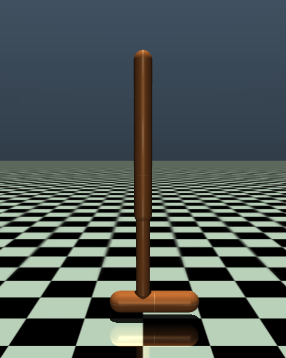

<h1 class="visually-hidden">Hopper</h1>
<div class="gn-env-banner">
<canvas class="gn-pixel" data-text="HOPPER" data-scale="6" data-color="#fcfcfc" data-shadow="#e45c10"></canvas>
<canvas class="gn-pixel" data-text="MUJOCO  3 ACTIONS  11 OBSERVATIONS" data-scale="2" data-color="#f8b800"></canvas>
</div>

<p class="gn-env-lead">Make a one-legged robot hop forward as far and as fast as it can without falling, with a motor at its hip, knee and ankle. The physics is MuJoCo's, run in Gym.NET's own engine, written from scratch in C# and bit for bit with MuJoCo 4.0.0.</p>

<aside class="gn-infobox" aria-label="Hopper at a glance">
<video src="media/Hopper-v5.episode.mp4" poster="media/Hopper-v5.figure.png" autoplay muted loop playsinline disablepictureinpicture disableremoteplayback aria-label="Hopper-v5, seed 0: Farama's SAC expert hops for all 1,000 steps"></video>
<p class="gn-infobox-caption">The whole episode <code>examples/Hopper</code> plays and records: Farama's SAC expert through the model's <code>track</code> camera, seed 0, 1,000 steps, return 4,187.0.</p>
<table>
<tr><td>Ids</td><td><code>Hopper-v5</code> 1,000 steps<br><code>Hopper-v4</code> 1,000 steps</td></tr>
<tr><td>Action space</td><td><code>Box(-1.0, 1.0, (3,), float32)</code></td></tr>
<tr><td>Observation space</td><td><code>Box(-inf, inf, (11,), float64)</code></td></tr>
<tr><td>Reward</td><td>1 a step for staying up, plus the forward speed, less 0.001 × the torques squared · solved at 3,800</td></tr>
<tr><td>Physics</td><td>MuJoCo 4.0.0 in Gym.NET's own engine, bit for bit: 4 Runge-Kutta steps of 0.002 s per env step</td></tr>
<tr><td>Render modes</td><td><code>human</code>, <code>rgb_array</code>, <code>depth_array</code>, <code>rgbd_tuple</code> · 480×480 · 125 fps</td></tr>
<tr><td>Make</td><td><code>Gymnasium.Make(<wbr>"Hopper-v5")</code></td></tr>
<tr><td>Class</td><td><a href="xref:Gym.Environments.Envs.MuJoCo.HopperEnvV5"><code>HopperEnvV5</code></a>, options <a href="xref:Gym.Environments.Envs.MuJoCo.HopperEnvV5Options"><code>HopperEnvV5Options</code></a>, info <a href="xref:Gym.Environments.Envs.MuJoCo.HopperInfoV5"><code>HopperInfoV5</code></a></td></tr>
<tr><td>Vector env</td><td>none of its own: <code>MakeVec</code> builds sync or async</td></tr>
<tr><td>Parity</td><td><span class="gn-badge gn-badge-ok">physics bit for bit</span><span class="gn-badge gn-badge-warn">frames: 14% of pixels differ</span><br>with Gymnasium 1.4.0 on MuJoCo 4.0.0</td></tr>
<tr><td>Gymnasium</td><td><a href="https://gymnasium.farama.org/v1.4.0/environments/mujoco/hopper/">Hopper</a> in Gymnasium 1.4.0's docs</td></tr>
</table>
</aside>

## Description

The hopper is a torso on a single leg of three segments, thigh, leg and foot, standing on the foot, and it moves only
in the vertical plane along the x axis. Three hinges join the parts, at the hip, the knee and the ankle, each with a
motor. Each step the agent sets the three torques; the reward pays a fixed amount for every step the hopper stays
upright, and for forward speed, and charges a little for torque. The episode ends as soon as the hopper falls: the
torso too low, tilted too far, or any part of the state out of range.

The env comes from T. Erez, Y. Tassa and E. Todorov's model-predictive control of periodic tasks, and Gymnasium keeps
it as one of its standard locomotion tasks. Gym.NET runs it on its own MuJoCo engine, a C# reimplementation of MuJoCo
4.0.0 that computes every float of every step as MuJoCo does on the reference machine, so the episodes are Gymnasium's,
value for value. Gym.NET also draws MuJoCo's frames itself, in software, close to Gymnasium's but not yet equal (see
[Parity](#parity-with-gymnasium)).

## Quick start

# [C#](#tab/csharp)

[!code-csharp[](../../../tests/Gym.Tests/Docs/EnvPageSamples/HopperSamples.cs?range=1-4,38-45&dedent=12)]

# [Python (Gymnasium)](#tab/python)

```python
import gymnasium as gym

env = gym.make("Hopper-v5")
# 11 numbers: the torso's height and angle, 3 joint angles, 6 velocities
observation, info = env.reset(seed=42)
# three torques, each from -1 to 1: thigh, leg, foot
action = env.action_space.sample()
observation, reward, terminated, truncated, info = env.step(action)
```

---

`dotnet add package Gym.NET.Environments`; the six longer examples are in [Code examples](#code-examples).

### Watch the agent

```bash
# from a clone of the repository: the agent in the video hops in MuJoCo's window
dotnet run --project examples/Hopper -c Release -- --render
```

Keyboard play is not offered: Gym.NET draws a frame of this model in about 0.5 s in software, while a step is 8 ms of
simulated time, so a game would run about 60 times slower than real time.

## How it works

<div class="gn-figure gn-figure-narrow">

<svg viewBox="0 0 480 600" font-family="system-ui, sans-serif" role="img" aria-label="Labels: the torso, whose height and angle are the observation's items 0 and 1 and whose velocities are items 5 to 7; the hip, the observation's items 2 and 8, driven by action 0; the knee, items 3 and 9, action 1; the ankle, items 4 and 10, action 2; every motor at gear 200">
<line x1="240" y1="162.47" x2="266" y2="66" stroke="#000" stroke-width="3" stroke-linecap="round"/><line x1="240" y1="162.47" x2="266" y2="66" stroke="#ffffff" stroke-width="1.3" stroke-linecap="round"/>
<line x1="240" y1="224.15" x2="209" y2="192" stroke="#000" stroke-width="3" stroke-linecap="round"/><line x1="240" y1="224.15" x2="209" y2="192" stroke="#ffd43b" stroke-width="1.3" stroke-linecap="round"/>
<line x1="240" y1="359.69" x2="274" y2="332" stroke="#000" stroke-width="3" stroke-linecap="round"/><line x1="240" y1="359.69" x2="274" y2="332" stroke="#ffd43b" stroke-width="1.3" stroke-linecap="round"/>
<line x1="240" y1="505.22" x2="204" y2="432" stroke="#000" stroke-width="3" stroke-linecap="round"/><line x1="240" y1="505.22" x2="204" y2="432" stroke="#ffd43b" stroke-width="1.3" stroke-linecap="round"/>
<circle cx="240" cy="162.47" r="4" fill="#ffffff" stroke="#000" stroke-width="1.2"/>
<text x="270" y="70" text-anchor="start" fill="#ffffff" font-weight="700" paint-order="stroke" stroke="#000" stroke-width="3" stroke-linejoin="round" font-size="13">torso: height [0], angle [1]</text>
<text x="270" y="86" text-anchor="start" fill="#ffffff" font-weight="600" paint-order="stroke" stroke="#000" stroke-width="3" stroke-linejoin="round" font-size="12">speeds [5] forward, [6] up,</text>
<text x="270" y="102" text-anchor="start" fill="#ffffff" font-weight="600" paint-order="stroke" stroke="#000" stroke-width="3" stroke-linejoin="round" font-size="12">[7] turning; x not observed</text>
<circle cx="240" cy="224.15" r="4" fill="#ffd43b" stroke="#000" stroke-width="1.2"/>
<text x="205" y="196" text-anchor="end" fill="#ffd43b" font-weight="700" paint-order="stroke" stroke="#000" stroke-width="3" stroke-linejoin="round" font-size="13">hip · action 0</text>
<text x="205" y="212" text-anchor="end" fill="#ffd43b" font-weight="600" paint-order="stroke" stroke="#000" stroke-width="3" stroke-linejoin="round" font-size="12">angle [2], speed [8]</text>
<text x="205" y="228" text-anchor="end" fill="#ffd43b" font-weight="600" paint-order="stroke" stroke="#000" stroke-width="3" stroke-linejoin="round" font-size="12">gear 200</text>
<circle cx="240" cy="359.69" r="4" fill="#ffd43b" stroke="#000" stroke-width="1.2"/>
<text x="278" y="336" text-anchor="start" fill="#ffd43b" font-weight="700" paint-order="stroke" stroke="#000" stroke-width="3" stroke-linejoin="round" font-size="13">knee · action 1</text>
<text x="278" y="352" text-anchor="start" fill="#ffd43b" font-weight="600" paint-order="stroke" stroke="#000" stroke-width="3" stroke-linejoin="round" font-size="12">angle [3], speed [9]</text>
<text x="278" y="368" text-anchor="start" fill="#ffd43b" font-weight="600" paint-order="stroke" stroke="#000" stroke-width="3" stroke-linejoin="round" font-size="12">gear 200</text>
<circle cx="240" cy="505.22" r="4" fill="#ffd43b" stroke="#000" stroke-width="1.2"/>
<text x="200" y="436" text-anchor="end" fill="#ffd43b" font-weight="700" paint-order="stroke" stroke="#000" stroke-width="3" stroke-linejoin="round" font-size="13">ankle · action 2</text>
<text x="200" y="452" text-anchor="end" fill="#ffd43b" font-weight="600" paint-order="stroke" stroke="#000" stroke-width="3" stroke-linejoin="round" font-size="12">angle [4], speed [10]</text>
<text x="200" y="468" text-anchor="end" fill="#ffd43b" font-weight="600" paint-order="stroke" stroke="#000" stroke-width="3" stroke-linejoin="round" font-size="12">gear 200</text>
</svg>
</div>
<p class="gn-figure-caption">The reset pose without noise (<code>reset_noise_scale</code> 0), rendered by Gym.NET with MuJoCo's free camera 2.4 m from a point 0.8 m above the floor, at azimuth 90° and elevation −5°. Each dot is a joint projected through MuJoCo's camera geometry, labelled with its items in the observation and its motor. Gymnasium's frame of the same pose differs in 24,318 of its 288,000 pixels, by 1 or 2 of 255 levels in all but 1,234: nine in ten on the floor, the larger differences along the hopper's edges.</p>

MuJoCo steps the model with the fourth-order Runge-Kutta integrator every 0.002 s, and an env step holds the action
for four of those steps, 0.008 s, hence 125 steps and frames a second. Each motor applies its gear, 200, times its
control, so a control of 1 is a torque of 200 N·m; the joints stop at their ranges. The torso's own three degrees of
freedom are free: x and z slide, the angle turns.

The reward of a step is a healthy bonus while the hopper is up, plus its average forward speed, less a cost on the
controls:

$$
r_t = h\,[\text{healthy}] + w_f\,\frac{x_{t+1} - x_t}{\Delta t} - w_c \sum_{j=1}^{3} a_{t,j}^2
$$

with $\Delta t = 0.008$ s, $h = 1$, $w_f = 1$ and $w_c = 0.001$. The hopper is healthy while its height stays at or
above 0.7 m, its torso's angle within ±0.2 rad, and every other item of the observation within ±100; the step that
leaves those ranges ends the episode.

| Constant | Gym.NET | Gymnasium | Value | Effect |
|---|---|---|--:|---|
| Physics step | `Model.Opt.Timestep` | `model.opt.timestep` | 0.002 s | MuJoCo's step, Runge-Kutta 4 |
| Frame skip | `FrameSkip` | `frame_skip` | 4 | Physics steps per env step: an env step is 0.008 s |
| Healthy reward | `HealthyRewardWeight` | `_healthy_reward` | 1.0 | Paid for every step the hopper is healthy |
| Forward weight | `ForwardRewardWeight` | `_forward_reward_weight` | 1.0 | Multiplies the speed in the reward |
| Control cost | `CtrlCostWeight` | `_ctrl_cost_weight` | 0.001 | Multiplies the controls squared |
| Healthy height | `HealthyZRange` | `_healthy_z_range` | 0.7 to ∞ | The torso's height while healthy |
| Healthy angle | `HealthyAngleRange` | `_healthy_angle_range` | −0.2 to 0.2 | The torso's angle while healthy, rad |
| Reset noise | `ResetNoiseScale` | `_reset_noise_scale` | 0.005 | The starting state's spread |

> [!NOTE]
> The healthy bonus dominates early learning: a hopper that stands still for 1,000 steps earns 1,000, more than a
> clumsy hop that falls. Hopper-v4 also paid the bonus on the step that ends the episode by a fall, which v5 fixed
> (Gymnasium's issue 526). The reward's speed is the torso's average over the step, while the observation's item 5 is
> MuJoCo's velocity at the step's end.

## Action space

`Box(-1.0, 1.0, (3,), float32)`: one control per motor, its torque the control times the motor's gear.

| Index | Motor | Gear (N·m) | Joint range |
|---|---|--:|---|
| 0 | Hip (`thigh_joint`) | 200 | −150° to 0° |
| 1 | Knee (`leg_joint`) | 200 | −150° to 0° |
| 2 | Ankle (`foot_joint`) | 200 | −45° to 45° |

MuJoCo clamps each control to the motor's range of −1 to 1 before it acts; the control cost reads the action as given.

## Observation space

`Box(-inf, inf, (11,), float64)`: the joint positions and velocities, `qpos` without the torso's x, then `qvel`.

| Index | Meaning | Unit |
|---|---|---|
| 0 | The torso's height (`rootz`) | m |
| 1 | The torso's angle (`rooty`) | rad |
| 2 to 4 | The hip's, knee's and ankle's angles | rad |
| 5 | The torso's forward velocity (`rootx`) | m/s |
| 6 | Its vertical velocity (`rootz`) | m/s |
| 7 | Its angular velocity (`rooty`) | rad/s |
| 8 to 10 | The three joints' angular velocities | rad/s |

`exclude_current_positions_from_observation` false puts the torso's x first, making 12 items. The x position is
always in the info.

## Rewards

`healthy_reward` for every step the hopper is healthy, plus the forward speed times `forward_reward_weight`, less
`ctrl_cost_weight` times the sum of the squared controls; the info splits the three as `reward_survive`,
`reward_forward` and `reward_ctrl`. The registry counts an average of 3,800 over 100 episodes as solved; the expert in
the video makes 4,187.0.

## Starting state

The model's pose, the torso upright with its centre 1.25 m above the floor and the leg straight below it, plus noise:
every position and every velocity gets a uniform draw from ±`reset_noise_scale` (0.005). With `reset_noise_scale` 0
every seed starts from the pose in the figure, at rest.

## Episode end

| Ends by | When |
|---|---|
| Termination | The hopper is unhealthy, if `terminate_when_unhealthy` (the default): its height below 0.7 m, its angle beyond ±0.2 rad, or any other observed value beyond ±100 |
| Truncation | 1,000 steps: the `TimeLimit` that `Make` wraps around the env |

## Arguments

By Gymnasium's name in `Make`'s kwargs, or by the C# name in the constructor and in
<xref:Gym.Environments.Envs.MuJoCo.HopperEnvV5Options>.

| Argument | Type and default | Effect |
|---|---|---|
| `xml_file`<br>`xmlFile` | `string`<br>`"hopper.xml"` | The model: the bundled one by name, or a path to your own MJCF file |
| `frame_skip`<br>`frameSkip` | `int`<br>`4` | Physics steps per env step; changes the step's duration and the frame rate |
| `default_camera_config`<br>`defaultCameraConfig` | `IReadOnlyDictionary<string, object?>?`<br>`null` | The free camera's `distance`, `azimuth`, `elevation`, `lookat` or `trackbodyid`; null takes the env's own, 3 m off and 20° above, which does not follow the hopper |
| `forward_reward_weight`<br>`forwardRewardWeight` | `double`<br>`1.0` | The weight of the speed in the reward |
| `ctrl_cost_weight`<br>`ctrlCostWeight` | `double`<br>`1e-3` | The weight of the control cost |
| `healthy_reward`<br>`healthyReward` | `double`<br>`1.0` | The reward for each healthy step |
| `terminate_when_unhealthy`<br>`terminateWhenUnhealthy` | `bool`<br>`true` | End the episode when the hopper is unhealthy |
| `healthy_state_range`<br>`healthyStateRange` | `(double Low, double High)?`<br>`null` | The range of every observed item but the height and the angle; null is (−100, 100) |
| `healthy_z_range`<br>`healthyZRange` | `(double Low, double High)?`<br>`null` | The torso's healthy height; null is (0.7, ∞) |
| `healthy_angle_range`<br>`healthyAngleRange` | `(double Low, double High)?`<br>`null` | The torso's healthy angle; null is (−0.2, 0.2) |
| `reset_noise_scale`<br>`resetNoiseScale` | `double`<br>`5e-3` | The starting state's noise; 0 starts from the model's pose |
| `exclude_current_positions_from_observation`<br>`excludeCurrentPositionsFromObservation` | `bool`<br>`true` | Leave the torso's x out of the observation |
| `render_mode`<br>`renderMode` | `string?` or `RenderMode`<br>`null` | `"human"` opens MuJoCo's window; `"rgb_array"`, `"depth_array"` and `"rgbd_tuple"` make `Render()` return frames |
| `width`<br>`width` | `int`<br>`480` | The frame's width in pixels |
| `height`<br>`height` | `int`<br>`480` | The frame's height in pixels |
| `camera_id`<br>`cameraId` | `int?`<br>`null` | A camera by index (−1 the free camera); not with `camera_name` |
| `camera_name`<br>`cameraName` | `string?`<br>`null` | A camera by name: the model's `"track"` follows the body's centre of mass |
| `max_geom`<br>`maxGeom` | `int`<br>`1000` | The renderer's scene capacity |
| `visual_options`<br>`visualOptions` | `IReadOnlyDictionary<int, bool>?`<br>`null` | MuJoCo's visualization flags by index (contact points, forces, ...) |
| (Gym.NET)<br>`viewerFactory` | `EnvViewerFactory?`<br>`null` | The window for `human`: Avalonia, WinForms, or headless |


# [C#](#tab/csharp)

[!code-csharp[](../../../tests/Gym.Tests/Docs/EnvPageSamples/HopperSamples.cs#Arguments)]

# [Python (Gymnasium)](#tab/python)

```python
env = gym.make("Hopper-v5", healthy_reward=0.5, healthy_z_range=(0.5, float("inf")))
```

---

## Info

<xref:Gym.Environments.Envs.MuJoCo.HopperInfoV5>: `x_position` and `z_distance_from_origin` (the torso's height above
its start) on every reset and step; `x_velocity`, `reward_forward`, `reward_ctrl` and `reward_survive` on every step.

## Rendering

| Mode | What you get |
|---|---|
| `rgb_array` | `Render()` returns the frame: `(480, 480, 3)` uint8 by default, `width` by `height` |
| `depth_array` | `Render()` returns MuJoCo's depth buffer, `(480, 480)` float32: 0 at the near plane, 1 at the far one, not metres |
| `rgbd_tuple` | `Render()` returns both, `RenderResult.RgbDepth`, as Python's `(rgb, depth)` |
| `human` | MuJoCo's window from the viewer factory, drawn after every reset and step, with Gymnasium's controls |
| none | `Render()` warns and returns nothing, as Gymnasium's does |

With no camera named, Gymnasium 1.4 renders through MuJoCo's free camera with the env's `default_camera_config`: for
Hopper 3 m from a point 1.15 m above the start, 20° above it. The config names the thigh as `trackbodyid`, but a free
camera tracks nothing, so the camera stays where it is and a hopping hopper leaves the frame. `camera_name = "track"`
takes the model's own camera, 3 m to the side, which follows the body's centre of mass, as the video does. In `human` mode, Tab cycles the cameras, the mouse
orbits, pans and zooms, and H lists Gymnasium's other keys. Gym.NET draws this model's frames in software in about
0.5 s each; by default every frame is drawn, and D switches to skipping frames.

## Episode anatomy

The whole episode, step by step: the distance hopped, the speed, the torso's height and angle, with a cursor following
the video. The expert hops about once every 0.57 s (72 steps), at 3.3 m/s on average after its first 100 steps, 25.5 m in all; its torso rides between 1.06 and 1.62 m, and its angle stays inside the healthy ±0.2 rad for all 1,000 steps, coming within 0.009 rad of the edge.

<div class="gn-anatomy" data-trace="media/Hopper-v5.episode.json">
<div><video src="media/Hopper-v5.episode.mp4" poster="media/Hopper-v5.figure.png" autoplay muted loop playsinline disablepictureinpicture disableremoteplayback aria-label="Hopper-v5, seed 0, the episode the chart follows"></video><div class="gn-anatomy-readout" aria-live="off"></div></div>
<div><div class="gn-anatomy-chart"></div><div class="gn-anatomy-legend"></div></div>
<script type="application/json" class="gn-anatomy-spec">{"label":"Hopper-v5, seed 0: the distance hopped, the speed, the torso's height and angle","bands":[{"height":70,"range":[-1,27],"ticks":[0,10,20],"series":[{"column":"x","color":"#f8b800","name":"x, the distance hopped (m)"}]},{"height":70,"range":[-0.5,4.2],"ticks":[0,2,4],"series":[{"column":"vx","color":"#3cbcfc","name":"the forward speed (m/s)"}]},{"height":70,"range":[0.6,1.7],"ticks":[0.7,1,1.5],"series":[{"column":"z","color":"#40c057","name":"the torso's height (m); healthy from 0.7"}]},{"height":60,"range":[-13,13],"scale":57.29577951308232,"ticks":[-10,0,10],"unit":"°","series":[{"column":"angle","color":"#b8b8f8","name":"the torso's angle; healthy within ±11.5°"}]}],"readout":[{"label":"step","column":"@step"},{"label":"x","column":"x","digits":1,"unit":" m"},{"label":"height","column":"z","digits":2,"unit":" m"},{"label":"return so far","column":"@return","digits":1}]}</script>
</div>

## Code examples

### Run an episode

# [C#](#tab/csharp)

[!code-csharp[](../../../tests/Gym.Tests/Docs/EnvPageSamples/HopperSamples.cs#RunAnEpisode)]

# [Python (Gymnasium)](#tab/python)

```python
import gymnasium as gym

env = gym.make("Hopper-v5")
observation, info = env.reset(seed=42)
episode_return, steps = 0.0, 0
while True:
    action = env.action_space.sample()
    observation, reward, terminated, truncated, info = env.step(action)
    episode_return, steps = episode_return + reward, steps + 1
    if terminated or truncated:
        break
# random torques fall within about 21 steps: 17.0 on average
print(f"{steps} steps, return {episode_return:.1f}")
```

---

### The reward's terms

# [C#](#tab/csharp)

[!code-csharp[](../../../tests/Gym.Tests/Docs/EnvPageSamples/HopperSamples.cs#RewardTerms)]

# [Python (Gymnasium)](#tab/python)

```python
import numpy as np

env = gym.make("Hopper-v5")
env.reset(seed=42)
action = np.full(3, 0.5, dtype=np.float32)  # every motor at half torque
observation, reward, terminated, truncated, info = env.step(action)
forward, healthy, control = info["reward_forward"], info["reward_survive"], info["reward_ctrl"]
# 1.0381 = 0.0388 forward + 1.0000 healthy - 0.0008 control
print(f"{reward:.4f} = {forward:.4f} forward + {healthy:.4f} healthy {control:.4f} control")
```

---

### Start without noise

# [C#](#tab/csharp)

[!code-csharp[](../../../tests/Gym.Tests/Docs/EnvPageSamples/HopperSamples.cs#ResetWithoutNoise)]

# [Python (Gymnasium)](#tab/python)

```python
env = gym.make("Hopper-v5", reset_noise_scale=0.0)
observation, info = env.reset(seed=42)
# 1.25, True: the torso 1.25 m up, every angle and velocity 0
print(f"{observation[0]}, {bool(np.all(observation[1:] == 0))}")
```

---

### Keep going after a fall

# [C#](#tab/csharp)

[!code-csharp[](../../../tests/Gym.Tests/Docs/EnvPageSamples/HopperSamples.cs#KeepGoing)]

# [Python (Gymnasium)](#tab/python)

```python
env = gym.make("Hopper-v5", terminate_when_unhealthy=False)
hopper = env.unwrapped
env.reset(seed=0)
env.action_space.seed(0)
steps, healthy, episode_return = 0, 0, 0.0
while True:
    observation, reward, terminated, truncated, info = env.step(env.action_space.sample())
    steps, episode_return = steps + 1, episode_return + reward
    healthy += 1 if hopper.is_healthy else 0
    if terminated or truncated:
        break
# 1000 steps, healthy for 98, return 236.0: it falls at step 26
print(f"{steps} steps, healthy for {healthy}, return {episode_return:.1f}")
```

---

### Cameras and depth

# [C#](#tab/csharp)

[!code-csharp[](../../../tests/Gym.Tests/Docs/EnvPageSamples/HopperSamples.cs#CamerasAndDepth)]

# [Python (Gymnasium)](#tab/python)

```python
# the model's "track" camera follows the hopper; rgbd_tuple draws colour and depth together
env = gym.make("Hopper-v5", render_mode="rgbd_tuple", camera_name="track")
env.reset(seed=42)
rgb, depth = env.render()
print(rgb.shape, depth.shape)  # (480, 480, 3) (480, 480)
# MuJoCo's raw depth buffer, 0 at the near plane and 1 at the far one,
# not metres: the nearest point, the floor at the bottom edge, is 0.97
print(f"{depth.min():.2f}")  # 0.97
```

---

### Many hoppers at once

# [C#](#tab/csharp)

[!code-csharp[](../../../tests/Gym.Tests/Docs/EnvPageSamples/HopperSamples.cs#ManyHoppers)]

# [Python (Gymnasium)](#tab/python)

```python
# No vector env of its own: make_vec steps 8 envs in turn ("sync")
envs = gym.make_vec("Hopper-v5", num_envs=8, vectorization_mode="sync")
observations, infos = envs.reset(seed=42)  # 8 x 11 observations
for t in range(100):
    actions = envs.action_space.sample()  # 8 x 3 torques
    # fallen hoppers reset themselves
    observations, rewards, terminations, truncations, infos = envs.step(actions)
```

---

Every C# example is a test in `tests/Gym.Tests/Docs/EnvPageSamples`, compiled and run by the unit gate; where a
comment states a number, the test checks it.

## Agents and examples

- **The video's agent** is Farama's SAC expert (Soft Actor-Critic), the agent the Farama Foundation, Gymnasium's
  maintainers, trained on Hopper-v5 to record the Minari datasets, imported from Hugging Face
  (`farama-minari/Hopper-v5-SAC-expert`): two dense layers of 256 with ReLU that read the 11 observations and squash
  their output into the motors' range with tanh. Seed 0 returns 4,187.0; over seeds 0 to 9 it averages 4,143.5 in
  Gym.NET, every seed hopping all 1,000 steps, and its model card reports 4,098.17 ± 247.70.
- **[examples/Hopper](https://github.com/SciSharp/Gym.NET/tree/master/examples/Hopper)**
  ([`HopperProgram.cs`](https://github.com/SciSharp/Gym.NET/blob/master/examples/Hopper/HopperProgram.cs))
  plays it: `dotnet run --project examples/Hopper -c Release` plays seed 0 headless, `--seed N` another seed,
  `--episodes N` that many seeds and their mean, `--render` in MuJoCo's window.
- **This page's video and chart** are the example's own episode: `--record docs/environments/mujoco/media` records it
  with `RecordVideo` (one frame per step, through the `track` camera) and writes the step trace and the figure beside
  it.

## Vectorized environment

Hopper registers no vector env of its own. `Gymnasium.MakeVec("Hopper-v5", n)` builds a `SyncVectorEnv` that steps `n`
separate envs in turn, and `VectorizeMode.Async` an `AsyncVectorEnv` that steps them on worker threads; each env resets
itself after its episode ends (next-step autoreset), as Gymnasium's. Each env has its own simulation.

## Variants

<a id="v4"></a>

### Hopper-v4

The same hopper with Gymnasium's previous arguments: no `xml_file`, `frame_skip` or `default_camera_config`, an empty
info at reset, only `x_position` and `x_velocity` in the step's info, and the healthy bonus paid on every step, the
falling one included. From the same seed and actions, v4 and v5 give the same observations; their rewards differ on the
step that ends the episode by a fall. Gymnasium warns that v4 is out of date, and Gym.NET does the same. The class is
<xref:Gym.Environments.Envs.MuJoCo.HopperEnvV4>, its info <xref:Gym.Environments.Envs.MuJoCo.HopperInfoV4>.

## Parity with Gymnasium

Gymnasium 1.4.0 runs inside the test process, MuJoCo 4.0.0 under it, and both are compared value by value:

| What is compared | How | Result |
|---|---|---|
| Episodes | sampled episodes of both versions from several seeds, three in a row in one env through their falls, every observation, reward, flag and info value with its NumPy type | ✓ bit for bit |
| Arguments | Gymnasium's keyword variants (the x in the observation, the model by name, other weights and the healthy ranges, no termination, another frame skip) | ✓ bit for bit |
| Actions | every form of action NumPy takes or refuses, with Gymnasium's messages | ✓ same values, same messages |
| Frames | `rgb_array` and `depth_array` frames against Gymnasium's on the reference GPU, within a measured baseline | 32,124 of 230,400 pixels differ |
| Spaces, metadata, `make`'s stack, the window | both spaces; the metadata; `make`'s stacks and warnings; the human window's controls and overlay | ✓ |

The tests: [MujocoLiveParityTests](https://github.com/SciSharp/Gym.NET/blob/master/tests/Gym.Tests.Parity/Tests/Envs/MujocoLiveParityTests.cs),
[MujocoFrameLiveParityTests](https://github.com/SciSharp/Gym.NET/blob/master/tests/Gym.Tests.Parity/Tests/Envs/MujocoFrameLiveParityTests.cs),
[MujocoWindowLiveParityTests](https://github.com/SciSharp/Gym.NET/blob/master/tests/Gym.Tests.Parity/Tests/Envs/MujocoWindowLiveParityTests.cs).
Bit for bit holds on the reference machine, an x64 CPU with FMA: the engine calls the platform's math functions, whose
last bits differ on a CPU without FMA. The frames are Gym.NET's own drawing of MuJoCo's renderer: this model's differ in
about 14% of the pixels, mostly by a level or two, on the floor's checkers and along the bodies' edges; Gymnasium's own
frames of one state vary between renders on the reference GPU for this model, so "equal" means one of the frames it
draws (DR-98).

## Performance

| | Steps a second | Bytes a step |
|---|--:|--:|
| Gym.NET | 12,505 | 15,941 |
| Gymnasium | 5,810 | |

2.2× faster. Gymnasium's own `benchmark_step` on both sides (Gym.NET's `Performance.BenchmarkStep`, DR-36): random actions, a reset at each episode's end, after a 2-second warm-up; .NET 10 in Release against CPython 3.12 with MuJoCo 4.0.0's own bindings; the medians of three interleaved rounds of 5 seconds on one machine (2026-11-24). Gym.NET's engine is managed C#, MuJoCo's is native C; the step is the physics, the observation and the reward, no rendering.

## Reference sources

- [gymnasium/envs/mujoco/hopper_v5.py](https://github.com/Farama-Foundation/Gymnasium/blob/8ba8c3a63bb4e000b7f33923f43d292acac07be1/gymnasium/envs/mujoco/hopper_v5.py)
  and [hopper_v4.py](https://github.com/Farama-Foundation/Gymnasium/blob/8ba8c3a63bb4e000b7f33923f43d292acac07be1/gymnasium/envs/mujoco/hopper_v4.py),
  Gymnasium 1.4.0: the environment; [mujoco_env.py](https://github.com/Farama-Foundation/Gymnasium/blob/8ba8c3a63bb4e000b7f33923f43d292acac07be1/gymnasium/envs/mujoco/mujoco_env.py),
  the base class; [mujoco_rendering.py](https://github.com/Farama-Foundation/Gymnasium/blob/8ba8c3a63bb4e000b7f33923f43d292acac07be1/gymnasium/envs/mujoco/mujoco_rendering.py),
  the cameras and the window.
- [hopper.xml](https://github.com/Farama-Foundation/Gymnasium/blob/8ba8c3a63bb4e000b7f33923f43d292acac07be1/gymnasium/envs/mujoco/assets/hopper.xml),
  the model, embedded as MuJoCo 4.0.0 compiles it (`src/Gym.Environments/Assets/mujoco`).
- [MuJoCo 4.0.0](https://github.com/google-deepmind/mujoco/tree/4.0.0/src/engine), the engine Gym.NET's `Gym.MuJoCo`
  reproduces, and its classic renderer (`src/render/classic`), which Gym.NET draws in software.

## Version history

| Version | Change |
|---|---|
| v5 | MuJoCo 2.3.3 or later; custom models through `xml_file`; `default_camera_config`, `frame_skip` and `observation_structure`; a non-empty info at reset; the healthy bonus only while healthy; the reward's terms and `z_distance_from_origin` in the info |
| v4 | The `mujoco` bindings (MuJoCo 2.1.3 or later) instead of mujoco-py |
| v3 | `make` kwargs such as `xml_file` and `reset_noise_scale`; frames from the tracking camera; now raises `ImportError` in Gymnasium (mujoco-py), and in Gym.NET |
| v2 | mujoco-py 1.50; likewise refused today |
| v1 | Episodes of 1,000 steps; the reward threshold |
| v0 | The first release |
| Gym.NET 1.0.0 | New: Gymnasium 1.4.0's Hopper-v5 and Hopper-v4 on Gym.NET's own MuJoCo engine, bit for bit; 0.2.0 had no MuJoCo |

## References

1. T. Erez, Y. Tassa and E. Todorov, "Infinite-Horizon Model Predictive Control for Periodic Tasks with Contacts",
   *Robotics: Science and Systems VII*, 2011: the model the env is based on. [roboticsproceedings.org](https://www.roboticsproceedings.org/rss07/p10.pdf)
2. E. Todorov, T. Erez and Y. Tassa, "MuJoCo: A physics engine for model-based control", *IROS*, 2012: the engine.
   [mujoco.org](https://mujoco.org)
3. T. Haarnoja, A. Zhou, P. Abbeel and S. Levine, "Soft Actor-Critic: Off-Policy Maximum Entropy Deep Reinforcement
   Learning with a Stochastic Actor", *ICML*, 2018: SAC, the expert's algorithm. [arXiv:1801.01290](https://arxiv.org/abs/1801.01290)

## External links

- [Hopper on Gymnasium's site](https://gymnasium.farama.org/v1.4.0/environments/mujoco/hopper/) (1.4.0)
- [HopperEnvV5.cs](https://github.com/SciSharp/Gym.NET/blob/master/src/Gym.Environments/Envs/MuJoCo/HopperEnvV5.cs) on GitHub
- [examples/Hopper](https://github.com/SciSharp/Gym.NET/tree/master/examples/Hopper)
- [farama-minari/Hopper-v5-SAC-expert](https://huggingface.co/farama-minari/Hopper-v5-SAC-expert), the expert on Hugging Face

## API reference

<xref:Gym.Environments.Envs.MuJoCo.HopperEnvV5> · <xref:Gym.Environments.Envs.MuJoCo.HopperEnvV5Options> · <xref:Gym.Environments.Envs.MuJoCo.HopperInfoV5> · <xref:Gym.Environments.Envs.MuJoCo.HopperEnvV4> · <xref:Gym.Environments.Envs.MuJoCo.MujocoEnv>
