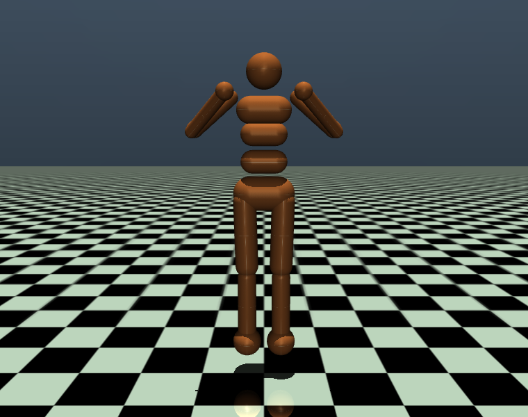

<h1 class="visually-hidden">Humanoid</h1>
<div class="gn-env-banner">
<canvas class="gn-pixel" data-text="HUMANOID" data-scale="6" data-color="#fcfcfc" data-shadow="#e45c10"></canvas>
<canvas class="gn-pixel" data-text="MUJOCO  17 ACTIONS  348 OBSERVATIONS" data-scale="2" data-color="#f8b800"></canvas>
</div>

<p class="gn-env-lead">Make a humanoid robot move forward as fast as it can without falling, with seventeen motors in its abdomen, hips, knees, shoulders and elbows. The physics is MuJoCo's, run in Gym.NET's own engine, written from scratch in C# and bit for bit with MuJoCo 4.0.0.</p>

<aside class="gn-infobox" aria-label="Humanoid at a glance">
<video src="media/Humanoid-v5.episode.mp4" poster="media/Humanoid-v5.figure.png" autoplay muted loop playsinline disablepictureinpicture disableremoteplayback aria-label="Humanoid-v5, seed 0: Farama's TQC expert runs for all 1,000 steps"></video>
<p class="gn-infobox-caption">The whole episode <code>examples/Humanoid</code> plays and records: Farama's TQC expert through the model's <code>track</code> camera, seed 0, 1,000 steps, return 10,563.5.</p>
<table>
<tr><td>Ids</td><td><code>Humanoid-v5</code> 1,000 steps<br><code>Humanoid-v4</code> 1,000 steps</td></tr>
<tr><td>Action space</td><td><code>Box(-0.4, 0.4, (17,), float32)</code></td></tr>
<tr><td>Observation space</td><td><code>Box(-inf, inf, (348,), float64)</code></td></tr>
<tr><td>Reward</td><td>5 a step while upright, plus 1.25 × the centre of mass's forward speed, less 0.1 × the controls squared and a contact cost · no registered threshold</td></tr>
<tr><td>Physics</td><td>MuJoCo 4.0.0 in Gym.NET's own engine, bit for bit: 5 Runge-Kutta steps of 0.003 s per env step</td></tr>
<tr><td>Render modes</td><td><code>human</code>, <code>rgb_array</code>, <code>depth_array</code>, <code>rgbd_tuple</code> · 480×480 · 67 fps</td></tr>
<tr><td>Make</td><td><code>Gymnasium.Make(<wbr>"Humanoid-v5")</code></td></tr>
<tr><td>Class</td><td><a href="xref:Gym.Environments.Envs.MuJoCo.HumanoidEnvV5"><code>HumanoidEnvV5</code></a>, options <a href="xref:Gym.Environments.Envs.MuJoCo.HumanoidEnvV5Options"><code>HumanoidEnvV5Options</code></a>, info <a href="xref:Gym.Environments.Envs.MuJoCo.HumanoidInfoV5"><code>HumanoidInfoV5</code></a></td></tr>
<tr><td>Vector env</td><td>none of its own: <code>MakeVec</code> builds sync or async</td></tr>
<tr><td>Parity</td><td><span class="gn-badge gn-badge-ok">physics bit for bit</span><span class="gn-badge gn-badge-warn">frames: 16% of pixels differ</span><br>with Gymnasium 1.4.0 on MuJoCo 4.0.0</td></tr>
<tr><td>Gymnasium</td><td><a href="https://gymnasium.farama.org/v1.4.0/environments/mujoco/humanoid/">Humanoid</a> in Gymnasium 1.4.0's docs</td></tr>
</table>
</aside>

## Description

The humanoid is a torso with a head, an abdomen of two parts below it, a pelvis, two legs of thigh, shin and foot, and
two arms of upper and lower arm. Seventeen hinges join the parts, each with a motor: three at the abdomen, three at
each hip, one at each knee, two at each shoulder and one at each elbow; the feet have none. It moves in three
dimensions, the torso a free body that can turn, lean and fall any way. Each step the agent sets the seventeen torques;
the reward pays 5 for every step the torso stays between 1 and 2 m up, and for the speed of the whole body's centre of
mass along x, and charges for torque and for hard contacts. The episode ends as soon as the torso leaves that band:
random torques topple it within about 25 steps.

The env comes from Y. Tassa, T. Erez and E. Todorov's work on synthesizing complex behaviours by trajectory
optimization, and Gymnasium keeps it as its hardest standard locomotion task. Gym.NET runs it on its own MuJoCo engine,
a C# reimplementation of MuJoCo 4.0.0 that computes every float of every step as MuJoCo does on the reference machine,
so the episodes are Gymnasium's, value for value. Gym.NET also draws MuJoCo's frames itself, in software, close to
Gymnasium's but not yet equal (see [Parity](#parity-with-gymnasium)).

## Quick start

# [C#](#tab/csharp)

[!code-csharp[](../../../tests/Gym.Tests/Docs/EnvPageSamples/HumanoidSamples.cs?range=1-4,37-43&dedent=12)]

# [Python (Gymnasium)](#tab/python)

```python
import gymnasium as gym

env = gym.make("Humanoid-v5")
# 348 numbers: the pose and velocities, then the bodies' inertias, velocities and forces
observation, info = env.reset(seed=42)
# seventeen torques, each from -0.4 to 0.4: abdomen, legs, arms
action = env.action_space.sample()
observation, reward, terminated, truncated, info = env.step(action)
```

---

`dotnet add package Gym.NET.Environments`; the six longer examples are in [Code examples](#code-examples).

### Watch the agent

```bash
# from a clone of the repository: the agent in the video runs in MuJoCo's window
dotnet run --project examples/Humanoid -c Release -- --render
```

Keyboard play is not offered: the humanoid's seventeen motors are far too many for a keyboard.

## How it works

<div class="gn-figure gn-figure-wide">

<svg viewBox="0 0 760 600" font-family="system-ui, sans-serif" role="img" aria-label="Labels: the torso, whose height and orientation are the observation's items 0 to 4 and its velocities items 22 to 27, with the joints' speeds at 28 to 44; the abdomen's z and y hinges, items 5 and 6, actions 1 and 0, and its x hinge, item 7, action 2, at gear 100; each hip's three hinges, items 8 to 10 on the right and 12 to 14 on the left, actions 3 to 5 and 7 to 9, at gears 100, 100 and 300; the knees, items 11 and 15, actions 6 and 10, at gear 200; the shoulders' two hinges each, items 16 and 17 and 19 and 20, actions 11 and 12 and 14 and 15, and the elbows, items 18 and 21, actions 13 and 16, at gear 25">
<line x1="380" y1="158.28" x2="380" y2="50" stroke="#000" stroke-width="3" stroke-linecap="round"/><line x1="380" y1="158.28" x2="380" y2="50" stroke="#ffffff" stroke-width="1.3" stroke-linecap="round"/>
<line x1="331.18" y1="140.75" x2="240" y2="56" stroke="#000" stroke-width="3" stroke-linecap="round"/><line x1="331.18" y1="140.75" x2="240" y2="56" stroke="#ffd43b" stroke-width="1.3" stroke-linecap="round"/>
<line x1="272.99" y1="192.61" x2="240" y2="156" stroke="#000" stroke-width="3" stroke-linecap="round"/><line x1="272.99" y1="192.61" x2="240" y2="156" stroke="#ffd43b" stroke-width="1.3" stroke-linecap="round"/>
<line x1="380" y1="251.08" x2="240" y2="242" stroke="#000" stroke-width="3" stroke-linecap="round"/><line x1="380" y1="251.08" x2="240" y2="242" stroke="#ffd43b" stroke-width="1.3" stroke-linecap="round"/>
<line x1="352.19" y1="290.01" x2="240" y2="322" stroke="#000" stroke-width="3" stroke-linecap="round"/><line x1="352.19" y1="290.01" x2="240" y2="322" stroke="#ffd43b" stroke-width="1.3" stroke-linecap="round"/>
<line x1="355.44" y1="393.81" x2="240" y2="434" stroke="#000" stroke-width="3" stroke-linecap="round"/><line x1="355.44" y1="393.81" x2="240" y2="434" stroke="#ffd43b" stroke-width="1.3" stroke-linecap="round"/>
<line x1="428.82" y1="140.75" x2="520" y2="56" stroke="#000" stroke-width="3" stroke-linecap="round"/><line x1="428.82" y1="140.75" x2="520" y2="56" stroke="#ffd43b" stroke-width="1.3" stroke-linecap="round"/>
<line x1="487.01" y1="192.61" x2="520" y2="156" stroke="#000" stroke-width="3" stroke-linecap="round"/><line x1="487.01" y1="192.61" x2="520" y2="156" stroke="#ffd43b" stroke-width="1.3" stroke-linecap="round"/>
<line x1="380" y1="214.41" x2="520" y2="226" stroke="#000" stroke-width="3" stroke-linecap="round"/><line x1="380" y1="214.41" x2="520" y2="226" stroke="#ffd43b" stroke-width="1.3" stroke-linecap="round"/>
<line x1="407.81" y1="290.01" x2="520" y2="322" stroke="#000" stroke-width="3" stroke-linecap="round"/><line x1="407.81" y1="290.01" x2="520" y2="322" stroke="#ffd43b" stroke-width="1.3" stroke-linecap="round"/>
<line x1="404.56" y1="393.81" x2="520" y2="434" stroke="#000" stroke-width="3" stroke-linecap="round"/><line x1="404.56" y1="393.81" x2="520" y2="434" stroke="#ffd43b" stroke-width="1.3" stroke-linecap="round"/>
<circle cx="380" cy="158.28" r="4" fill="#ffffff" stroke="#000" stroke-width="1.2"/>
<text x="380" y="26" text-anchor="middle" fill="#ffffff" font-weight="700" paint-order="stroke" stroke="#000" stroke-width="3" stroke-linejoin="round" font-size="13">torso: height [0], orientation [1] to [4]</text>
<text x="380" y="42" text-anchor="middle" fill="#ffffff" font-weight="600" paint-order="stroke" stroke="#000" stroke-width="3" stroke-linejoin="round" font-size="12">velocities [22] to [27]; joints' speeds [28] to [44]</text>
<circle cx="331.18" cy="140.75" r="4" fill="#ffd43b" stroke="#000" stroke-width="1.2"/>
<text x="236" y="60" text-anchor="end" fill="#ffd43b" font-weight="700" paint-order="stroke" stroke="#000" stroke-width="3" stroke-linejoin="round" font-size="13">right shoulder · actions 11, 12</text>
<text x="236" y="76" text-anchor="end" fill="#ffd43b" font-weight="600" paint-order="stroke" stroke="#000" stroke-width="3" stroke-linejoin="round" font-size="12">angles [16], [17] · gear 25</text>
<circle cx="272.99" cy="192.61" r="4" fill="#ffd43b" stroke="#000" stroke-width="1.2"/>
<text x="236" y="160" text-anchor="end" fill="#ffd43b" font-weight="700" paint-order="stroke" stroke="#000" stroke-width="3" stroke-linejoin="round" font-size="13">right elbow · action 13</text>
<text x="236" y="176" text-anchor="end" fill="#ffd43b" font-weight="600" paint-order="stroke" stroke="#000" stroke-width="3" stroke-linejoin="round" font-size="12">angle [18] · gear 25</text>
<circle cx="380" cy="251.08" r="4" fill="#ffd43b" stroke="#000" stroke-width="1.2"/>
<text x="236" y="246" text-anchor="end" fill="#ffd43b" font-weight="700" paint-order="stroke" stroke="#000" stroke-width="3" stroke-linejoin="round" font-size="13">abdomen x · action 2</text>
<text x="236" y="262" text-anchor="end" fill="#ffd43b" font-weight="600" paint-order="stroke" stroke="#000" stroke-width="3" stroke-linejoin="round" font-size="12">angle [7] · gear 100</text>
<circle cx="352.19" cy="290.01" r="4" fill="#ffd43b" stroke="#000" stroke-width="1.2"/>
<text x="236" y="326" text-anchor="end" fill="#ffd43b" font-weight="700" paint-order="stroke" stroke="#000" stroke-width="3" stroke-linejoin="round" font-size="13">right hip · actions 3, 4, 5</text>
<text x="236" y="342" text-anchor="end" fill="#ffd43b" font-weight="600" paint-order="stroke" stroke="#000" stroke-width="3" stroke-linejoin="round" font-size="12">x, z, y: angles [8], [9], [10]</text>
<text x="236" y="358" text-anchor="end" fill="#ffd43b" font-weight="600" paint-order="stroke" stroke="#000" stroke-width="3" stroke-linejoin="round" font-size="12">gears 100, 100, 300</text>
<circle cx="355.44" cy="393.81" r="4" fill="#ffd43b" stroke="#000" stroke-width="1.2"/>
<text x="236" y="438" text-anchor="end" fill="#ffd43b" font-weight="700" paint-order="stroke" stroke="#000" stroke-width="3" stroke-linejoin="round" font-size="13">right knee · action 6</text>
<text x="236" y="454" text-anchor="end" fill="#ffd43b" font-weight="600" paint-order="stroke" stroke="#000" stroke-width="3" stroke-linejoin="round" font-size="12">angle [11] · gear 200</text>
<circle cx="428.82" cy="140.75" r="4" fill="#ffd43b" stroke="#000" stroke-width="1.2"/>
<text x="524" y="60" text-anchor="start" fill="#ffd43b" font-weight="700" paint-order="stroke" stroke="#000" stroke-width="3" stroke-linejoin="round" font-size="13">left shoulder · actions 14, 15</text>
<text x="524" y="76" text-anchor="start" fill="#ffd43b" font-weight="600" paint-order="stroke" stroke="#000" stroke-width="3" stroke-linejoin="round" font-size="12">angles [19], [20] · gear 25</text>
<circle cx="487.01" cy="192.61" r="4" fill="#ffd43b" stroke="#000" stroke-width="1.2"/>
<text x="524" y="160" text-anchor="start" fill="#ffd43b" font-weight="700" paint-order="stroke" stroke="#000" stroke-width="3" stroke-linejoin="round" font-size="13">left elbow · action 16</text>
<text x="524" y="176" text-anchor="start" fill="#ffd43b" font-weight="600" paint-order="stroke" stroke="#000" stroke-width="3" stroke-linejoin="round" font-size="12">angle [21] · gear 25</text>
<circle cx="380" cy="214.41" r="4" fill="#ffd43b" stroke="#000" stroke-width="1.2"/>
<text x="524" y="230" text-anchor="start" fill="#ffd43b" font-weight="700" paint-order="stroke" stroke="#000" stroke-width="3" stroke-linejoin="round" font-size="13">abdomen z, y · actions 1, 0</text>
<text x="524" y="246" text-anchor="start" fill="#ffd43b" font-weight="600" paint-order="stroke" stroke="#000" stroke-width="3" stroke-linejoin="round" font-size="12">angles [5], [6] · gear 100</text>
<circle cx="407.81" cy="290.01" r="4" fill="#ffd43b" stroke="#000" stroke-width="1.2"/>
<text x="524" y="326" text-anchor="start" fill="#ffd43b" font-weight="700" paint-order="stroke" stroke="#000" stroke-width="3" stroke-linejoin="round" font-size="13">left hip · actions 7, 8, 9</text>
<text x="524" y="342" text-anchor="start" fill="#ffd43b" font-weight="600" paint-order="stroke" stroke="#000" stroke-width="3" stroke-linejoin="round" font-size="12">x, z, y: angles [12], [13], [14]</text>
<text x="524" y="358" text-anchor="start" fill="#ffd43b" font-weight="600" paint-order="stroke" stroke="#000" stroke-width="3" stroke-linejoin="round" font-size="12">gears 100, 100, 300</text>
<circle cx="404.56" cy="393.81" r="4" fill="#ffd43b" stroke="#000" stroke-width="1.2"/>
<text x="524" y="438" text-anchor="start" fill="#ffd43b" font-weight="700" paint-order="stroke" stroke="#000" stroke-width="3" stroke-linejoin="round" font-size="13">left knee · action 10</text>
<text x="524" y="454" text-anchor="start" fill="#ffd43b" font-weight="600" paint-order="stroke" stroke="#000" stroke-width="3" stroke-linejoin="round" font-size="12">angle [15] · gear 200</text>
</svg>
</div>
<p class="gn-figure-caption">The reset pose without noise (<code>reset_noise_scale</code> 0), rendered by Gym.NET with MuJoCo's free camera 2.6 m in front of a point 0.9 m above the floor, at azimuth 180° and elevation −8°: the humanoid faces the camera, so its right side is on the left. Each dot is a joint projected through MuJoCo's camera geometry, one for each place where joints meet (both abdomen hinges on the upper dot, a hip's three hinges on one), labelled with its items in the observation, its motors and their gears; the dots sit within 0.02 px of MuJoCo's own joint anchors. Gymnasium's frame of the same pose differs in 45,452 of its 456,000 pixels: 43,145 by 1 or 2 of 255 levels, nine in ten of them on the floor's checkers; the other 2,307, by up to 59, almost all on the body, along its edges and the faint cross marks of its texture.</p>

MuJoCo steps the model with the fourth-order Runge-Kutta integrator every 0.003 s, and an env step holds the action
for five of those steps, 0.015 s, hence 67 steps and frames a second (66.7, rounded). Each motor applies its gear times
its control, and the controls run from −0.4 to 0.4, so the strongest motor, a hip's pitch at gear 300, gives at most
120 N·m. The torso hangs on a free joint: its position and its orientation, a quaternion, are seven numbers of `qpos`,
its velocity and angular velocity six of `qvel`. Two fixed tendons measure each knee's angle less its hip's pitch; the
info reports them, and nothing acts through them.

The reward of a step is a healthy bonus while the humanoid is up, plus the centre of mass's average forward speed over
the step, less a cost on the controls and one on the external forces, mostly the floor's contacts, capped at 10:

$$
r_t = h\,[\text{healthy}] + w_f\,\frac{c_{t+1} - c_t}{\Delta t} - w_c \sum_{j=1}^{17} u_{t,j}^2 - \min\Bigl(w_k \sum_{b} \lVert F_b \rVert^2,\ 10\Bigr)
$$

with $\Delta t = 0.015$ s, $h = 5$, $w_f = 1.25$, $w_c = 0.1$ and $w_k = 5 \times 10^{-7}$; $c$ is the x of the whole
body's centre of mass (the bodies' positions weighted by their masses), $u$ the controls as given (MuJoCo's `ctrl`), and $F_b$ the six
numbers of MuJoCo's `cfrc_ext` for body $b$, a torque and a force, not clipped. The humanoid is healthy while its
torso's height is strictly between 1 and 2 m; the step that leaves that band ends the episode.

| Constant | Gym.NET | Gymnasium | Value | Effect |
|---|---|---|--:|---|
| Physics step | `Model.Opt.Timestep` | `model.opt.timestep` | 0.003 s | MuJoCo's step, Runge-Kutta 4 |
| Frame skip | `FrameSkip` | `frame_skip` | 5 | Physics steps per env step: an env step is 0.015 s |
| Healthy reward | `HealthyRewardWeight` | `_healthy_reward` | 5.0 | Paid for every step the humanoid is healthy |
| Forward weight | `ForwardRewardWeight` | `_forward_reward_weight` | 1.25 | Multiplies the centre of mass's speed in the reward |
| Control cost | `CtrlCostWeight` | `_ctrl_cost_weight` | 0.1 | Multiplies the controls squared |
| Contact cost | `ContactCostWeight` | `_contact_cost_weight` | 5e-7 | Multiplies the external forces squared |
| Contact cost range | `ContactCostRange` | `_contact_cost_range` | −∞ to 10 | The clip of the contact cost itself |
| Healthy height | `HealthyZRange` | `_healthy_z_range` | 1.0 to 2.0 | The torso's height while healthy, m, both ends excluded |
| Reset noise | `ResetNoiseScale` | `_reset_noise_scale` | 0.01 | The starting state's spread |

> [!NOTE]
> The healthy bonus is half of what a good run earns: 5 a step, 5,000 of the expert's 10,563.5. Humanoid-v4 paid the
> bonus on the step that ends the episode too, and had no contact cost; v5 fixed the first (Gymnasium's issue 526) and
> restored the second (issue 504). The forward speed is the centre of mass's, not the torso's. The floor collides
> everywhere but is drawn only 20 m to each side of the start: the expert in the video passes x = 20 m at step 351,
> and from there its frames show no floor, only the dark sky.

## Action space

`Box(-0.4, 0.4, (17,), float32)`: one control per motor, its torque the control times the motor's gear. The model lists
the abdomen's y motor before its z motor, so the first two actions are in the other order from the observation's.

| Index | Motor | Gear (N·m) | Joint range |
|---|---|--:|---|
| 0 | Abdomen, pitch (`abdomen_y`) | 100 | −75° to 30° |
| 1 | Abdomen, yaw (`abdomen_z`) | 100 | −45° to 45° |
| 2 | Abdomen, roll (`abdomen_x`) | 100 | −35° to 35° |
| 3, 7 | Right and left hip, roll (`right_hip_x`, `left_hip_x`) | 100 | −25° to 5° |
| 4, 8 | Right and left hip, yaw (`right_hip_z`, `left_hip_z`) | 100 | −60° to 35° |
| 5, 9 | Right and left hip, pitch (`right_hip_y`, `left_hip_y`) | 300 | −110° to 20° |
| 6, 10 | Right and left knee (`right_knee`, `left_knee`) | 200 | −160° to −2° |
| 11, 14 | Right and left shoulder, first hinge (`right_shoulder1`, `left_shoulder1`) | 25 | −85° to 60°, −60° to 85° |
| 12, 15 | Right and left shoulder, second hinge (`right_shoulder2`, `left_shoulder2`) | 25 | −85° to 60°, −60° to 85° |
| 13, 16 | Right and left elbow (`right_elbow`, `left_elbow`) | 25 | −90° to 50° |

MuJoCo clamps each control to the motor's range of −0.4 to 0.4 before it acts. The joint ranges are soft, as all of
MuJoCo's limits: a joint pushed hard enough passes its range for a while (see [Episode anatomy](#episode-anatomy)).

## Observation space

`Box(-inf, inf, (348,), float64)`: `qpos` without the torso's x and y, `qvel`, then four blocks MuJoCo computes for the
13 bodies other than the world.

| Index | Meaning | Unit |
|---|---|---|
| 0 | The torso's height | m |
| 1 to 4 | The torso's orientation, a quaternion (w, x, y, z) | |
| 5 to 21 | The 17 joints' angles: the abdomen's z, y and x, the right hip's x, z and y and knee, the left's, the right shoulder's two and elbow, the left's | rad |
| 22 to 24 | The torso's velocity along x, y and z | m/s |
| 25 to 27 | Its angular velocity | rad/s |
| 28 to 44 | The joints' angular velocities, in the same order | rad/s |
| 45 to 174 | `cinert`: each body's inertia and mass about the centre of mass, 10 numbers a body | |
| 175 to 252 | `cvel`: each body's angular and linear velocity at the centre of mass, 6 a body | |
| 253 to 269 | `qfrc_actuator`: the force each motor puts on its joint, in the joints' order | N·m |
| 270 to 347 | `cfrc_ext`: the external forces on each body, mostly contacts, a torque and a force, 6 a body | |

`exclude_current_positions_from_observation` false puts the torso's x and y first, making 350 items;
`include_cinert_in_observation`, `include_cvel_in_observation`, `include_qfrc_actuator_in_observation` and
`include_cfrc_ext_in_observation` false each leave their block out. The x and y positions are always in the info.

## Rewards

`healthy_reward` for every step the humanoid is healthy, plus the centre of mass's forward speed times
`forward_reward_weight`, less `ctrl_cost_weight` times the sum of the squared controls and the contact cost, capped at
the top of `contact_cost_range`; the info splits the four as `reward_survive`, `reward_forward`, `reward_ctrl` and
`reward_contact`. The registry sets no threshold for solving it; the expert in the video makes 10,563.5.

## Starting state

The model's pose, the torso 1.4 m up and unrotated with every joint at 0 (the arms reaching forward and down, as the
model draws them), plus noise: every position and every velocity gets a uniform draw from ±`reset_noise_scale`
(0.01). The feet start 0.1 m above the floor, so the humanoid drops onto them in its first steps. With
`reset_noise_scale` 0 every seed starts from the pose in the figure, at rest.

## Episode end

| Ends by | When |
|---|---|
| Termination | The humanoid is unhealthy, if `terminate_when_unhealthy` (the default): its torso's height at or below 1 m, or at or above 2 m |
| Truncation | 1,000 steps: the `TimeLimit` that `Make` wraps around the env |

## Arguments

By Gymnasium's name in `Make`'s kwargs, or by the C# name in the constructor and in
<xref:Gym.Environments.Envs.MuJoCo.HumanoidEnvV5Options>.

| Argument | Type and default | Effect |
|---|---|---|
| `xml_file`<br>`xmlFile` | `string`<br>`"humanoid.xml"` | The model: the bundled one by name, or a path to your own MJCF file |
| `frame_skip`<br>`frameSkip` | `int`<br>`5` | Physics steps per env step; changes the step's duration and the frame rate |
| `default_camera_config`<br>`defaultCameraConfig` | `IReadOnlyDictionary<string, object?>?`<br>`null` | The free camera's `distance`, `azimuth`, `elevation`, `lookat` or `trackbodyid`; null takes the env's own, 4 m off and 20° above, which does not follow the humanoid |
| `forward_reward_weight`<br>`forwardRewardWeight` | `double`<br>`1.25` | The weight of the centre of mass's speed in the reward |
| `ctrl_cost_weight`<br>`ctrlCostWeight` | `double`<br>`0.1` | The weight of the control cost |
| `contact_cost_weight`<br>`contactCostWeight` | `double`<br>`5e-7` | The weight of the contact cost; 0 leaves it out |
| `contact_cost_range`<br>`contactCostRange` | `(double Low, double High)?`<br>`null` | The clip of the contact cost; null is (−∞, 10.0) |
| `healthy_reward`<br>`healthyReward` | `double`<br>`5.0` | The reward for each healthy step |
| `terminate_when_unhealthy`<br>`terminateWhenUnhealthy` | `bool`<br>`true` | End the episode when the humanoid is unhealthy |
| `healthy_z_range`<br>`healthyZRange` | `(double Low, double High)?`<br>`null` | The torso's healthy height, both ends excluded; null is (1.0, 2.0) |
| `reset_noise_scale`<br>`resetNoiseScale` | `double`<br>`1e-2` | The starting state's noise; 0 starts from the model's pose |
| `exclude_current_positions_from_observation`<br>`excludeCurrentPositionsFromObservation` | `bool`<br>`true` | Leave the torso's x and y out of the observation |
| `include_cinert_in_observation`<br>`includeCinertInObservation` | `bool`<br>`true` | Put the bodies' inertias in the observation |
| `include_cvel_in_observation`<br>`includeCvelInObservation` | `bool`<br>`true` | Put the bodies' velocities in the observation |
| `include_qfrc_actuator_in_observation`<br>`includeQfrcActuatorInObservation` | `bool`<br>`true` | Put the motors' joint forces in the observation |
| `include_cfrc_ext_in_observation`<br>`includeCfrcExtInObservation` | `bool`<br>`true` | Put the bodies' external forces in the observation |
| `render_mode`<br>`renderMode` | `string?` or `RenderMode`<br>`null` | `"human"` opens MuJoCo's window; `"rgb_array"`, `"depth_array"` and `"rgbd_tuple"` make `Render()` return frames |
| `width`<br>`width` | `int`<br>`480` | The frame's width in pixels |
| `height`<br>`height` | `int`<br>`480` | The frame's height in pixels |
| `camera_id`<br>`cameraId` | `int?`<br>`null` | A camera by index (−1 the free camera); not with `camera_name` |
| `camera_name`<br>`cameraName` | `string?`<br>`null` | A camera by name: the model's `"track"` follows the body's centre of mass |
| `max_geom`<br>`maxGeom` | `int`<br>`1000` | The renderer's scene capacity |
| `visual_options`<br>`visualOptions` | `IReadOnlyDictionary<int, bool>?`<br>`null` | MuJoCo's visualization flags by index (contact points, forces, ...) |
| (Gym.NET)<br>`viewerFactory` | `EnvViewerFactory?`<br>`null` | The window for `human`: Avalonia, WinForms, or headless |

[!code-csharp[](../../../tests/Gym.Tests/Docs/EnvPageSamples/HumanoidSamples.cs#Arguments)]

## Info

<xref:Gym.Environments.Envs.MuJoCo.HumanoidInfoV5>: `x_position`, `y_position`, `distance_from_origin`, and
`tendon_length` and `tendon_velocity` (the two hip-knee tendons) on every reset and step; `x_velocity`, `y_velocity`
(the centre of mass's), `reward_survive`, `reward_forward`, `reward_ctrl` and `reward_contact` on every step.

## Rendering

| Mode | What you get |
|---|---|
| `rgb_array` | `Render()` returns the frame: `(480, 480, 3)` uint8 by default, `width` by `height` |
| `depth_array` | `Render()` returns MuJoCo's depth buffer, `(480, 480)` float32: 0 at the near plane, 1 at the far one, not metres |
| `rgbd_tuple` | `Render()` returns both, `RenderResult.RgbDepth`, as Python's `(rgb, depth)` |
| `human` | MuJoCo's window from the viewer factory, drawn after every reset and step, with Gymnasium's controls |
| none | `Render()` warns and returns nothing, as Gymnasium's does |

With no camera named, Gymnasium 1.4 renders through MuJoCo's free camera with the env's `default_camera_config`: for
Humanoid 4 m from a point 2 m above the start, 20° above it. The config names the torso as `trackbodyid`, but a free
camera tracks nothing, so the camera stays where it is and a running humanoid leaves the frame. `camera_name = "track"`
takes the model's own camera, 4 m to the side at the height of the centre of mass, looking across the direction of
travel and following it, as the video does. In `human` mode, Tab cycles the cameras, the mouse orbits, pans and zooms,
and H lists Gymnasium's other keys. Gym.NET draws this model's frames in software in about 0.45 s each; by default
every frame is drawn, and D switches to skipping frames.

## Episode anatomy

The whole episode, step by step: the distance run, the centre of mass's speed, the torso's height and the right knee,
with a cursor following the video. The expert runs rather than walks: a stride every 0.34 s (22.5 steps), its centre of mass at 5.3 m/s on average after the first 100 steps, 74.4 m in the 15 s and never more than 1.1 m off the x axis. Its torso rides between 1.22 and 1.30 m once it has landed, well inside the healthy band, and the healthy bonus makes 5,000 of its 10,563.5. MuJoCo's joint limits are soft: on 169 of the steps its right knee straightens past its −2° stop, to as much as 21°.

<div class="gn-anatomy" data-trace="media/Humanoid-v5.episode.json">
<div><video src="media/Humanoid-v5.episode.mp4" poster="media/Humanoid-v5.figure.png" autoplay muted loop playsinline disablepictureinpicture disableremoteplayback aria-label="Humanoid-v5, seed 0, the episode the chart follows"></video><div class="gn-anatomy-readout" aria-live="off"></div></div>
<div><div class="gn-anatomy-chart"></div><div class="gn-anatomy-legend"></div></div>
<script type="application/json" class="gn-anatomy-spec">{"label":"Humanoid-v5, seed 0: the distance run, the centre of mass's speed, the torso's height and the right knee","bands":[{"height":70,"range":[-2,78],"ticks":[0,25,50,75],"series":[{"column":"x","color":"#f8b800","name":"x, the distance run (m)"}]},{"height":70,"range":[-0.3,6.2],"ticks":[0,2,4,6],"scale":0.8,"series":[{"column":"reward_forward","color":"#3cbcfc","name":"the centre of mass's speed (m/s), the reward's"}]},{"height":60,"range":[0.95,1.45],"ticks":[1,1.2,1.4],"series":[{"column":"z","color":"#40c057","name":"the torso's height (m); healthy above 1"}]},{"height":70,"range":[-125,30],"scale":57.29577951308232,"ticks":[-90,-45,0],"unit":"°","series":[{"column":"right_knee","color":"#b8b8f8","name":"the right knee's angle; its stop at −2°"}]}],"readout":[{"label":"step","column":"@step"},{"label":"x","column":"x","digits":1,"unit":" m"},{"label":"height","column":"z","digits":2,"unit":" m"},{"label":"return so far","column":"@return","digits":1}]}</script>
</div>

## Code examples

### Run an episode

# [C#](#tab/csharp)

[!code-csharp[](../../../tests/Gym.Tests/Docs/EnvPageSamples/HumanoidSamples.cs#RunAnEpisode)]

# [Python (Gymnasium)](#tab/python)

```python
import gymnasium as gym

env = gym.make("Humanoid-v5")
observation, info = env.reset(seed=42)
episode_return, steps = 0.0, 0
while True:
    action = env.action_space.sample()
    observation, reward, terminated, truncated, info = env.step(action)
    episode_return, steps = episode_return + reward, steps + 1
    if terminated or truncated:
        break
# random torques fall within about 25 steps: 117.8 on average
print(f"{steps} steps, return {episode_return:.1f}")
```

---

### The reward's terms

# [C#](#tab/csharp)

[!code-csharp[](../../../tests/Gym.Tests/Docs/EnvPageSamples/HumanoidSamples.cs#RewardTerms)]

# [Python (Gymnasium)](#tab/python)

```python
import numpy as np

env = gym.make("Humanoid-v5")
env.reset(seed=42)
action = np.full(17, 0.2, dtype=np.float32)  # every motor at half torque
for t in range(10):
    env.step(action)  # the humanoid starts 0.1 m above the floor
observation, reward, terminated, truncated, info = env.step(action)
forward, healthy = info["reward_forward"], info["reward_survive"]
control, contact = info["reward_ctrl"], info["reward_contact"]
# the feet land: 1.3454 = 0.0354 forward + 5.0000 healthy - 0.0680 control - 3.6220 contact
print(f"{reward:.4f} = {forward:.4f} forward + {healthy:.4f} healthy {control:.4f} control {contact:.4f} contact")
```

---

### Start without noise

# [C#](#tab/csharp)

[!code-csharp[](../../../tests/Gym.Tests/Docs/EnvPageSamples/HumanoidSamples.cs#ResetWithoutNoise)]

# [Python (Gymnasium)](#tab/python)

```python
env = gym.make("Humanoid-v5", reset_noise_scale=0.0)
observation, info = env.reset(seed=42)
# 1.40, 1.00, True: the torso 1.4 m up and unrotated, every joint at 0 and at rest (items 2 to 44)
print(f"{observation[0]:.2f}, {observation[1]:.2f}, {bool(np.all(observation[2:45] == 0))}")
```

---

### Keep going after a fall

# [C#](#tab/csharp)

[!code-csharp[](../../../tests/Gym.Tests/Docs/EnvPageSamples/HumanoidSamples.cs#KeepGoing)]

# [Python (Gymnasium)](#tab/python)

```python
env = gym.make("Humanoid-v5", terminate_when_unhealthy=False)
humanoid = env.unwrapped
env.reset(seed=0)
env.action_space.seed(0)
steps, healthy, episode_return = 0, 0, 0.0
while True:
    observation, reward, terminated, truncated, info = env.step(env.action_space.sample())
    steps, episode_return = steps + 1, episode_return + reward
    healthy += 1 if humanoid.is_healthy else 0
    if terminated or truncated:
        break
# 1000 steps, healthy for 20, return -276.3: it falls at step 21 and lies on the floor
print(f"{steps} steps, healthy for {healthy}, return {episode_return:.1f}")
```

---

### Cameras and depth

# [C#](#tab/csharp)

[!code-csharp[](../../../tests/Gym.Tests/Docs/EnvPageSamples/HumanoidSamples.cs#CamerasAndDepth)]

# [Python (Gymnasium)](#tab/python)

```python
# the model's "track" camera follows the humanoid from the side; rgbd_tuple draws colour and depth together
env = gym.make("Humanoid-v5", render_mode="rgbd_tuple", camera_name="track")
env.reset(seed=42)
rgb, depth = env.render()
print(rgb.shape, depth.shape)  # (480, 480, 3) (480, 480)
# MuJoCo's raw depth buffer, 0 at the near plane and 1 at the far one,
# not metres: the nearest point, the floor at the bottom edge, is 0.99
print(f"{depth.min():.2f}")  # 0.99
```

---

### Many humanoids at once

# [C#](#tab/csharp)

[!code-csharp[](../../../tests/Gym.Tests/Docs/EnvPageSamples/HumanoidSamples.cs#ManyHumanoids)]

# [Python (Gymnasium)](#tab/python)

```python
# No vector env of its own: make_vec steps 8 envs in turn ("sync")
envs = gym.make_vec("Humanoid-v5", num_envs=8, vectorization_mode="sync")
observations, infos = envs.reset(seed=42)  # 8 x 348 observations
for t in range(100):
    actions = envs.action_space.sample()  # 8 x 17 torques
    # fallen humanoids reset themselves
    observations, rewards, terminations, truncations, infos = envs.step(actions)
```

---

Every C# example is a test in `tests/Gym.Tests/Docs/EnvPageSamples`, compiled and run by the unit gate; where a
comment states a number, the test checks it.

## Agents and examples

- **The video's agent** is Farama's TQC expert (Truncated Quantile Critics), the agent the Farama Foundation,
  Gymnasium's maintainers, trained on Humanoid-v5 to record the Minari datasets, imported from Hugging Face
  (`farama-minari/Humanoid-v5-TQC-expert`): two dense layers of 256 with ReLU that read the 348 observations and squash
  their output into the motors' range with tanh. Seed 0 returns 10,563.5; over seeds 0 to 9 it averages 10,650.7 in
  Gym.NET, every seed running all 1,000 steps, and its model card reports 10,370.61 ± 1,542.02.
- **[examples/Humanoid](https://github.com/SciSharp/Gym.NET/tree/master/examples/Humanoid)**
  ([`HumanoidProgram.cs`](https://github.com/SciSharp/Gym.NET/blob/master/examples/Humanoid/HumanoidProgram.cs))
  plays it: `dotnet run --project examples/Humanoid -c Release` plays seed 0 headless, `--seed N` another seed,
  `--episodes N` that many seeds and their mean, `--render` in MuJoCo's window.
- **This page's video and chart** are the example's own episode: `--record docs/environments/mujoco/media` records it
  with `RecordVideo` (one frame per step, through the `track` camera) and writes the step trace and the figure beside
  it.

## Vectorized environment

Humanoid registers no vector env of its own. `Gymnasium.MakeVec("Humanoid-v5", n)` builds a `SyncVectorEnv` that steps
`n` separate envs in turn, and `VectorizeMode.Async` an `AsyncVectorEnv` that steps them on worker threads; each env
resets itself after its episode ends (next-step autoreset), as Gymnasium's. Each env has its own simulation.

## Variants

<a id="v4"></a>

### Humanoid-v4

The same humanoid with Gymnasium's previous arguments: no `xml_file`, `frame_skip`, `default_camera_config`,
`contact_cost_weight`, `contact_cost_range` or `include_*_in_observation`; 376 observations, the four blocks keeping
the world body's rows and `qfrc_actuator` the torso's six; an empty info at reset, and a step's info with Gymnasium's
older names (`reward_linvel`, `reward_quadctrl`, `reward_alive`, `forward_reward`), its positions the centre of mass's;
no contact cost; and the healthy bonus paid on every step, the one that ends the episode included. From the same seed
and actions, the rewards differ wherever v5's contact cost is not 0 and on the step that ends the episode (5 of the 21
steps of one sampled episode). Gymnasium warns that v4 is out of date, and Gym.NET does the same. The class is
<xref:Gym.Environments.Envs.MuJoCo.HumanoidEnvV4>, its info <xref:Gym.Environments.Envs.MuJoCo.HumanoidInfoV4>.

## Parity with Gymnasium

Gymnasium 1.4.0 runs inside the test process, MuJoCo 4.0.0 under it, and both are compared value by value:

| What is compared | How | Result |
|---|---|---|
| Episodes | sampled episodes of both versions from several seeds, three in a row in one env through their falls, every observation (the four blocks included), reward, flag and info value with its NumPy type | ✓ bit for bit |
| Arguments | Gymnasium's keyword variants (the positions in the observation, each block left out, the contact cost's weight and range, no termination) | ✓ bit for bit |
| Actions | every form of action NumPy takes or refuses, with Gymnasium's messages | ✓ same values, same messages |
| Frames | `rgb_array` and `depth_array` frames against Gymnasium's on the reference GPU, within a measured baseline | 36,128 of 230,400 pixels differ |
| Spaces, metadata, `make`'s stack, the window | both spaces; the metadata; `make`'s stacks and warnings; the human window's controls and overlay | ✓ |

The tests: [MujocoLiveParityTests](https://github.com/SciSharp/Gym.NET/blob/master/tests/Gym.Tests.Parity/Tests/Envs/MujocoLiveParityTests.cs),
[MujocoFrameLiveParityTests](https://github.com/SciSharp/Gym.NET/blob/master/tests/Gym.Tests.Parity/Tests/Envs/MujocoFrameLiveParityTests.cs),
[MujocoWindowLiveParityTests](https://github.com/SciSharp/Gym.NET/blob/master/tests/Gym.Tests.Parity/Tests/Envs/MujocoWindowLiveParityTests.cs).
Bit for bit holds on the reference machine, an x64 CPU with FMA: the engine calls the platform's math functions, whose
last bits differ on a CPU without FMA. The frames are Gym.NET's own drawing of MuJoCo's renderer: this model's differ in
about 16% of the pixels, mostly by a level or two on the floor's checkers, the larger differences along the body's
edges and the cross marks of its texture; Gymnasium's own frames of one state can differ between renders on the
reference GPU for this model, by a few pixels, so "equal" means one of the frames it draws (DR-98).

## Performance

| | Steps a second | Bytes a step |
|---|--:|--:|
| Gym.NET | 3,702 | 28,171 |
| Gymnasium | 2,840 | |

1.3× faster. Gymnasium's own `benchmark_step` on both sides (Gym.NET's `Performance.BenchmarkStep`, DR-36): random actions, a reset at each episode's end, after a 2-second warm-up; .NET 10 in Release against CPython 3.12 with MuJoCo 4.0.0's own bindings; the medians of three interleaved rounds of 5 seconds on one machine (2026-11-24). Gym.NET's engine is managed C#, MuJoCo's is native C; the step is the physics, the observation and the reward, no rendering.

## Reference sources

- [gymnasium/envs/mujoco/humanoid_v5.py](https://github.com/Farama-Foundation/Gymnasium/blob/8ba8c3a63bb4e000b7f33923f43d292acac07be1/gymnasium/envs/mujoco/humanoid_v5.py)
  and [humanoid_v4.py](https://github.com/Farama-Foundation/Gymnasium/blob/8ba8c3a63bb4e000b7f33923f43d292acac07be1/gymnasium/envs/mujoco/humanoid_v4.py),
  Gymnasium 1.4.0: the environment; [mujoco_env.py](https://github.com/Farama-Foundation/Gymnasium/blob/8ba8c3a63bb4e000b7f33923f43d292acac07be1/gymnasium/envs/mujoco/mujoco_env.py),
  the base class; [mujoco_rendering.py](https://github.com/Farama-Foundation/Gymnasium/blob/8ba8c3a63bb4e000b7f33923f43d292acac07be1/gymnasium/envs/mujoco/mujoco_rendering.py),
  the cameras and the window.
- [humanoid.xml](https://github.com/Farama-Foundation/Gymnasium/blob/8ba8c3a63bb4e000b7f33923f43d292acac07be1/gymnasium/envs/mujoco/assets/humanoid.xml),
  the model, embedded as MuJoCo 4.0.0 compiles it (`src/Gym.Environments/Assets/mujoco`).
- [MuJoCo 4.0.0](https://github.com/google-deepmind/mujoco/tree/4.0.0/src/engine), the engine Gym.NET's `Gym.MuJoCo`
  reproduces, and its classic renderer (`src/render/classic`), which Gym.NET draws in software.

## Version history

| Version | Change |
|---|---|
| v5 | MuJoCo 2.3.3 or later; custom models through `xml_file` again; `default_camera_config`, `frame_skip`, the four `include_*_in_observation` and `observation_structure`; a non-empty info at reset; the healthy bonus only while healthy; the contact cost restored, with `contact_cost_weight` and `contact_cost_range` as in v3; the world body's rows and the torso's `qfrc_actuator` out of the observation; the info's positions from `qpos`; `tendon_length` and `tendon_velocity` in the info; the info's terms renamed `reward_survive`, `reward_forward` and `reward_ctrl`, and `forward_reward` removed |
| v4 | The `mujoco` bindings (MuJoCo 2.1.3 or later) instead of mujoco-py |
| v3 | `make` kwargs such as `xml_file`, `ctrl_cost_weight` and `reset_noise_scale`; frames from the tracking camera; now raises `ImportError` in Gymnasium (mujoco-py), and in Gym.NET |
| v2 | mujoco-py 1.50; likewise refused today |
| v1 | Episodes of 1,000 steps; the reward threshold |
| v0 | The first release |
| Gym.NET 1.0.0 | New: Gymnasium 1.4.0's Humanoid-v5 and Humanoid-v4 on Gym.NET's own MuJoCo engine, bit for bit; 0.2.0 had no MuJoCo |

## References

1. Y. Tassa, T. Erez and E. Todorov, "Synthesis and stabilization of complex behaviors through online trajectory
   optimization", *IROS*, 2012: the humanoid. [ieeexplore.ieee.org](https://ieeexplore.ieee.org/document/6386025)
2. E. Todorov, T. Erez and Y. Tassa, "MuJoCo: A physics engine for model-based control", *IROS*, 2012: the engine.
   [mujoco.org](https://mujoco.org)
3. A. Kuznetsov, P. Shvechikov, A. Grishin and D. Vetrov, "Controlling Overestimation Bias with Truncated Mixture of
   Continuous Distributional Quantile Critics", *ICML*, 2020: TQC, the expert's algorithm. [arXiv:2005.04269](https://arxiv.org/abs/2005.04269)

## External links

- [Humanoid on Gymnasium's site](https://gymnasium.farama.org/v1.4.0/environments/mujoco/humanoid/) (1.4.0)
- [HumanoidEnvV5.cs](https://github.com/SciSharp/Gym.NET/blob/master/src/Gym.Environments/Envs/MuJoCo/HumanoidEnvV5.cs) on GitHub
- [examples/Humanoid](https://github.com/SciSharp/Gym.NET/tree/master/examples/Humanoid)
- [farama-minari/Humanoid-v5-TQC-expert](https://huggingface.co/farama-minari/Humanoid-v5-TQC-expert), the expert on Hugging Face

## API reference

<xref:Gym.Environments.Envs.MuJoCo.HumanoidEnvV5> · <xref:Gym.Environments.Envs.MuJoCo.HumanoidEnvV5Options> · <xref:Gym.Environments.Envs.MuJoCo.HumanoidInfoV5> · <xref:Gym.Environments.Envs.MuJoCo.HumanoidEnvV4> · <xref:Gym.Environments.Envs.MuJoCo.MujocoEnv>
