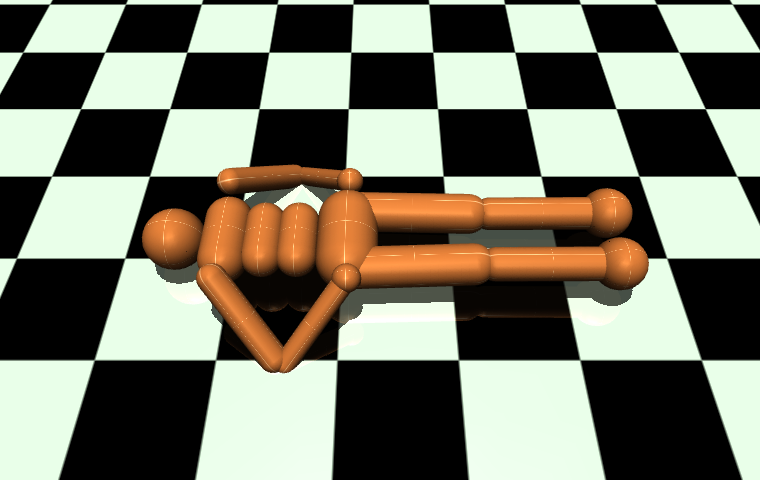

<h1 class="visually-hidden">Humanoid Standup</h1>
<div class="gn-env-banner">
<canvas class="gn-pixel" data-text="HUMANOID STANDUP" data-scale="5" data-color="#fcfcfc" data-shadow="#e45c10"></canvas>
<canvas class="gn-pixel" data-text="MUJOCO  17 ACTIONS  348 OBSERVATIONS" data-scale="2" data-color="#f8b800"></canvas>
</div>

<p class="gn-env-lead">Make a humanoid robot lying flat on the floor stand up and stay standing, with seventeen motors in its abdomen, hips, knees, shoulders and elbows. The physics is MuJoCo's, run in Gym.NET's own engine, written from scratch in C# and bit for bit with MuJoCo 4.0.0.</p>

<aside class="gn-infobox" aria-label="Humanoid Standup at a glance">
<video src="media/HumanoidStandup-v5.episode.mp4" poster="media/HumanoidStandup-v5.figure.png" autoplay muted loop playsinline disablepictureinpicture disableremoteplayback aria-label="HumanoidStandup-v5, seed 0: Farama's SAC expert stands up within a second and stays up for all 1,000 steps"></video>
<p class="gn-infobox-caption">The whole episode <code>examples/HumanoidStandup</code> plays and records: Farama's SAC expert through the model's <code>track</code> camera, seed 0, 1,000 steps, return 399,827.7.</p>
<table>
<tr><td>Ids</td><td><code>HumanoidStandup-v5</code> 1,000 steps<br><code>HumanoidStandup-v4</code> 1,000 steps</td></tr>
<tr><td>Action space</td><td><code>Box(-0.4, 0.4, (17,), float32)</code></td></tr>
<tr><td>Observation space</td><td><code>Box(-inf, inf, (348,), float64)</code></td></tr>
<tr><td>Reward</td><td>the torso's height over 0.003 s, plus 1, less 0.1 × the controls squared and an impact cost · no registered threshold</td></tr>
<tr><td>Physics</td><td>MuJoCo 4.0.0 in Gym.NET's own engine, bit for bit: 5 Runge-Kutta steps of 0.003 s per env step</td></tr>
<tr><td>Render modes</td><td><code>human</code>, <code>rgb_array</code>, <code>depth_array</code>, <code>rgbd_tuple</code> · 480×480 · 67 fps</td></tr>
<tr><td>Make</td><td><code>Gymnasium.Make(<wbr>"HumanoidStandup-v5")</code></td></tr>
<tr><td>Class</td><td><a href="xref:Gym.Environments.Envs.MuJoCo.HumanoidStandupEnvV5"><code>HumanoidStandupEnvV5</code></a>, options <a href="xref:Gym.Environments.Envs.MuJoCo.HumanoidStandupEnvV5Options"><code>HumanoidStandupEnvV5Options</code></a>, info <a href="xref:Gym.Environments.Envs.MuJoCo.HumanoidStandupInfoV5"><code>HumanoidStandupInfoV5</code></a></td></tr>
<tr><td>Vector env</td><td>none of its own: <code>MakeVec</code> builds sync or async</td></tr>
<tr><td>Parity</td><td><span class="gn-badge gn-badge-ok">physics bit for bit</span><span class="gn-badge gn-badge-warn">frames: 15% of pixels differ</span><br>with Gymnasium 1.4.0 on MuJoCo 4.0.0</td></tr>
<tr><td>Gymnasium</td><td><a href="https://gymnasium.farama.org/v1.4.0/environments/mujoco/humanoid_standup/">Humanoid Standup</a> in Gymnasium 1.4.0's docs</td></tr>
</table>
</aside>

## Description

The humanoid of [Humanoid](humanoid.md), the same seventeen motorized hinges in its abdomen, hips, knees, shoulders and
elbows, but built lying flat on the floor, its head toward −x. Each step the agent sets the seventeen torques; the
reward pays for the torso's height every step, as if it were a speed: the height divided by MuJoCo's physics step,
0.003 s, so lying flat earns about 30 a step and standing about 400. A constant 1 a step is added, and the torques and
the impacts are charged. Nothing ends an episode early: every episode runs its 1,000 steps, so the task is to get up
fast and stay up.

The env comes from Y. Tassa, T. Erez and E. Todorov's work on synthesizing complex behaviours by trajectory
optimization, and Gymnasium keeps it with Humanoid among its standard tasks. Gym.NET runs it on its own MuJoCo engine,
a C# reimplementation of MuJoCo 4.0.0 that computes every float of every step as MuJoCo does on the reference machine,
so the episodes are Gymnasium's, value for value. Gym.NET also draws MuJoCo's frames itself, in software, close to
Gymnasium's but not yet equal (see [Parity](#parity-with-gymnasium)).

## Quick start

# [C#](#tab/csharp)

[!code-csharp[](../../../tests/Gym.Tests/Docs/EnvPageSamples/HumanoidStandupSamples.cs?range=1-4,38-46&dedent=12)]

# [Python (Gymnasium)](#tab/python)

```python
import gymnasium as gym

env = gym.make("HumanoidStandup-v5")
# 348 numbers: the pose and velocities, then the bodies' inertias, velocities and forces
observation, info = env.reset(seed=42)
# seventeen torques, each from -0.4 to 0.4: abdomen, legs, arms
action = env.action_space.sample()
observation, reward, terminated, truncated, info = env.step(action)
```

---

`dotnet add package Gym.NET.Environments`; the six longer examples are in [Code examples](#code-examples).

### Watch the agent

```bash
# from a clone of the repository: the agent in the video stands up in MuJoCo's window
dotnet run --project examples/HumanoidStandup -c Release -- --render
```

Keyboard play is not offered: the humanoid's seventeen motors are far too many for a keyboard.

## Episode anatomy

The whole episode, step by step: the torso's height, the height term it earns and both knees, with a cursor following
the video. The expert is on its feet within 0.6 s: it sits up, folds both knees under it to about −160° and rises out of the squat, its torso passing 1 m at step 31 and 1.2 m at step 38; from step 100 on it stays between 1.21 and 1.23 m, its knees nearly straight. Standing earns about 406 a step from the height term, 399,057.6 of its 399,827.7; it barely moves otherwise, 1.3 m along x and 0.5 m along y in the 15 s.

<div class="gn-anatomy" data-trace="media/HumanoidStandup-v5.episode.json">
<div><video src="media/HumanoidStandup-v5.episode.mp4" poster="media/HumanoidStandup-v5.figure.png" autoplay muted loop playsinline disablepictureinpicture disableremoteplayback aria-label="HumanoidStandup-v5, seed 0, the episode the chart follows"></video><div class="gn-anatomy-readout" aria-live="off"></div></div>
<div><div class="gn-anatomy-chart"></div><div class="gn-anatomy-legend"></div></div>
<script type="application/json" class="gn-anatomy-spec">{"label":"HumanoidStandup-v5, seed 0: the torso's height, the height term and both knees","bands":[{"height":80,"range":[0,1.35],"ticks":[0.2,0.6,1,1.2],"series":[{"column":"z","color":"#40c057","name":"the torso's height (m)"}]},{"height":70,"range":[0,450],"ticks":[0,200,400],"series":[{"column":"reward_linup","color":"#f8b800","name":"the height term, the height over 0.003 s"}]},{"height":80,"range":[-175,15],"scale":57.29577951308232,"ticks":[-150,-90,-30,0],"unit":"°","series":[{"column":"right_knee","color":"#b8b8f8","name":"the right knee's angle"},{"column":"left_knee","color":"#3cbcfc","name":"the left knee's angle"}]}],"readout":[{"label":"step","column":"@step"},{"label":"height","column":"z","digits":2,"unit":" m"},{"label":"return so far","column":"@return","digits":1}]}</script>
</div>

## How it works

<div class="gn-figure gn-figure-wide">

<svg viewBox="0 0 760 480" font-family="system-ui, sans-serif" role="img" aria-label="Labels: the torso, whose height and orientation are the observation's items 0 to 4 and its velocities items 22 to 27; the abdomen's three hinges, items 5 to 7, driven by actions 1, 0 and 2 at gear 100; each hip's three hinges and knee, items 8 to 11 on the right and 12 to 15 on the left, actions 3 to 6 and 7 to 10, at gears 100, 100, 300 and 200; each shoulder's two hinges and elbow, items 16 to 18 on the right and 19 to 21 on the left, actions 11 to 13 and 14 to 16, at gear 25">
<line x1="226.26" y1="239.02" x2="156" y2="116" stroke="#000" stroke-width="3" stroke-linecap="round"/><line x1="226.26" y1="239.02" x2="156" y2="116" stroke="#ffffff" stroke-width="1.3" stroke-linecap="round"/>
<line x1="230.52" y1="181.36" x2="256" y2="36" stroke="#000" stroke-width="3" stroke-linecap="round"/><line x1="230.52" y1="181.36" x2="256" y2="36" stroke="#ffd43b" stroke-width="1.3" stroke-linecap="round"/>
<line x1="301.58" y1="175.89" x2="256" y2="36" stroke="#000" stroke-width="3" stroke-linecap="round"/><line x1="301.58" y1="175.89" x2="256" y2="36" stroke="#ffd43b" stroke-width="1.3" stroke-linecap="round"/>
<line x1="295.35" y1="225.84" x2="326" y2="88" stroke="#000" stroke-width="3" stroke-linecap="round"/><line x1="295.35" y1="225.84" x2="326" y2="88" stroke="#ffd43b" stroke-width="1.3" stroke-linecap="round"/>
<line x1="353.07" y1="218.24" x2="326" y2="88" stroke="#000" stroke-width="3" stroke-linecap="round"/><line x1="353.07" y1="218.24" x2="326" y2="88" stroke="#ffd43b" stroke-width="1.3" stroke-linecap="round"/>
<line x1="355.21" y1="211.85" x2="556" y2="136" stroke="#000" stroke-width="3" stroke-linecap="round"/><line x1="355.21" y1="211.85" x2="556" y2="136" stroke="#ffd43b" stroke-width="1.3" stroke-linecap="round"/>
<line x1="489.98" y1="209.72" x2="556" y2="136" stroke="#000" stroke-width="3" stroke-linecap="round"/><line x1="489.98" y1="209.72" x2="556" y2="136" stroke="#ffd43b" stroke-width="1.3" stroke-linecap="round"/>
<line x1="211.7" y1="278.14" x2="236" y2="420" stroke="#000" stroke-width="3" stroke-linecap="round"/><line x1="211.7" y1="278.14" x2="236" y2="420" stroke="#ffd43b" stroke-width="1.3" stroke-linecap="round"/>
<line x1="281.82" y1="368.24" x2="236" y2="420" stroke="#000" stroke-width="3" stroke-linecap="round"/><line x1="281.82" y1="368.24" x2="236" y2="420" stroke="#ffd43b" stroke-width="1.3" stroke-linecap="round"/>
<line x1="353.47" y1="267.83" x2="556" y2="356" stroke="#000" stroke-width="3" stroke-linecap="round"/><line x1="353.47" y1="267.83" x2="556" y2="356" stroke="#ffd43b" stroke-width="1.3" stroke-linecap="round"/>
<line x1="496.97" y1="260.38" x2="556" y2="356" stroke="#000" stroke-width="3" stroke-linecap="round"/><line x1="496.97" y1="260.38" x2="556" y2="356" stroke="#ffd43b" stroke-width="1.3" stroke-linecap="round"/>
<circle cx="226.26" cy="239.02" r="4" fill="#ffffff" stroke="#000" stroke-width="1.2"/>
<text x="152" y="120" text-anchor="end" fill="#ffffff" font-weight="700" paint-order="stroke" stroke="#000" stroke-width="3" stroke-linejoin="round" font-size="13">torso: height [0]</text>
<text x="152" y="136" text-anchor="end" fill="#ffffff" font-weight="600" paint-order="stroke" stroke="#000" stroke-width="3" stroke-linejoin="round" font-size="12">orientation [1] to [4]</text>
<text x="152" y="152" text-anchor="end" fill="#ffffff" font-weight="600" paint-order="stroke" stroke="#000" stroke-width="3" stroke-linejoin="round" font-size="12">velocities [22] to [27]</text>
<circle cx="230.52" cy="181.36" r="4" fill="#ffd43b" stroke="#000" stroke-width="1.2"/>
<text x="252" y="40" text-anchor="end" fill="#ffd43b" font-weight="700" paint-order="stroke" stroke="#000" stroke-width="3" stroke-linejoin="round" font-size="13">left arm · actions 14 to 16</text>
<text x="252" y="56" text-anchor="end" fill="#ffd43b" font-weight="600" paint-order="stroke" stroke="#000" stroke-width="3" stroke-linejoin="round" font-size="12">shoulder [19], [20], elbow [21]</text>
<text x="252" y="72" text-anchor="end" fill="#ffd43b" font-weight="600" paint-order="stroke" stroke="#000" stroke-width="3" stroke-linejoin="round" font-size="12">gear 25</text>
<circle cx="301.58" cy="175.89" r="4" fill="#ffd43b" stroke="#000" stroke-width="1.2"/>
<circle cx="295.35" cy="225.84" r="4" fill="#ffd43b" stroke="#000" stroke-width="1.2"/>
<text x="330" y="92" text-anchor="start" fill="#ffd43b" font-weight="700" paint-order="stroke" stroke="#000" stroke-width="3" stroke-linejoin="round" font-size="13">abdomen · actions 1, 0, 2</text>
<text x="330" y="108" text-anchor="start" fill="#ffd43b" font-weight="600" paint-order="stroke" stroke="#000" stroke-width="3" stroke-linejoin="round" font-size="12">z, y, x angles [5], [6], [7] · gear 100</text>
<circle cx="353.07" cy="218.24" r="4" fill="#ffd43b" stroke="#000" stroke-width="1.2"/>
<circle cx="355.21" cy="211.85" r="4" fill="#ffd43b" stroke="#000" stroke-width="1.2"/>
<text x="560" y="140" text-anchor="start" fill="#ffd43b" font-weight="700" paint-order="stroke" stroke="#000" stroke-width="3" stroke-linejoin="round" font-size="13">left leg · actions 7 to 10</text>
<text x="560" y="156" text-anchor="start" fill="#ffd43b" font-weight="600" paint-order="stroke" stroke="#000" stroke-width="3" stroke-linejoin="round" font-size="12">hip [12] to [14], knee [15]</text>
<text x="560" y="172" text-anchor="start" fill="#ffd43b" font-weight="600" paint-order="stroke" stroke="#000" stroke-width="3" stroke-linejoin="round" font-size="12">gears 100, 100, 300, 200</text>
<circle cx="489.98" cy="209.72" r="4" fill="#ffd43b" stroke="#000" stroke-width="1.2"/>
<circle cx="211.7" cy="278.14" r="4" fill="#ffd43b" stroke="#000" stroke-width="1.2"/>
<text x="232" y="424" text-anchor="end" fill="#ffd43b" font-weight="700" paint-order="stroke" stroke="#000" stroke-width="3" stroke-linejoin="round" font-size="13">right arm · actions 11 to 13</text>
<text x="232" y="440" text-anchor="end" fill="#ffd43b" font-weight="600" paint-order="stroke" stroke="#000" stroke-width="3" stroke-linejoin="round" font-size="12">shoulder [16], [17], elbow [18]</text>
<text x="232" y="456" text-anchor="end" fill="#ffd43b" font-weight="600" paint-order="stroke" stroke="#000" stroke-width="3" stroke-linejoin="round" font-size="12">gear 25</text>
<circle cx="281.82" cy="368.24" r="4" fill="#ffd43b" stroke="#000" stroke-width="1.2"/>
<circle cx="353.47" cy="267.83" r="4" fill="#ffd43b" stroke="#000" stroke-width="1.2"/>
<text x="560" y="360" text-anchor="start" fill="#ffd43b" font-weight="700" paint-order="stroke" stroke="#000" stroke-width="3" stroke-linejoin="round" font-size="13">right leg · actions 3 to 6</text>
<text x="560" y="376" text-anchor="start" fill="#ffd43b" font-weight="600" paint-order="stroke" stroke="#000" stroke-width="3" stroke-linejoin="round" font-size="12">hip [8] to [10], knee [11]</text>
<text x="560" y="392" text-anchor="start" fill="#ffd43b" font-weight="600" paint-order="stroke" stroke="#000" stroke-width="3" stroke-linejoin="round" font-size="12">gears 100, 100, 300, 200</text>
<circle cx="496.97" cy="260.38" r="4" fill="#ffd43b" stroke="#000" stroke-width="1.2"/>
</svg>
</div>
<p class="gn-figure-caption">The reset pose without noise (<code>reset_noise_scale</code> 0), rendered by Gym.NET with MuJoCo's free camera 1.7 m from a point 0.45 m along the body and 0.1 m above the floor, at azimuth 90° and elevation −55°: the humanoid lies flat with its head toward −x, on the left, its right side toward the camera. Each dot is a joint projected through MuJoCo's camera geometry, one for each place where joints meet; each label names a body part's items in the observation, its motors and their gears; the dots sit within 0.3 px of MuJoCo's own joint anchors. Gymnasium's frame of the same pose differs in 16,177 of its 364,800 pixels: 11,216 by 1 or 2 of 255 levels, half on the floor's checkers and half on the body; the other 4,961, by up to 77, nearly all on the body, along its edges, the faint cross marks of its texture and its reflection in the floor.</p>

MuJoCo steps the model with the fourth-order Runge-Kutta integrator every 0.003 s, and an env step holds the action
for five of those steps, 0.015 s, hence 67 steps and frames a second (66.7, rounded). Each motor applies its gear times
its control, and the controls run from −0.4 to 0.4. The torso hangs on a free joint: its position and its orientation,
a quaternion, are seven numbers of `qpos`, its velocity and angular velocity six of `qvel`. The model is Humanoid's
laid down, with one difference in its joints: the left hip's pitch bends to −120°, the right's to −110°.

The reward of a step is the torso's height after it, divided by MuJoCo's physics step, plus 1, less a cost on the
controls and one on the external forces, mostly the floor's contacts, capped at 10:

$$
r_t = \frac{z_{t+1}}{\delta} + 1 - w_c \sum_{j=1}^{17} u_{t,j}^2 - \min\Bigl(w_i \sum_{b} \lVert F_b \rVert^2,\ 10\Bigr)
$$

with $\delta = 0.003$ s, the physics step and not the env step, $w_c = 0.1$ and $w_i = 5 \times 10^{-7}$; $z$ is the
torso's height, $u$ the controls as given (MuJoCo's `ctrl`), and $F_b$ the six numbers of MuJoCo's `cfrc_ext` for body
$b$, a torque and a force, not clipped. The height term has no weight: `uph_cost_weight` is taken and stored but never
read, in Gymnasium as in Gym.NET.

| Constant | Gym.NET | Gymnasium | Value | Effect |
|---|---|---|--:|---|
| Physics step | `Model.Opt.Timestep` | `model.opt.timestep` | 0.003 s | MuJoCo's step, Runge-Kutta 4; the height term divides by it |
| Frame skip | `FrameSkip` | `frame_skip` | 5 | Physics steps per env step: an env step is 0.015 s |
| Up weight | `UphCostWeight` | `_uph_cost_weight` | 1 | Stored, never read: the height term is always the height over 0.003 s |
| Control cost | `CtrlCostWeight` | `_ctrl_cost_weight` | 0.1 | Multiplies the controls squared |
| Impact cost | `ImpactCostWeight` | `_impact_cost_weight` | 5e-7 | Multiplies the external forces squared |
| Impact cost range | `ImpactCostRange` | `_impact_cost_range` | −∞ to 10 | The clip of the impact cost itself |
| Reset noise | `ResetNoiseScale` | `_reset_noise_scale` | 0.01 | The starting state's spread |

> [!NOTE]
> The height term dwarfs the rest: lying still for a whole episode earns 29,802.0 (about 29.4 a step once the body
> settles), random torques 32,836.4 on average over seeds 0 to 9, since flailing lifts the torso a little, and the expert,
> standing, 399,827.7, 99.8% of it from the height term. HumanoidStandup-v4 computes the same rewards.

## Action space

`Box(-0.4, 0.4, (17,), float32)`: one control per motor, its torque the control times the motor's gear. The model lists
the abdomen's y motor before its z motor, so the first two actions are in the other order from the observation's.

| Index | Motor | Gear (N·m) | Joint range |
|---|---|--:|---|
| 0 | Abdomen, pitch (`abdomen_y`) | 100 | −75° to 30° |
| 1 | Abdomen, yaw (`abdomen_z`) | 100 | −45° to 45° |
| 2 | Abdomen, roll (`abdomen_x`) | 100 | −35° to 35° |
| 3, 7 | Right and left hip, roll (`right_hip_x`, `left_hip_x`) | 100 | −25° to 5° |
| 4, 8 | Right and left hip, yaw (`right_hip_z`, `left_hip_z`) | 100 | −60° to 35° |
| 5, 9 | Right and left hip, pitch (`right_hip_y`, `left_hip_y`) | 300 | −110° to 20°, −120° to 20° |
| 6, 10 | Right and left knee (`right_knee`, `left_knee`) | 200 | −160° to −2° |
| 11, 14 | Right and left shoulder, first hinge (`right_shoulder1`, `left_shoulder1`) | 25 | −85° to 60°, −60° to 85° |
| 12, 15 | Right and left shoulder, second hinge (`right_shoulder2`, `left_shoulder2`) | 25 | −85° to 60°, −60° to 85° |
| 13, 16 | Right and left elbow (`right_elbow`, `left_elbow`) | 25 | −90° to 50° |

MuJoCo clamps each control to the motor's range of −0.4 to 0.4 before it acts.

## Observation space

`Box(-inf, inf, (348,), float64)`: Humanoid's, block for block: `qpos` without the torso's x and y, `qvel`, then four
blocks MuJoCo computes for the 13 bodies other than the world.

| Index | Meaning | Unit |
|---|---|---|
| 0 | The torso's height | m |
| 1 to 4 | The torso's orientation, a quaternion (w, x, y, z) | |
| 5 to 21 | The 17 joints' angles: the abdomen's z, y and x, the right hip's x, z and y and knee, the left's, the right shoulder's two and elbow, the left's | rad |
| 22 to 24 | The torso's velocity along x, y and z | m/s |
| 25 to 27 | Its angular velocity | rad/s |
| 28 to 44 | The joints' angular velocities, in the same order | rad/s |
| 45 to 174 | `cinert`: each body's inertia and mass about the centre of mass, 10 numbers a body | |
| 175 to 252 | `cvel`: each body's angular and linear velocity at the centre of mass, 6 a body | |
| 253 to 269 | `qfrc_actuator`: the force each motor puts on its joint, in the joints' order | N·m |
| 270 to 347 | `cfrc_ext`: the external forces on each body, mostly contacts, a torque and a force, 6 a body | |

`exclude_current_positions_from_observation` false puts the torso's x and y first, making 350 items;
`include_cinert_in_observation`, `include_cvel_in_observation`, `include_qfrc_actuator_in_observation` and
`include_cfrc_ext_in_observation` false each leave their block out. The x and y positions are always in the info.

## Rewards

The height term, plus 1, less `ctrl_cost_weight` times the sum of the squared controls and the impact cost, capped at
the top of `impact_cost_range`; the info carries the three terms as `reward_linup`, `reward_quadctrl` and
`reward_impact`, without the constant 1. The registry sets no threshold for solving it; the expert in the video makes
399,827.7.

## Starting state

The model's pose, lying flat on the floor with the torso 0.105 m up and unrotated and every joint at 0, plus noise:
every position and every velocity gets a uniform draw from ±`reset_noise_scale` (0.01). With `reset_noise_scale` 0
every seed starts from the pose in the figure, at rest.

## Episode end

| Ends by | When |
|---|---|
| Termination | Never: the humanoid may lie, fall or stand as it likes |
| Truncation | 1,000 steps: the `TimeLimit` that `Make` wraps around the env |

## Arguments

By Gymnasium's name in `Make`'s kwargs, or by the C# name in the constructor and in
<xref:Gym.Environments.Envs.MuJoCo.HumanoidStandupEnvV5Options>.

| Argument | Type and default | Effect |
|---|---|---|
| `xml_file`<br>`xmlFile` | `string`<br>`"humanoidstandup.xml"` | The model: the bundled one by name, or a path to your own MJCF file |
| `frame_skip`<br>`frameSkip` | `int`<br>`5` | Physics steps per env step; changes the step's duration and the frame rate |
| `default_camera_config`<br>`defaultCameraConfig` | `IReadOnlyDictionary<string, object?>?`<br>`null` | The free camera's `distance`, `azimuth`, `elevation`, `lookat` or `trackbodyid`; null takes the env's own, 4 m off and 20° above, which does not follow the humanoid |
| `uph_cost_weight`<br>`uphCostWeight` | `double`<br>`1` | Stored and never read, as in Gymnasium: the height term keeps a weight of 1 |
| `ctrl_cost_weight`<br>`ctrlCostWeight` | `double`<br>`0.1` | The weight of the control cost |
| `impact_cost_weight`<br>`impactCostWeight` | `double`<br>`5e-7` | The weight of the impact cost; 0 leaves it out |
| `impact_cost_range`<br>`impactCostRange` | `(double Low, double High)?`<br>`null` | The clip of the impact cost; null is (−∞, 10.0) |
| `reset_noise_scale`<br>`resetNoiseScale` | `double`<br>`1e-2` | The starting state's noise; 0 starts from the model's pose |
| `exclude_current_positions_from_observation`<br>`excludeCurrentPositionsFromObservation` | `bool`<br>`true` | Leave the torso's x and y out of the observation |
| `include_cinert_in_observation`<br>`includeCinertInObservation` | `bool`<br>`true` | Put the bodies' inertias in the observation |
| `include_cvel_in_observation`<br>`includeCvelInObservation` | `bool`<br>`true` | Put the bodies' velocities in the observation |
| `include_qfrc_actuator_in_observation`<br>`includeQfrcActuatorInObservation` | `bool`<br>`true` | Put the motors' joint forces in the observation |
| `include_cfrc_ext_in_observation`<br>`includeCfrcExtInObservation` | `bool`<br>`true` | Put the bodies' external forces in the observation |
| `render_mode`<br>`renderMode` | `string?` or `RenderMode`<br>`null` | `"human"` opens MuJoCo's window; `"rgb_array"`, `"depth_array"` and `"rgbd_tuple"` make `Render()` return frames |
| `width`<br>`width` | `int`<br>`480` | The frame's width in pixels |
| `height`<br>`height` | `int`<br>`480` | The frame's height in pixels |
| `camera_id`<br>`cameraId` | `int?`<br>`null` | A camera by index (−1 the free camera); not with `camera_name` |
| `camera_name`<br>`cameraName` | `string?`<br>`null` | A camera by name: the model's `"track"` follows the body's centre of mass |
| `max_geom`<br>`maxGeom` | `int`<br>`1000` | The renderer's scene capacity |
| `visual_options`<br>`visualOptions` | `IReadOnlyDictionary<int, bool>?`<br>`null` | MuJoCo's visualization flags by index (contact points, forces, ...) |
| (Gym.NET)<br>`viewerFactory` | `EnvViewerFactory?`<br>`null` | The window for `human`: Avalonia, WinForms, or headless |


# [C#](#tab/csharp)

[!code-csharp[](../../../tests/Gym.Tests/Docs/EnvPageSamples/HumanoidStandupSamples.cs#Arguments)]

# [Python (Gymnasium)](#tab/python)

```python
env = gym.make("HumanoidStandup-v5", include_cinert_in_observation=False,
               include_cvel_in_observation=False,
               include_qfrc_actuator_in_observation=False,
               include_cfrc_ext_in_observation=False)
```

---

## Info

<xref:Gym.Environments.Envs.MuJoCo.HumanoidStandupInfoV5>: `x_position`, `y_position`, `z_distance_from_origin` (the
torso's height above its start), and `tendon_length` and `tendon_velocity` (the two hip-knee tendons) on every reset and
step; `reward_linup`, `reward_quadctrl` and `reward_impact` on every step.

## Rendering

| Mode | What you get |
|---|---|
| `rgb_array` | `Render()` returns the frame: `(480, 480, 3)` uint8 by default, `width` by `height` |
| `depth_array` | `Render()` returns MuJoCo's depth buffer, `(480, 480)` float32: 0 at the near plane, 1 at the far one, not metres |
| `rgbd_tuple` | `Render()` returns both, `RenderResult.RgbDepth`, as Python's `(rgb, depth)` |
| `human` | MuJoCo's window from the viewer factory, drawn after every reset and step, with Gymnasium's controls |
| none | `Render()` warns and returns nothing, as Gymnasium's does |

With no camera named, Gymnasium 1.4 renders through MuJoCo's free camera with the env's `default_camera_config`: for
HumanoidStandup 4 m from a point 0.89 m above the start, 20° above it. The config names the torso as `trackbodyid`, but
a free camera tracks nothing; the humanoid stands up where it lies, so it stays in view. `camera_name = "track"` takes
the model's own camera, 3 m to the side and 0.5 m above the centre of mass, following it, as the video does. In `human`
mode, Tab cycles the cameras, the mouse orbits, pans and zooms, and H lists Gymnasium's other keys. Gym.NET draws this
model's frames in software in about 0.6 s each; by default every frame is drawn, and D switches to skipping frames.

## Code examples

### Run an episode

# [C#](#tab/csharp)

[!code-csharp[](../../../tests/Gym.Tests/Docs/EnvPageSamples/HumanoidStandupSamples.cs#RunAnEpisode)]

# [Python (Gymnasium)](#tab/python)

```python
import gymnasium as gym

env = gym.make("HumanoidStandup-v5")
observation, info = env.reset(seed=42)
episode_return = 0.0
while True:
    action = env.action_space.sample()
    observation, reward, terminated, truncated, info = env.step(action)
    episode_return += reward
    if terminated or truncated:  # never terminated: 1,000 steps
        break
print(f"return {episode_return:.1f}")  # random torques: 32,836.4 on average
```

---

### The reward's terms

# [C#](#tab/csharp)

[!code-csharp[](../../../tests/Gym.Tests/Docs/EnvPageSamples/HumanoidStandupSamples.cs#RewardTerms)]

# [Python (Gymnasium)](#tab/python)

```python
import numpy as np

env = gym.make("HumanoidStandup-v5")
env.reset(seed=42)
action = np.full(17, 0.2, dtype=np.float32)  # every motor at half torque
observation, reward, terminated, truncated, info = env.step(action)
up, control, impact = info["reward_linup"], info["reward_quadctrl"], info["reward_impact"]
# 38.9265 = 38.0847 up (the height over 0.003 s) + 1 - 0.0680 control - 0.0902 impact
print(f"{reward:.4f} = {up:.4f} up + 1 {control:.4f} control {impact:.4f} impact")
```

---

### Start without noise

# [C#](#tab/csharp)

[!code-csharp[](../../../tests/Gym.Tests/Docs/EnvPageSamples/HumanoidStandupSamples.cs#ResetWithoutNoise)]

# [Python (Gymnasium)](#tab/python)

```python
env = gym.make("HumanoidStandup-v5", reset_noise_scale=0.0)
observation, info = env.reset(seed=42)
# 0.105, 1.00, True: lying, the torso 0.105 m up and unrotated, every joint at 0 and at rest
print(f"{observation[0]:.3f}, {observation[1]:.2f}, {bool(np.all(observation[2:45] == 0))}")
```

---

### Lie still

# [C#](#tab/csharp)

[!code-csharp[](../../../tests/Gym.Tests/Docs/EnvPageSamples/HumanoidStandupSamples.cs#LieStill)]

# [Python (Gymnasium)](#tab/python)

```python
env = gym.make("HumanoidStandup-v5")
env.reset(seed=0)
rest = np.zeros(17, dtype=np.float32)  # no torque at all
steps, episode_return = 0, 0.0
while True:
    observation, reward, terminated, truncated, info = env.step(rest)
    steps, episode_return = steps + 1, episode_return + reward
    if terminated or truncated:
        break
# 1000 steps, return 29802.0: lying still pays about 29.4 a step
print(f"{steps} steps, return {episode_return:.1f}")
```

---

### Cameras and depth

# [C#](#tab/csharp)

[!code-csharp[](../../../tests/Gym.Tests/Docs/EnvPageSamples/HumanoidStandupSamples.cs#CamerasAndDepth)]

# [Python (Gymnasium)](#tab/python)

```python
# the model's "track" camera follows the humanoid from the side; rgbd_tuple draws colour and depth together
env = gym.make("HumanoidStandup-v5", render_mode="rgbd_tuple", camera_name="track")
env.reset(seed=42)
rgb, depth = env.render()
print(rgb.shape, depth.shape)  # (480, 480, 3) (480, 480)
# MuJoCo's raw depth buffer, 0 at the near plane and 1 at the far one,
# not metres: the nearest point, the floor at the bottom edge, is 0.97
print(f"{depth.min():.2f}")  # 0.97
```

---

### Many humanoids at once

# [C#](#tab/csharp)

[!code-csharp[](../../../tests/Gym.Tests/Docs/EnvPageSamples/HumanoidStandupSamples.cs#ManyHumanoids)]

# [Python (Gymnasium)](#tab/python)

```python
# No vector env of its own: make_vec steps 8 envs in turn ("sync")
envs = gym.make_vec("HumanoidStandup-v5", num_envs=8, vectorization_mode="sync")
observations, infos = envs.reset(seed=42)  # 8 x 348 observations
for t in range(100):
    actions = envs.action_space.sample()  # 8 x 17 torques
    # no episode ends early
    observations, rewards, terminations, truncations, infos = envs.step(actions)
```

---

Every C# example is a test in `tests/Gym.Tests/Docs/EnvPageSamples`, compiled and run by the unit gate; where a
comment states a number, the test checks it.

## Agents and examples

- **The video's agent** is Farama's SAC expert (Soft Actor-Critic), the agent the Farama Foundation, Gymnasium's
  maintainers, trained on HumanoidStandup-v5 to record the Minari datasets, imported from Hugging Face
  (`farama-minari/HumanoidStandup-v5-SAC-expert`): two dense layers of 256 with ReLU that squash their output into the
  motors' range with tanh. It was trained seeing positions and velocities only, so the example makes the env with the
  four `include_*_in_observation` false (the agent file's `make_kwargs`), 45 observations; they change what the agent
  sees, never the dynamics. Seed 0 returns 399,827.7; over seeds 0 to 9 it averages 400,097.0 in Gym.NET, every seed
  standing within a second and staying up, and its model card reports 395,485.91 ± 33,309.92.
- **[examples/HumanoidStandup](https://github.com/SciSharp/Gym.NET/tree/master/examples/HumanoidStandup)**
  ([`HumanoidStandupProgram.cs`](https://github.com/SciSharp/Gym.NET/blob/master/examples/HumanoidStandup/HumanoidStandupProgram.cs))
  plays it: `dotnet run --project examples/HumanoidStandup -c Release` plays seed 0 headless, `--seed N` another seed,
  `--episodes N` that many seeds and their mean, `--render` in MuJoCo's window.
- **This page's video and chart** are the example's own episode: `--record docs/environments/mujoco/media` records it
  with `RecordVideo` (one frame per step, through the `track` camera) and writes the step trace and the figure beside
  it.

## Vectorized environment

HumanoidStandup registers no vector env of its own. `Gymnasium.MakeVec("HumanoidStandup-v5", n)` builds a
`SyncVectorEnv` that steps `n` separate envs in turn, and `VectorizeMode.Async` an `AsyncVectorEnv` that steps them on
worker threads; each env resets itself after its episode ends (next-step autoreset), as Gymnasium's. Each env has its
own simulation.

## Variants

<a id="v4"></a>

### HumanoidStandup-v4

The same humanoid with no arguments of its own: Gymnasium's v4 takes only the base class's (the render mode, the frame
size and the camera); 376 observations, the four blocks keeping the world body's rows and `qfrc_actuator` the torso's
six; an empty info at reset, and only the three reward terms in a step's info. The rewards are v5's: from the same seed
and actions, v4 and v5 give equal rewards, measured over 200 steps. Gymnasium warns that v4 is out of date, and Gym.NET
does the same. The class is <xref:Gym.Environments.Envs.MuJoCo.HumanoidStandupEnvV4>, its info
<xref:Gym.Environments.Envs.MuJoCo.HumanoidStandupInfoV4>.

## Parity with Gymnasium

Gymnasium 1.4.0 runs inside the test process, MuJoCo 4.0.0 under it, and both are compared value by value:

| What is compared | How | Result |
|---|---|---|
| Episodes | sampled episodes of both versions from several seeds, three in a row in one env, every observation (the four blocks included), reward, flag and info value with its NumPy type | ✓ bit for bit |
| Arguments | Gymnasium's keyword variants (the impact cost's weight and range, the inertias out of the observation, the positions in it) | ✓ bit for bit |
| Actions | every form of action NumPy takes or refuses, with Gymnasium's messages | ✓ same values, same messages |
| Frames | `rgb_array` and `depth_array` frames against Gymnasium's on the reference GPU, within a measured baseline | 34,504 of 230,400 pixels differ |
| Spaces, metadata, `make`'s stack, the window | both spaces; the metadata; `make`'s stacks and warnings; the human window's controls and overlay | ✓ |

The tests: [MujocoLiveParityTests](https://github.com/SciSharp/Gym.NET/blob/master/tests/Gym.Tests.Parity/Tests/Envs/MujocoLiveParityTests.cs),
[MujocoFrameLiveParityTests](https://github.com/SciSharp/Gym.NET/blob/master/tests/Gym.Tests.Parity/Tests/Envs/MujocoFrameLiveParityTests.cs),
[MujocoWindowLiveParityTests](https://github.com/SciSharp/Gym.NET/blob/master/tests/Gym.Tests.Parity/Tests/Envs/MujocoWindowLiveParityTests.cs).
Bit for bit holds on the reference machine, an x64 CPU with FMA: the engine calls the platform's math functions, whose
last bits differ on a CPU without FMA. The frames are Gym.NET's own drawing of MuJoCo's renderer: this model's differ in
about 15% of the pixels, mostly by a level or two on the floor's checkers, the larger differences on the body, along its
edges and the cross marks of its texture; Gymnasium's own frames of one state can differ between renders on the
reference GPU for this model, by tens of pixels, so "equal" means one of the frames it draws (DR-98).

## Performance

| | Steps a second | Bytes a step |
|---|--:|--:|
| Gym.NET | 2,034 | 25,565 |
| Gymnasium | 1,798 | |

1.1× faster. Gymnasium's own `benchmark_step` on both sides (Gym.NET's `Performance.BenchmarkStep`, DR-36): random actions, a reset at each episode's end, after a 2-second warm-up; .NET 10 in Release against CPython 3.12 with MuJoCo 4.0.0's own bindings; the medians of three interleaved rounds of 5 seconds on one machine (2026-11-24). Gym.NET's engine is managed C#, MuJoCo's is native C; the step is the physics, the observation and the reward, no rendering.

## Reference sources

- [gymnasium/envs/mujoco/humanoidstandup_v5.py](https://github.com/Farama-Foundation/Gymnasium/blob/8ba8c3a63bb4e000b7f33923f43d292acac07be1/gymnasium/envs/mujoco/humanoidstandup_v5.py)
  and [humanoidstandup_v4.py](https://github.com/Farama-Foundation/Gymnasium/blob/8ba8c3a63bb4e000b7f33923f43d292acac07be1/gymnasium/envs/mujoco/humanoidstandup_v4.py),
  Gymnasium 1.4.0: the environment; [mujoco_env.py](https://github.com/Farama-Foundation/Gymnasium/blob/8ba8c3a63bb4e000b7f33923f43d292acac07be1/gymnasium/envs/mujoco/mujoco_env.py),
  the base class; [mujoco_rendering.py](https://github.com/Farama-Foundation/Gymnasium/blob/8ba8c3a63bb4e000b7f33923f43d292acac07be1/gymnasium/envs/mujoco/mujoco_rendering.py),
  the cameras and the window.
- [humanoidstandup.xml](https://github.com/Farama-Foundation/Gymnasium/blob/8ba8c3a63bb4e000b7f33923f43d292acac07be1/gymnasium/envs/mujoco/assets/humanoidstandup.xml),
  the model, embedded as MuJoCo 4.0.0 compiles it (`src/Gym.Environments/Assets/mujoco`).
- [MuJoCo 4.0.0](https://github.com/google-deepmind/mujoco/tree/4.0.0/src/engine), the engine Gym.NET's `Gym.MuJoCo`
  reproduces, and its classic renderer (`src/render/classic`), which Gym.NET draws in software.

## Version history

| Version | Change |
|---|---|
| v5 | MuJoCo 2.3.3 or later; custom models through `xml_file`; `default_camera_config`, `frame_skip`, `uph_cost_weight`, `ctrl_cost_weight`, `impact_cost_weight`, `impact_cost_range`, `reset_noise_scale`, the four `include_*_in_observation` and `observation_structure`; a non-empty info at reset, with the positions, `z_distance_from_origin` and the tendons; the world body's rows and the torso's `qfrc_actuator` out of the observation |
| v4 | The `mujoco` bindings (MuJoCo 2.1.3 or later) instead of mujoco-py |
| v3 | None: HumanoidStandup has no v3 |
| v2 | mujoco-py 1.50; now raises `ImportError` in Gymnasium (mujoco-py), and in Gym.NET |
| v1 | Episodes of 1,000 steps (Gymnasium's note for v1 also adds reward thresholds; this env registers none) |
| v0 | The first release |
| Gym.NET 1.0.0 | New: Gymnasium 1.4.0's HumanoidStandup-v5 and HumanoidStandup-v4 on Gym.NET's own MuJoCo engine, bit for bit; 0.2.0 had no MuJoCo |

## References

1. Y. Tassa, T. Erez and E. Todorov, "Synthesis and stabilization of complex behaviors through online trajectory
   optimization", *IROS*, 2012: the humanoid. [ieeexplore.ieee.org](https://ieeexplore.ieee.org/document/6386025)
2. E. Todorov, T. Erez and Y. Tassa, "MuJoCo: A physics engine for model-based control", *IROS*, 2012: the engine.
   [mujoco.org](https://mujoco.org)
3. T. Haarnoja, A. Zhou, P. Abbeel and S. Levine, "Soft Actor-Critic: Off-Policy Maximum Entropy Deep Reinforcement
   Learning with a Stochastic Actor", *ICML*, 2018: SAC, the expert's algorithm. [arXiv:1801.01290](https://arxiv.org/abs/1801.01290)

## External links

- [Humanoid Standup on Gymnasium's site](https://gymnasium.farama.org/v1.4.0/environments/mujoco/humanoid_standup/) (1.4.0)
- [HumanoidStandupEnvV5.cs](https://github.com/SciSharp/Gym.NET/blob/master/src/Gym.Environments/Envs/MuJoCo/HumanoidStandupEnvV5.cs) on GitHub
- [examples/HumanoidStandup](https://github.com/SciSharp/Gym.NET/tree/master/examples/HumanoidStandup)
- [farama-minari/HumanoidStandup-v5-SAC-expert](https://huggingface.co/farama-minari/HumanoidStandup-v5-SAC-expert), the expert on Hugging Face

## API reference

<xref:Gym.Environments.Envs.MuJoCo.HumanoidStandupEnvV5> · <xref:Gym.Environments.Envs.MuJoCo.HumanoidStandupEnvV5Options> · <xref:Gym.Environments.Envs.MuJoCo.HumanoidStandupInfoV5> · <xref:Gym.Environments.Envs.MuJoCo.HumanoidStandupEnvV4> · <xref:Gym.Environments.Envs.MuJoCo.MujocoEnv>
