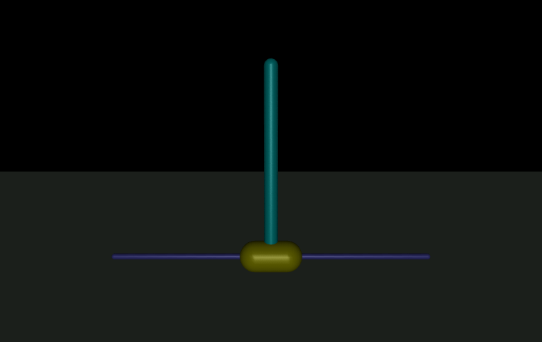

<h1 class="visually-hidden">Inverted Double Pendulum</h1>
<div class="gn-env-banner">
<canvas class="gn-pixel" data-text="INVERTED DOUBLE PENDULUM" data-scale="4" data-color="#fcfcfc" data-shadow="#0058f8"></canvas>
<canvas class="gn-pixel" data-text="MUJOCO  1 ACTION  9 OBSERVATIONS" data-scale="2" data-color="#f8b800"></canvas>
</div>

<p class="gn-env-lead">Keep two poles, the second hinged on top of the first, balanced upright on a cart that slides along a 2 m rail, pushing only the cart. The physics is MuJoCo's, run in Gym.NET's own engine, written from scratch in C# and bit for bit with MuJoCo 4.0.0, and Gym.NET draws its frames pixel for pixel as Gymnasium does.</p>

<aside class="gn-infobox" aria-label="Inverted Double Pendulum at a glance">
<video src="media/InvertedDoublePendulum-v5.episode.mp4" poster="media/InvertedDoublePendulum-v5.figure.png" autoplay muted loop playsinline disablepictureinpicture disableremoteplayback aria-label="InvertedDoublePendulum-v5, seed 0: Farama's SAC expert keeps both poles up for all 1,000 steps"></video>
<p class="gn-infobox-caption">The whole episode <code>examples/InvertedDoublePendulum</code> plays and records: Farama's SAC expert, 2.6 m to the side, seed 0, 1,000 steps, return 9,355.8.</p>
<table>
<tr><td>Ids</td><td><code>InvertedDoublePendulum-v5</code> 1,000 steps<br><code>InvertedDoublePendulum-v4</code> 1,000 steps</td></tr>
<tr><td>Action space</td><td><code>Box(-1.0, 1.0, (1,), float32)</code></td></tr>
<tr><td>Observation space</td><td><code>Box(-inf, inf, (9,), float64)</code></td></tr>
<tr><td>Reward</td><td>10 a step while the tip is above 1 m, less its squared distance from a point 2 m up and a speed penalty · solved at 9,100</td></tr>
<tr><td>Physics</td><td>MuJoCo 4.0.0 in Gym.NET's own engine, bit for bit: 5 Runge-Kutta steps of 0.01 s per env step</td></tr>
<tr><td>Render modes</td><td><code>human</code>, <code>rgb_array</code>, <code>depth_array</code>, <code>rgbd_tuple</code> · 480×480 · 20 fps</td></tr>
<tr><td>Make</td><td><code>Gymnasium.Make(<wbr>"InvertedDouble<wbr>Pendulum-v5")</code></td></tr>
<tr><td>Class</td><td><a href="xref:Gym.Environments.Envs.MuJoCo.InvertedDoublePendulumEnvV5"><code>InvertedDouble<wbr>PendulumEnvV5</code></a>, options <a href="xref:Gym.Environments.Envs.MuJoCo.InvertedDoublePendulumEnvV5Options"><code>InvertedDouble<wbr>PendulumEnvV5Options</code></a>, info <a href="xref:Gym.Environments.Envs.MuJoCo.InvertedDoublePendulumInfoV5"><code>InvertedDouble<wbr>PendulumInfoV5</code></a></td></tr>
<tr><td>Vector env</td><td>none of its own: <code>MakeVec</code> builds sync or async</td></tr>
<tr><td>Parity</td><td><span class="gn-badge gn-badge-ok">physics bit for bit</span><span class="gn-badge gn-badge-ok">frames pixel for pixel</span><br>with Gymnasium 1.4.0 on MuJoCo 4.0.0</td></tr>
<tr><td>Gymnasium</td><td><a href="https://gymnasium.farama.org/v1.4.0/environments/mujoco/inverted_double_pendulum/">Inverted Double Pendulum</a> in Gymnasium 1.4.0's docs</td></tr>
</table>
</aside>

## Description

[Inverted Pendulum](inverted_pendulum.md) with a second pole: a cart slides along a rail 2 m long, a pole 0.6 m long
is hinged on it, and a second pole of the same length is hinged on the top of the first. Only the cart has a motor;
each step the agent pushes it with a force from −1 to 1 (times the gear, 500). The reward pays 10 for every step the
tip of the upper pole stays above 1 m, less a penalty for the tip's distance from a point 2 m up, which it can never
reach, and a small one for the poles' spin; the episode ends on the step the tip drops to 1 m.

The model's gravity leans a hundred-thousandth of a metre per second squared toward +x, so the balance has no
resting point: from the exact upright pose, with no push at all, the poles fall at step 53; with that lean set to 0
they stand all 1,000 steps. The env builds on A. Barto, R. Sutton and C. Anderson's cart-pole, and Gymnasium keeps it
among its MuJoCo tasks. Gym.NET runs it on its own MuJoCo engine, a C# reimplementation of MuJoCo 4.0.0 that computes
every float of every step as MuJoCo does on the reference machine, so the episodes are Gymnasium's, value for value;
for this model Gym.NET's software drawing of MuJoCo's frames also matches Gymnasium's (see
[Parity](#parity-with-gymnasium)).

## Quick start

# [C#](#tab/csharp)

[!code-csharp[](../../../tests/Gym.Tests/Docs/EnvPageSamples/InvertedDoublePendulumSamples.cs?range=1-4,39-45&dedent=12)]

# [Python (Gymnasium)](#tab/python)

```python
import gymnasium as gym

env = gym.make("InvertedDoublePendulum-v5")
# 9 numbers: the cart's position, the poles' sines and cosines, 3 speeds, the rail's force
observation, info = env.reset(seed=42)
# one force, from -1 to 1: push the cart left or right
action = env.action_space.sample()
observation, reward, terminated, truncated, info = env.step(action)
```

---

`dotnet add package Gym.NET.Environments`; the seven longer examples are in [Code examples](#code-examples).

### Watch the agent, or play

```bash
# from a clone of the repository: the agent in the video balances in MuJoCo's window
dotnet run --project examples/InvertedDoublePendulum -c Release -- --render
# or try it yourself: A pushes the cart left, D right
dotnet run --project examples/InvertedDoublePendulum -c Release -- --play
```

`--play` runs Gymnasium's `play` (`Play.Run`) at the env's 20 steps a second: the frames are cheap here, about 0.03 s
each in Gym.NET's software renderer. Each new game starts from the same seed.

## How it works

<div class="gn-figure gn-figure-wide">

<svg viewBox="0 0 760 480" font-family="system-ui, sans-serif" role="img" aria-label="Labels: the tip, 1.2 m up, whose height the reward reads and whose drop to 1 m ends the episode; the second hinge, its angle's sine and cosine the observation's items 2 and 4 and its speed item 7, with no motor; the cart, driven by action 0 at gear 500, its position item 0, its speed item 5 and the rail's force on it item 8, with the first hinge on it, items 1, 3 and 6; the rail's ends at minus and plus 1 m">
<line x1="380" y1="92.48" x2="416" y2="60" stroke="#000" stroke-width="3" stroke-linecap="round"/><line x1="380" y1="92.48" x2="416" y2="60" stroke="#ffd43b" stroke-width="1.3" stroke-linecap="round"/>
<line x1="380" y1="228.88" x2="416" y2="202" stroke="#000" stroke-width="3" stroke-linecap="round"/><line x1="380" y1="228.88" x2="416" y2="202" stroke="#ffd43b" stroke-width="1.3" stroke-linecap="round"/>
<line x1="380" y1="359.89" x2="416" y2="426" stroke="#000" stroke-width="3" stroke-linecap="round"/><line x1="380" y1="359.89" x2="416" y2="426" stroke="#ffffff" stroke-width="1.3" stroke-linecap="round"/>
<line x1="161.18" y1="359.89" x2="161" y2="384" stroke="#000" stroke-width="3" stroke-linecap="round"/><line x1="161.18" y1="359.89" x2="161" y2="384" stroke="#ffd43b" stroke-width="1.3" stroke-linecap="round"/>
<line x1="598.82" y1="359.89" x2="599" y2="384" stroke="#000" stroke-width="3" stroke-linecap="round"/><line x1="598.82" y1="359.89" x2="599" y2="384" stroke="#ffd43b" stroke-width="1.3" stroke-linecap="round"/>
<circle cx="380" cy="92.48" r="4" fill="#ffd43b" stroke="#000" stroke-width="1.2"/>
<text x="420" y="64" text-anchor="start" fill="#ffd43b" font-weight="700" paint-order="stroke" stroke="#000" stroke-width="3" stroke-linejoin="round" font-size="13">tip · the reward's point, 1.2 m up</text>
<text x="420" y="80" text-anchor="start" fill="#ffd43b" font-weight="600" paint-order="stroke" stroke="#000" stroke-width="3" stroke-linejoin="round" font-size="12">the episode ends when it drops to 1 m</text>
<circle cx="380" cy="228.88" r="4" fill="#ffd43b" stroke="#000" stroke-width="1.2"/>
<text x="420" y="206" text-anchor="start" fill="#ffd43b" font-weight="700" paint-order="stroke" stroke="#000" stroke-width="3" stroke-linejoin="round" font-size="13">second hinge · angle: sin [2], cos [4]</text>
<text x="420" y="222" text-anchor="start" fill="#ffd43b" font-weight="600" paint-order="stroke" stroke="#000" stroke-width="3" stroke-linejoin="round" font-size="12">speed [7]; no motor</text>
<circle cx="380" cy="359.89" r="4" fill="#ffffff" stroke="#000" stroke-width="1.2"/>
<text x="420" y="430" text-anchor="start" fill="#ffffff" font-weight="700" paint-order="stroke" stroke="#000" stroke-width="3" stroke-linejoin="round" font-size="13">cart · action 0 · gear 500</text>
<text x="420" y="446" text-anchor="start" fill="#ffffff" font-weight="600" paint-order="stroke" stroke="#000" stroke-width="3" stroke-linejoin="round" font-size="12">position [0], speed [5], rail's force [8]</text>
<text x="420" y="462" text-anchor="start" fill="#ffffff" font-weight="600" paint-order="stroke" stroke="#000" stroke-width="3" stroke-linejoin="round" font-size="12">first hinge: sin [1], cos [3], speed [6]</text>
<circle cx="161.18" cy="359.89" r="4" fill="#ffd43b" stroke="#000" stroke-width="1.2"/>
<text x="161" y="398" text-anchor="middle" fill="#ffd43b" font-weight="700" paint-order="stroke" stroke="#000" stroke-width="3" stroke-linejoin="round" font-size="13">rail end, −1 m</text>
<circle cx="598.82" cy="359.89" r="4" fill="#ffd43b" stroke="#000" stroke-width="1.2"/>
<text x="599" y="398" text-anchor="middle" fill="#ffd43b" font-weight="700" paint-order="stroke" stroke="#000" stroke-width="3" stroke-linejoin="round" font-size="13">rail end, +1 m</text>
</svg>
</div>
<p class="gn-figure-caption">The reset pose without noise (<code>reset_noise_scale</code> 0), rendered by Gym.NET with MuJoCo's free camera from the side, 2.6 m from a point 0.55 m above the rail, at azimuth 90° and elevation −5°, the video's view: the two poles in line, the tip 1.2 m up, the floor 3 m below. Each dot is a point of the model projected through MuJoCo's camera geometry: the cart's slider, where the first hinge also sits, the second hinge, the tip and the rail's ends. Gymnasium's frame of the same pose differs in none of its 364,800 pixels.</p>

MuJoCo steps the model with the fourth-order Runge-Kutta integrator every 0.01 s, and an env step holds the action for
five of those steps, 0.05 s, hence 20 steps and frames a second. The motor pushes the cart along the rail with 500 times
the control, up to 500 N; the cart stops at the rail's ends, ±1 m, while both hinges turn freely, without limits; all
three joints are lightly damped.

The reward of a step reads the tip (the site at the top of the upper pole) after the step:

$$
r_t = h\,[\,z_\text{tip} > 1\,] - \bigl(0.01\,x_\text{tip}^2 + (z_\text{tip} - 2)^2\bigr) - \bigl(0.001\,\omega_1^2 + 0.005\,\omega_2^2\bigr)
$$

with $h = 10$ and $\omega_1$, $\omega_2$ the hinges' angular velocities. Since the poles stand 1.2 m, the distance term
costs at least 0.64, and a step pays at most 9.36 (see [The best a step can pay](#the-best-a-step-can-pay)).

| Constant | Gym.NET | Gymnasium | Value | Effect |
|---|---|---|--:|---|
| Physics step | `Model.Opt.Timestep` | `model.opt.timestep` | 0.01 s | MuJoCo's step, Runge-Kutta 4 |
| Frame skip | `FrameSkip` | `frame_skip` | 5 | Physics steps per env step: an env step is 0.05 s |
| Gear | the model's | `actuator_gear` | 500 | Force per unit of control |
| Healthy reward | `HealthyReward` | `_healthy_reward` | 10.0 | Paid for every step the tip stays above 1 m |
| Reset noise | `ResetNoiseScale` | `_reset_noise_scale` | 0.1 | The starting state's spread |
| Sideways gravity | the model's | `model.opt.gravity[0]` | 1e-5 m/s² | Tips the balance toward +x |

> [!NOTE]
> InvertedDoublePendulum-v4 paid the 10 on the step the tip drops too, and observed the hinges' constraint forces as two
> more numbers, always 0; v5 pays only while the tip is up (Gymnasium's issue 500) and leaves them out (issue 228). The
> registry counts an average of 9,100 over 100 episodes as solved, which needs the tip near the top for nearly every
> one of the 1,000 steps.

## Action space

`Box(-1.0, 1.0, (1,), float32)`: the force on the cart, in units of the motor's gear: 1 is 500 N to the right.

| Index | Motor | Gear (N) | Joint range |
|---|---|--:|---|
| 0 | The cart's slide (`slider`) | 500 | −1 m to 1 m |

MuJoCo clamps the control to the motor's range of −1 to 1 before it acts.

## Observation space

`Box(-inf, inf, (9,), float64)`: the cart's position, the angles as sines and cosines, the speeds clipped to ±10, and
the rail's force on the cart.

| Index | Meaning | Unit |
|---|---|---|
| 0 | The cart's position along the rail (`slider`) | m |
| 1, 2 | The sines of the lower pole's angle and of the upper pole's angle from the lower | |
| 3, 4 | Their cosines | |
| 5 | The cart's velocity, clipped to ±10 | m/s |
| 6, 7 | The hinges' angular velocities, clipped to ±10 | rad/s |
| 8 | The constraint force on the cart (`qfrc_constraint`), the rail's ends pushing back, clipped to ±10 | N |

## Rewards

`healthy_reward` for every step after which the tip is above 1 m, less the distance and velocity penalties; the info
splits the three as `reward_survive`, `distance_penalty` and `velocity_penalty`. The registry counts an average of 9,100
over 100 episodes as solved; the expert in the video makes 9,355.8.

## Starting state

The cart in the middle and both poles upright, plus noise: the three positions get a uniform draw from
±`reset_noise_scale` (0.1), and the three velocities a normal draw with that standard deviation. With
`reset_noise_scale` 0 every seed starts from the pose in the figure, at rest, from which the sideways gravity alone
topples the poles in 53 steps.

## Episode end

| Ends by | When |
|---|---|
| Termination | The tip drops to 1 m or below (it stands 1.2 m up) |
| Truncation | 1,000 steps: the `TimeLimit` that `Make` wraps around the env |

## Arguments

By Gymnasium's name in `Make`'s kwargs, or by the C# name in the constructor and in
<xref:Gym.Environments.Envs.MuJoCo.InvertedDoublePendulumEnvV5Options>.

| Argument | Type and default | Effect |
|---|---|---|
| `xml_file`<br>`xmlFile` | `string`<br>`"inverted_double_pendulum.xml"` | The model: the bundled one by name, or a path to your own MJCF file |
| `frame_skip`<br>`frameSkip` | `int`<br>`5` | Physics steps per env step; changes the step's duration and the frame rate |
| `default_camera_config`<br>`defaultCameraConfig` | `IReadOnlyDictionary<string, object?>?`<br>`null` | The free camera's `distance`, `azimuth`, `elevation`, `lookat` or `trackbodyid`; null leaves the renderer's start, the model's extent, 8.2 m off |
| `healthy_reward`<br>`healthyReward` | `double`<br>`10.0` | The reward for each step the tip stays above 1 m |
| `reset_noise_scale`<br>`resetNoiseScale` | `double`<br>`0.1` | The starting state's noise; 0 starts from the model's pose |
| `render_mode`<br>`renderMode` | `string?` or `RenderMode`<br>`null` | `"human"` opens MuJoCo's window; `"rgb_array"`, `"depth_array"` and `"rgbd_tuple"` make `Render()` return frames |
| `width`<br>`width` | `int`<br>`480` | The frame's width in pixels |
| `height`<br>`height` | `int`<br>`480` | The frame's height in pixels |
| `camera_id`<br>`cameraId` | `int?`<br>`null` | A camera by index (−1 the free camera); not with `camera_name` |
| `camera_name`<br>`cameraName` | `string?`<br>`null` | A camera by name; this model has none |
| `max_geom`<br>`maxGeom` | `int`<br>`1000` | The renderer's scene capacity |
| `visual_options`<br>`visualOptions` | `IReadOnlyDictionary<int, bool>?`<br>`null` | MuJoCo's visualization flags by index (contact points, forces, ...) |
| (Gym.NET)<br>`viewerFactory` | `EnvViewerFactory?`<br>`null` | The window for `human`: Avalonia, WinForms, or headless |

[!code-csharp[](../../../tests/Gym.Tests/Docs/EnvPageSamples/InvertedDoublePendulumSamples.cs#Arguments)]

## Info

<xref:Gym.Environments.Envs.MuJoCo.InvertedDoublePendulumInfoV5>: `reward_survive`, `distance_penalty` and
`velocity_penalty` on every step; a reset sends an empty info.

## Rendering

| Mode | What you get |
|---|---|
| `rgb_array` | `Render()` returns the frame: `(480, 480, 3)` uint8 by default, `width` by `height` |
| `depth_array` | `Render()` returns MuJoCo's depth buffer, `(480, 480)` float32: 0 at the near plane, 1 at the far one, not metres |
| `rgbd_tuple` | `Render()` returns both, `RenderResult.RgbDepth`, as Python's `(rgb, depth)` |
| `human` | MuJoCo's window from the viewer factory, drawn after every reset and step, with Gymnasium's controls |
| none | `Render()` warns and returns nothing, as Gymnasium's does |

The model has no camera, and Gymnasium's v5 sets no camera configuration for it (v4 set one, 4.1 m off), so with no
camera named the frames come from MuJoCo's free camera at the model's extent, 8.2 m off, where the poles are a few pixels
tall. The video sets the free camera 2.6 m off, as the front-page showreel does, and so can any `default_camera_config`.
In `human` mode, the mouse orbits, pans and zooms, and H lists Gymnasium's other keys. Gym.NET draws this model's frames
in software in about 0.03 s each, faster than the env's 20 frames a second.

## Episode anatomy

The whole episode, step by step: the cart's position, both poles' angles, the push and each step's reward, with a
cursor following the video. The expert has both poles steady within 100 steps (5 s), pushing hardest in the first steps, up to full force; after that it holds them within 0.05° of upright with pushes under 0.0005, the cart parked 0.63 m right of the middle. Each of those steps pays 9.356: the 10 for staying up less the distance penalty's 0.644, since the tip stands 1.2 m up and the penalty measures it from 2 m.

<div class="gn-anatomy" data-trace="media/InvertedDoublePendulum-v5.episode.json">
<div><video src="media/InvertedDoublePendulum-v5.episode.mp4" poster="media/InvertedDoublePendulum-v5.figure.png" autoplay muted loop playsinline disablepictureinpicture disableremoteplayback aria-label="InvertedDoublePendulum-v5, seed 0, the episode the chart follows"></video><div class="gn-anatomy-readout" aria-live="off"></div></div>
<div><div class="gn-anatomy-chart"></div><div class="gn-anatomy-legend"></div></div>
<script type="application/json" class="gn-anatomy-spec">{"label":"InvertedDoublePendulum-v5, seed 0: the cart's position, both poles' angles, the push and each step's reward","bands":[{"height":70,"range":[-0.55,0.75],"ticks":[-0.4,0,0.4],"series":[{"column":"x","color":"#f8b800","name":"the cart's position (m), on a rail of ±1"}]},{"height":70,"range":[-12.5,6.5],"scale":57.29577951308232,"ticks":[-10,-5,0,5],"unit":"°","series":[{"column":"angle1","color":"#3cbcfc","name":"the lower pole's angle"},{"column":"angle2","color":"#b8b8f8","name":"the upper pole's angle, from the lower's"}]},{"height":60,"range":[-1.05,0.8],"ticks":[-1,0,0.5],"series":[{"column":"a0","color":"#ff6b6b","name":"the push, from −1 to 1 (× gear 500)"}]},{"height":60,"range":[9.22,9.38],"ticks":[9.25,9.3,9.35],"series":[{"column":"reward","color":"#40c057","name":"each step's reward; 9.36 at most"}]}],"readout":[{"label":"step","column":"@step"},{"label":"cart","column":"x","digits":2,"unit":" m"},{"label":"return so far","column":"@return","digits":1}]}</script>
</div>

## Code examples

### Run an episode

# [C#](#tab/csharp)

[!code-csharp[](../../../tests/Gym.Tests/Docs/EnvPageSamples/InvertedDoublePendulumSamples.cs#RunAnEpisode)]

# [Python (Gymnasium)](#tab/python)

```python
import gymnasium as gym

env = gym.make("InvertedDoublePendulum-v5")
observation, info = env.reset(seed=42)
episode_return, steps = 0.0, 0
while True:
    action = env.action_space.sample()
    observation, reward, terminated, truncated, info = env.step(action)
    episode_return, steps = episode_return + reward, steps + 1
    if terminated or truncated:
        break
# random pushes drop the tip within about 6 steps: 44.6 on average
print(f"{steps} steps, return {episode_return:.1f}")
```

---

### The reward's terms

# [C#](#tab/csharp)

[!code-csharp[](../../../tests/Gym.Tests/Docs/EnvPageSamples/InvertedDoublePendulumSamples.cs#RewardTerms)]

# [Python (Gymnasium)](#tab/python)

```python
import numpy as np

env = gym.make("InvertedDoublePendulum-v5")
env.reset(seed=42)
action = np.array([0.5], dtype=np.float32)  # half a push to the right
observation, reward, terminated, truncated, info = env.step(action)
alive, distance, velocity = info["reward_survive"], info["distance_penalty"], info["velocity_penalty"]
# 9.3082 = 10.0000 alive - 0.6448 distance - 0.0469 velocity
print(f"{reward:.4f} = {alive:.4f} alive {distance:.4f} distance {velocity:.4f} velocity")
```

---

### The best a step can pay

# [C#](#tab/csharp)

[!code-csharp[](../../../tests/Gym.Tests/Docs/EnvPageSamples/InvertedDoublePendulumSamples.cs#BestStep)]

# [Python (Gymnasium)](#tab/python)

```python
env = gym.make("InvertedDoublePendulum-v5", reset_noise_scale=0.0)
env.reset(seed=42)  # both poles upright, at rest
observation, reward, terminated, truncated, info = env.step(np.array([0.0], dtype=np.float32))
# 9.3600: 10 - (1.2 - 2)^2, the tip 1.2 m up measured from 2 m
print(f"{reward:.4f}")
```

---

### Start without noise

# [C#](#tab/csharp)

[!code-csharp[](../../../tests/Gym.Tests/Docs/EnvPageSamples/InvertedDoublePendulumSamples.cs#ResetWithoutNoise)]

# [Python (Gymnasium)](#tab/python)

```python
env = gym.make("InvertedDoublePendulum-v5", reset_noise_scale=0.0)
observation, info = env.reset(seed=42)
rest = np.delete(observation, [3, 4])
# 1.0, 1.0, True: both poles upright (their cosines 1), every other value 0
print(f"{observation[3]:.1f}, {observation[4]:.1f}, {bool(np.all(rest == 0))}")
```

---

### Cameras and depth

# [C#](#tab/csharp)

[!code-csharp[](../../../tests/Gym.Tests/Docs/EnvPageSamples/InvertedDoublePendulumSamples.cs#CamerasAndDepth)]

# [Python (Gymnasium)](#tab/python)

```python
# no camera set for v5: place the free camera as the video does; rgbd_tuple draws colour and depth together
view = {"trackbodyid": 0, "distance": 2.6, "lookat": np.array([0.0, 0.0, 0.55]), "elevation": -5.0}
env = gym.make("InvertedDoublePendulum-v5", render_mode="rgbd_tuple", default_camera_config=view)
env.reset(seed=42)
rgb, depth = env.render()
print(rgb.shape, depth.shape)  # (480, 480, 3) (480, 480)
# MuJoCo's raw depth buffer, 0 at the near plane and 1 at the far one,
# not metres: the nearest point, on the upper pole, is 0.967
print(f"{depth.min():.3f}")  # 0.967
```

---

### Many pendulums at once

# [C#](#tab/csharp)

[!code-csharp[](../../../tests/Gym.Tests/Docs/EnvPageSamples/InvertedDoublePendulumSamples.cs#ManyPendulums)]

# [Python (Gymnasium)](#tab/python)

```python
# No vector env of its own: make_vec steps 8 envs in turn ("sync")
envs = gym.make_vec("InvertedDoublePendulum-v5", num_envs=8, vectorization_mode="sync")
observations, infos = envs.reset(seed=42)  # 8 x 9 observations
for t in range(100):
    actions = envs.action_space.sample()  # 8 x 1 forces
    # fallen pendulums reset themselves
    observations, rewards, terminations, truncations, infos = envs.step(actions)
```

---

Every C# example is a test in `tests/Gym.Tests/Docs/EnvPageSamples`, compiled and run by the unit gate; where a
comment states a number, the test checks it.

## Agents and examples

- **The video's agent** is Farama's SAC expert (Soft Actor-Critic), the agent the Farama Foundation, Gymnasium's
  maintainers, trained on InvertedDoublePendulum-v5 to record the Minari datasets, imported from Hugging Face
  (`farama-minari/InvertedDoublePendulum-v5-SAC-expert`): two dense layers of 256 with ReLU that read the 9 observations
  and squash their output into the motor's range with tanh. Seed 0 returns 9,355.8; over seeds 0 to 9 it averages
  9,356.0 in Gym.NET, every seed holding both poles all 1,000 steps.
- **[examples/InvertedDoublePendulum](https://github.com/SciSharp/Gym.NET/tree/master/examples/InvertedDoublePendulum)**
  ([`InvertedDoublePendulumProgram.cs`](https://github.com/SciSharp/Gym.NET/blob/master/examples/InvertedDoublePendulum/InvertedDoublePendulumProgram.cs))
  plays it: `dotnet run --project examples/InvertedDoublePendulum -c Release` plays seed 0 headless, `--seed N` another
  seed, `--episodes N` that many seeds and their mean, `--render` in MuJoCo's window, `--play` from the keyboard.
- **This page's video and chart** are the example's own episode: `--record docs/environments/mujoco/media` records it
  with `RecordVideo` (one frame per step, through the free camera 2.6 m to the side) and writes the step trace and the
  figure beside it.

## Vectorized environment

InvertedDoublePendulum registers no vector env of its own. `Gymnasium.MakeVec("InvertedDoublePendulum-v5", n)` builds
a `SyncVectorEnv` that steps `n` separate envs in turn, and `VectorizeMode.Async` an `AsyncVectorEnv` that steps them on
worker threads; each env resets itself after its episode ends (next-step autoreset), as Gymnasium's. Each env has its
own simulation.

## Variants

<a id="v4"></a>

### InvertedDoublePendulum-v4

The same cart and poles with no arguments of its own (Gymnasium's v4 takes only the base class's: the render mode, the
frame size and the camera), 11 observations (the hinges' constraint forces too, always 0), an empty info after every
step and reset, the camera 4.1 m off by default, and the 10 paid on every step, the falling one included. From the same
seed and actions, the rewards of v4 and v5 differ on the step that ends the episode. Gymnasium warns that v4 is out of
date, and Gym.NET does the same. The class is <xref:Gym.Environments.Envs.MuJoCo.InvertedDoublePendulumEnvV4>.

## Parity with Gymnasium

Gymnasium 1.4.0 runs inside the test process, MuJoCo 4.0.0 under it, and both are compared value by value:

| What is compared | How | Result |
|---|---|---|
| Episodes | sampled episodes of both versions from several seeds, three in a row in one env through their falls, every observation, reward, flag and info value with its NumPy type | ✓ bit for bit |
| Arguments | Gymnasium's keyword variants (another healthy reward with more starting noise) | ✓ bit for bit |
| Actions | every form of action NumPy takes or refuses, with Gymnasium's messages | ✓ same values, same messages |
| Frames | `rgb_array` and `depth_array` frames against Gymnasium's on the reference GPU, at the reset and after the steps | ✓ RGB pixel for pixel; depth within a measured baseline |
| Spaces, metadata, `make`'s stack, the window | both spaces; the metadata; `make`'s stacks and warnings; the human window's controls and overlay | ✓ |

The tests: [MujocoLiveParityTests](https://github.com/SciSharp/Gym.NET/blob/master/tests/Gym.Tests.Parity/Tests/Envs/MujocoLiveParityTests.cs),
[MujocoFrameLiveParityTests](https://github.com/SciSharp/Gym.NET/blob/master/tests/Gym.Tests.Parity/Tests/Envs/MujocoFrameLiveParityTests.cs),
[MujocoWindowLiveParityTests](https://github.com/SciSharp/Gym.NET/blob/master/tests/Gym.Tests.Parity/Tests/Envs/MujocoWindowLiveParityTests.cs).
Bit for bit holds on the reference machine, an x64 CPU with FMA: the engine calls the platform's math functions, whose
last bits differ on a CPU without FMA. The frames are Gym.NET's own drawing of MuJoCo's renderer, and for this model the
frame cells (v4 and v5) record 0 differing pixels, so the gate holds them to equality; the figure above, at another
view, is equal too (DR-98 traced every clip-space triangle of this model to the GPU's bits).

## Performance

| | Steps a second | Bytes a step |
|---|--:|--:|
| Gym.NET | 25,659 | 13,039 |
| Gymnasium | 8,212 | |

3.1× faster. Gymnasium's own `benchmark_step` on both sides (Gym.NET's `Performance.BenchmarkStep`, DR-36): random actions, a reset at each episode's end, after a 2-second warm-up; .NET 10 in Release against CPython 3.12 with MuJoCo 4.0.0's own bindings; the medians of three interleaved rounds of 5 seconds on one machine (2026-11-24). Gym.NET's engine is managed C#, MuJoCo's is native C; the step is the physics, the observation and the reward, no rendering.

## Reference sources

- [gymnasium/envs/mujoco/inverted_double_pendulum_v5.py](https://github.com/Farama-Foundation/Gymnasium/blob/8ba8c3a63bb4e000b7f33923f43d292acac07be1/gymnasium/envs/mujoco/inverted_double_pendulum_v5.py)
  and [inverted_double_pendulum_v4.py](https://github.com/Farama-Foundation/Gymnasium/blob/8ba8c3a63bb4e000b7f33923f43d292acac07be1/gymnasium/envs/mujoco/inverted_double_pendulum_v4.py),
  Gymnasium 1.4.0: the environment; [mujoco_env.py](https://github.com/Farama-Foundation/Gymnasium/blob/8ba8c3a63bb4e000b7f33923f43d292acac07be1/gymnasium/envs/mujoco/mujoco_env.py),
  the base class; [mujoco_rendering.py](https://github.com/Farama-Foundation/Gymnasium/blob/8ba8c3a63bb4e000b7f33923f43d292acac07be1/gymnasium/envs/mujoco/mujoco_rendering.py),
  the cameras and the window.
- [inverted_double_pendulum.xml](https://github.com/Farama-Foundation/Gymnasium/blob/8ba8c3a63bb4e000b7f33923f43d292acac07be1/gymnasium/envs/mujoco/assets/inverted_double_pendulum.xml),
  the model, embedded as MuJoCo 4.0.0 compiles it (`src/Gym.Environments/Assets/mujoco`).
- [MuJoCo 4.0.0](https://github.com/google-deepmind/mujoco/tree/4.0.0/src/engine), the engine Gym.NET's `Gym.MuJoCo`
  reproduces, and its classic renderer (`src/render/classic`), which Gym.NET draws in software.

## Version history

| Version | Change |
|---|---|
| v5 | MuJoCo 2.3.3 or later; custom models through `xml_file`; `default_camera_config`, `frame_skip`, `healthy_reward` and `reset_noise_scale`; the 10 only while the tip is up, no longer on the falling step (issue 500); the hinges' constraint forces out of the observation (issue 228); the reward's terms in the info |
| v4 | The `mujoco` bindings (MuJoCo 2.1.3 or later) instead of mujoco-py |
| v3 | None: InvertedDoublePendulum has no v3 |
| v2 | mujoco-py 1.50; now raises `ImportError` in Gymnasium (mujoco-py), and in Gym.NET |
| v1 | Episodes of 1,000 steps |
| v0 | The first release |
| Gym.NET 1.0.0 | New: Gymnasium 1.4.0's InvertedDoublePendulum-v5 and InvertedDoublePendulum-v4 on Gym.NET's own MuJoCo engine, bit for bit and their frames pixel for pixel; 0.2.0 had no MuJoCo |

## References

1. A. Barto, R. Sutton and C. Anderson, "Neuronlike adaptive elements that can solve difficult learning control
   problems", *IEEE Transactions on Systems, Man, and Cybernetics*, 1983: the cart-pole it builds on.
   [ieeexplore.ieee.org](https://ieeexplore.ieee.org/document/6313077)
2. E. Todorov, T. Erez and Y. Tassa, "MuJoCo: A physics engine for model-based control", *IROS*, 2012: the engine.
   [mujoco.org](https://mujoco.org)
3. T. Haarnoja, A. Zhou, P. Abbeel and S. Levine, "Soft Actor-Critic: Off-Policy Maximum Entropy Deep Reinforcement
   Learning with a Stochastic Actor", *ICML*, 2018: SAC, the expert's algorithm. [arXiv:1801.01290](https://arxiv.org/abs/1801.01290)

## External links

- [Inverted Double Pendulum on Gymnasium's site](https://gymnasium.farama.org/v1.4.0/environments/mujoco/inverted_double_pendulum/) (1.4.0)
- [InvertedDoublePendulumEnvV5.cs](https://github.com/SciSharp/Gym.NET/blob/master/src/Gym.Environments/Envs/MuJoCo/InvertedDoublePendulumEnvV5.cs) on GitHub
- [examples/InvertedDoublePendulum](https://github.com/SciSharp/Gym.NET/tree/master/examples/InvertedDoublePendulum)
- [farama-minari/InvertedDoublePendulum-v5-SAC-expert](https://huggingface.co/farama-minari/InvertedDoublePendulum-v5-SAC-expert), the expert on Hugging Face

## API reference

<xref:Gym.Environments.Envs.MuJoCo.InvertedDoublePendulumEnvV5> · <xref:Gym.Environments.Envs.MuJoCo.InvertedDoublePendulumEnvV5Options> · <xref:Gym.Environments.Envs.MuJoCo.InvertedDoublePendulumInfoV5> · <xref:Gym.Environments.Envs.MuJoCo.InvertedDoublePendulumEnvV4> · <xref:Gym.Environments.Envs.MuJoCo.MujocoEnv>
