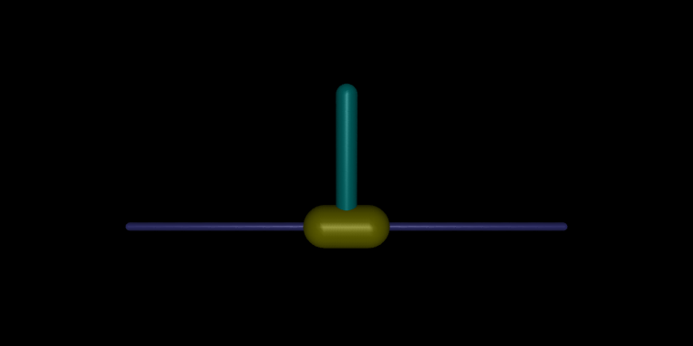

<h1 class="visually-hidden">Inverted Pendulum</h1>
<div class="gn-env-banner">
<canvas class="gn-pixel" data-text="INVERTED PENDULUM" data-scale="5" data-color="#fcfcfc" data-shadow="#0058f8"></canvas>
<canvas class="gn-pixel" data-text="MUJOCO  1 ACTION  4 OBSERVATIONS" data-scale="2" data-color="#f8b800"></canvas>
</div>

<p class="gn-env-lead">Keep a pole balanced upright on a cart that slides along a 2 m rail, pushing the cart left and right with a continuous force. The physics is MuJoCo's, run in Gym.NET's own engine, written from scratch in C# and bit for bit with MuJoCo 4.0.0, and Gym.NET draws its frames pixel for pixel as Gymnasium does.</p>

<aside class="gn-infobox" aria-label="Inverted Pendulum at a glance">
<video src="media/InvertedPendulum-v5.episode.mp4" poster="media/InvertedPendulum-v5.figure.png" autoplay muted loop playsinline disablepictureinpicture disableremoteplayback aria-label="InvertedPendulum-v5, seed 0: Farama's SAC expert keeps the pole up for all 1,000 steps"></video>
<p class="gn-infobox-caption">The whole episode <code>examples/InvertedPendulum</code> plays and records: Farama's SAC expert through Gymnasium's own camera for this env, seed 0, 1,000 steps, return 1,000.0.</p>
<table>
<tr><td>Ids</td><td><code>InvertedPendulum-v5</code> 1,000 steps<br><code>InvertedPendulum-v4</code> 1,000 steps</td></tr>
<tr><td>Action space</td><td><code>Box(-3.0, 3.0, (1,), float32)</code></td></tr>
<tr><td>Observation space</td><td><code>Box(-inf, inf, (4,), float64)</code></td></tr>
<tr><td>Reward</td><td>1 for every step the pole stays within 0.2 rad of upright · solved at 950</td></tr>
<tr><td>Physics</td><td>MuJoCo 4.0.0 in Gym.NET's own engine, bit for bit: 2 Runge-Kutta steps of 0.02 s per env step</td></tr>
<tr><td>Render modes</td><td><code>human</code>, <code>rgb_array</code>, <code>depth_array</code>, <code>rgbd_tuple</code> · 480×480 · 25 fps</td></tr>
<tr><td>Make</td><td><code>Gymnasium.Make(<wbr>"InvertedPendulum-v5")</code></td></tr>
<tr><td>Class</td><td><a href="xref:Gym.Environments.Envs.MuJoCo.InvertedPendulumEnvV5"><code>InvertedPendulumEnvV5</code></a>, options <a href="xref:Gym.Environments.Envs.MuJoCo.InvertedPendulumEnvV5Options"><code>InvertedPendulumEnvV5Options</code></a>, info <a href="xref:Gym.Environments.Envs.MuJoCo.InvertedPendulumInfoV5"><code>InvertedPendulumInfoV5</code></a></td></tr>
<tr><td>Vector env</td><td>none of its own: <code>MakeVec</code> builds sync or async</td></tr>
<tr><td>Parity</td><td><span class="gn-badge gn-badge-ok">physics bit for bit</span><span class="gn-badge gn-badge-ok">frames pixel for pixel</span><br>with Gymnasium 1.4.0 on MuJoCo 4.0.0</td></tr>
<tr><td>Gymnasium</td><td><a href="https://gymnasium.farama.org/v1.4.0/environments/mujoco/inverted_pendulum/">Inverted Pendulum</a> in Gymnasium 1.4.0's docs</td></tr>
</table>
</aside>

## Description

MuJoCo's cart-pole: a cart slides along a rail 2 m long, and a pole 0.6 m long stands on it, hinged at the cart. Each
step the agent pushes the cart with a force from −3 to 3 (times the motor's gear, 100); the reward pays 1 for every
step the pole stays within 0.2 rad (11.5°) of upright, and the episode ends on the step it leans further. Unlike
[Cart Pole](../classic_control/cart_pole.md), whose push is left or right at a fixed strength and whose physics is a
few lines of Euler steps, the force here is continuous and MuJoCo simulates the cart, the hinge and the rail's ends.

The env is A. Barto, R. Sutton and C. Anderson's cart-pole in MuJoCo, and Gymnasium keeps it as the simplest of its
MuJoCo tasks. Gym.NET runs it on its own MuJoCo engine, a C# reimplementation of MuJoCo 4.0.0 that computes every float
of every step as MuJoCo does on the reference machine, so the episodes are Gymnasium's, value for value; for this model
Gym.NET's software drawing of MuJoCo's frames also matches Gymnasium's (see [Parity](#parity-with-gymnasium)).

## Quick start

# [C#](#tab/csharp)

[!code-csharp[](../../../tests/Gym.Tests/Docs/EnvPageSamples/InvertedPendulumSamples.cs?range=1-4,37-43&dedent=12)]

# [Python (Gymnasium)](#tab/python)

```python
import gymnasium as gym

env = gym.make("InvertedPendulum-v5")
# 4 numbers: the cart's position, the pole's angle, and their speeds
observation, info = env.reset(seed=42)
# one force, from -3 to 3: push the cart left or right
action = env.action_space.sample()
observation, reward, terminated, truncated, info = env.step(action)
```

---

`dotnet add package Gym.NET.Environments`; the seven longer examples are in [Code examples](#code-examples).

### Watch the agent, or play

```bash
# from a clone of the repository: the agent in the video balances in MuJoCo's window
dotnet run --project examples/InvertedPendulum -c Release -- --render
# or balance it yourself: A pushes the cart left, D right
dotnet run --project examples/InvertedPendulum -c Release -- --play
```

`--play` runs Gymnasium's `play` (`Play.Run`) at the env's 25 steps a second: the frames are cheap here, about 0.02 s
each in Gym.NET's software renderer. Each new game starts from the same seed.

## How it works

<div class="gn-figure gn-figure-wide">

<svg viewBox="0 0 760 380" font-family="system-ui, sans-serif" role="img" aria-label="Labels: the pole, whose tip stands 0.6 m up and which counts as upright within 0.2 rad; the cart, driven by action 0 at gear 100, its position and speed the observation's items 0 and 2, with the pole's hinge on it, items 1 and 3; the rail's ends at minus and plus 1 m">
<line x1="380.25" y1="104.12" x2="416" y2="52" stroke="#000" stroke-width="3" stroke-linecap="round"/><line x1="380.25" y1="104.12" x2="416" y2="52" stroke="#ffd43b" stroke-width="1.3" stroke-linecap="round"/>
<line x1="380" y1="248.69" x2="436" y2="332" stroke="#000" stroke-width="3" stroke-linecap="round"/><line x1="380" y1="248.69" x2="436" y2="332" stroke="#ffffff" stroke-width="1.3" stroke-linecap="round"/>
<line x1="142.92" y1="248.69" x2="143" y2="282" stroke="#000" stroke-width="3" stroke-linecap="round"/><line x1="142.92" y1="248.69" x2="143" y2="282" stroke="#ffd43b" stroke-width="1.3" stroke-linecap="round"/>
<line x1="617.08" y1="248.69" x2="617" y2="282" stroke="#000" stroke-width="3" stroke-linecap="round"/><line x1="617.08" y1="248.69" x2="617" y2="282" stroke="#ffd43b" stroke-width="1.3" stroke-linecap="round"/>
<circle cx="380.25" cy="104.12" r="4" fill="#ffd43b" stroke="#000" stroke-width="1.2"/>
<text x="420" y="56" text-anchor="start" fill="#ffd43b" font-weight="700" paint-order="stroke" stroke="#000" stroke-width="3" stroke-linejoin="round" font-size="13">pole · its tip 0.6 m up</text>
<text x="420" y="72" text-anchor="start" fill="#ffd43b" font-weight="600" paint-order="stroke" stroke="#000" stroke-width="3" stroke-linejoin="round" font-size="12">upright while within ±0.2 rad (11.5°)</text>
<circle cx="380" cy="248.69" r="4" fill="#ffffff" stroke="#000" stroke-width="1.2"/>
<text x="440" y="336" text-anchor="start" fill="#ffffff" font-weight="700" paint-order="stroke" stroke="#000" stroke-width="3" stroke-linejoin="round" font-size="13">cart · action 0 · gear 100</text>
<text x="440" y="352" text-anchor="start" fill="#ffffff" font-weight="600" paint-order="stroke" stroke="#000" stroke-width="3" stroke-linejoin="round" font-size="12">position [0], speed [2]; the pole's</text>
<text x="440" y="368" text-anchor="start" fill="#ffffff" font-weight="600" paint-order="stroke" stroke="#000" stroke-width="3" stroke-linejoin="round" font-size="12">hinge: angle [1], speed [3]</text>
<circle cx="142.92" cy="248.69" r="4" fill="#ffd43b" stroke="#000" stroke-width="1.2"/>
<text x="143" y="296" text-anchor="middle" fill="#ffd43b" font-weight="700" paint-order="stroke" stroke="#000" stroke-width="3" stroke-linejoin="round" font-size="13">rail end, −1 m</text>
<circle cx="617.08" cy="248.69" r="4" fill="#ffd43b" stroke="#000" stroke-width="1.2"/>
<text x="617" y="296" text-anchor="middle" fill="#ffd43b" font-weight="700" paint-order="stroke" stroke="#000" stroke-width="3" stroke-linejoin="round" font-size="13">rail end, +1 m</text>
</svg>
</div>
<p class="gn-figure-caption">The reset pose without noise (<code>reset_noise_scale</code> 0), rendered by Gym.NET with MuJoCo's free camera from the side, 1.9 m from a point 0.25 m above the rail, at azimuth 90° and elevation −8°. Each dot is a point of the model projected through MuJoCo's camera geometry: the cart's slider, where the pole's hinge also sits, the pole's tip and the rail's ends, the slider's range. Gymnasium's frame of the same pose differs in 3 of its 288,800 pixels, each by one level of 255: the frames the parity tests compare, through the env's own camera at 480×480, are equal.</p>

MuJoCo steps the model with the fourth-order Runge-Kutta integrator every 0.02 s, and an env step holds the action for
two of those steps, 0.04 s, hence 25 steps and frames a second. The motor pushes the cart along the rail with 100 times
the control, up to 300 N; the cart stops at the rail's ends, ±1 m, and the pole's hinge at ±90°. Both joints are damped.
The model has no floor: the rail hangs in black space.

The reward of a step is 1 while the pole is up, after the step:

$$
r_t = [\,|\theta_{t+1}| \le 0.2\,]
$$

with $\theta$ the pole's angle in radians; the step after which it is beyond 0.2 rad (or any observed value is not
finite) pays 0 and ends the episode. In Gymnasium the reward is a Python `int`; Gym.NET's rewards are `double`
throughout, the same values.

| Constant | Gym.NET | Gymnasium | Value | Effect |
|---|---|---|--:|---|
| Physics step | `Model.Opt.Timestep` | `model.opt.timestep` | 0.02 s | MuJoCo's step, Runge-Kutta 4 |
| Frame skip | `FrameSkip` | `frame_skip` | 2 | Physics steps per env step: an env step is 0.04 s |
| Gear | the model's | `actuator_gear` | 100 | Force per unit of control |
| Upright | fixed | fixed | 0.2 rad | The pole's largest angle that still pays |
| Reset noise | `ResetNoiseScale` | `_reset_noise_scale` | 0.01 | The starting state's spread |

> [!NOTE]
> InvertedPendulum-v4 paid 1 on the step the pole falls too, so an episode's return counted its last step; v5 pays
> only while upright (Gymnasium's issue 500), and the falling step's reward is 0. The registry counts an average of 950
> over 100 episodes as solved; random pushes topple the pole within about 6 steps.

## Action space

`Box(-3.0, 3.0, (1,), float32)`: the force on the cart, in units of the motor's gear: 3 is 300 N to the right.

| Index | Motor | Gear (N) | Joint range |
|---|---|--:|---|
| 0 | The cart's slide (`slider`) | 100 | −1 m to 1 m |

MuJoCo clamps the control to the motor's range of −3 to 3 before it acts.

## Observation space

`Box(-inf, inf, (4,), float64)`: `qpos` then `qvel`.

| Index | Meaning | Unit |
|---|---|---|
| 0 | The cart's position along the rail (`slider`) | m |
| 1 | The pole's angle from upright (`hinge`) | rad |
| 2 | The cart's velocity | m/s |
| 3 | The pole's angular velocity | rad/s |

## Rewards

1 for every step after which the pole is within 0.2 rad of upright, 0 for the step that ends the episode; the info
carries it again as `reward_survive`. The registry counts an average of 950 over 100 episodes as solved; the expert in
the video makes 1,000.0, every step of the time limit.

## Starting state

The cart in the middle of the rail and the pole upright, plus noise: both positions and both velocities get a uniform
draw from ±`reset_noise_scale` (0.01). With `reset_noise_scale` 0 every seed starts from the pose in the figure, at
rest, where the pole balances until something pushes it.

## Episode end

| Ends by | When |
|---|---|
| Termination | The pole leans past 0.2 rad, or an observed value is not finite |
| Truncation | 1,000 steps: the `TimeLimit` that `Make` wraps around the env |

## Arguments

By Gymnasium's name in `Make`'s kwargs, or by the C# name in the constructor and in
<xref:Gym.Environments.Envs.MuJoCo.InvertedPendulumEnvV5Options>.

| Argument | Type and default | Effect |
|---|---|---|
| `xml_file`<br>`xmlFile` | `string`<br>`"inverted_pendulum.xml"` | The model: the bundled one by name, or a path to your own MJCF file |
| `frame_skip`<br>`frameSkip` | `int`<br>`2` | Physics steps per env step; changes the step's duration and the frame rate |
| `default_camera_config`<br>`defaultCameraConfig` | `IReadOnlyDictionary<string, object?>?`<br>`null` | The free camera's `distance`, `azimuth`, `elevation`, `lookat` or `trackbodyid`; null takes the env's own, 2.04 m off |
| `reset_noise_scale`<br>`resetNoiseScale` | `double`<br>`0.01` | The starting state's noise; 0 starts from the model's pose |
| `render_mode`<br>`renderMode` | `string?` or `RenderMode`<br>`null` | `"human"` opens MuJoCo's window; `"rgb_array"`, `"depth_array"` and `"rgbd_tuple"` make `Render()` return frames |
| `width`<br>`width` | `int`<br>`480` | The frame's width in pixels |
| `height`<br>`height` | `int`<br>`480` | The frame's height in pixels |
| `camera_id`<br>`cameraId` | `int?`<br>`null` | A camera by index (−1 the free camera); not with `camera_name` |
| `camera_name`<br>`cameraName` | `string?`<br>`null` | A camera by name; this model has none |
| `max_geom`<br>`maxGeom` | `int`<br>`1000` | The renderer's scene capacity |
| `visual_options`<br>`visualOptions` | `IReadOnlyDictionary<int, bool>?`<br>`null` | MuJoCo's visualization flags by index (contact points, forces, ...) |
| (Gym.NET)<br>`viewerFactory` | `EnvViewerFactory?`<br>`null` | The window for `human`: Avalonia, WinForms, or headless |

[!code-csharp[](../../../tests/Gym.Tests/Docs/EnvPageSamples/InvertedPendulumSamples.cs#Arguments)]

## Info

<xref:Gym.Environments.Envs.MuJoCo.InvertedPendulumInfoV5>: `reward_survive` on every step; a reset sends an empty
info.

## Rendering

| Mode | What you get |
|---|---|
| `rgb_array` | `Render()` returns the frame: `(480, 480, 3)` uint8 by default, `width` by `height` |
| `depth_array` | `Render()` returns MuJoCo's depth buffer, `(480, 480)` float32: 0 at the near plane, 1 at the far one, not metres |
| `rgbd_tuple` | `Render()` returns both, `RenderResult.RgbDepth`, as Python's `(rgb, depth)` |
| `human` | MuJoCo's window from the viewer factory, drawn after every reset and step, with Gymnasium's controls |
| none | `Render()` warns and returns nothing, as Gymnasium's does |

The model has no camera, so `camera_name` has nothing to name. With no camera named, Gymnasium 1.4 renders through
MuJoCo's free camera with the env's `default_camera_config`: 2.04 m from the middle of the model's parts, at azimuth 90°
and elevation −45°, which keeps the whole rail in view, as the video does. In `human` mode, the mouse orbits, pans and
zooms, and H lists Gymnasium's other keys. Gym.NET draws this model's frames in software in about 0.02 s each, faster
than the env's 25 frames a second.

## Episode anatomy

The whole episode, step by step: the cart's position, the pole's angle and the push, with a cursor following the
video. The expert hardly has to act: the pole stays within 3° of upright for the whole episode (it falls past 11.5°), the cart within 13 cm of the middle of its 2 m rail, and no push reaches half the motor's strength (1.43 of 3 at the most, 0.13 on average).

<div class="gn-anatomy" data-trace="media/InvertedPendulum-v5.episode.json">
<div><video src="media/InvertedPendulum-v5.episode.mp4" poster="media/InvertedPendulum-v5.figure.png" autoplay muted loop playsinline disablepictureinpicture disableremoteplayback aria-label="InvertedPendulum-v5, seed 0, the episode the chart follows"></video><div class="gn-anatomy-readout" aria-live="off"></div></div>
<div><div class="gn-anatomy-chart"></div><div class="gn-anatomy-legend"></div></div>
<script type="application/json" class="gn-anatomy-spec">{"label":"InvertedPendulum-v5, seed 0: the cart's position, the pole's angle and the push","bands":[{"height":70,"range":[-0.16,0.04],"ticks":[-0.15,-0.1,-0.05,0],"series":[{"column":"x","color":"#f8b800","name":"the cart's position (m), on a rail of ±1"}]},{"height":70,"range":[-12,12],"scale":57.29577951308232,"ticks":[-10,0,10],"unit":"°","series":[{"column":"angle","color":"#3cbcfc","name":"the pole's angle; it falls past ±11.5°"}]},{"height":60,"range":[-1.6,1.0],"ticks":[-1,0,1],"series":[{"column":"a0","color":"#ff6b6b","name":"the push, from −3 to 3 (× gear 100)"}]}],"readout":[{"label":"step","column":"@step"},{"label":"angle","column":"angle","scale":57.29577951308232,"digits":2,"unit":"°"},{"label":"return so far","column":"@return","digits":0}]}</script>
</div>

## Code examples

### Run an episode

# [C#](#tab/csharp)

[!code-csharp[](../../../tests/Gym.Tests/Docs/EnvPageSamples/InvertedPendulumSamples.cs#RunAnEpisode)]

# [Python (Gymnasium)](#tab/python)

```python
import gymnasium as gym

env = gym.make("InvertedPendulum-v5")
observation, info = env.reset(seed=42)
episode_return, steps = 0.0, 0
while True:
    action = env.action_space.sample()
    observation, reward, terminated, truncated, info = env.step(action)
    episode_return, steps = episode_return + reward, steps + 1
    if terminated or truncated:
        break
# random pushes topple the pole within about 6 steps: 5.2 on average
print(f"{steps} steps, return {episode_return:.1f}")
```

---

### The falling step pays nothing

# [C#](#tab/csharp)

[!code-csharp[](../../../tests/Gym.Tests/Docs/EnvPageSamples/InvertedPendulumSamples.cs#FallingStep)]

# [Python (Gymnasium)](#tab/python)

```python
import numpy as np

env = gym.make("InvertedPendulum-v5")
env.reset(seed=42)
push = np.array([3.0], dtype=np.float32)  # full force to the right, every step
steps, episode_return = 0, 0.0
while True:
    observation, reward, terminated, truncated, info = env.step(push)
    steps, episode_return = steps + 1, episode_return + reward
    if terminated or truncated:
        break
# 3 steps, return 2.0: the step the pole falls on pays 0
print(f"{steps} steps, return {episode_return:.1f}")
```

---

### The same push in v4

# [C#](#tab/csharp)

[!code-csharp[](../../../tests/Gym.Tests/Docs/EnvPageSamples/InvertedPendulumSamples.cs#FallingStepInV4)]

# [Python (Gymnasium)](#tab/python)

```python
env = gym.make("InvertedPendulum-v4")
env.reset(seed=42)
steps, episode_return = 0, 0.0
while True:
    observation, reward, terminated, truncated, info = env.step(push)
    steps, episode_return = steps + 1, episode_return + reward
    if terminated or truncated:
        break
# 3 steps, return 3.0: v4 also paid the falling step
print(f"{steps} steps, return {episode_return:.1f}")
```

---

### Start without noise

# [C#](#tab/csharp)

[!code-csharp[](../../../tests/Gym.Tests/Docs/EnvPageSamples/InvertedPendulumSamples.cs#ResetWithoutNoise)]

# [Python (Gymnasium)](#tab/python)

```python
env = gym.make("InvertedPendulum-v5", reset_noise_scale=0.0)
observation, info = env.reset(seed=42)
# the cart in the middle, the pole upright, both at rest: every observed value 0
print(bool(np.all(observation == 0)))  # True
```

---

### Cameras and depth

# [C#](#tab/csharp)

[!code-csharp[](../../../tests/Gym.Tests/Docs/EnvPageSamples/InvertedPendulumSamples.cs#CamerasAndDepth)]

# [Python (Gymnasium)](#tab/python)

```python
# no camera in the model: Gymnasium's free camera, 2.04 m off; rgbd_tuple draws colour and depth together
env = gym.make("InvertedPendulum-v5", render_mode="rgbd_tuple")
env.reset(seed=42)
rgb, depth = env.render()
print(rgb.shape, depth.shape)  # (480, 480, 3) (480, 480)
# MuJoCo's raw depth buffer, 0 at the near plane and 1 at the far one,
# not metres: the nearest point, the top of the pole, is 0.987
print(f"{depth.min():.3f}")  # 0.987
```

---

### Many pendulums at once

# [C#](#tab/csharp)

[!code-csharp[](../../../tests/Gym.Tests/Docs/EnvPageSamples/InvertedPendulumSamples.cs#ManyPendulums)]

# [Python (Gymnasium)](#tab/python)

```python
# No vector env of its own: make_vec steps 8 envs in turn ("sync")
envs = gym.make_vec("InvertedPendulum-v5", num_envs=8, vectorization_mode="sync")
observations, infos = envs.reset(seed=42)  # 8 x 4 observations
for t in range(100):
    actions = envs.action_space.sample()  # 8 x 1 forces
    # fallen pendulums reset themselves
    observations, rewards, terminations, truncations, infos = envs.step(actions)
```

---

Every C# example is a test in `tests/Gym.Tests/Docs/EnvPageSamples`, compiled and run by the unit gate; where a
comment states a number, the test checks it.

## Agents and examples

- **The video's agent** is Farama's SAC expert (Soft Actor-Critic), the agent the Farama Foundation, Gymnasium's
  maintainers, trained on InvertedPendulum-v5 to record the Minari datasets, imported from Hugging Face
  (`farama-minari/InvertedPendulum-v5-SAC-expert`): two dense layers of 256 with ReLU that read the 4 observations and
  squash their output into the motor's range with tanh. Seed 0 returns 1,000.0; over seeds 0 to 9 it scores 1,000.0
  in Gym.NET, every seed balancing all 1,000 steps, as its model card reports (1,000.00 ± 0.00).
- **[examples/InvertedPendulum](https://github.com/SciSharp/Gym.NET/tree/master/examples/InvertedPendulum)**
  ([`InvertedPendulumProgram.cs`](https://github.com/SciSharp/Gym.NET/blob/master/examples/InvertedPendulum/InvertedPendulumProgram.cs))
  plays it: `dotnet run --project examples/InvertedPendulum -c Release` plays seed 0 headless, `--seed N` another seed,
  `--episodes N` that many seeds and their mean, `--render` in MuJoCo's window, `--play` from the keyboard.
- **This page's video and chart** are the example's own episode: `--record docs/environments/mujoco/media` records it
  with `RecordVideo` (one frame per step, through Gymnasium's own camera for this env) and writes the step trace and the
  figure beside it.

## Vectorized environment

InvertedPendulum registers no vector env of its own. `Gymnasium.MakeVec("InvertedPendulum-v5", n)` builds a
`SyncVectorEnv` that steps `n` separate envs in turn, and `VectorizeMode.Async` an `AsyncVectorEnv` that steps them on
worker threads; each env resets itself after its episode ends (next-step autoreset), as Gymnasium's. Each env has its
own simulation.

## Variants

<a id="v4"></a>

### InvertedPendulum-v4

The same cart and pole with no arguments of its own (Gymnasium's v4 takes only the base class's: the render mode, the
frame size and the camera), an empty info after every step and reset, and a reward of 1 on every step, the falling one
included (see [The same push in v4](#the-same-push-in-v4)). From the same seed and actions, v4 and v5 give the same
observations; their rewards differ on the step that ends the episode. Gymnasium warns that v4 is out of
date, and Gym.NET does the same. The class is <xref:Gym.Environments.Envs.MuJoCo.InvertedPendulumEnvV4>.

## Parity with Gymnasium

Gymnasium 1.4.0 runs inside the test process, MuJoCo 4.0.0 under it, and both are compared value by value:

| What is compared | How | Result |
|---|---|---|
| Episodes | sampled episodes of both versions from several seeds, three in a row in one env through their falls, every observation, reward, flag and info value with its type | ✓ bit for bit |
| Arguments | Gymnasium's keyword variants (more starting noise, another frame skip) | ✓ bit for bit |
| Actions | every form of action NumPy takes or refuses, with Gymnasium's messages | ✓ same values, same messages |
| Frames | `rgb_array` and `depth_array` frames against Gymnasium's on the reference GPU, at the reset and after the steps | ✓ RGB pixel for pixel; depth within a measured baseline |
| Spaces, metadata, `make`'s stack, the window | both spaces; the metadata; `make`'s stacks and warnings; the human window's controls and overlay | ✓ |

The tests: [MujocoLiveParityTests](https://github.com/SciSharp/Gym.NET/blob/master/tests/Gym.Tests.Parity/Tests/Envs/MujocoLiveParityTests.cs),
[MujocoFrameLiveParityTests](https://github.com/SciSharp/Gym.NET/blob/master/tests/Gym.Tests.Parity/Tests/Envs/MujocoFrameLiveParityTests.cs),
[MujocoWindowLiveParityTests](https://github.com/SciSharp/Gym.NET/blob/master/tests/Gym.Tests.Parity/Tests/Envs/MujocoWindowLiveParityTests.cs).
Bit for bit holds on the reference machine, an x64 CPU with FMA: the engine calls the platform's math functions, whose
last bits differ on a CPU without FMA. The frames are Gym.NET's own drawing of MuJoCo's renderer, and for this model
the frame cells (the env's own camera at 480×480, v4 and v5) record 0 differing pixels, so the gate holds them to
equality; another view can still differ by a pixel or two, as the figure's does (DR-98 traces the GPU's rounding).

## Performance

| | Steps a second | Bytes a step |
|---|--:|--:|
| Gym.NET | 51,631 | 11,823 |
| Gymnasium | 14,437 | |

3.6× faster. Gymnasium's own `benchmark_step` on both sides (Gym.NET's `Performance.BenchmarkStep`, DR-36): random actions, a reset at each episode's end, after a 2-second warm-up; .NET 10 in Release against CPython 3.12 with MuJoCo 4.0.0's own bindings; the medians of three interleaved rounds of 5 seconds on one machine (2026-11-24). Gym.NET's engine is managed C#, MuJoCo's is native C; the step is the physics, the observation and the reward, no rendering.

## Reference sources

- [gymnasium/envs/mujoco/inverted_pendulum_v5.py](https://github.com/Farama-Foundation/Gymnasium/blob/8ba8c3a63bb4e000b7f33923f43d292acac07be1/gymnasium/envs/mujoco/inverted_pendulum_v5.py)
  and [inverted_pendulum_v4.py](https://github.com/Farama-Foundation/Gymnasium/blob/8ba8c3a63bb4e000b7f33923f43d292acac07be1/gymnasium/envs/mujoco/inverted_pendulum_v4.py),
  Gymnasium 1.4.0: the environment; [mujoco_env.py](https://github.com/Farama-Foundation/Gymnasium/blob/8ba8c3a63bb4e000b7f33923f43d292acac07be1/gymnasium/envs/mujoco/mujoco_env.py),
  the base class; [mujoco_rendering.py](https://github.com/Farama-Foundation/Gymnasium/blob/8ba8c3a63bb4e000b7f33923f43d292acac07be1/gymnasium/envs/mujoco/mujoco_rendering.py),
  the cameras and the window.
- [inverted_pendulum.xml](https://github.com/Farama-Foundation/Gymnasium/blob/8ba8c3a63bb4e000b7f33923f43d292acac07be1/gymnasium/envs/mujoco/assets/inverted_pendulum.xml),
  the model, embedded as MuJoCo 4.0.0 compiles it (`src/Gym.Environments/Assets/mujoco`).
- [MuJoCo 4.0.0](https://github.com/google-deepmind/mujoco/tree/4.0.0/src/engine), the engine Gym.NET's `Gym.MuJoCo`
  reproduces, and its classic renderer (`src/render/classic`), which Gym.NET draws in software.

## Version history

| Version | Change |
|---|---|
| v5 | MuJoCo 2.3.3 or later; custom models through `xml_file`; `default_camera_config`, `frame_skip`, `reset_noise_scale` and `observation_structure`; the reward only while the pole is up, no longer on the falling step (issue 500); `reward_survive` in the info |
| v4 | The `mujoco` bindings (MuJoCo 2.1.3 or later) instead of mujoco-py |
| v3 | None: InvertedPendulum has no v3 |
| v2 | mujoco-py 1.50; now raises `ImportError` in Gymnasium (mujoco-py), and in Gym.NET |
| v1 | Episodes of 1,000 steps |
| v0 | The first release |
| Gym.NET 1.0.0 | New: Gymnasium 1.4.0's InvertedPendulum-v5 and InvertedPendulum-v4 on Gym.NET's own MuJoCo engine, bit for bit and their frames pixel for pixel; 0.2.0 had no MuJoCo |

## References

1. A. Barto, R. Sutton and C. Anderson, "Neuronlike adaptive elements that can solve difficult learning control
   problems", *IEEE Transactions on Systems, Man, and Cybernetics*, 1983: the cart-pole. [ieeexplore.ieee.org](https://ieeexplore.ieee.org/document/6313077)
2. E. Todorov, T. Erez and Y. Tassa, "MuJoCo: A physics engine for model-based control", *IROS*, 2012: the engine.
   [mujoco.org](https://mujoco.org)
3. T. Haarnoja, A. Zhou, P. Abbeel and S. Levine, "Soft Actor-Critic: Off-Policy Maximum Entropy Deep Reinforcement
   Learning with a Stochastic Actor", *ICML*, 2018: SAC, the expert's algorithm. [arXiv:1801.01290](https://arxiv.org/abs/1801.01290)

## External links

- [Inverted Pendulum on Gymnasium's site](https://gymnasium.farama.org/v1.4.0/environments/mujoco/inverted_pendulum/) (1.4.0)
- [InvertedPendulumEnvV5.cs](https://github.com/SciSharp/Gym.NET/blob/master/src/Gym.Environments/Envs/MuJoCo/InvertedPendulumEnvV5.cs) on GitHub
- [examples/InvertedPendulum](https://github.com/SciSharp/Gym.NET/tree/master/examples/InvertedPendulum)
- [farama-minari/InvertedPendulum-v5-SAC-expert](https://huggingface.co/farama-minari/InvertedPendulum-v5-SAC-expert), the expert on Hugging Face

## API reference

<xref:Gym.Environments.Envs.MuJoCo.InvertedPendulumEnvV5> · <xref:Gym.Environments.Envs.MuJoCo.InvertedPendulumEnvV5Options> · <xref:Gym.Environments.Envs.MuJoCo.InvertedPendulumInfoV5> · <xref:Gym.Environments.Envs.MuJoCo.InvertedPendulumEnvV4> · <xref:Gym.Environments.Envs.MuJoCo.MujocoEnv>
