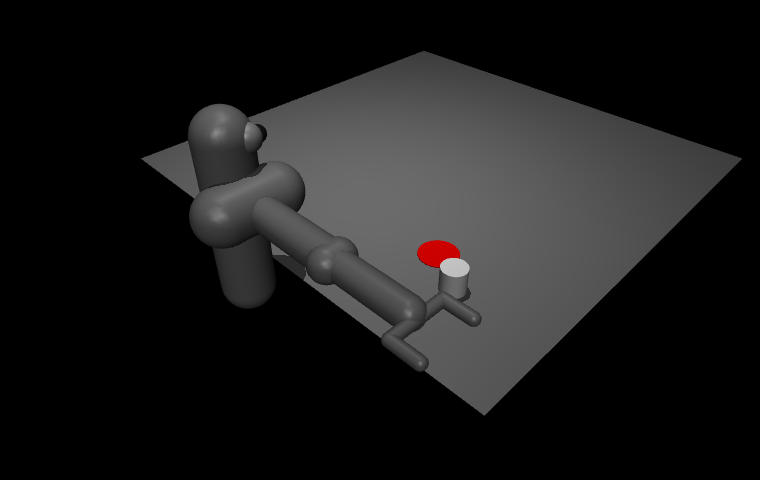

<h1 class="visually-hidden">Pusher</h1>
<div class="gn-env-banner">
<canvas class="gn-pixel" data-text="PUSHER" data-scale="6" data-color="#fcfcfc" data-shadow="#e40058"></canvas>
<canvas class="gn-pixel" data-text="MUJOCO  7 ACTIONS  23 OBSERVATIONS" data-scale="2" data-color="#f8b800"></canvas>
</div>

<p class="gn-env-lead">Make a seven-joint robot arm push a white puck across a table into a red goal, as close to its centre as it can, with as little effort as it can. The physics is MuJoCo's, run in Gym.NET's own engine, written from scratch in C# and bit for bit with MuJoCo 4.0.0.</p>

<aside class="gn-infobox" aria-label="Pusher at a glance">
<video src="media/Pusher-v5.episode.mp4" poster="media/Pusher-v5.figure.png" autoplay muted loop playsinline disablepictureinpicture disableremoteplayback aria-label="Pusher-v5, seed 7: Farama's SAC expert sweeps to the puck and pushes it into the goal"></video>
<p class="gn-infobox-caption">The whole episode <code>examples/Pusher</code> plays and records: Farama's SAC expert, 2.4 m off at azimuth 135°, seed 7, 100 steps, return −20.4.</p>
<table>
<tr><td>Ids</td><td><code>Pusher-v5</code> 100 steps<br><code>Pusher-v4</code> 100 steps, refused on MuJoCo 3 and later</td></tr>
<tr><td>Action space</td><td><code>Box(-2.0, 2.0, (7,), float32)</code></td></tr>
<tr><td>Observation space</td><td><code>Box(-inf, inf, (23,), float64)</code></td></tr>
<tr><td>Reward</td><td>minus the puck's distance from the goal, half the fingertip's from the puck, and 0.1 × the torques squared · solved at 0</td></tr>
<tr><td>Physics</td><td>MuJoCo 4.0.0 in Gym.NET's own engine, bit for bit: 5 Euler steps of 0.01 s per env step</td></tr>
<tr><td>Render modes</td><td><code>human</code>, <code>rgb_array</code>, <code>depth_array</code>, <code>rgbd_tuple</code> · 480×480 · 20 fps</td></tr>
<tr><td>Make</td><td><code>Gymnasium.Make(<wbr>"Pusher-v5")</code></td></tr>
<tr><td>Class</td><td><a href="xref:Gym.Environments.Envs.MuJoCo.PusherEnvV5"><code>PusherEnvV5</code></a>, options <a href="xref:Gym.Environments.Envs.MuJoCo.PusherEnvV5Options"><code>PusherEnvV5Options</code></a>, info <a href="xref:Gym.Environments.Envs.MuJoCo.PusherInfoV5"><code>PusherInfoV5</code></a></td></tr>
<tr><td>Vector env</td><td>none of its own: <code>MakeVec</code> builds sync or async</td></tr>
<tr><td>Parity</td><td><span class="gn-badge gn-badge-ok">physics bit for bit</span><span class="gn-badge gn-badge-warn">frames: 0.2% of pixels differ</span><br>with Gymnasium 1.4.0 on MuJoCo 4.0.0</td></tr>
<tr><td>Gymnasium</td><td><a href="https://gymnasium.farama.org/v1.4.0/environments/mujoco/pusher/">Pusher</a> in Gymnasium 1.4.0's docs</td></tr>
</table>
</aside>

## Description

The pusher is a robot arm fixed beside a table, built like a human arm and named like the PR2 robot's right arm: a
shoulder that pans and lifts, an upper arm that rolls, an elbow that flexes, a forearm that rolls and a wrist that
flexes and rolls, seven hinges in all, each with a motor, ending in a two-fingered gripper. On the table lie a white
puck and a red goal. Each step the agent sets the seven torques; the reward charges for the puck's distance from the
goal, for half the fingertip's distance from the puck, and for torque, so the best an episode can do is near 0.
Nothing ends an episode early: it runs its 100 steps, 5 s.

Gymnasium keeps Pusher among its MuJoCo tasks as its manipulation task: the arm must first reach the puck, then push
it, so the reward for the second part comes only after the first. Gym.NET runs it on its own MuJoCo engine, a C#
reimplementation of MuJoCo 4.0.0 that computes every float of every step as MuJoCo does on the reference machine, so
the episodes are Gymnasium's, value for value. Gym.NET also draws MuJoCo's frames itself, in software, close to
Gymnasium's but not yet equal (see [Parity](#parity-with-gymnasium)).

## Quick start

# [C#](#tab/csharp)

[!code-csharp[](../../../tests/Gym.Tests/Docs/EnvPageSamples/PusherSamples.cs?range=1-4,39-45&dedent=12)]

# [Python (Gymnasium)](#tab/python)

```python
import gymnasium as gym

env = gym.make("Pusher-v5")
# 23 numbers: 7 joint angles, 7 speeds, then the fingertip's, the puck's and the goal's positions
observation, info = env.reset(seed=42)
# seven torques, each from -2 to 2: shoulder to wrist
action = env.action_space.sample()
observation, reward, terminated, truncated, info = env.step(action)
```

---

`dotnet add package Gym.NET.Environments`; the six longer examples are in [Code examples](#code-examples).

### Watch the agent

```bash
# from a clone of the repository: the agent in the video pushes in MuJoCo's window
dotnet run --project examples/Pusher -c Release -- --render
```

Keyboard play is not offered: the arm's seven motors would need 14 keys held in combinations, too many to play.

## How it works

<div class="gn-figure gn-figure-wide">

<svg viewBox="0 0 760 480" font-family="system-ui, sans-serif" role="img" aria-label="Labels: the shoulder's pan joint, the observation's item 0 and speed 7, driven by action 0; the shoulder lift and upper-arm roll, items 1 and 2, actions 1 and 2; the elbow flex and forearm roll, items 3 and 4, actions 3 and 4; the wrist flex and roll, items 5 and 6, actions 5 and 6, where the fingertip the observation reads, items 14 to 16, also lies; the puck, items 17 to 19; the goal, items 20 to 22">
<line x1="231.97" y1="191.5" x2="200" y2="108" stroke="#000" stroke-width="3" stroke-linecap="round"/><line x1="231.97" y1="191.5" x2="200" y2="108" stroke="#ffd43b" stroke-width="1.3" stroke-linecap="round"/>
<line x1="249.62" y1="203.64" x2="200" y2="258" stroke="#000" stroke-width="3" stroke-linecap="round"/><line x1="249.62" y1="203.64" x2="200" y2="258" stroke="#ffd43b" stroke-width="1.3" stroke-linecap="round"/>
<line x1="332.28" y1="260.53" x2="308" y2="396" stroke="#000" stroke-width="3" stroke-linecap="round"/><line x1="332.28" y1="260.53" x2="308" y2="396" stroke="#ffd43b" stroke-width="1.3" stroke-linecap="round"/>
<line x1="416.96" y1="318.82" x2="466" y2="410" stroke="#000" stroke-width="3" stroke-linecap="round"/><line x1="416.96" y1="318.82" x2="466" y2="410" stroke="#ffd43b" stroke-width="1.3" stroke-linecap="round"/>
<line x1="453.62" y1="278.39" x2="562" y2="326" stroke="#000" stroke-width="3" stroke-linecap="round"/><line x1="453.62" y1="278.39" x2="562" y2="326" stroke="#ffffff" stroke-width="1.3" stroke-linecap="round"/>
<line x1="438.68" y1="253.69" x2="562" y2="202" stroke="#000" stroke-width="3" stroke-linecap="round"/><line x1="438.68" y1="253.69" x2="562" y2="202" stroke="#ff8787" stroke-width="1.3" stroke-linecap="round"/>
<circle cx="231.97" cy="191.5" r="4" fill="#ffd43b" stroke="#000" stroke-width="1.2"/>
<text x="196" y="112" text-anchor="end" fill="#ffd43b" font-weight="700" paint-order="stroke" stroke="#000" stroke-width="3" stroke-linejoin="round" font-size="13">shoulder pan · action 0</text>
<text x="196" y="128" text-anchor="end" fill="#ffd43b" font-weight="600" paint-order="stroke" stroke="#000" stroke-width="3" stroke-linejoin="round" font-size="12">angle [0], speed [7]</text>
<circle cx="249.62" cy="203.64" r="4" fill="#ffd43b" stroke="#000" stroke-width="1.2"/>
<text x="196" y="262" text-anchor="end" fill="#ffd43b" font-weight="700" paint-order="stroke" stroke="#000" stroke-width="3" stroke-linejoin="round" font-size="13">shoulder lift, upper-arm roll</text>
<text x="196" y="278" text-anchor="end" fill="#ffd43b" font-weight="600" paint-order="stroke" stroke="#000" stroke-width="3" stroke-linejoin="round" font-size="12">actions 1, 2 · angles [1], [2]</text>
<circle cx="332.28" cy="260.53" r="4" fill="#ffd43b" stroke="#000" stroke-width="1.2"/>
<text x="304" y="400" text-anchor="end" fill="#ffd43b" font-weight="700" paint-order="stroke" stroke="#000" stroke-width="3" stroke-linejoin="round" font-size="13">elbow flex, forearm roll</text>
<text x="304" y="416" text-anchor="end" fill="#ffd43b" font-weight="600" paint-order="stroke" stroke="#000" stroke-width="3" stroke-linejoin="round" font-size="12">actions 3, 4 · angles [3], [4]</text>
<circle cx="416.96" cy="318.82" r="4" fill="#ffd43b" stroke="#000" stroke-width="1.2"/>
<text x="470" y="414" text-anchor="start" fill="#ffd43b" font-weight="700" paint-order="stroke" stroke="#000" stroke-width="3" stroke-linejoin="round" font-size="13">wrist flex, wrist roll · actions 5, 6</text>
<text x="470" y="430" text-anchor="start" fill="#ffd43b" font-weight="600" paint-order="stroke" stroke="#000" stroke-width="3" stroke-linejoin="round" font-size="12">angles [5], [6]; here too the "fingertip"</text>
<text x="470" y="446" text-anchor="start" fill="#ffd43b" font-weight="600" paint-order="stroke" stroke="#000" stroke-width="3" stroke-linejoin="round" font-size="12">the observation reads, [14] to [16]</text>
<circle cx="453.62" cy="278.39" r="4" fill="#ffffff" stroke="#000" stroke-width="1.2"/>
<text x="566" y="330" text-anchor="start" fill="#ffffff" font-weight="700" paint-order="stroke" stroke="#000" stroke-width="3" stroke-linejoin="round" font-size="13">puck · position [17] to [19]</text>
<circle cx="438.68" cy="253.69" r="4" fill="#ff8787" stroke="#000" stroke-width="1.2"/>
<text x="566" y="206" text-anchor="start" fill="#ff8787" font-weight="700" paint-order="stroke" stroke="#000" stroke-width="3" stroke-linejoin="round" font-size="13">goal · position [20] to [22]</text>
</svg>
</div>
<p class="gn-figure-caption">The reset of seed 7, the video's, rendered by Gym.NET with MuJoCo's free camera 1.9 m off at azimuth 135° and elevation −38°: the arm at its zero pose, straight out over the table, the puck where seed 7 puts it beside the goal. Each dot is a joint or a body projected through MuJoCo's camera geometry, one for each place where joints meet, labelled with its items in the observation and its motors; the joints' speeds, items 7 to 13, follow the angles' order. Gymnasium's frame of the same state differs in 1,024 of its 364,800 pixels, all but 5 by a single level of 255, scattered over the arm's and the table's shading; the other 5 by up to 13.</p>

MuJoCo steps the model with its Euler integrator every 0.01 s, and an env step holds the action for five
of those steps, 0.05 s, hence 20 steps and frames a second. Each motor's torque is its control, from −2 to 2 N·m (gear
1). The puck is a cylinder 0.1 m across on two slide joints, x and y, damped as it slides; the goal is a thin red disc
0.16 m across, also on two slides, which nothing moves.

The reward of a step weighs three distances after it:

$$
r_t = -w_d \lVert p_\text{puck} - p_\text{goal} \rVert - w_n \lVert p_\text{puck} - p_\text{tip} \rVert - w_c \sum_{j=1}^{7} a_{t,j}^2
$$

with $w_d = 1$, $w_n = 0.5$ and $w_c = 0.1$; each position is its body's origin, as Gymnasium's `get_body_com` reads
it. Two of those origins are not where they look: the fingertip, `tips_arm`, is the wrist's centre, the two tip spheres
of the gripper sitting 0.1 m ahead of it and 0.1 m to each side; and the goal's body lies 0.048 m below the puck's, so
the distance term never reaches 0, even with the puck dead centre.

| Constant | Gym.NET | Gymnasium | Value | Effect |
|---|---|---|--:|---|
| Physics step | `Model.Opt.Timestep` | `model.opt.timestep` | 0.01 s | MuJoCo's step, Euler |
| Frame skip | `FrameSkip` | `frame_skip` | 5 | Physics steps per env step: an env step is 0.05 s |
| Distance weight | `RewardDistWeight` | `_reward_dist_weight` | 1.0 | Multiplies the puck's distance from the goal |
| Near weight | `RewardNearWeight` | `_reward_near_weight` | 0.5 | Multiplies the fingertip's distance from the puck |
| Control weight | `RewardControlWeight` | `_reward_control_weight` | 0.1 | Multiplies the torques squared |

> [!NOTE]
> Pusher takes no `reset_noise_scale`: its reset is fixed by the env, the arm at its zero pose and the puck placed by
> the seed. A full-torque step costs 2.8 in control, about five times what the two distances cost at the start (0.55
> from seed 42), so the effort matters; random torques score −146.5 on average over seeds 0 to 9, and doing nothing
> from seed 7 scores −47.9.

## Action space

`Box(-2.0, 2.0, (7,), float32)`: one control per motor, each the joint's torque in N·m.

| Index | Motor (joint) | Joint range |
|---|---|---|
| 0 | Shoulder pan (`r_shoulder_pan_joint`) | −131° to 98° |
| 1 | Shoulder lift (`r_shoulder_lift_joint`) | −30° to 80° |
| 2 | Upper-arm roll (`r_upper_arm_roll_joint`) | −86° to 97° |
| 3 | Elbow flex (`r_elbow_flex_joint`) | −133° to 0° |
| 4 | Forearm roll (`r_forearm_roll_joint`) | −86° to 86° |
| 5 | Wrist flex (`r_wrist_flex_joint`) | −63° to 0° |
| 6 | Wrist roll (`r_wrist_roll_joint`) | −86° to 86° |

MuJoCo clamps each control to the motor's range of −2 to 2 before it acts; the control cost reads the action as given.

## Observation space

`Box(-inf, inf, (23,), float64)`: the arm's state, then three positions in the world.

| Index | Meaning | Unit |
|---|---|---|
| 0 to 6 | The seven joints' angles, in the actions' order | rad |
| 7 to 13 | Their angular velocities | rad/s |
| 14 to 16 | The fingertip's position, `tips_arm`'s origin at the wrist | m |
| 17 to 19 | The puck's position | m |
| 20 to 22 | The goal's position, always (0.45, −0.05, −0.323) | m |

The puck's and the goal's own speeds are not observed.

## Rewards

`reward_dist_weight` times the puck's distance from the goal, `reward_near_weight` times the fingertip's distance from
the puck, and `reward_control_weight` times the sum of the squared torques, all three charged; the info carries them as
`reward_dist`, `reward_near` and `reward_ctrl`. The registry counts an average of 0 over 100 episodes as solved, which
no policy reaches, since the distance term cannot reach 0; the expert in the video makes −20.4.

## Starting state

The arm at its zero pose, every joint at 0, with its joints' speeds drawn uniformly from ±0.005; the goal at its place;
the puck placed by the seed anywhere 0.25 to 0.65 m along x and −0.35 to −0.05 m along y, drawn again until it lies more
than 0.17 m from the goal, so it starts 0.17 to 0.36 m away. The env adds no other noise and takes no noise argument.

## Episode end

| Ends by | When |
|---|---|
| Termination | Never |
| Truncation | 100 steps: the `TimeLimit` that `Make` wraps around the env |

## Arguments

By Gymnasium's name in `Make`'s kwargs, or by the C# name in the constructor and in
<xref:Gym.Environments.Envs.MuJoCo.PusherEnvV5Options>.

| Argument | Type and default | Effect |
|---|---|---|
| `xml_file`<br>`xmlFile` | `string`<br>`"pusher_v5.xml"` | The model: the bundled one by name, or a path to your own MJCF file |
| `frame_skip`<br>`frameSkip` | `int`<br>`5` | Physics steps per env step; changes the step's duration and the frame rate |
| `default_camera_config`<br>`defaultCameraConfig` | `IReadOnlyDictionary<string, object?>?`<br>`null` | The free camera's `distance`, `azimuth`, `elevation`, `lookat` or `trackbodyid`; null takes the env's own, 4 m from the middle of the model's parts |
| `reward_near_weight`<br>`rewardNearWeight` | `double`<br>`0.5` | The weight of the fingertip's distance from the puck |
| `reward_dist_weight`<br>`rewardDistWeight` | `double`<br>`1.0` | The weight of the puck's distance from the goal |
| `reward_control_weight`<br>`rewardControlWeight` | `double`<br>`0.1` | The weight of the control cost |
| `render_mode`<br>`renderMode` | `string?` or `RenderMode`<br>`null` | `"human"` opens MuJoCo's window; `"rgb_array"`, `"depth_array"` and `"rgbd_tuple"` make `Render()` return frames |
| `width`<br>`width` | `int`<br>`480` | The frame's width in pixels |
| `height`<br>`height` | `int`<br>`480` | The frame's height in pixels |
| `camera_id`<br>`cameraId` | `int?`<br>`null` | A camera by index (−1 the free camera); not with `camera_name` |
| `camera_name`<br>`cameraName` | `string?`<br>`null` | A camera by name; Pusher's model has none |
| `max_geom`<br>`maxGeom` | `int`<br>`1000` | The renderer's scene capacity |
| `visual_options`<br>`visualOptions` | `IReadOnlyDictionary<int, bool>?`<br>`null` | MuJoCo's visualization flags by index (contact points, forces, ...) |
| (Gym.NET)<br>`viewerFactory` | `EnvViewerFactory?`<br>`null` | The window for `human`: Avalonia, WinForms, or headless |

[!code-csharp[](../../../tests/Gym.Tests/Docs/EnvPageSamples/PusherSamples.cs#Arguments)]

## Info

<xref:Gym.Environments.Envs.MuJoCo.PusherInfoV5>: `reward_dist`, `reward_ctrl` and `reward_near` on every step; a reset
sends an empty info.

## Rendering

| Mode | What you get |
|---|---|
| `rgb_array` | `Render()` returns the frame: `(480, 480, 3)` uint8 by default, `width` by `height` |
| `depth_array` | `Render()` returns MuJoCo's depth buffer, `(480, 480)` float32: 0 at the near plane, 1 at the far one, not metres |
| `rgbd_tuple` | `Render()` returns both, `RenderResult.RgbDepth`, as Python's `(rgb, depth)` |
| `human` | MuJoCo's window from the viewer factory, drawn after every reset and step, with Gymnasium's controls |
| none | `Render()` warns and returns nothing, as Gymnasium's does |

Pusher's model has no camera, so `camera_name` has nothing to name. With no camera named, Gymnasium 1.4 renders through
MuJoCo's free camera with the env's `default_camera_config`: 4 m from the middle of the model's parts, at azimuth 90°
and elevation −45°, where the arm is a small figure. The video sets the free camera 2.4 m off at azimuth 135°, as the
front-page showreel does, and so can any `default_camera_config`. In `human` mode, the mouse orbits, pans and zooms, and
H lists Gymnasium's other keys. Gym.NET draws this model's frames in software in about 0.2 s each; by default every
frame is drawn, and D switches to skipping frames.

## Episode anatomy

The whole episode, step by step: the puck's distance from the goal, the fingertip's from the puck, the control cost and
two of the arm's joints, with a cursor following the video. The expert swings the arm over in its first 30 steps (1.5 s), bringing the fingertip from 0.56 m to within 0.06 m of the puck, then pushes the puck the 0.19 m to the goal: its centre crosses the goal's edge at step 68, the whole puck is on the disc from step 90, and it ends 1.1 cm from the centre. The distance term still pays −0.049 on the last step: the goal's body lies 0.048 m below the puck's, so the term never reaches 0.

<div class="gn-anatomy" data-trace="media/Pusher-v5.episode.json">
<div><video src="media/Pusher-v5.episode.mp4" poster="media/Pusher-v5.figure.png" autoplay muted loop playsinline disablepictureinpicture disableremoteplayback aria-label="Pusher-v5, seed 7, the episode the chart follows"></video><div class="gn-anatomy-readout" aria-live="off"></div></div>
<div><div class="gn-anatomy-chart"></div><div class="gn-anatomy-legend"></div></div>
<script type="application/json" class="gn-anatomy-spec">{"label":"Pusher-v5, seed 7: the puck's distance from the goal, the fingertip's from the puck, the control cost and two of the arm's joints","bands":[{"height":70,"range":[0,0.22],"ticks":[0,0.1,0.2],"scale":-1,"series":[{"column":"reward_dist","color":"#ff8787","name":"the puck's distance from the goal (m)"}]},{"height":70,"range":[0,0.6],"ticks":[0,0.2,0.4],"scale":-2,"series":[{"column":"reward_near","color":"#f8b800","name":"the fingertip's distance from the puck (m)"}]},{"height":60,"range":[-0.3,0.02],"ticks":[-0.2,-0.1,0],"series":[{"column":"reward_ctrl","color":"#3cbcfc","name":"the control cost, −0.1 × the torques squared"}]},{"height":70,"range":[-70,35],"scale":57.29577951308232,"ticks":[-60,-30,0,30],"unit":"°","series":[{"column":"shoulder_pan","color":"#40c057","name":"the shoulder's pan"},{"column":"elbow","color":"#b8b8f8","name":"the elbow's flex"}]}],"readout":[{"label":"step","column":"@step"},{"label":"puck to goal","column":"reward_dist","scale":-1,"digits":3,"unit":" m"},{"label":"return so far","column":"@return","digits":1}]}</script>
</div>

## Code examples

### Run an episode

# [C#](#tab/csharp)

[!code-csharp[](../../../tests/Gym.Tests/Docs/EnvPageSamples/PusherSamples.cs#RunAnEpisode)]

# [Python (Gymnasium)](#tab/python)

```python
import gymnasium as gym

env = gym.make("Pusher-v5")
observation, info = env.reset(seed=42)
episode_return = 0.0
while True:
    action = env.action_space.sample()
    observation, reward, terminated, truncated, info = env.step(action)
    episode_return += reward
    if terminated or truncated:  # never terminated: 100 steps
        break
print(f"return {episode_return:.1f}")  # random torques: -146.5 on average
```

---

### The reward's terms

# [C#](#tab/csharp)

[!code-csharp[](../../../tests/Gym.Tests/Docs/EnvPageSamples/PusherSamples.cs#RewardTerms)]

# [Python (Gymnasium)](#tab/python)

```python
import numpy as np

env = gym.make("Pusher-v5")
env.reset(seed=42)
action = np.full(7, 1.0, dtype=np.float32)  # every motor at half torque
observation, reward, terminated, truncated, info = env.step(action)
distance, near, control = info["reward_dist"], info["reward_near"], info["reward_ctrl"]
# -1.2499 = -0.3352 distance - 0.2147 near - 0.7000 control
print(f"{reward:.4f} = {distance:.4f} distance {near:.4f} near {control:.4f} control")
```

---

### Where the puck starts

# [C#](#tab/csharp)

[!code-csharp[](../../../tests/Gym.Tests/Docs/EnvPageSamples/PusherSamples.cs#WhereThePuckStarts)]

# [Python (Gymnasium)](#tab/python)

```python
env = gym.make("Pusher-v5")
observation, info = env.reset(seed=42)
# the puck's x and y are items 17 and 18, the goal's 20 and 21
distance = np.hypot(observation[17] - observation[20], observation[18] - observation[21])
print(f"{distance:.3f} m")  # 0.332 m: every seed puts it between 0.17 and 0.36 m away
```

---

### Pusher-v4 refuses

# [C#](#tab/csharp)

[!code-csharp[](../../../tests/Gym.Tests/Docs/EnvPageSamples/PusherSamples.cs#PusherV4Refuses)]

# [Python (Gymnasium)](#tab/python)

```python
try:
    env = gym.make("Pusher-v4")
except ImportError as error:
    # `Pusher-v4` is only supported on `mujoco<3`, for more information ...
    print(error)
```

---

### Cameras and depth

# [C#](#tab/csharp)

[!code-csharp[](../../../tests/Gym.Tests/Docs/EnvPageSamples/PusherSamples.cs#CamerasAndDepth)]

# [Python (Gymnasium)](#tab/python)

```python
# no camera in the model: place the free camera as the video does; rgbd_tuple draws colour and depth together
view = {"trackbodyid": -1, "distance": 2.4, "azimuth": 135.0}
env = gym.make("Pusher-v5", render_mode="rgbd_tuple", default_camera_config=view)
env.reset(seed=42)
rgb, depth = env.render()
print(rgb.shape, depth.shape)  # (480, 480, 3) (480, 480)
# MuJoCo's raw depth buffer, 0 at the near plane and 1 at the far one, not metres
print(f"{depth.min():.3f}")  # 0.993
```

---

### Many arms at once

# [C#](#tab/csharp)

[!code-csharp[](../../../tests/Gym.Tests/Docs/EnvPageSamples/PusherSamples.cs#ManyArms)]

# [Python (Gymnasium)](#tab/python)

```python
# No vector env of its own: make_vec steps 8 envs in turn ("sync")
envs = gym.make_vec("Pusher-v5", num_envs=8, vectorization_mode="sync")
observations, infos = envs.reset(seed=42)  # 8 x 23 observations
for t in range(100):
    actions = envs.action_space.sample()  # 8 x 7 torques
    # after 100 steps each arm resets itself
    observations, rewards, terminations, truncations, infos = envs.step(actions)
```

---

Every C# example is a test in `tests/Gym.Tests/Docs/EnvPageSamples`, compiled and run by the unit gate; where a
comment states a number, the test checks it.

## Agents and examples

- **The video's agent** is Farama's SAC expert (Soft Actor-Critic), the agent the Farama Foundation, Gymnasium's
  maintainers, trained on Pusher-v5 to record the Minari datasets, imported from Hugging Face
  (`farama-minari/Pusher-v5-SAC-expert`): two dense layers of 256 with ReLU that read the 23 observations and squash
  their output into the motors' range with tanh. Seed 7, the example's default, pushes the puck into the goal for
  −20.4; over seeds 0 to 9 it averages −28.0 in Gym.NET, and its model card reports −22.05 ± 2.69.
- **[examples/Pusher](https://github.com/SciSharp/Gym.NET/tree/master/examples/Pusher)**
  ([`PusherProgram.cs`](https://github.com/SciSharp/Gym.NET/blob/master/examples/Pusher/PusherProgram.cs))
  plays it: `dotnet run --project examples/Pusher -c Release` plays seed 7 headless, `--seed N` another seed,
  `--episodes N` that many seeds from 7 and their mean, `--render` in MuJoCo's window.
- **This page's video and chart** are the example's own episode: `--record docs/environments/mujoco/media` records it
  with `RecordVideo` (one frame per step, through the free camera 2.4 m off at azimuth 135°) and writes the step trace
  and the figure beside it.

## Vectorized environment

Pusher registers no vector env of its own. `Gymnasium.MakeVec("Pusher-v5", n)` builds a `SyncVectorEnv` that steps `n`
separate envs in turn, and `VectorizeMode.Async` an `AsyncVectorEnv` that steps them on worker threads; each env resets
itself after its episode ends (next-step autoreset), as Gymnasium's. Each env has its own simulation.

## Variants

<a id="v4"></a>

### Pusher-v4

Registered, as in Gymnasium, and refused: Gymnasium 1.4's Pusher-v4 raises `ImportError` on MuJoCo 3 and later
(Gymnasium's issue 950, after which v5 made the puck denser than air), and Gym.NET's engine is MuJoCo 4.0.0's, so it
refuses the same way, with the same message (see [Pusher-v4 refuses](#pusher-v4-refuses)); the unit tests check the
refusal and its message. The class is <xref:Gym.Environments.Envs.MuJoCo.PusherEnvV4>, which throws from its
constructor; use Pusher-v5.

## Parity with Gymnasium

Gymnasium 1.4.0 runs inside the test process, MuJoCo 4.0.0 under it, and both are compared value by value:

| What is compared | How | Result |
|---|---|---|
| Episodes | sampled episodes from several seeds, three in a row in one env, every observation, reward, flag and info value with its NumPy type | ✓ bit for bit |
| Arguments | Gymnasium's keyword variants (the model by name, the three reward weights) | ✓ bit for bit |
| Actions | every form of action NumPy takes or refuses, with Gymnasium's messages | ✓ same values, same messages |
| Frames | `rgb_array` and `depth_array` frames against Gymnasium's on the reference GPU, within a measured baseline | 352 of 230,400 pixels differ |
| Spaces, metadata, `make`'s stack, the window | both spaces; the metadata; `make`'s stacks and warnings; the human window's controls and overlay | ✓ |

The tests: [MujocoLiveParityTests](https://github.com/SciSharp/Gym.NET/blob/master/tests/Gym.Tests.Parity/Tests/Envs/MujocoLiveParityTests.cs),
[MujocoFrameLiveParityTests](https://github.com/SciSharp/Gym.NET/blob/master/tests/Gym.Tests.Parity/Tests/Envs/MujocoFrameLiveParityTests.cs),
[MujocoWindowLiveParityTests](https://github.com/SciSharp/Gym.NET/blob/master/tests/Gym.Tests.Parity/Tests/Envs/MujocoWindowLiveParityTests.cs).
Bit for bit holds on the reference machine, an x64 CPU with FMA: the engine calls the platform's math functions, whose
last bits differ on a CPU without FMA. The frames are Gym.NET's own drawing of MuJoCo's renderer: this model's differ in
about 0.2% of the pixels, nearly all by a single level of 255 (DR-98 is closing the gap family by family).

## Performance

| | Steps a second | Bytes a step |
|---|--:|--:|
| Gym.NET | 14,025 | 15,005 |
| Gymnasium | 9,115 | |

1.5× faster. Gymnasium's own `benchmark_step` on both sides (Gym.NET's `Performance.BenchmarkStep`, DR-36): random actions, a reset at each episode's end, after a 2-second warm-up; .NET 10 in Release against CPython 3.12 with MuJoCo 4.0.0's own bindings; the medians of three interleaved rounds of 5 seconds on one machine (2026-11-24). Gym.NET's engine is managed C#, MuJoCo's is native C; the step is the physics, the observation and the reward, no rendering.

## Reference sources

- [gymnasium/envs/mujoco/pusher_v5.py](https://github.com/Farama-Foundation/Gymnasium/blob/8ba8c3a63bb4e000b7f33923f43d292acac07be1/gymnasium/envs/mujoco/pusher_v5.py)
  and [pusher_v4.py](https://github.com/Farama-Foundation/Gymnasium/blob/8ba8c3a63bb4e000b7f33923f43d292acac07be1/gymnasium/envs/mujoco/pusher_v4.py),
  Gymnasium 1.4.0: the environment and the refusal; [mujoco_env.py](https://github.com/Farama-Foundation/Gymnasium/blob/8ba8c3a63bb4e000b7f33923f43d292acac07be1/gymnasium/envs/mujoco/mujoco_env.py),
  the base class; [mujoco_rendering.py](https://github.com/Farama-Foundation/Gymnasium/blob/8ba8c3a63bb4e000b7f33923f43d292acac07be1/gymnasium/envs/mujoco/mujoco_rendering.py),
  the cameras and the window.
- [pusher_v5.xml](https://github.com/Farama-Foundation/Gymnasium/blob/8ba8c3a63bb4e000b7f33923f43d292acac07be1/gymnasium/envs/mujoco/assets/pusher_v5.xml),
  the model, embedded as MuJoCo 4.0.0 compiles it (`src/Gym.Environments/Assets/mujoco`).
- [MuJoCo 4.0.0](https://github.com/google-deepmind/mujoco/tree/4.0.0/src/engine), the engine Gym.NET's `Gym.MuJoCo`
  reproduces, and its classic renderer (`src/render/classic`), which Gym.NET draws in software.

## Version history

| Version | Change |
|---|---|
| v5 | MuJoCo 2.3.3 or later; the puck denser than air (issue 950); `default_camera_config`, `frame_skip` and `xml_file`; the distance and near terms from the state after the step, no longer before it (issue 821); the three reward weights as arguments; `reward_ctrl` in the info multiplied by its weight; `reward_near` in the info |
| v4 | The `mujoco` bindings (MuJoCo 2.1.3 or later); not compatible with MuJoCo 3 or later, so refused in Gymnasium 1.4 on MuJoCo 4.0.0, and in Gym.NET |
| v3 | None: Pusher has no v3 |
| v2 | mujoco-py 1.50; now raises `ImportError` in Gymnasium (mujoco-py), and in Gym.NET |
| v1 | Episodes of 100 steps (the other robots got 1,000); the reward threshold |
| v0 | The first release |
| Gym.NET 1.0.0 | New: Gymnasium 1.4.0's Pusher-v5 on Gym.NET's own MuJoCo engine, bit for bit, and Pusher-v4's refusal; 0.2.0 had no MuJoCo |

## References

1. E. Todorov, T. Erez and Y. Tassa, "MuJoCo: A physics engine for model-based control", *IROS*, 2012: the engine.
   [mujoco.org](https://mujoco.org)
2. T. Haarnoja, A. Zhou, P. Abbeel and S. Levine, "Soft Actor-Critic: Off-Policy Maximum Entropy Deep Reinforcement
   Learning with a Stochastic Actor", *ICML*, 2018: SAC, the expert's algorithm. [arXiv:1801.01290](https://arxiv.org/abs/1801.01290)

## External links

- [Pusher on Gymnasium's site](https://gymnasium.farama.org/v1.4.0/environments/mujoco/pusher/) (1.4.0)
- [PusherEnvV5.cs](https://github.com/SciSharp/Gym.NET/blob/master/src/Gym.Environments/Envs/MuJoCo/PusherEnvV5.cs) on GitHub
- [examples/Pusher](https://github.com/SciSharp/Gym.NET/tree/master/examples/Pusher)
- [farama-minari/Pusher-v5-SAC-expert](https://huggingface.co/farama-minari/Pusher-v5-SAC-expert), the expert on Hugging Face

## API reference

<xref:Gym.Environments.Envs.MuJoCo.PusherEnvV5> · <xref:Gym.Environments.Envs.MuJoCo.PusherEnvV5Options> · <xref:Gym.Environments.Envs.MuJoCo.PusherInfoV5> · <xref:Gym.Environments.Envs.MuJoCo.PusherEnvV4> · <xref:Gym.Environments.Envs.MuJoCo.MujocoEnv>
