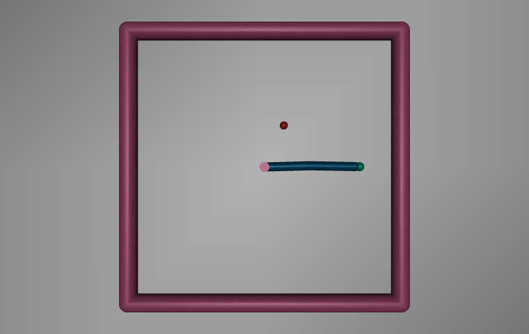

<h1 class="visually-hidden">Reacher</h1>
<div class="gn-env-banner">
<canvas class="gn-pixel" data-text="REACHER" data-scale="6" data-color="#fcfcfc" data-shadow="#e40058"></canvas>
<canvas class="gn-pixel" data-text="MUJOCO  2 ACTIONS  10 OBSERVATIONS" data-scale="2" data-color="#f8b800"></canvas>
</div>

<p class="gn-env-lead">Move the fingertip of a two-joint robot arm onto a target the seed places at random within reach, and keep it there, with as little torque as it takes. The physics is MuJoCo's, run in Gym.NET's own engine, written from scratch in C# and bit for bit with MuJoCo 4.0.0.</p>

<aside class="gn-infobox" aria-label="Reacher at a glance">
<video src="media/Reacher-v5.episode.mp4" poster="media/Reacher-v5.figure.png" autoplay muted loop playsinline disablepictureinpicture disableremoteplayback aria-label="Reacher-v5, seed 0: Farama's SAC expert puts the fingertip on the target, at half speed"></video>
<p class="gn-infobox-caption">The whole episode <code>examples/Reacher</code> plays and records, at half speed: Farama's SAC expert through Gymnasium's own camera for this env, seed 0, 50 steps, return −2.8.</p>
<table>
<tr><td>Ids</td><td><code>Reacher-v5</code> 50 steps<br><code>Reacher-v4</code> 50 steps</td></tr>
<tr><td>Action space</td><td><code>Box(-1.0, 1.0, (2,), float32)</code></td></tr>
<tr><td>Observation space</td><td><code>Box(-inf, inf, (10,), float64)</code></td></tr>
<tr><td>Reward</td><td>minus the fingertip's distance from the target, less the torques squared · solved at −3.75</td></tr>
<tr><td>Physics</td><td>MuJoCo 4.0.0 in Gym.NET's own engine, bit for bit: 2 Runge-Kutta steps of 0.01 s per env step</td></tr>
<tr><td>Render modes</td><td><code>human</code>, <code>rgb_array</code>, <code>depth_array</code>, <code>rgbd_tuple</code> · 480×480 · 50 fps</td></tr>
<tr><td>Make</td><td><code>Gymnasium.Make(<wbr>"Reacher-v5")</code></td></tr>
<tr><td>Class</td><td><a href="xref:Gym.Environments.Envs.MuJoCo.ReacherEnvV5"><code>ReacherEnvV5</code></a>, options <a href="xref:Gym.Environments.Envs.MuJoCo.ReacherEnvV5Options"><code>ReacherEnvV5Options</code></a>, info <a href="xref:Gym.Environments.Envs.MuJoCo.ReacherInfoV5"><code>ReacherInfoV5</code></a></td></tr>
<tr><td>Vector env</td><td>none of its own: <code>MakeVec</code> builds sync or async</td></tr>
<tr><td>Parity</td><td><span class="gn-badge gn-badge-ok">physics bit for bit</span><span class="gn-badge gn-badge-warn">frames: 1 pixel in 230,400 differs</span><br>with Gymnasium 1.4.0 on MuJoCo 4.0.0</td></tr>
<tr><td>Gymnasium</td><td><a href="https://gymnasium.farama.org/v1.4.0/environments/mujoco/reacher/">Reacher</a> in Gymnasium 1.4.0's docs</td></tr>
</table>
</aside>

## Description

The reacher is an arm of two links lying flat in a square arena, its base fixed at the middle: a shoulder that turns
all the way round, an elbow that turns up to 3 rad either way, each with a motor, and a fingertip at the end of the
second link, 0.21 m from the base. Each episode the seed places a red target somewhere within 0.2 m of the base. Each
step the agent sets the two torques; the reward charges the fingertip's distance from the target and the squared
torques, so the best an episode can do is near 0. Nothing ends an episode early: it runs its 50 steps, one second.

Gymnasium keeps Reacher among its MuJoCo tasks as its simplest reaching task. Gym.NET runs it on its own MuJoCo engine,
a C# reimplementation of MuJoCo 4.0.0 that computes every float of every step as MuJoCo does on the reference machine,
so the episodes are Gymnasium's, value for value. Gym.NET also draws MuJoCo's frames itself, in software, and for this
model they are all but equal to Gymnasium's (see [Parity](#parity-with-gymnasium)).

## Quick start

# [C#](#tab/csharp)

[!code-csharp[](../../../tests/Gym.Tests/Docs/EnvPageSamples/ReacherSamples.cs?range=1-4,38-45&dedent=12)]

# [Python (Gymnasium)](#tab/python)

```python
import gymnasium as gym

env = gym.make("Reacher-v5")
# 10 numbers: the joints' cosines and sines, the target, 2 speeds, the fingertip's offset
observation, info = env.reset(seed=42)
# two torques, each from -1 to 1: shoulder and elbow
action = env.action_space.sample()
observation, reward, terminated, truncated, info = env.step(action)
```

---

`dotnet add package Gym.NET.Environments`; the seven longer examples are in [Code examples](#code-examples).

### Watch the agent, or play

```bash
# from a clone of the repository: the agent in the video reaches in MuJoCo's window
dotnet run --project examples/Reacher -c Release -- --render
# or reach yourself from the keyboard (the example's README lists the keys)
dotnet run --project examples/Reacher -c Release -- --play
```

`--play` runs Gymnasium's `play` (`Play.Run`). Gym.NET draws a frame of this model in about 0.05 s in software, so the
game runs at about 20 steps a second instead of the env's 50. Each new game starts from the same seed.

## How it works

<div class="gn-figure gn-figure-wide">

<svg viewBox="0 0 760 480" font-family="system-ui, sans-serif" role="img" aria-label="Labels: the target, its position the observation's items 4 and 5, placed by the seed within 0.2 m of the base; the shoulder, driven by action 0 at gear 200, its angle's cosine and sine items 0 and 2 and its speed item 6, turning all the way round; the elbow, action 1, items 1, 3 and 7, within 3 rad either way; the fingertip, whose offset from the target is items 8 and 9">
<line x1="407.77" y1="180.24" x2="432" y2="100" stroke="#000" stroke-width="3" stroke-linecap="round"/><line x1="407.77" y1="180.24" x2="432" y2="100" stroke="#ff8787" stroke-width="1.3" stroke-linecap="round"/>
<line x1="380" y1="240" x2="348" y2="326" stroke="#000" stroke-width="3" stroke-linecap="round"/><line x1="380" y1="240" x2="348" y2="326" stroke="#ffd43b" stroke-width="1.3" stroke-linecap="round"/>
<line x1="445.08" y1="238.22" x2="464" y2="326" stroke="#000" stroke-width="3" stroke-linecap="round"/><line x1="445.08" y1="238.22" x2="464" y2="326" stroke="#ffd43b" stroke-width="1.3" stroke-linecap="round"/>
<line x1="516.68" y1="239.55" x2="600" y2="228" stroke="#000" stroke-width="3" stroke-linecap="round"/><line x1="516.68" y1="239.55" x2="600" y2="228" stroke="#ffffff" stroke-width="1.3" stroke-linecap="round"/>
<circle cx="407.77" cy="180.24" r="4" fill="#ff8787" stroke="#000" stroke-width="1.2"/>
<text x="436" y="104" text-anchor="start" fill="#ff8787" font-weight="700" paint-order="stroke" stroke="#000" stroke-width="3" stroke-linejoin="round" font-size="13">target · position [4], [5]</text>
<text x="436" y="120" text-anchor="start" fill="#ff8787" font-weight="600" paint-order="stroke" stroke="#000" stroke-width="3" stroke-linejoin="round" font-size="12">placed by the seed within 0.2 m</text>
<circle cx="380" cy="240" r="4" fill="#ffd43b" stroke="#000" stroke-width="1.2"/>
<text x="344" y="330" text-anchor="end" fill="#ffd43b" font-weight="700" paint-order="stroke" stroke="#000" stroke-width="3" stroke-linejoin="round" font-size="13">shoulder · action 0 · gear 200</text>
<text x="344" y="346" text-anchor="end" fill="#ffd43b" font-weight="600" paint-order="stroke" stroke="#000" stroke-width="3" stroke-linejoin="round" font-size="12">cos [0], sin [2], speed [6]</text>
<text x="344" y="362" text-anchor="end" fill="#ffd43b" font-weight="600" paint-order="stroke" stroke="#000" stroke-width="3" stroke-linejoin="round" font-size="12">turns all the way round</text>
<circle cx="445.08" cy="238.22" r="4" fill="#ffd43b" stroke="#000" stroke-width="1.2"/>
<text x="468" y="330" text-anchor="start" fill="#ffd43b" font-weight="700" paint-order="stroke" stroke="#000" stroke-width="3" stroke-linejoin="round" font-size="13">elbow · action 1 · gear 200</text>
<text x="468" y="346" text-anchor="start" fill="#ffd43b" font-weight="600" paint-order="stroke" stroke="#000" stroke-width="3" stroke-linejoin="round" font-size="12">cos [1], sin [3], speed [7]</text>
<text x="468" y="362" text-anchor="start" fill="#ffd43b" font-weight="600" paint-order="stroke" stroke="#000" stroke-width="3" stroke-linejoin="round" font-size="12">within ±3 rad</text>
<circle cx="516.68" cy="239.55" r="4" fill="#ffffff" stroke="#000" stroke-width="1.2"/>
<text x="604" y="232" text-anchor="start" fill="#ffffff" font-weight="700" paint-order="stroke" stroke="#000" stroke-width="3" stroke-linejoin="round" font-size="13">fingertip</text>
<text x="604" y="248" text-anchor="start" fill="#ffffff" font-weight="600" paint-order="stroke" stroke="#000" stroke-width="3" stroke-linejoin="round" font-size="12">[8], [9]: its offset</text>
<text x="604" y="264" text-anchor="start" fill="#ffffff" font-weight="600" paint-order="stroke" stroke="#000" stroke-width="3" stroke-linejoin="round" font-size="12">from the target</text>
</svg>
</div>
<p class="gn-figure-caption">The reset of seed 0, the video's, rendered by Gym.NET with MuJoCo's free camera straight down from 0.9 m above the arena's middle: x runs to the right, y up. Each dot is a joint or a body projected through MuJoCo's camera geometry, labelled with its items in the observation and its motor. Gymnasium's frame of the same state differs in 7 of its 364,800 pixels, each by one level of 255.</p>

MuJoCo steps the model with the fourth-order Runge-Kutta integrator every 0.01 s, and an env step holds the action for
two of those steps, 0.02 s, hence 50 steps and frames a second. Each motor applies its gear, 200, times its control.
The arm lies flat and nothing in the arena collides; the walls are only drawn. The target is a small red sphere on two
slide joints that nothing moves during an episode.

The reward of a step reads the fingertip and the target after it:

$$
r_t = -w_d \lVert p_\text{tip} - p_\text{target} \rVert - w_c \sum_{j=1}^{2} a_{t,j}^2
$$

with $w_d = 1$ and $w_c = 1$; each position is its body's origin, as Gymnasium's `get_body_com` reads it, both at the
same height, so the distance is the one in the arena's plane. At full torque the control term costs 2 a step, five times
the largest distance the fingertip can be from the target (0.41 m), so the reward pays for moving the arm gently.

| Constant | Gym.NET | Gymnasium | Value | Effect |
|---|---|---|--:|---|
| Physics step | `Model.Opt.Timestep` | `model.opt.timestep` | 0.01 s | MuJoCo's step, Runge-Kutta 4 |
| Frame skip | `FrameSkip` | `frame_skip` | 2 | Physics steps per env step: an env step is 0.02 s |
| Distance weight | `RewardDistWeight` | `_reward_dist_weight` | 1 | Multiplies the fingertip's distance from the target |
| Control weight | `RewardControlWeight` | `_reward_control_weight` | 1 | Multiplies the torques squared |
| Gears | the model's | `actuator_gear` | 200, 200 | Torque per unit of control |

> [!NOTE]
> Reacher takes no `reset_noise_scale`: its reset is fixed by the env, the arm's joints turned by up to 0.1 rad and the
> target placed by the seed. The registry counts an average of −3.75 over 100 episodes as solved; random torques score
> −43.8 on average over seeds 0 to 9, about three quarters of it control cost. In Gymnasium the control weight's default is the
> Python int 1, which keeps an integer action's cost an integer; Gym.NET keeps that by taking `null` for it.

## Action space

`Box(-1.0, 1.0, (2,), float32)`: one control per motor, its torque the control times the gear, 200.

| Index | Motor | Gear | Joint range |
|---|---|--:|---|
| 0 | Shoulder (`joint0`) | 200 | none: turns all the way round |
| 1 | Elbow (`joint1`) | 200 | −3 rad to 3 rad |

MuJoCo clamps each control to the motor's range of −1 to 1 before it acts; the control cost reads the action as given.

## Observation space

`Box(-inf, inf, (10,), float64)`: the angles as cosines and sines, the target, the speeds, and the gap to close.

| Index | Meaning | Unit |
|---|---|---|
| 0, 1 | The cosines of the shoulder's and the elbow's angles | |
| 2, 3 | Their sines | |
| 4, 5 | The target's x and y, from the arm's base | m |
| 6, 7 | The shoulder's and the elbow's angular velocities | rad/s |
| 8, 9 | The fingertip's offset from the target, x and y | m |

The length of items 8 and 9 is the reward's distance, to the last bit (see
[Read the distance from the observation](#read-the-distance-from-the-observation)).

## Rewards

`reward_dist_weight` times the fingertip's distance from the target and `reward_control_weight` times the sum of the
squared torques, both charged; the info carries them as `reward_dist` and `reward_ctrl`. The registry counts an average
of −3.75 over 100 episodes as solved; the expert in the video makes −2.8.

## Starting state

The arm's two joints turned from their zero pose by a uniform draw from ±0.1 rad each, their speeds from ±0.005; the
target placed by the seed anywhere within 0.2 m of the base (a draw from a square, repeated until it falls inside the
circle), at rest. The env adds no other noise and takes no noise argument.

## Episode end

| Ends by | When |
|---|---|
| Termination | Never |
| Truncation | 50 steps: the `TimeLimit` that `Make` wraps around the env |

## Arguments

By Gymnasium's name in `Make`'s kwargs, or by the C# name in the constructor and in
<xref:Gym.Environments.Envs.MuJoCo.ReacherEnvV5Options>.

| Argument | Type and default | Effect |
|---|---|---|
| `xml_file`<br>`xmlFile` | `string`<br>`"reacher.xml"` | The model: the bundled one by name, or a path to your own MJCF file |
| `frame_skip`<br>`frameSkip` | `int`<br>`2` | Physics steps per env step; changes the step's duration and the frame rate |
| `default_camera_config`<br>`defaultCameraConfig` | `IReadOnlyDictionary<string, object?>?`<br>`null` | The free camera's `distance`, `azimuth`, `elevation`, `lookat` or `trackbodyid`; null takes the env's own, the renderer's start 1.24 m off |
| `reward_dist_weight`<br>`rewardDistWeight` | `double`<br>`1` | The weight of the fingertip's distance from the target |
| `reward_control_weight`<br>`rewardControlWeight` | `double?`<br>`null` | The weight of the control cost; null is Gymnasium's default, the int 1 |
| `render_mode`<br>`renderMode` | `string?` or `RenderMode`<br>`null` | `"human"` opens MuJoCo's window; `"rgb_array"`, `"depth_array"` and `"rgbd_tuple"` make `Render()` return frames |
| `width`<br>`width` | `int`<br>`480` | The frame's width in pixels |
| `height`<br>`height` | `int`<br>`480` | The frame's height in pixels |
| `camera_id`<br>`cameraId` | `int?`<br>`null` | A camera by index (−1 the free camera); not with `camera_name` |
| `camera_name`<br>`cameraName` | `string?`<br>`null` | A camera by name; this model has none |
| `max_geom`<br>`maxGeom` | `int`<br>`1000` | The renderer's scene capacity |
| `visual_options`<br>`visualOptions` | `IReadOnlyDictionary<int, bool>?`<br>`null` | MuJoCo's visualization flags by index (contact points, forces, ...) |
| (Gym.NET)<br>`viewerFactory` | `EnvViewerFactory?`<br>`null` | The window for `human`: Avalonia, WinForms, or headless |


# [C#](#tab/csharp)

[!code-csharp[](../../../tests/Gym.Tests/Docs/EnvPageSamples/ReacherSamples.cs#Arguments)]

# [Python (Gymnasium)](#tab/python)

```python
env = gym.make("Reacher-v5", reward_control_weight=0.1)
```

---

## Info

<xref:Gym.Environments.Envs.MuJoCo.ReacherInfoV5>: `reward_dist` and `reward_ctrl` on every step; a reset sends an empty
info.

## Rendering

| Mode | What you get |
|---|---|
| `rgb_array` | `Render()` returns the frame: `(480, 480, 3)` uint8 by default, `width` by `height` |
| `depth_array` | `Render()` returns MuJoCo's depth buffer, `(480, 480)` float32: 0 at the near plane, 1 at the far one, not metres |
| `rgbd_tuple` | `Render()` returns both, `RenderResult.RgbDepth`, as Python's `(rgb, depth)` |
| `human` | MuJoCo's window from the viewer factory, drawn after every reset and step, with Gymnasium's controls |
| none | `Render()` warns and returns nothing, as Gymnasium's does |

The model has no camera, so `camera_name` has nothing to name. With no camera named, Gymnasium 1.4 renders through
MuJoCo's free camera with the env's `default_camera_config`, which names only the world as `trackbodyid`: the camera
stays at the renderer's start, 1.24 m from the middle of the model's parts at 45°, which shows the whole arena, as the
video does. In `human` mode, the mouse orbits, pans and zooms, and H lists Gymnasium's other keys. Gym.NET draws this
model's frames in software in about 0.05 s each; by default every frame is drawn, so the window runs at about 20 steps
a second instead of the env's 50, and D switches to skipping frames.

## Episode anatomy

The whole episode, step by step: the fingertip's distance from the target, the control cost and the arm's two angles,
with a cursor following the video. The expert folds the elbow to 122° and barely turns the shoulder: the fingertip, 0.19 m from the target at the start, is within 2 cm of it at step 20 (0.4 s) and within 1 cm at step 23, and comes to rest less than a millimetre away. Of the −2.8, the distance costs 2.19, most of it in the first 20 steps, and the torques 0.63. The video plays at half speed, 25 frames a second, the whole episode taking 2 s.

<div class="gn-anatomy" data-trace="media/Reacher-v5.episode.json">
<div><video src="media/Reacher-v5.episode.mp4" poster="media/Reacher-v5.figure.png" autoplay muted loop playsinline disablepictureinpicture disableremoteplayback aria-label="Reacher-v5, seed 0, the episode the chart follows, at half speed"></video><div class="gn-anatomy-readout" aria-live="off"></div></div>
<div><div class="gn-anatomy-chart"></div><div class="gn-anatomy-legend"></div></div>
<script type="application/json" class="gn-anatomy-spec">{"label":"Reacher-v5, seed 0: the fingertip's distance from the target, the control cost and the arm's two angles","bands":[{"height":70,"range":[0,0.2],"ticks":[0,0.1,0.2],"scale":-1,"series":[{"column":"reward_dist","color":"#ff8787","name":"the fingertip's distance from the target (m)"}]},{"height":60,"range":[-0.16,0.01],"ticks":[-0.15,-0.1,-0.05,0],"series":[{"column":"reward_ctrl","color":"#3cbcfc","name":"the control cost, minus the torques squared"}]},{"height":70,"range":[-10,130],"scale":57.29577951308232,"ticks":[0,45,90],"unit":"°","series":[{"column":"angle0","color":"#40c057","name":"the shoulder's angle"},{"column":"angle1","color":"#b8b8f8","name":"the elbow's angle"}]}],"readout":[{"label":"step","column":"@step"},{"label":"distance","column":"reward_dist","scale":-1,"digits":3,"unit":" m"},{"label":"return so far","column":"@return","digits":2}]}</script>
</div>

## Code examples

### Run an episode

# [C#](#tab/csharp)

[!code-csharp[](../../../tests/Gym.Tests/Docs/EnvPageSamples/ReacherSamples.cs#RunAnEpisode)]

# [Python (Gymnasium)](#tab/python)

```python
import gymnasium as gym

env = gym.make("Reacher-v5")
observation, info = env.reset(seed=42)
episode_return = 0.0
while True:
    action = env.action_space.sample()
    observation, reward, terminated, truncated, info = env.step(action)
    episode_return += reward
    if terminated or truncated:  # never terminated: 50 steps
        break
print(f"return {episode_return:.1f}")  # random torques: -43.8 on average
```

---

### The reward's terms

# [C#](#tab/csharp)

[!code-csharp[](../../../tests/Gym.Tests/Docs/EnvPageSamples/ReacherSamples.cs#RewardTerms)]

# [Python (Gymnasium)](#tab/python)

```python
import numpy as np

env = gym.make("Reacher-v5")
env.reset(seed=42)
action = np.full(2, 0.5, dtype=np.float32)  # both motors at half torque
observation, reward, terminated, truncated, info = env.step(action)
distance, control = info["reward_dist"], info["reward_ctrl"]
# -0.6435 = -0.1435 distance - 0.5000 control
print(f"{reward:.4f} = {distance:.4f} distance {control:.4f} control")
```

---

### Read the distance from the observation

# [C#](#tab/csharp)

[!code-csharp[](../../../tests/Gym.Tests/Docs/EnvPageSamples/ReacherSamples.cs#DistanceFromTheObservation)]

# [Python (Gymnasium)](#tab/python)

```python
env = gym.make("Reacher-v5")
env.reset(seed=42)
observation, reward, terminated, truncated, info = env.step(np.full(2, 0.5, dtype=np.float32))
# items 8 and 9: the fingertip's offset from the target, in x and y
from_observation = np.sqrt(observation[8] ** 2 + observation[9] ** 2)
# 0.1435 m, True: the same number the reward charges
print(f"{from_observation:.4f} m, {from_observation == -info['reward_dist']}")
```

---

### Where the target starts

# [C#](#tab/csharp)

[!code-csharp[](../../../tests/Gym.Tests/Docs/EnvPageSamples/ReacherSamples.cs#WhereTheTargetStarts)]

# [Python (Gymnasium)](#tab/python)

```python
env = gym.make("Reacher-v5")
observation, info = env.reset(seed=42)
# the target's x and y are items 4 and 5, from the arm's base
print(f"{np.hypot(observation[4], observation[5]):.3f} m")  # 0.155 m: every seed puts it within 0.2 m of the base
```

---

### Cameras and depth

# [C#](#tab/csharp)

[!code-csharp[](../../../tests/Gym.Tests/Docs/EnvPageSamples/ReacherSamples.cs#CamerasAndDepth)]

# [Python (Gymnasium)](#tab/python)

```python
# no camera in the model: Gymnasium's free camera, 1.24 m off at 45°; rgbd_tuple draws colour and depth together
env = gym.make("Reacher-v5", render_mode="rgbd_tuple")
env.reset(seed=42)
rgb, depth = env.render()
print(rgb.shape, depth.shape)  # (480, 480, 3) (480, 480)
# MuJoCo's raw depth buffer, 0 at the near plane and 1 at the far one,
# not metres: the nearest point, the floor at the bottom edge, is 0.986
print(f"{depth.min():.3f}")  # 0.986
```

---

### Many arms at once

# [C#](#tab/csharp)

[!code-csharp[](../../../tests/Gym.Tests/Docs/EnvPageSamples/ReacherSamples.cs#ManyArms)]

# [Python (Gymnasium)](#tab/python)

```python
# No vector env of its own: make_vec steps 8 envs in turn ("sync")
envs = gym.make_vec("Reacher-v5", num_envs=8, vectorization_mode="sync")
observations, infos = envs.reset(seed=42)  # 8 x 10 observations
for t in range(100):
    actions = envs.action_space.sample()  # 8 x 2 torques
    # every 50 steps each arm gets a new target
    observations, rewards, terminations, truncations, infos = envs.step(actions)
```

---

Every C# example is a test in `tests/Gym.Tests/Docs/EnvPageSamples`, compiled and run by the unit gate; where a
comment states a number, the test checks it.

## Agents and examples

- **The video's agent** is Farama's SAC expert (Soft Actor-Critic), the agent the Farama Foundation, Gymnasium's
  maintainers, trained on Reacher-v5 to record the Minari datasets, imported from Hugging Face
  (`farama-minari/Reacher-v5-SAC-expert`): two dense layers of 256 with ReLU that read the 10 observations and squash
  their output into the motors' range with tanh. Seed 0 returns −2.8; over seeds 0 to 9 it averages −3.4 in
  Gym.NET (from −5.9 to −1), and its model card reports −3.28 ± 1.38.
- **[examples/Reacher](https://github.com/SciSharp/Gym.NET/tree/master/examples/Reacher)**
  ([`ReacherProgram.cs`](https://github.com/SciSharp/Gym.NET/blob/master/examples/Reacher/ReacherProgram.cs))
  plays it: `dotnet run --project examples/Reacher -c Release` plays seed 0 headless, `--seed N` another seed,
  `--episodes N` that many seeds and their mean, `--render` in MuJoCo's window, `--play` from the keyboard.
- **This page's video and chart** are the example's own episode: `--record docs/environments/mujoco/media` records it
  with `RecordVideo` (one frame per step at 25 frames a second, half the env's rate, through Gymnasium's own camera for
  this env) and writes the step trace and the figure beside it.

## Vectorized environment

Reacher registers no vector env of its own. `Gymnasium.MakeVec("Reacher-v5", n)` builds a `SyncVectorEnv` that steps
`n` separate envs in turn, and `VectorizeMode.Async` an `AsyncVectorEnv` that steps them on worker threads; each env
resets itself after its episode ends (next-step autoreset), as Gymnasium's. Each env has its own simulation.

## Variants

<a id="v4"></a>

### Reacher-v4

The same arm with no arguments of its own (Gymnasium's v4 takes only the base class's: the render mode, the frame size
and the camera), 11 observations (the fingertip's offset from the target in z too, always 0), and the distance term
read before the step's physics instead of after it (Gymnasium's issue 821). Gymnasium warns that v4 is out of date, and Gym.NET does the same. The class is
<xref:Gym.Environments.Envs.MuJoCo.ReacherEnvV4>, its info <xref:Gym.Environments.Envs.MuJoCo.ReacherInfoV4>.

## Parity with Gymnasium

Gymnasium 1.4.0 runs inside the test process, MuJoCo 4.0.0 under it, and both are compared value by value:

| What is compared | How | Result |
|---|---|---|
| Episodes | sampled episodes of both versions from several seeds, three in a row in one env, every observation, reward, flag and info value with its NumPy type | ✓ bit for bit |
| Arguments | Gymnasium's keyword variants (the two reward weights, another frame skip) | ✓ bit for bit |
| Actions | every form of action NumPy takes or refuses, with Gymnasium's messages | ✓ same values, same messages |
| Frames | `rgb_array` and `depth_array` frames against Gymnasium's on the reference GPU, within a measured baseline | 1 of 230,400 pixels differs |
| Spaces, metadata, `make`'s stack, the window | both spaces; the metadata; `make`'s stacks and warnings; the human window's controls and overlay | ✓ |

The tests: [MujocoLiveParityTests](https://github.com/SciSharp/Gym.NET/blob/master/tests/Gym.Tests.Parity/Tests/Envs/MujocoLiveParityTests.cs),
[MujocoFrameLiveParityTests](https://github.com/SciSharp/Gym.NET/blob/master/tests/Gym.Tests.Parity/Tests/Envs/MujocoFrameLiveParityTests.cs),
[MujocoWindowLiveParityTests](https://github.com/SciSharp/Gym.NET/blob/master/tests/Gym.Tests.Parity/Tests/Envs/MujocoWindowLiveParityTests.cs).
Bit for bit holds on the reference machine, an x64 CPU with FMA: the engine calls the platform's math functions, whose
last bits differ on a CPU without FMA. The frames are Gym.NET's own drawing of MuJoCo's renderer: for this model the
frame cells differ in a single pixel of 230,400, at the reset and after the steps; every clip-space triangle of the model is the GPU's, bit for bit, and what is left is in the rasterization (DR-98).

## Performance

| | Steps a second | Bytes a step |
|---|--:|--:|
| Gym.NET | 37,015 | 13,624 |
| Gymnasium | 10,419 | |

3.6× faster. Gymnasium's own `benchmark_step` on both sides (Gym.NET's `Performance.BenchmarkStep`, DR-36): random actions, a reset at each episode's end, after a 2-second warm-up; .NET 10 in Release against CPython 3.12 with MuJoCo 4.0.0's own bindings; the medians of three interleaved rounds of 5 seconds on one machine (2026-11-24). Gym.NET's engine is managed C#, MuJoCo's is native C; the step is the physics, the observation and the reward, no rendering.

## Reference sources

- [gymnasium/envs/mujoco/reacher_v5.py](https://github.com/Farama-Foundation/Gymnasium/blob/8ba8c3a63bb4e000b7f33923f43d292acac07be1/gymnasium/envs/mujoco/reacher_v5.py)
  and [reacher_v4.py](https://github.com/Farama-Foundation/Gymnasium/blob/8ba8c3a63bb4e000b7f33923f43d292acac07be1/gymnasium/envs/mujoco/reacher_v4.py),
  Gymnasium 1.4.0: the environment; [mujoco_env.py](https://github.com/Farama-Foundation/Gymnasium/blob/8ba8c3a63bb4e000b7f33923f43d292acac07be1/gymnasium/envs/mujoco/mujoco_env.py),
  the base class; [mujoco_rendering.py](https://github.com/Farama-Foundation/Gymnasium/blob/8ba8c3a63bb4e000b7f33923f43d292acac07be1/gymnasium/envs/mujoco/mujoco_rendering.py),
  the cameras and the window.
- [reacher.xml](https://github.com/Farama-Foundation/Gymnasium/blob/8ba8c3a63bb4e000b7f33923f43d292acac07be1/gymnasium/envs/mujoco/assets/reacher.xml),
  the model, embedded as MuJoCo 4.0.0 compiles it (`src/Gym.Environments/Assets/mujoco`).
- [MuJoCo 4.0.0](https://github.com/google-deepmind/mujoco/tree/4.0.0/src/engine), the engine Gym.NET's `Gym.MuJoCo`
  reproduces, and its classic renderer (`src/render/classic`), which Gym.NET draws in software.

## Version history

| Version | Change |
|---|---|
| v5 | MuJoCo 2.3.3 or later; `default_camera_config`, `frame_skip` and `xml_file`; the distance term from the state after the step, no longer before it (issue 821); the fingertip's z offset, always 0, out of the observation (issue 204); the two reward weights as arguments; `reward_ctrl` in the info multiplied by its weight |
| v4 | The `mujoco` bindings (MuJoCo 2.1.3 or later) instead of mujoco-py |
| v3 | None: Reacher has no v3 |
| v2 | mujoco-py 1.50; now raises `ImportError` in Gymnasium (mujoco-py), and in Gym.NET |
| v1 | Episodes of 50 steps (the other robots got 1,000); the reward threshold |
| v0 | The first release |
| Gym.NET 1.0.0 | New: Gymnasium 1.4.0's Reacher-v5 and Reacher-v4 on Gym.NET's own MuJoCo engine, bit for bit; 0.2.0 had no MuJoCo |

## References

1. E. Todorov, T. Erez and Y. Tassa, "MuJoCo: A physics engine for model-based control", *IROS*, 2012: the engine.
   [mujoco.org](https://mujoco.org)
2. T. Haarnoja, A. Zhou, P. Abbeel and S. Levine, "Soft Actor-Critic: Off-Policy Maximum Entropy Deep Reinforcement
   Learning with a Stochastic Actor", *ICML*, 2018: SAC, the expert's algorithm. [arXiv:1801.01290](https://arxiv.org/abs/1801.01290)

## External links

- [Reacher on Gymnasium's site](https://gymnasium.farama.org/v1.4.0/environments/mujoco/reacher/) (1.4.0)
- [ReacherEnvV5.cs](https://github.com/SciSharp/Gym.NET/blob/master/src/Gym.Environments/Envs/MuJoCo/ReacherEnvV5.cs) on GitHub
- [examples/Reacher](https://github.com/SciSharp/Gym.NET/tree/master/examples/Reacher)
- [farama-minari/Reacher-v5-SAC-expert](https://huggingface.co/farama-minari/Reacher-v5-SAC-expert), the expert on Hugging Face

## API reference

<xref:Gym.Environments.Envs.MuJoCo.ReacherEnvV5> · <xref:Gym.Environments.Envs.MuJoCo.ReacherEnvV5Options> · <xref:Gym.Environments.Envs.MuJoCo.ReacherInfoV5> · <xref:Gym.Environments.Envs.MuJoCo.ReacherEnvV4> · <xref:Gym.Environments.Envs.MuJoCo.MujocoEnv>
