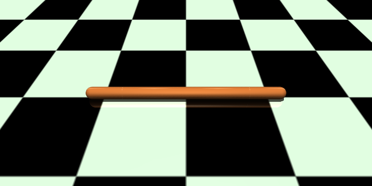

<h1 class="visually-hidden">Swimmer</h1>
<div class="gn-env-banner">
<canvas class="gn-pixel" data-text="SWIMMER" data-scale="6" data-color="#fcfcfc" data-shadow="#0058f8"></canvas>
<canvas class="gn-pixel" data-text="MUJOCO  2 ACTIONS  8 OBSERVATIONS" data-scale="2" data-color="#f8b800"></canvas>
</div>

<p class="gn-env-lead">Make a snake of three links swim forward through a viscous pool as fast as it can, with a rotor at each of its two joints. The physics is MuJoCo's, run in Gym.NET's own engine, written from scratch in C# and bit for bit with MuJoCo 4.0.0.</p>

<aside class="gn-infobox" aria-label="Swimmer at a glance">
<video src="media/Swimmer-v5.episode.mp4" poster="media/Swimmer-v5.figure.png" autoplay muted loop playsinline disablepictureinpicture disableremoteplayback aria-label="Swimmer-v5, seed 0: Farama's PPO expert undulates forward for 1,000 steps"></video>
<p class="gn-infobox-caption">The whole episode <code>examples/Swimmer</code> plays and records: Farama's PPO expert through the model's <code>track</code> camera, seed 0, 1,000 steps, return 361.0.</p>
<table>
<tr><td>Ids</td><td><code>Swimmer-v5</code> 1,000 steps<br><code>Swimmer-v4</code> 1,000 steps</td></tr>
<tr><td>Action space</td><td><code>Box(-1.0, 1.0, (2,), float32)</code></td></tr>
<tr><td>Observation space</td><td><code>Box(-inf, inf, (8,), float64)</code></td></tr>
<tr><td>Reward</td><td>the forward speed, less 0.0001 × the torques squared · solved at 360</td></tr>
<tr><td>Physics</td><td>MuJoCo 4.0.0 in Gym.NET's own engine, bit for bit: 4 Runge-Kutta steps of 0.01 s per env step, in a viscous fluid</td></tr>
<tr><td>Render modes</td><td><code>human</code>, <code>rgb_array</code>, <code>depth_array</code>, <code>rgbd_tuple</code> · 480×480 · 25 fps</td></tr>
<tr><td>Make</td><td><code>Gymnasium.Make(<wbr>"Swimmer-v5")</code></td></tr>
<tr><td>Class</td><td><a href="xref:Gym.Environments.Envs.MuJoCo.SwimmerEnvV5"><code>SwimmerEnvV5</code></a>, options <a href="xref:Gym.Environments.Envs.MuJoCo.SwimmerEnvV5Options"><code>SwimmerEnvV5Options</code></a>, info <a href="xref:Gym.Environments.Envs.MuJoCo.SwimmerInfoV5"><code>SwimmerInfoV5</code></a></td></tr>
<tr><td>Vector env</td><td>none of its own: <code>MakeVec</code> builds sync or async</td></tr>
<tr><td>Parity</td><td><span class="gn-badge gn-badge-ok">physics bit for bit</span><span class="gn-badge gn-badge-warn">frames: 2.4% of pixels differ</span><br>with Gymnasium 1.4.0 on MuJoCo 4.0.0</td></tr>
<tr><td>Gymnasium</td><td><a href="https://gymnasium.farama.org/v1.4.0/environments/mujoco/swimmer/">Swimmer</a> in Gymnasium 1.4.0's docs</td></tr>
</table>
</aside>

## Description

The swimmer is a chain of three capsules, a front link, a middle one and a back one, joined by two rotors, and it lies
in a pool: it slides over the floor's plane on x and y and turns about the vertical, a free body in two dimensions.
MuJoCo's fluid model gives the pool a density and a viscosity, so a link moving through it is dragged, and that drag is
the only thing the swimmer can push against. Each step the agent sets the two rotors' torques; undulating the links the right way
moves the body forward. The reward pays for speed along x and charges a tenth of a thousandth for the torques, and
nothing ends the episode early.

The env comes from R. Coulom's thesis on reinforcement learning for motor control, and Gymnasium keeps it as one of its
standard locomotion tasks. Gym.NET runs it on its own MuJoCo engine, a C# reimplementation of MuJoCo 4.0.0 that computes
every float of every step as MuJoCo does on the reference machine, so the episodes are Gymnasium's, value for value.
Gym.NET also draws MuJoCo's frames itself, in software, close to Gymnasium's but not yet equal (see
[Parity](#parity-with-gymnasium)).

## Quick start

# [C#](#tab/csharp)

[!code-csharp[](../../../tests/Gym.Tests/Docs/EnvPageSamples/SwimmerSamples.cs?range=1-4,38-45&dedent=12)]

# [Python (Gymnasium)](#tab/python)

```python
import gymnasium as gym

env = gym.make("Swimmer-v5")
# 8 numbers: the heading, the 2 rotors' angles, 5 velocities
observation, info = env.reset(seed=42)
# two torques, each from -1 to 1: the front rotor, the back rotor
action = env.action_space.sample()
observation, reward, terminated, truncated, info = env.step(action)
```

---

`dotnet add package Gym.NET.Environments`; the six longer examples are in [Code examples](#code-examples).

### Watch the agent

```bash
# from a clone of the repository: the agent in the video swims in MuJoCo's window
dotnet run --project examples/Swimmer -c Release -- --render
```

Keyboard play is not offered: Gym.NET draws a frame of this model in about 0.55 s in software, while a step is 40 ms of
simulated time, so a game would run about 14 times slower than real time.

## How it works

<div class="gn-figure gn-figure-wide">

<svg viewBox="0 0 760 380" font-family="system-ui, sans-serif" role="img" aria-label="Labels: the root, the point the sliders move, whose heading is the observation's item 0 and whose velocities are items 3 to 5; the front rotor, items 1 and 6, driven by action 0; the back rotor, items 2 and 7, driven by action 1; both motors at gear 150">
<line x1="380" y1="190" x2="380" y2="102" stroke="#000" stroke-width="3" stroke-linecap="round"/><line x1="380" y1="190" x2="380" y2="102" stroke="#ffffff" stroke-width="1.3" stroke-linecap="round"/>
<line x1="443.71" y1="190" x2="492" y2="288" stroke="#000" stroke-width="3" stroke-linecap="round"/><line x1="443.71" y1="190" x2="492" y2="288" stroke="#ffd43b" stroke-width="1.3" stroke-linecap="round"/>
<line x1="316.29" y1="190" x2="268" y2="288" stroke="#000" stroke-width="3" stroke-linecap="round"/><line x1="316.29" y1="190" x2="268" y2="288" stroke="#ffd43b" stroke-width="1.3" stroke-linecap="round"/>
<circle cx="380" cy="190" r="4" fill="#ffffff" stroke="#000" stroke-width="1.2"/>
<text x="380" y="62" text-anchor="middle" fill="#ffffff" font-weight="700" paint-order="stroke" stroke="#000" stroke-width="3" stroke-linejoin="round" font-size="13">root: heading [0]</text>
<text x="380" y="78" text-anchor="middle" fill="#ffffff" font-weight="600" paint-order="stroke" stroke="#000" stroke-width="3" stroke-linejoin="round" font-size="12">speeds [3] x, [4] y, [5] turning</text>
<text x="380" y="94" text-anchor="middle" fill="#ffffff" font-weight="600" paint-order="stroke" stroke="#000" stroke-width="3" stroke-linejoin="round" font-size="12">its x and y not observed</text>
<circle cx="443.71" cy="190" r="4" fill="#ffd43b" stroke="#000" stroke-width="1.2"/>
<text x="496" y="292" text-anchor="start" fill="#ffd43b" font-weight="700" paint-order="stroke" stroke="#000" stroke-width="3" stroke-linejoin="round" font-size="13">front rotor · action 0</text>
<text x="496" y="308" text-anchor="start" fill="#ffd43b" font-weight="600" paint-order="stroke" stroke="#000" stroke-width="3" stroke-linejoin="round" font-size="12">angle [1], speed [6], gear 150</text>
<circle cx="316.29" cy="190" r="4" fill="#ffd43b" stroke="#000" stroke-width="1.2"/>
<text x="264" y="292" text-anchor="end" fill="#ffd43b" font-weight="700" paint-order="stroke" stroke="#000" stroke-width="3" stroke-linejoin="round" font-size="13">back rotor · action 1</text>
<text x="264" y="308" text-anchor="end" fill="#ffd43b" font-weight="600" paint-order="stroke" stroke="#000" stroke-width="3" stroke-linejoin="round" font-size="12">angle [2], speed [7], gear 150</text>
</svg>
</div>
<p class="gn-figure-caption">The reset pose without noise (<code>reset_noise_scale</code> 0), rendered by Gym.NET with MuJoCo's free camera 3.6 m from the swimmer's middle, at azimuth 90° and elevation −45°. Each dot is a point projected through MuJoCo's camera geometry, labelled with its items in the observation: the two rotors with their motors, and the root, the point the sliders move: the torso body's origin, on the front link's axis 0.5 m behind the front rotor, at this pose the middle of the swimmer. The front link is on the right, toward +x, the direction the reward pays for. Gymnasium's frame of the same pose differs in 5,348 of its 288,800 pixels, by 1 or 2 of 255 levels in 3,769 of them; the other 1,579, by up to 70, lie along the links' outlines, on the faint cross marks of their texture and in their reflection on the floor.</p>

MuJoCo steps the model with the fourth-order Runge-Kutta integrator every 0.01 s, and an env step holds the action for
four of those steps, 0.04 s, hence 25 steps and frames a second. The pool is the model's own medium: a density of 4,000
and a viscosity of 0.1, which drag every link that moves through it. Each rotor applies its gear, 150, times its control;
the rotors turn up to ±100°. The root's three degrees of freedom are free: x and y slide, the heading turns.

The reward of a step is the root's average forward speed over it, less a cost on the controls:

$$
r_t = w_f\,\frac{x_{t+1} - x_t}{\Delta t} - w_c \sum_{j=1}^{2} a_{t,j}^2
$$

with $\Delta t = 0.04$ s, $w_f = 1$ and $w_c = 0.0001$. A full-torque step costs at most 0.0002: the reward is almost
all speed.

| Constant | Gym.NET | Gymnasium | Value | Effect |
|---|---|---|--:|---|
| Physics step | `Model.Opt.Timestep` | `model.opt.timestep` | 0.01 s | MuJoCo's step, Runge-Kutta 4 |
| Frame skip | `FrameSkip` | `frame_skip` | 4 | Physics steps per env step: an env step is 0.04 s |
| Forward weight | `ForwardRewardWeight` | `_forward_reward_weight` | 1.0 | Multiplies the speed in the reward |
| Control cost | `CtrlCostWeight` | `_ctrl_cost_weight` | 0.0001 | Multiplies the controls squared |
| Reset noise | `ResetNoiseScale` | `_reset_noise_scale` | 0.1 | The starting state's spread |
| Gears | the model's | `actuator_gear` | 150, 150 | Torque per unit of control |
| Viscosity | the model's | `model.opt.viscosity` | 0.1 | The pool's drag on every link |

> [!NOTE]
> The swimmer's speed comes from drag alone, so it is slow: the expert in the video averages 0.36 m/s, and
> the registry's 360 over 1,000 steps (40 s) means swimming 14.4 m. The reward's speed is the root's average over the
> step, while the observation's item 3 is MuJoCo's velocity at the step's end.

## Action space

`Box(-1.0, 1.0, (2,), float32)`: one control per rotor, its torque the control times the gear, 150.

| Index | Rotor | Gear (N·m) | Range |
|---|---|--:|---|
| 0 | Between the front link and the middle one (`motor1_rot`) | 150 | −100° to 100° |
| 1 | Between the middle link and the back one (`motor2_rot`) | 150 | −100° to 100° |

MuJoCo clamps each control to the motor's range of −1 to 1 before it acts; the control cost reads the action as given.

## Observation space

`Box(-inf, inf, (8,), float64)`: the joint positions without the root's x and y, then the velocities.

| Index | Meaning | Unit |
|---|---|---|
| 0 | The heading (`free_body_rot`) | rad |
| 1 | The front rotor's angle | rad |
| 2 | The back rotor's angle | rad |
| 3 | The root's x velocity | m/s |
| 4 | Its y velocity | m/s |
| 5 | Its angular velocity | rad/s |
| 6, 7 | The two rotors' angular velocities | rad/s |

`exclude_current_positions_from_observation` false puts the root's x and y first, making 10 items. Both are always in
the info. The root is the point the sliders move, the torso body's origin: it lies on the front link's axis, 0.5 m behind the
front rotor, so at the middle of the swimmer while the links are in line, and the heading is the front link's.
Gymnasium's docs call it the tip.

## Rewards

The forward speed times `forward_reward_weight`, less `ctrl_cost_weight` times the sum of the squared controls; the info
splits the two as `reward_forward` and `reward_ctrl`. Moving backward pays a negative speed; moving sideways pays
nothing. The registry counts an average of 360 over 100 episodes as solved; the expert in the video makes 361.0.

## Starting state

The three links in a straight line along x at rest, plus noise: every position (the root's x, y and heading, the two
rotors) and every velocity gets a uniform draw from ±`reset_noise_scale` (0.1). With `reset_noise_scale` 0 every seed
starts from the pose in the figure.

## Episode end

| Ends by | When |
|---|---|
| Termination | Never |
| Truncation | 1,000 steps: the `TimeLimit` that `Make` wraps around the env |

## Arguments

By Gymnasium's name in `Make`'s kwargs, or by the C# name in the constructor and in
<xref:Gym.Environments.Envs.MuJoCo.SwimmerEnvV5Options>.

| Argument | Type and default | Effect |
|---|---|---|
| `xml_file`<br>`xmlFile` | `string`<br>`"swimmer.xml"` | The model: the bundled one by name, or a path to your own MJCF file |
| `frame_skip`<br>`frameSkip` | `int`<br>`4` | Physics steps per env step; changes the step's duration and the frame rate |
| `default_camera_config`<br>`defaultCameraConfig` | `IReadOnlyDictionary<string, object?>?`<br>`null` | The free camera's `distance`, `azimuth`, `elevation`, `lookat` or `trackbodyid`; Swimmer sets none, so null leaves the renderer's start, the model's extent, 8 m off |
| `forward_reward_weight`<br>`forwardRewardWeight` | `double`<br>`1.0` | The weight of the speed in the reward |
| `ctrl_cost_weight`<br>`ctrlCostWeight` | `double`<br>`1e-4` | The weight of the control cost |
| `reset_noise_scale`<br>`resetNoiseScale` | `double`<br>`0.1` | The starting state's noise; 0 starts from the model's pose |
| `exclude_current_positions_from_observation`<br>`excludeCurrentPositionsFromObservation` | `bool`<br>`true` | Leave the root's x and y out of the observation |
| `render_mode`<br>`renderMode` | `string?` or `RenderMode`<br>`null` | `"human"` opens MuJoCo's window; `"rgb_array"`, `"depth_array"` and `"rgbd_tuple"` make `Render()` return frames |
| `width`<br>`width` | `int`<br>`480` | The frame's width in pixels |
| `height`<br>`height` | `int`<br>`480` | The frame's height in pixels |
| `camera_id`<br>`cameraId` | `int?`<br>`null` | A camera by index (−1 the free camera); not with `camera_name` |
| `camera_name`<br>`cameraName` | `string?`<br>`null` | A camera by name: the model's `"track"` follows the body's centre of mass |
| `max_geom`<br>`maxGeom` | `int`<br>`1000` | The renderer's scene capacity |
| `visual_options`<br>`visualOptions` | `IReadOnlyDictionary<int, bool>?`<br>`null` | MuJoCo's visualization flags by index (contact points, forces, ...) |
| (Gym.NET)<br>`viewerFactory` | `EnvViewerFactory?`<br>`null` | The window for `human`: Avalonia, WinForms, or headless |


# [C#](#tab/csharp)

[!code-csharp[](../../../tests/Gym.Tests/Docs/EnvPageSamples/SwimmerSamples.cs#Arguments)]

# [Python (Gymnasium)](#tab/python)

```python
env = gym.make("Swimmer-v5", ctrl_cost_weight=1e-3, reset_noise_scale=0.2)
```

---

## Info

<xref:Gym.Environments.Envs.MuJoCo.SwimmerInfoV5>: `x_position`, `y_position` and `distance_from_origin` on every reset
and step; `x_velocity`, `y_velocity`, `reward_forward` and `reward_ctrl` on every step.

## Rendering

| Mode | What you get |
|---|---|
| `rgb_array` | `Render()` returns the frame: `(480, 480, 3)` uint8 by default, `width` by `height` |
| `depth_array` | `Render()` returns MuJoCo's depth buffer, `(480, 480)` float32: 0 at the near plane, 1 at the far one, not metres |
| `rgbd_tuple` | `Render()` returns both, `RenderResult.RgbDepth`, as Python's `(rgb, depth)` |
| `human` | MuJoCo's window from the viewer factory, drawn after every reset and step, with Gymnasium's controls |
| none | `Render()` warns and returns nothing, as Gymnasium's does |

Swimmer sets no camera configuration, so with no camera named, Gymnasium 1.4 renders through MuJoCo's free camera at the
model's extent, 8 m from the middle of its parts, where the swimmer is small. `camera_name = "track"` takes the model's
own camera, 3 m to the side and 3 m up, looking down at 45° across the direction of travel and following the body's
centre of mass, as the video does. In
`human` mode, Tab cycles the cameras, the mouse orbits, pans and zooms, and H lists Gymnasium's other keys. Gym.NET draws
this model's frames in software in about 0.55 s each; by default every frame is drawn, and D switches to skipping frames.

## Episode anatomy

The whole episode, step by step: the distance swum, the speed, the heading and the two rotors' angles, with a cursor
following the video. The expert swims with a stroke of about 36 steps (1.4 s), the back rotor a quarter of a stroke (8 steps) behind the front one, so a wave runs down the body toward the tail; it drives the rotors at full torque most of the time, the front one in 77% of the steps and the back one in 99%. Within each stroke the speed swings between −0.97 and 1.21 m/s, 0.36 m/s on average, 14.4 m in all; the heading swings between −55° and 40°, and the rotors between −56° and 59°, well inside their ±100°.

<div class="gn-anatomy" data-trace="media/Swimmer-v5.episode.json">
<div><video src="media/Swimmer-v5.episode.mp4" poster="media/Swimmer-v5.figure.png" autoplay muted loop playsinline disablepictureinpicture disableremoteplayback aria-label="Swimmer-v5, seed 0, the episode the chart follows"></video><div class="gn-anatomy-readout" aria-live="off"></div></div>
<div><div class="gn-anatomy-chart"></div><div class="gn-anatomy-legend"></div></div>
<script type="application/json" class="gn-anatomy-spec">{"label":"Swimmer-v5, seed 0: the distance swum, the speed, the heading and the two rotors' angles","bands":[{"height":70,"range":[-0.5,15.5],"ticks":[0,5,10,15],"series":[{"column":"x","color":"#f8b800","name":"x, the distance swum (m)"}]},{"height":70,"range":[-1.1,1.35],"ticks":[-1,0,1],"series":[{"column":"vx","color":"#3cbcfc","name":"the forward speed (m/s)"}]},{"height":60,"range":[-60,60],"scale":57.29577951308232,"ticks":[-45,0,45],"unit":"°","series":[{"column":"angle","color":"#b8b8f8","name":"the heading"}]},{"height":70,"range":[-65,65],"scale":57.29577951308232,"ticks":[-45,0,45],"unit":"°","series":[{"column":"joint1","color":"#40c057","name":"the front rotor's angle"},{"column":"joint2","color":"#ff6b6b","name":"the back rotor's angle"}]}],"readout":[{"label":"step","column":"@step"},{"label":"x","column":"x","digits":2,"unit":" m"},{"label":"speed","column":"vx","digits":2,"unit":" m/s"},{"label":"return so far","column":"@return","digits":1}]}</script>
</div>

## Code examples

### Run an episode

# [C#](#tab/csharp)

[!code-csharp[](../../../tests/Gym.Tests/Docs/EnvPageSamples/SwimmerSamples.cs#RunAnEpisode)]

# [Python (Gymnasium)](#tab/python)

```python
import gymnasium as gym

env = gym.make("Swimmer-v5")
observation, info = env.reset(seed=42)
episode_return = 0.0
while True:
    action = env.action_space.sample()
    observation, reward, terminated, truncated, info = env.step(action)
    episode_return += reward
    if terminated or truncated:  # never terminated: 1,000 steps
        break
print(f"return {episode_return:.1f}")  # random torques: 9.4 on average
```

---

### The reward's terms

# [C#](#tab/csharp)

[!code-csharp[](../../../tests/Gym.Tests/Docs/EnvPageSamples/SwimmerSamples.cs#RewardTerms)]

# [Python (Gymnasium)](#tab/python)

```python
import numpy as np

env = gym.make("Swimmer-v5")
env.reset(seed=42)
action = np.full(2, 0.5, dtype=np.float32)  # both rotors at half torque
observation, reward, terminated, truncated, info = env.step(action)
forward, control = info["reward_forward"], info["reward_ctrl"]
# 0.08428 = 0.08433 forward (the speed in m/s) - 0.00005 (0.0001 x the torques squared)
print(f"{reward:.5f} = {forward:.5f} forward {control:.5f} control")
```

---

### Start without noise

# [C#](#tab/csharp)

[!code-csharp[](../../../tests/Gym.Tests/Docs/EnvPageSamples/SwimmerSamples.cs#ResetWithoutNoise)]

# [Python (Gymnasium)](#tab/python)

```python
env = gym.make("Swimmer-v5", reset_noise_scale=0.0)
observation, info = env.reset(seed=42)
# the links in a straight line, at rest: every observed value 0
print(bool(np.all(observation == 0)))  # True
```

---

### Observe the position

# [C#](#tab/csharp)

[!code-csharp[](../../../tests/Gym.Tests/Docs/EnvPageSamples/SwimmerSamples.cs#ObserveThePosition)]

# [Python (Gymnasium)](#tab/python)

```python
env = gym.make("Swimmer-v5", exclude_current_positions_from_observation=False)
observation, info = env.reset(seed=42)
# 10 numbers, x 0.0548 and y -0.0122 first: the root's position
print(f"{observation.size} numbers, x {observation[0]:.4f} and y {observation[1]:.4f} first")
```

---

### Cameras and depth

# [C#](#tab/csharp)

[!code-csharp[](../../../tests/Gym.Tests/Docs/EnvPageSamples/SwimmerSamples.cs#CamerasAndDepth)]

# [Python (Gymnasium)](#tab/python)

```python
# the model's "track" camera follows the swimmer from above; rgbd_tuple draws colour and depth together
env = gym.make("Swimmer-v5", render_mode="rgbd_tuple", camera_name="track")
env.reset(seed=42)
rgb, depth = env.render()
print(rgb.shape, depth.shape)  # (480, 480, 3) (480, 480)
# MuJoCo's raw depth buffer, 0 at the near plane and 1 at the far one,
# not metres: the nearest point, the floor at the bottom edge, is 0.97
print(f"{depth.min():.2f}")  # 0.97
```

---

### Many swimmers at once

# [C#](#tab/csharp)

[!code-csharp[](../../../tests/Gym.Tests/Docs/EnvPageSamples/SwimmerSamples.cs#ManySwimmers)]

# [Python (Gymnasium)](#tab/python)

```python
# No vector env of its own: make_vec steps 8 envs in turn ("sync")
envs = gym.make_vec("Swimmer-v5", num_envs=8, vectorization_mode="sync")
observations, infos = envs.reset(seed=42)  # 8 x 8 observations
for t in range(100):
    actions = envs.action_space.sample()  # 8 x 2 torques
    observations, rewards, terminations, truncations, infos = envs.step(actions)
```

---

Every C# example is a test in `tests/Gym.Tests/Docs/EnvPageSamples`, compiled and run by the unit gate; where a
comment states a number, the test checks it.

## Agents and examples

- **The video's agent** is Farama's PPO expert (Proximal Policy Optimization), the agent the Farama Foundation,
  Gymnasium's maintainers, trained on Swimmer-v5 to record the Minari datasets, imported from Hugging Face
  (`farama-minari/Swimmer-v5-PPO-expert`): two dense layers of 64 that read the 8 observations, their output clipped to
  the rotors' range. Seed 0 returns 361.0; over seeds 0 to 9 it averages 364.0 in Gym.NET (361 to 366), and its
  model card reports 363.70 ± 1.81.
- **[examples/Swimmer](https://github.com/SciSharp/Gym.NET/tree/master/examples/Swimmer)**
  ([`SwimmerProgram.cs`](https://github.com/SciSharp/Gym.NET/blob/master/examples/Swimmer/SwimmerProgram.cs))
  plays it: `dotnet run --project examples/Swimmer -c Release` plays seed 0 headless, `--seed N` another seed,
  `--episodes N` that many seeds and their mean, `--render` in MuJoCo's window.
- **This page's video and chart** are the example's own episode: `--record docs/environments/mujoco/media` records it
  with `RecordVideo` (one frame per step, through the `track` camera) and writes the step trace and the figure beside
  it.

## Vectorized environment

Swimmer registers no vector env of its own. `Gymnasium.MakeVec("Swimmer-v5", n)` builds a `SyncVectorEnv` that steps
`n` separate envs in turn, and `VectorizeMode.Async` an `AsyncVectorEnv` that steps them on worker threads; each env
resets itself after its episode ends (next-step autoreset), as Gymnasium's. Each env has its own simulation.

## Variants

<a id="v4"></a>

### Swimmer-v4

The same swimmer with Gymnasium's previous arguments: no `xml_file`, `frame_skip` or `default_camera_config`, an empty
info at reset, and the forward term named twice, `reward_fwd` and `forward_reward`, instead of `reward_forward`. The
physics is the same: from the same seed and actions, v4 and v5 give the same observations and rewards, measured over 200
steps, and the same frames. Gymnasium warns that v4 is out of date, and Gym.NET does the same. The class is
<xref:Gym.Environments.Envs.MuJoCo.SwimmerEnvV4>, its info <xref:Gym.Environments.Envs.MuJoCo.SwimmerInfoV4>.

## Parity with Gymnasium

Gymnasium 1.4.0 runs inside the test process, MuJoCo 4.0.0 under it, and both are compared value by value:

| What is compared | How | Result |
|---|---|---|
| Episodes | sampled episodes of both versions from several seeds, three in a row in one env, every observation, reward, flag and info value with its NumPy type | ✓ bit for bit |
| Arguments | Gymnasium's keyword variants: the position in the observation, another control weight, another frame skip | ✓ bit for bit |
| Actions | every form of action NumPy takes or refuses, with Gymnasium's messages | ✓ same values, same messages |
| Frames | `rgb_array` and `depth_array` frames against Gymnasium's on the reference GPU, within a measured baseline | 5,533 of 230,400 pixels differ |
| Spaces, metadata, `make`'s stack, the window | both spaces; the metadata; `make`'s stacks and warnings; the human window's controls and overlay | ✓ |

The tests: [MujocoLiveParityTests](https://github.com/SciSharp/Gym.NET/blob/master/tests/Gym.Tests.Parity/Tests/Envs/MujocoLiveParityTests.cs),
[MujocoFrameLiveParityTests](https://github.com/SciSharp/Gym.NET/blob/master/tests/Gym.Tests.Parity/Tests/Envs/MujocoFrameLiveParityTests.cs),
[MujocoWindowLiveParityTests](https://github.com/SciSharp/Gym.NET/blob/master/tests/Gym.Tests.Parity/Tests/Envs/MujocoWindowLiveParityTests.cs).
Bit for bit holds on the reference machine, an x64 CPU with FMA: the engine calls the platform's math functions, whose
last bits differ on a CPU without FMA. The frames are Gym.NET's own drawing of MuJoCo's renderer: this model's differ in
about 2.4% of the pixels; in the figure above, seven in ten of the differing pixels are a level or two off, and the
rest lie along the links' outlines, on their texture's faint cross marks and in their reflection on the floor (DR-98
is closing the gap family by family).

## Performance

| | Steps a second | Bytes a step |
|---|--:|--:|
| Gym.NET | 17,104 | 16,764 |
| Gymnasium | 9,360 | |

1.8× faster. Gymnasium's own `benchmark_step` on both sides (Gym.NET's `Performance.BenchmarkStep`, DR-36): random actions, a reset at each episode's end, after a 2-second warm-up; .NET 10 in Release against CPython 3.12 with MuJoCo 4.0.0's own bindings; the medians of three interleaved rounds of 5 seconds on one machine (2026-11-24). Gym.NET's engine is managed C#, MuJoCo's is native C; the step is the physics, the observation and the reward, no rendering.

## Reference sources

- [gymnasium/envs/mujoco/swimmer_v5.py](https://github.com/Farama-Foundation/Gymnasium/blob/8ba8c3a63bb4e000b7f33923f43d292acac07be1/gymnasium/envs/mujoco/swimmer_v5.py)
  and [swimmer_v4.py](https://github.com/Farama-Foundation/Gymnasium/blob/8ba8c3a63bb4e000b7f33923f43d292acac07be1/gymnasium/envs/mujoco/swimmer_v4.py),
  Gymnasium 1.4.0: the environment; [mujoco_env.py](https://github.com/Farama-Foundation/Gymnasium/blob/8ba8c3a63bb4e000b7f33923f43d292acac07be1/gymnasium/envs/mujoco/mujoco_env.py),
  the base class; [mujoco_rendering.py](https://github.com/Farama-Foundation/Gymnasium/blob/8ba8c3a63bb4e000b7f33923f43d292acac07be1/gymnasium/envs/mujoco/mujoco_rendering.py),
  the cameras and the window.
- [swimmer.xml](https://github.com/Farama-Foundation/Gymnasium/blob/8ba8c3a63bb4e000b7f33923f43d292acac07be1/gymnasium/envs/mujoco/assets/swimmer.xml),
  the model, embedded as MuJoCo 4.0.0 compiles it (`src/Gym.Environments/Assets/mujoco`).
- [MuJoCo 4.0.0](https://github.com/google-deepmind/mujoco/tree/4.0.0/src/engine), the engine Gym.NET's `Gym.MuJoCo`
  reproduces, its fluid model among it, and its classic renderer (`src/render/classic`), which Gym.NET draws in software.

## Version history

| Version | Change |
|---|---|
| v5 | MuJoCo 2.3.3 or later; custom models through `xml_file`; `default_camera_config`, `frame_skip` and `observation_structure`; a non-empty info at reset; `forward_reward_weight`, `ctrl_cost_weight`, `reset_noise_scale` and `exclude_current_positions_from_observation` as arguments; `reward_fwd` and `forward_reward` renamed `reward_forward` |
| v4 | The `mujoco` bindings (MuJoCo 2.1.3 or later) instead of mujoco-py |
| v3 | `make` kwargs such as `xml_file`, `ctrl_cost_weight` and `reset_noise_scale`; frames from the tracking camera; now raises `ImportError` in Gymnasium (mujoco-py), and in Gym.NET |
| v2 | mujoco-py 1.50; likewise refused today |
| v1 | Episodes of 1,000 steps; the reward threshold |
| v0 | The first release |
| Gym.NET 1.0.0 | New: Gymnasium 1.4.0's Swimmer-v5 and Swimmer-v4 on Gym.NET's own MuJoCo engine, bit for bit; 0.2.0 had no MuJoCo |

## References

1. R. Coulom, "Reinforcement Learning Using Neural Networks, with Applications to Motor Control", PhD thesis, Institut
   National Polytechnique de Grenoble, 2002: the swimmer. [theses.hal.science](https://tel.archives-ouvertes.fr/tel-00003985/document)
2. E. Todorov, T. Erez and Y. Tassa, "MuJoCo: A physics engine for model-based control", *IROS*, 2012: the engine.
   [mujoco.org](https://mujoco.org)
3. J. Schulman, F. Wolski, P. Dhariwal, A. Radford and O. Klimov, "Proximal Policy Optimization Algorithms", 2017: PPO,
   the expert's algorithm. [arXiv:1707.06347](https://arxiv.org/abs/1707.06347)

## External links

- [Swimmer on Gymnasium's site](https://gymnasium.farama.org/v1.4.0/environments/mujoco/swimmer/) (1.4.0)
- [SwimmerEnvV5.cs](https://github.com/SciSharp/Gym.NET/blob/master/src/Gym.Environments/Envs/MuJoCo/SwimmerEnvV5.cs) on GitHub
- [examples/Swimmer](https://github.com/SciSharp/Gym.NET/tree/master/examples/Swimmer)
- [farama-minari/Swimmer-v5-PPO-expert](https://huggingface.co/farama-minari/Swimmer-v5-PPO-expert), the expert on Hugging Face

## API reference

<xref:Gym.Environments.Envs.MuJoCo.SwimmerEnvV5> · <xref:Gym.Environments.Envs.MuJoCo.SwimmerEnvV5Options> · <xref:Gym.Environments.Envs.MuJoCo.SwimmerInfoV5> · <xref:Gym.Environments.Envs.MuJoCo.SwimmerEnvV4> · <xref:Gym.Environments.Envs.MuJoCo.MujocoEnv>
