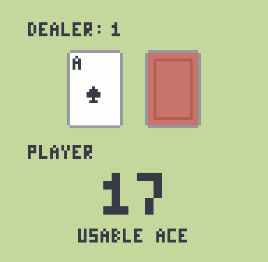

<h1 class="visually-hidden">Blackjack</h1>
<div class="gn-env-banner">
<canvas class="gn-pixel" data-text="BLACKJACK" data-scale="6" data-color="#fcfcfc" data-shadow="#f83800"></canvas>
<canvas class="gn-pixel" data-text="TOY TEXT  2 ACTIONS  3 OBSERVATIONS" data-scale="2" data-color="#f8b800"></canvas>
</div>

<p class="gn-env-lead">Play one hand of blackjack against the dealer, from an infinite deck: hit for another card or stick, and get closer to 21 than the dealer without going over. The player sees only their own total, the dealer's face-up card and whether they hold an ace that counts 11, which makes it the textbook first problem for Monte Carlo methods.</p>

<aside class="gn-infobox" aria-label="Blackjack at a glance">
<video src="media/Blackjack-v1.episode.mp4" poster="media/Blackjack-v1.figure.png" autoplay muted loop playsinline disablepictureinpicture disableremoteplayback aria-label="Blackjack-v1, seed 1574758: basic strategy hits six times, from 4 through a soft 15 and a soft 17 to 21, sticks, and beats the dealer's 17"></video>
<p class="gn-infobox-caption">The hand <code>examples/Blackjack</code> records for this page (DR-128): basic strategy, seed 1574758, 7 steps, return 1.</p>
<table>
<tr><td>Ids</td><td><code>Blackjack-v1</code> no step limit</td></tr>
<tr><td>Action space</td><td><code>Discrete(2)</code></td></tr>
<tr><td>Observation space</td><td><code>Tuple(Discrete(32), Discrete(11), Discrete(2))</code></td></tr>
<tr><td>Reward</td><td>+1 a win, −1 a loss, 0 a draw, at the hand's end; 1.5 for a natural under casino rules · no threshold</td></tr>
<tr><td>Physics</td><td>an infinite deck: every card drawn with replacement (an ace 1, a face card 10); the dealer draws to 17</td></tr>
<tr><td>Render modes</td><td><code>human</code>, <code>rgb_array</code> · 384×376 · 4 fps</td></tr>
<tr><td>Make</td><td><code>Gymnasium.Make("Blackjack-v1")</code></td></tr>
<tr><td>Class</td><td><a href="xref:Gym.Environments.Envs.ToyText.BlackjackEnv"><code>BlackjackEnv</code></a>, options <a href="xref:Gym.Environments.Envs.ToyText.BlackjackEnvOptions"><code>BlackjackEnvOptions</code></a>, observation <a href="xref:Gym.Environments.Envs.ToyText.BlackjackObservation"><code>BlackjackObservation</code></a></td></tr>
<tr><td>Vector env</td><td>none of its own: <code>MakeVec</code> builds sync or async</td></tr>
<tr><td>Parity</td><td><span class="gn-badge gn-badge-ok">bit for bit</span><span class="gn-badge gn-badge-ok">pixel for pixel</span><br>with Gymnasium 1.4.0</td></tr>
<tr><td>Gymnasium</td><td><a href="https://gymnasium.farama.org/v1.4.0/environments/toy_text/blackjack/">Blackjack</a> in Gymnasium 1.4.0's docs</td></tr>
</table>
</aside>

## Description

One hand of blackjack against the dealer, from an infinite deck. The player is dealt two cards and the dealer two, one
of them face down. The player sees their own total, the dealer's face-up card and whether they hold an ace that counts
11; they hit, taking another card, until they stick or go over 21. Going over loses at once. Once the player sticks,
the dealer draws until their total is 17 or more, and the closer total to 21 wins: 1 for a win, −1 for a loss, 0 for a
draw. Each hand is an episode, and its only reward comes at its end.

The cards come from the env's seeded generator, so a seed is a deck order: the same seed deals the same hand, in
Gymnasium and in Gym.NET. Over 10,000 seeded hands random play wins 32 in 100 and returns −0.32 a hand on average; the
example's basic strategy wins 43 and draws 9, and still returns −0.0476 a hand, the house's edge under these rules (no
doubling, no splitting, the dealer standing on a soft 17).

It is Sutton and Barto's Example 5.1, the problem they introduce Monte Carlo methods with: the reward waits for the
hand's end, and the dealer's hidden card and the deck make every decision a bet whose odds the agent must learn. Gym.NET's
Blackjack computes exactly what Gymnasium's does: the same cards from the same seed, the same observations, rewards and
pixels.

## Quick start

# [C#](#tab/csharp)

[!code-csharp[](../../../tests/Gym.Tests/Docs/EnvPageSamples/BlackjackSamples.cs?range=1-4,40-46&dedent=12)]

# [Python (Gymnasium)](#tab/python)

```python
import gymnasium as gym

env = gym.make("Blackjack-v1")
# (the player's sum, the dealer's face-up card, a usable ace)
observation, info = env.reset(seed=42)
# 0 stick, 1 hit
action = env.action_space.sample()
observation, reward, terminated, truncated, info = env.step(action)
```

---

`dotnet add package Gym.NET.Environments`; the six longer examples are in [Code examples](#code-examples).

### Play it, or watch the agent

```bash
# from a clone of the repository: H hits, S sticks
dotnet run --project examples/Blackjack -c Release -- --play
# the agent plays the showreel's hand, seed 40, in a window
dotnet run --project examples/Blackjack -c Release -- --render
```

## How it works

<div class="gn-figure gn-figure-art">

<svg viewBox="0 0 384 376" font-family="system-ui, sans-serif" role="img" aria-label="Labels: the observation (17, 1, 1); its second item, 1, the dealer's face-up card; the hidden card, face down and never shown; its first item, 17, the player's sum; its third, the usable ace; the player's cards, 2, 2, A, 2, which the table never draws">
<text x="192" y="19" text-anchor="middle" font-size="12" font-weight="700" fill="#1f2328" paint-order="stroke" stroke="#fff" stroke-width="3" stroke-linejoin="round">observation (17, 1, 1)</text>
<text x="180" y="47" font-size="11" font-weight="700" fill="#c2189b" paint-order="stroke" stroke="#fff" stroke-width="3" stroke-linejoin="round">← [1]: the dealer's face-up card</text>
<text x="294" y="120" font-size="11" font-weight="700" fill="#1f2328" paint-order="stroke" stroke="#fff" stroke-width="3" stroke-linejoin="round">face down,</text>
<text x="294" y="134" font-size="11" font-weight="700" fill="#1f2328" paint-order="stroke" stroke="#fff" stroke-width="3" stroke-linejoin="round">never shown</text>
<text x="240" y="283" font-size="11" font-weight="700" fill="#c2189b" paint-order="stroke" stroke="#fff" stroke-width="3" stroke-linejoin="round">← [0]: the player's sum</text>
<text x="274" y="343" font-size="11" font-weight="700" fill="#c2189b" paint-order="stroke" stroke="#fff" stroke-width="3" stroke-linejoin="round">← [2] = 1</text>
<text x="192" y="369" text-anchor="middle" font-size="11" fill="#1f2328" paint-order="stroke" stroke="#fff" stroke-width="3" stroke-linejoin="round">the player's cards, never drawn: 2 2 A 2</text>
</svg>
</div>
<p class="gn-figure-caption">Step 2 of the page's hand, exactly as <code>Render()</code> returns it, at 1.25 times its size: the player's soft 17 (two 2s, an ace and a 2), the dealer's ace face up and a 6 face down. The table shows the observation, (17, 1, 1), and nothing more: never the player's cards, and never the dealer's second card, even after the hand ends.</p>

Cards count their number, a face card 10 and an ace 1, from a deck that never runs out: each draw is any of 13 ranks
with equal chance, so a 10 comes four times in thirteen. With $t$ the cards' total, every ace counted 1, a hand's sum
counts one ace as 11 whenever that keeps it at 21 or under, and that ace is then "usable":

$$
\text{sum} = \begin{cases} t + 10 & \text{an ace is held and } t + 10 \le 21 \quad \text{(a usable ace)} \\ t & \text{otherwise} \end{cases}
$$

A hit that takes the sum over 21 ends the hand with −1. A stick ends it too: the dealer draws while their own sum,
counted the same way, is below 17, and the reward compares the two, a bust scoring 0:

$$
r = \operatorname{sign}\big(\text{score}_\text{player} - \text{score}_\text{dealer}\big)
$$

A natural, an ace and a ten as the first two cards, changes it under two of the rule sets the env offers: Blackjack-v1's
(`sab`) counts it a win against a dealer without one, and casino rules (`natural`) pay 1.5 when it wins.

| Card | Value |
|---|---|
| Ace | 1, or 11 when that keeps the sum at 21 or under (a usable ace) |
| 2 to 9 | Its number |
| 10, jack, queen, king | 10 |

> [!WARNING]
> Blackjack-v1 plays Sutton and Barto's rules, `sab=true`, and the class's own default is `sab=false`: `new
> BlackjackEnv()` deals the same cards as `Make("Blackjack-v1")`, but a natural against the dealer's 21 of three or more
> cards is a draw there and a win here. The observation is a
> tuple of three 0-d arrays that the reset's or step's result owns: read it by name with `BlackjackObservation`, and take
> the numbers out before the result is disposed, since the record shares the arrays.

## Action space

`Discrete(2)`: hit or stick.

| Action | Does |
|---|---|
| 0 | Stick: stop; the dealer plays out the hand and the episode ends |
| 1 | Hit: take a card; over 21 ends the episode with −1 |

The env asserts that the space contains the action, as Gymnasium's does: 0 and 1 pass, as numbers or as `true` and
`false`, and an action outside the space (2, −1, 0.5, an array, `null`) raises Gymnasium's bare `AssertionError`.

## Observation space

`Tuple(Discrete(32), Discrete(11), Discrete(2))`: three 0-d int64 `NDArray`s in an `object?[]`, or by name through
<xref:Gym.Environments.Envs.ToyText.BlackjackObservation>:

| Item | Name | Meaning | Values |
|---|---|---|---|
| 0 | `PlayerSum` | The player's sum, a usable ace counted 11 | 4 to 21 at the deal, up to 31 after a hit that busts |
| 1 | `DealerCard` | The dealer's face-up card | 1 (an ace) to 10 |
| 2 | `UsableAce` | Whether the player holds a usable ace | 0 or 1 |

## Rewards

At the hand's end, +1 for a win, −1 for a loss and 0 for a draw; every step before it pays 0. Under Blackjack-v1's rules
a natural against a dealer without one wins +1; with `sab=false, natural=true` a natural that wins pays +1.5. The
registry sets no threshold for "solved".

## Starting state

Two cards each: the player's sum is 4 to 21, the dealer's face-up card 1 to 10, and the player holds a usable ace in
about one deal in seven (1,474 of 10,000 seeded deals). The reset also draws the face-up card's suit, and for a 10 its
face (jack, queen or king), for the picture only; those draws move the generator all the same.

## Episode end

| Ends by | When |
|---|---|
| Termination | The player sticks (the dealer then plays out the hand), or hits over 21 |
| Truncation | Never: Blackjack-v1 registers no step limit, and a hand ends within a few hits (basic strategy's longest over 10,000 seeded hands took 6 steps) |

## Arguments

By Gymnasium's name in `Make`'s kwargs, or by the C# name in the constructor and in
<xref:Gym.Environments.Envs.ToyText.BlackjackEnvOptions>.

| Argument | Type and default | Effect |
|---|---|---|
| `render_mode`<br>`renderMode` | `string?` or `RenderMode`<br>`null` | `"human"` opens a window, `"rgb_array"` makes `Render()` return the frame |
| `natural`<br>`natural` | `bool`<br>`false` | Casino rules: a natural that wins pays 1.5; ignored when `sab` is set |
| `sab`<br>`sab` | `bool`<br>`false` | Sutton and Barto's rules: a natural against a dealer without one wins 1; Blackjack-v1 sets it |
| (Gym.NET)<br>`viewerFactory` | `EnvViewerFactory?`<br>`null` | The window for `human`: Avalonia, WinForms, or headless |

[!code-csharp[](../../../tests/Gym.Tests/Docs/EnvPageSamples/BlackjackSamples.cs#Arguments)]

## Info

`{}` on every reset and step: Blackjack sends no info, so it has no typed info record.

## Rendering

| Mode | What you get |
|---|---|
| `rgb_array` | `Render()` returns the frame: `(376, 384, 3)` uint8, Gymnasium's pixels |
| `human` | A window from the viewer factory, drawn after every reset and step, paced at 4 frames a second |
| none | `Render()` warns and returns nothing, as Gymnasium's does |

Blackjack has no text mode. The frame is the Farama Foundation's pixel art, embedded from Gymnasium, drawn at four
pixels to an art pixel: the dealer's label with the face-up card's value, that card and one face down, the player's
label, their sum in large digits, and "usable ace" while they hold one.

## Episode anatomy

The page's hand, step by step: the player's sum against the lines at 17, where the dealer stands, and 21, over which a
hand busts; below, the usable ace and each action. Two 2s make 4. An ace makes a soft 15 and a 2 a soft 17, both hits
against the dealer's ace; a 6 then takes the ace back to 1, a hard 13, and a 2, an ace and a 5 bring it to 21, where the
player sticks. The dealer turns over a 6 and stands on a soft 17: the player wins, 1.

<div class="gn-anatomy" data-trace="media/Blackjack-v1.episode.json">
<div><video src="media/Blackjack-v1.episode.mp4" poster="media/Blackjack-v1.figure.png" autoplay muted loop playsinline disablepictureinpicture disableremoteplayback aria-label="Blackjack-v1, seed 1574758, the hand the chart follows"></video><div class="gn-anatomy-readout" aria-live="off"></div></div>
<div><div class="gn-anatomy-chart"></div><div class="gn-anatomy-legend"></div></div>
<script type="application/json" class="gn-anatomy-spec">{"label":"Blackjack-v1, seed 1574758: the player's sum against the dealer's 17 and the bust at 21, the usable ace, and each hit or stick","bands":[{"height":110,"range":[0,24],"ticks":[0,17,21],"series":[{"column":"sum","color":"#3cbcfc","name":"the player's sum (the lines at 17 and 21)"}]},{"label":"ace","strip":{"column":"usable","colors":{"0":"#343a40","1":"#f8b800"},"name":"a usable ace"}},{"label":"action","strip":{"column":"action","colors":{"0":"#e8590c","1":"#40c057"},"name":"hit in green, stick in orange"}}],"readout":[{"label":"step","column":"@step"},{"label":"sum","column":"sum","digits":0},{"label":"dealer shows","column":"dealer","map":{"1":"an ace"}},{"label":"usable ace","column":"usable","map":{"0":"no","1":"yes"}},{"label":"next","column":"action","map":{"0":"stick","1":"hit"}},{"label":"return so far","column":"@return","digits":0}]}</script>
</div>

## Code examples

### Run an episode

# [C#](#tab/csharp)

[!code-csharp[](../../../tests/Gym.Tests/Docs/EnvPageSamples/BlackjackSamples.cs#RunAnEpisode)]

# [Python (Gymnasium)](#tab/python)

```python
import gymnasium as gym

env = gym.make("Blackjack-v1")
observation, info = env.reset(seed=42)
episode_return = 0.0
while True:
    action = env.action_space.sample()
    observation, reward, terminated, truncated, info = env.step(action)
    episode_return += reward
    if terminated or truncated:
        break
print(f"return {episode_return}")  # 1 a win, -1 a loss, 0 a draw
```

---

### Basic strategy

# [C#](#tab/csharp)

[!code-csharp[](../../../tests/Gym.Tests/Docs/EnvPageSamples/BlackjackSamples.cs#BasicStrategy)]

# [Python (Gymnasium)](#tab/python)

```python
env = gym.make("Blackjack-v1")


def basic(total, dealer, soft):
    # hit or stick by the player's sum, the dealer's card and a soft hand
    if soft:
        return int(total < 18 or (total == 18 and (dealer >= 9 or dealer == 1)))
    return int(total < 12 or (total < 17 and (dealer >= 7 or dealer == 1))
               or (total == 12 and dealer <= 3))


total = 0.0
for seed in range(10_000):
    observation, info = env.reset(seed=seed)
    while True:
        action = basic(*observation)
        observation, reward, terminated, truncated, info = env.step(action)
        total += reward
        if terminated:
            break
# -0.0476 a hand: basic strategy still loses, as in a casino
print(f"{total / 10_000:.4f}")
```

---

### The hands behind the table

# [C#](#tab/csharp)

[!code-csharp[](../../../tests/Gym.Tests/Docs/EnvPageSamples/BlackjackSamples.cs#TheHands)]

# [Python (Gymnasium)](#tab/python)

```python
env = gym.make("Blackjack-v1")
env.reset(seed=1_574_758)
table = env.unwrapped
# aces are 1; the dealer's second card is the face-down one
print("player", *table.player)  # 2 2
print("dealer", *table.dealer)  # 1 6
```

---

### Casino rules

# [C#](#tab/csharp)

[!code-csharp[](../../../tests/Gym.Tests/Docs/EnvPageSamples/BlackjackSamples.cs#CasinoRules)]

# [Python (Gymnasium)](#tab/python)

```python
# Blackjack-v1 plays the book's rules (sab=True): a natural wins 1
env = gym.make("Blackjack-v1", sab=False, natural=True)
env.reset(seed=5)  # an ace and a ten
observation, reward, terminated, truncated, info = env.step(0)
print(reward)  # 1.5
```

---

### Estimate values: first-visit Monte Carlo

# [C#](#tab/csharp)

[!code-csharp[](../../../tests/Gym.Tests/Docs/EnvPageSamples/BlackjackSamples.cs#MonteCarlo)]

# [Python (Gymnasium)](#tab/python)

```python
from collections import defaultdict

import numpy as np

env = gym.make("Blackjack-v1")
returns = defaultdict(list)
for seed in range(10_000):
    state, info = env.reset(seed=seed)
    seen = []
    while True:
        seen.append(state)
        # the book's policy: stick on 20 or 21, else hit
        action = 0 if state[0] >= 20 else 1
        state, reward, terminated, truncated, info = env.step(action)
        if terminated:
            # the only reward comes at the end: every state seen earns it
            for s in seen:
                returns[s].append(reward)
            break
# 20 against a 10: 0.413 from 610 hands; 13 against a 10: -0.597 from 365
for key in [(20, 10, 0), (13, 10, 0)]:
    print(f"{key}: {np.mean(returns[key]):.3f} from {len(returns[key])} hands")
```

---

Sutton and Barto's Example 5.1 at the shorter of its Figure 5.1's two runs, 10,000 hands (the other is 500,000): a
state's value is the mean return of the hands that pass through it, which a Blackjack hand never revisits (each hit
raises the hard sum or turns a soft hand hard), so every visit is a first visit.

### Many tables at once

# [C#](#tab/csharp)

[!code-csharp[](../../../tests/Gym.Tests/Docs/EnvPageSamples/BlackjackSamples.cs#ManyTables)]

# [Python (Gymnasium)](#tab/python)

```python
# No vector env of its own: make_vec steps 8 envs in turn ("sync")
envs = gym.make_vec("Blackjack-v1", num_envs=8, vectorization_mode="sync")
observations, infos = envs.reset(seed=42)
for t in range(100):
    actions = envs.action_space.sample()  # one per table
    # finished hands deal again
    observations, rewards, terminations, truncations, infos = envs.step(actions)
```

---

Every C# example is a test in `tests/Gym.Tests/Docs/EnvPageSamples`, compiled and run by the unit gate; where a
comment states a number, the test checks it.

## Agents and examples

- **The video's agent** is basic strategy for these rules: hit a soft total below 18, and a soft 18 against a 9, a 10 or
  an ace; hit a hard total below 12, 12 to 16 against a 7 or better or an ace, and 12 against a 2 or a 3; otherwise
  stick. It returns −0.0476 a hand over 10,000 seeded hands. The page plays seed 1,574,758 (DR-128): among seeds 0 to
  1,999,999, the longest hand this strategy wins on exactly 21, eight cards against the dealer's ace.
- **[examples/Blackjack](https://github.com/SciSharp/Gym.NET/tree/master/examples/Blackjack)**
  ([`BlackjackProgram.cs`](https://github.com/SciSharp/Gym.NET/blob/master/examples/Blackjack/BlackjackProgram.cs))
  plays that strategy: `dotnet run --project examples/Blackjack -c Release` plays seed 40, the showreel's one-step win,
  `--seed N` another seed, `--episodes N` that many hands and their mean, `--render` in a window.
- **Play it yourself**: `--play` deals you the hands: H hits, S sticks. The game is turn-based: it steps only while a key
  is held.
- **This page's video and chart** are the page's hand: `--record docs/environments/toy_text/media` records seed
  1,574,758 with `RecordVideo` (one frame per step) and writes the step trace and the figure beside it.

## Vectorized environment

Blackjack registers no vector env of its own. `Gymnasium.MakeVec("Blackjack-v1", n)` builds a `SyncVectorEnv` that
steps `n` separate envs in turn, and `VectorizeMode.Async` an `AsyncVectorEnv` that steps them on worker threads; each
env deals a new hand after its hand ends (next-step autoreset), as Gymnasium's. The batched observation is a tuple of
three arrays, one value per table.

## Parity with Gymnasium

Gymnasium 1.4.0 runs inside the test process and both are compared value by value:

| What is compared | How | Result |
|---|---|---|
| Hands under every rule set | seeded games of sampled actions and of a fixed strategy, `sab` and `natural` on and off: the hands, the face-up card's suit and face, the generator after each game | ✓ bit for bit |
| The cards | `draw_card` and `draw_hand` on generators seeded on both sides | ✓ the same cards |
| The scoring | every reward rule on injected hands: wins, losses and draws, the dealer drawing to 17 or busting, naturals on either side under each rule set; the hand functions over every hand of up to three cards | ✓ equal |
| Actions | the ones the space assertion admits (0, 1, `True`, `False`, NumPy integers) and the ones it refuses, with their errors; stepping before a reset | ✓ same values, same errors |
| Frames | `rgb_array` frames after the reset and every step of 60 seeded games, and of injected hands at the totals' extremes | ✓ pixel for pixel |
| Spaces, `make`'s stack, goldens | both spaces and their seeded samples; `make`'s stack (`sab=True`, no time limit) with its passive checker; a golden | ✓ |
| Gymnasium's own checkers on Gym.NET's env | `check_env`, `check_environments_match` | ✓ |

The tests: [BlackjackLiveParityTests](https://github.com/SciSharp/Gym.NET/blob/master/tests/Gym.Tests.Parity/Tests/Envs/BlackjackLiveParityTests.cs),
[EnvCoverageLiveParityTests](https://github.com/SciSharp/Gym.NET/blob/master/tests/Gym.Tests.Parity/Tests/Envs/EnvCoverageLiveParityTests.cs),
[GymnasiumToolsLiveParityTests](https://github.com/SciSharp/Gym.NET/blob/master/tests/Gym.Tests.Parity/Tests/Bridge/GymnasiumToolsLiveParityTests.cs).

## Performance

| | Steps a second | Bytes a step |
|---|--:|--:|
| Gym.NET | 66,271 | 18,656 |
| Gymnasium | 17,185 | |

3.9× faster. Gymnasium's own `benchmark_step` on both sides (Gym.NET's `Performance.BenchmarkStep`, DR-36):
random actions, a reset at each episode's end, after a 2-second warm-up; .NET 10 in Release against CPython 3.12
with the pinned NumPy; the medians of three interleaved rounds of 5 seconds on one machine (2026-11-24).

## Reference sources

- [gymnasium/envs/toy_text/blackjack.py](https://github.com/Farama-Foundation/Gymnasium/blob/8ba8c3a63bb4e000b7f33923f43d292acac07be1/gymnasium/envs/toy_text/blackjack.py),
  Gymnasium 1.4.0: the environment (the deck, the hand functions, the dealer's play, the three rule sets, reset and the
  table's drawing).
- [gymnasium/envs/toy_text/img/blackjack](https://github.com/Farama-Foundation/Gymnasium/tree/8ba8c3a63bb4e000b7f33923f43d292acac07be1/gymnasium/envs/toy_text/img/blackjack):
  the Farama Foundation's pixel art, embedded in Gym.NET.Environments (`src/Gym.Environments/Assets/README.md` lists
  each file with its source and SHA-256).
- [gymnasium/utils/seeding.py](https://github.com/Farama-Foundation/Gymnasium/blob/8ba8c3a63bb4e000b7f33923f43d292acac07be1/gymnasium/utils/seeding.py):
  the env's generator, NumPy's PCG64, which NumSharp reproduces for every card, suit and face.

## Version history

| Version | Change |
|---|---|
| Blackjack-v1 | The natural's handling fixed; Gymnasium 1.4.0 draws it in the Farama Foundation's new pixel art |
| Blackjack-v0 | The first release |
| Gym.NET 1.0.0 | New: Gymnasium 1.4.0's Blackjack-v1, bit for bit; 0.2.0 had no Blackjack |

## References

1. R. S. Sutton and A. G. Barto, *Reinforcement Learning: An Introduction*, 2nd edition, MIT Press, 2018: Example 5.1,
   "Blackjack", in section 5.1, "Monte Carlo Prediction", where the task, its rules and the stick-on-20 policy come from.
   [The book](http://incompleteideas.net/book/the-book-2nd.html)
2. R. R. Baldwin, W. E. Cantey, H. Maisel and J. P. McDermott, "The Optimum Strategy in Blackjack", *Journal of the
   American Statistical Association* 51 (275), 1956, [doi:10.1080/01621459.1956.10501334](https://doi.org/10.1080/01621459.1956.10501334):
   basic strategy, which the video's agent plays.

## External links

- [Blackjack on Gymnasium's site](https://gymnasium.farama.org/v1.4.0/environments/toy_text/blackjack/) (1.4.0)
- [BlackjackEnv.cs](https://github.com/SciSharp/Gym.NET/blob/master/src/Gym.Environments/Envs/ToyText/BlackjackEnv.cs) on GitHub
- [examples/Blackjack](https://github.com/SciSharp/Gym.NET/tree/master/examples/Blackjack)

## API reference

<xref:Gym.Environments.Envs.ToyText.BlackjackEnv> · <xref:Gym.Environments.Envs.ToyText.BlackjackEnvOptions> ·
<xref:Gym.Environments.Envs.ToyText.BlackjackObservation>
