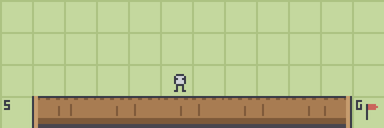

<h1 class="visually-hidden">Cliff Walking</h1>
<div class="gn-env-banner">
<canvas class="gn-pixel" data-text="CLIFF WALKING" data-scale="6" data-color="#fcfcfc" data-shadow="#f83800"></canvas>
<canvas class="gn-pixel" data-text="TOY TEXT  4 ACTIONS  48 OBSERVATIONS" data-scale="2" data-color="#f8b800"></canvas>
</div>

<p class="gn-env-lead">Walk a grid from the start to the goal along the edge of a cliff: every step costs 1, and a step off the edge costs 100 and puts the walker back at the start. The shortest way runs right along the edge, which makes it the textbook case of how a learner's own exploration shapes what it learns.</p>

<aside class="gn-infobox" aria-label="Cliff Walking at a glance">
<video src="media/CliffWalking-v1.episode.mp4" poster="media/CliffWalking-v1.board.png" autoplay muted loop playsinline disablepictureinpicture disableremoteplayback aria-label="CliffWalking-v1, seed 0: the plan steps up off the start, walks the cliff's edge to the right and steps down onto the goal in 13 steps"></video>
<p class="gn-infobox-caption">The whole episode <code>examples/CliffWalking</code> plays and records: value iteration over the env's transition table, seed 0, 13 steps, return −13.</p>
<table>
<tr><td>Ids</td><td><code>CliffWalking-v1</code> no step limit<br><code>CliffWalkingSlippery-v1</code> no step limit</td></tr>
<tr><td>Action space</td><td><code>Discrete(4)</code></td></tr>
<tr><td>Observation space</td><td><code>Discrete(48)</code></td></tr>
<tr><td>Reward</td><td>−1 a step, −100 off the cliff and back to the start · no threshold</td></tr>
<tr><td>Physics</td><td>the transition table <code>P</code>: every move certain; on the slippery cliff the aimed move and each sideways slide 1/3</td></tr>
<tr><td>Render modes</td><td><code>human</code>, <code>rgb_array</code>, <code>ansi</code> · 768×256 · 4 fps</td></tr>
<tr><td>Make</td><td><code>Gymnasium.Make("CliffWalking-v1")</code></td></tr>
<tr><td>Class</td><td><a href="xref:Gym.Environments.Envs.ToyText.CliffWalkingEnv"><code>CliffWalkingEnv</code></a>, options <a href="xref:Gym.Environments.Envs.ToyText.CliffWalkingEnvOptions"><code>CliffWalkingEnvOptions</code></a>, info <a href="xref:Gym.Environments.Envs.ToyText.CliffWalkingInfo"><code>CliffWalkingInfo</code></a></td></tr>
<tr><td>Vector env</td><td>none of its own: <code>MakeVec</code> builds sync or async</td></tr>
<tr><td>Parity</td><td><span class="gn-badge gn-badge-ok">bit for bit</span><span class="gn-badge gn-badge-ok">pixel for pixel</span><br>with Gymnasium 1.4.0</td></tr>
<tr><td>Gymnasium</td><td><a href="https://gymnasium.farama.org/v1.4.0/environments/toy_text/cliff_walking/">Cliff Walking</a> in Gymnasium 1.4.0's docs</td></tr>
</table>
</aside>

## Description

The grid is four rows by twelve columns. The walker starts in the bottom-left corner and the goal is the bottom-right
one; between them, the rest of the bottom row is the cliff. Each step the agent sends the walker one cell up, right,
down or left, or nowhere at the grid's edge. Every step costs 1. A step onto the cliff costs 100 instead and puts the
walker back on the start, and the episode goes on: only the goal ends it, and nothing cuts it short, since neither id
registers a step limit.

So the best return is −13: one step up, eleven along the cliff's edge, one down onto the goal. Random moves take
thousands of steps to get there: 6,444 on average over 1,000 seeded episodes, falling off the cliff about 590 times on
the way.

The task is Sutton and Barto's Example 6.6, which compares two ways of learning it: Q-learning learns the path along the
edge and, still exploring, keeps falling off it, while SARSA learns a longer path away from the edge and does better
while it learns. The env also hands over its own transition table, `P`, so it can be planned exactly. Gym.NET's
CliffWalking computes exactly what Gymnasium's does: the same table, the same draws from the same seed, the same
observations, rewards, infos, text and pixels.

## Quick start

# [C#](#tab/csharp)

[!code-csharp[](../../../tests/Gym.Tests/Docs/EnvPageSamples/CliffWalkingSamples.cs?range=1-4,35-41&dedent=12)]

# [Python (Gymnasium)](#tab/python)

```python
import gymnasium as gym

env = gym.make("CliffWalking-v1")
# the cell, row * 12 + col: 36 is the start
observation, info = env.reset(seed=42)
# 0 up, 1 right, 2 down, 3 left
action = env.action_space.sample()
observation, reward, terminated, truncated, info = env.step(action)
```

---

`dotnet add package Gym.NET.Environments`; the six longer examples are in [Code examples](#code-examples).

### Play it, or watch the agent

```bash
# from a clone of the repository: you walk with the arrow keys
dotnet run --project examples/CliffWalking -c Release -- --play
# the agent in the video plays it in a window
dotnet run --project examples/CliffWalking -c Release -- --render
```

## How it works

<div class="gn-figure gn-figure-wide">

<svg viewBox="0 0 768 256" font-family="system-ui, sans-serif" font-size="14" role="img" aria-label="Labels: every cell's number, 0 to 47, the observation; the start, cell 36; the goal, cell 47; the cliff, cells 37 to 46; the walker on cell 29, where up, right and left each cost 1 and down drops it off the cliff for 100, back to the start; the plan moves right">
<defs><marker id="gn-cw-p" viewBox="0 0 10 10" refX="9" refY="5" markerWidth="5" markerHeight="5" orient="auto-start-reverse"><path d="M0,0 L10,5 L0,10 z" fill="#c2189b"/></marker><marker id="gn-cw-m" viewBox="0 0 10 10" refX="9" refY="5" markerWidth="5" markerHeight="5" orient="auto-start-reverse"><path d="M0,0 L10,5 L0,10 z" fill="#1971c2"/></marker><marker id="gn-cw-f" viewBox="0 0 10 10" refX="9" refY="5" markerWidth="5" markerHeight="5" orient="auto-start-reverse"><path d="M0,0 L10,5 L0,10 z" fill="#e03131"/></marker></defs>
<text x="59" y="15" text-anchor="end" font-size="12" font-weight="700" fill="#1f2328" paint-order="stroke" stroke="#fff" stroke-width="3.5" stroke-linejoin="round">0</text>
<text x="123" y="15" text-anchor="end" font-size="12" font-weight="700" fill="#1f2328" paint-order="stroke" stroke="#fff" stroke-width="3.5" stroke-linejoin="round">1</text>
<text x="187" y="15" text-anchor="end" font-size="12" font-weight="700" fill="#1f2328" paint-order="stroke" stroke="#fff" stroke-width="3.5" stroke-linejoin="round">2</text>
<text x="251" y="15" text-anchor="end" font-size="12" font-weight="700" fill="#1f2328" paint-order="stroke" stroke="#fff" stroke-width="3.5" stroke-linejoin="round">3</text>
<text x="315" y="15" text-anchor="end" font-size="12" font-weight="700" fill="#1f2328" paint-order="stroke" stroke="#fff" stroke-width="3.5" stroke-linejoin="round">4</text>
<text x="379" y="15" text-anchor="end" font-size="12" font-weight="700" fill="#1f2328" paint-order="stroke" stroke="#fff" stroke-width="3.5" stroke-linejoin="round">5</text>
<text x="443" y="15" text-anchor="end" font-size="12" font-weight="700" fill="#1f2328" paint-order="stroke" stroke="#fff" stroke-width="3.5" stroke-linejoin="round">6</text>
<text x="507" y="15" text-anchor="end" font-size="12" font-weight="700" fill="#1f2328" paint-order="stroke" stroke="#fff" stroke-width="3.5" stroke-linejoin="round">7</text>
<text x="571" y="15" text-anchor="end" font-size="12" font-weight="700" fill="#1f2328" paint-order="stroke" stroke="#fff" stroke-width="3.5" stroke-linejoin="round">8</text>
<text x="635" y="15" text-anchor="end" font-size="12" font-weight="700" fill="#1f2328" paint-order="stroke" stroke="#fff" stroke-width="3.5" stroke-linejoin="round">9</text>
<text x="699" y="15" text-anchor="end" font-size="12" font-weight="700" fill="#1f2328" paint-order="stroke" stroke="#fff" stroke-width="3.5" stroke-linejoin="round">10</text>
<text x="763" y="15" text-anchor="end" font-size="12" font-weight="700" fill="#1f2328" paint-order="stroke" stroke="#fff" stroke-width="3.5" stroke-linejoin="round">11</text>
<text x="59" y="79" text-anchor="end" font-size="12" font-weight="700" fill="#1f2328" paint-order="stroke" stroke="#fff" stroke-width="3.5" stroke-linejoin="round">12</text>
<text x="123" y="79" text-anchor="end" font-size="12" font-weight="700" fill="#1f2328" paint-order="stroke" stroke="#fff" stroke-width="3.5" stroke-linejoin="round">13</text>
<text x="187" y="79" text-anchor="end" font-size="12" font-weight="700" fill="#1f2328" paint-order="stroke" stroke="#fff" stroke-width="3.5" stroke-linejoin="round">14</text>
<text x="251" y="79" text-anchor="end" font-size="12" font-weight="700" fill="#1f2328" paint-order="stroke" stroke="#fff" stroke-width="3.5" stroke-linejoin="round">15</text>
<text x="315" y="79" text-anchor="end" font-size="12" font-weight="700" fill="#1f2328" paint-order="stroke" stroke="#fff" stroke-width="3.5" stroke-linejoin="round">16</text>
<text x="379" y="79" text-anchor="end" font-size="12" font-weight="700" fill="#1f2328" paint-order="stroke" stroke="#fff" stroke-width="3.5" stroke-linejoin="round">17</text>
<text x="443" y="79" text-anchor="end" font-size="12" font-weight="700" fill="#1f2328" paint-order="stroke" stroke="#fff" stroke-width="3.5" stroke-linejoin="round">18</text>
<text x="507" y="79" text-anchor="end" font-size="12" font-weight="700" fill="#1f2328" paint-order="stroke" stroke="#fff" stroke-width="3.5" stroke-linejoin="round">19</text>
<text x="571" y="79" text-anchor="end" font-size="12" font-weight="700" fill="#1f2328" paint-order="stroke" stroke="#fff" stroke-width="3.5" stroke-linejoin="round">20</text>
<text x="635" y="79" text-anchor="end" font-size="12" font-weight="700" fill="#1f2328" paint-order="stroke" stroke="#fff" stroke-width="3.5" stroke-linejoin="round">21</text>
<text x="699" y="79" text-anchor="end" font-size="12" font-weight="700" fill="#1f2328" paint-order="stroke" stroke="#fff" stroke-width="3.5" stroke-linejoin="round">22</text>
<text x="763" y="79" text-anchor="end" font-size="12" font-weight="700" fill="#1f2328" paint-order="stroke" stroke="#fff" stroke-width="3.5" stroke-linejoin="round">23</text>
<text x="59" y="143" text-anchor="end" font-size="12" font-weight="700" fill="#1f2328" paint-order="stroke" stroke="#fff" stroke-width="3.5" stroke-linejoin="round">24</text>
<text x="123" y="143" text-anchor="end" font-size="12" font-weight="700" fill="#1f2328" paint-order="stroke" stroke="#fff" stroke-width="3.5" stroke-linejoin="round">25</text>
<text x="187" y="143" text-anchor="end" font-size="12" font-weight="700" fill="#1f2328" paint-order="stroke" stroke="#fff" stroke-width="3.5" stroke-linejoin="round">26</text>
<text x="251" y="143" text-anchor="end" font-size="12" font-weight="700" fill="#1f2328" paint-order="stroke" stroke="#fff" stroke-width="3.5" stroke-linejoin="round">27</text>
<text x="315" y="143" text-anchor="end" font-size="12" font-weight="700" fill="#1f2328" paint-order="stroke" stroke="#fff" stroke-width="3.5" stroke-linejoin="round">28</text>
<text x="379" y="143" text-anchor="end" font-size="12" font-weight="700" fill="#1f2328" paint-order="stroke" stroke="#fff" stroke-width="3.5" stroke-linejoin="round">29</text>
<text x="443" y="143" text-anchor="end" font-size="12" font-weight="700" fill="#1f2328" paint-order="stroke" stroke="#fff" stroke-width="3.5" stroke-linejoin="round">30</text>
<text x="507" y="143" text-anchor="end" font-size="12" font-weight="700" fill="#1f2328" paint-order="stroke" stroke="#fff" stroke-width="3.5" stroke-linejoin="round">31</text>
<text x="571" y="143" text-anchor="end" font-size="12" font-weight="700" fill="#1f2328" paint-order="stroke" stroke="#fff" stroke-width="3.5" stroke-linejoin="round">32</text>
<text x="635" y="143" text-anchor="end" font-size="12" font-weight="700" fill="#1f2328" paint-order="stroke" stroke="#fff" stroke-width="3.5" stroke-linejoin="round">33</text>
<text x="699" y="143" text-anchor="end" font-size="12" font-weight="700" fill="#1f2328" paint-order="stroke" stroke="#fff" stroke-width="3.5" stroke-linejoin="round">34</text>
<text x="763" y="143" text-anchor="end" font-size="12" font-weight="700" fill="#1f2328" paint-order="stroke" stroke="#fff" stroke-width="3.5" stroke-linejoin="round">35</text>
<text x="59" y="207" text-anchor="end" font-size="12" font-weight="700" fill="#1f2328" paint-order="stroke" stroke="#fff" stroke-width="3.5" stroke-linejoin="round">36</text>
<text x="763" y="207" text-anchor="end" font-size="12" font-weight="700" fill="#1f2328" paint-order="stroke" stroke="#fff" stroke-width="3.5" stroke-linejoin="round">47</text>
<text x="32" y="251" text-anchor="middle" font-weight="700" fill="#1f2328" paint-order="stroke" stroke="#fff" stroke-width="3.5" stroke-linejoin="round">start</text>
<text x="736" y="251" text-anchor="middle" font-weight="700" fill="#2f9e44" paint-order="stroke" stroke="#fff" stroke-width="3.5" stroke-linejoin="round">goal</text>
<text x="554" y="214" text-anchor="middle" font-weight="700" fill="#fff" paint-order="stroke" stroke="#3b2a1a" stroke-width="3.5" stroke-linejoin="round">the cliff, cells 37 to 46</text>
<text x="554" y="232" text-anchor="middle" font-weight="700" fill="#fff" paint-order="stroke" stroke="#3b2a1a" stroke-width="3.5" stroke-linejoin="round">−100, back to the start</text>
<line x1="352" y1="138" x2="352" y2="110" stroke="#1971c2" stroke-width="3" marker-end="url(#gn-cw-m)"/>
<text x="360" y="129" text-anchor="start" font-weight="700" fill="#1971c2" paint-order="stroke" stroke="#fff" stroke-width="3.5" stroke-linejoin="round">−1</text>
<line x1="372" y1="160" x2="402" y2="160" stroke="#c2189b" stroke-width="3" marker-end="url(#gn-cw-p)"/>
<text x="387" y="178" text-anchor="middle" font-weight="700" fill="#c2189b" paint-order="stroke" stroke="#fff" stroke-width="3.5" stroke-linejoin="round">−1</text>
<text x="408" y="165" font-weight="700" fill="#c2189b" paint-order="stroke" stroke="#fff" stroke-width="3.5" stroke-linejoin="round">the plan</text>
<line x1="352" y1="182" x2="352" y2="202" stroke="#e03131" stroke-width="3" marker-end="url(#gn-cw-f)"/>
<text x="360" y="214" text-anchor="start" font-weight="700" fill="#e03131" paint-order="stroke" stroke="#fff" stroke-width="3.5" stroke-linejoin="round">−100</text>
<line x1="332" y1="160" x2="302" y2="160" stroke="#1971c2" stroke-width="3" marker-end="url(#gn-cw-m)"/>
<text x="317" y="178" text-anchor="middle" font-weight="700" fill="#1971c2" paint-order="stroke" stroke="#fff" stroke-width="3.5" stroke-linejoin="round">−1</text>
<path d="M 344 242 L 54 242" fill="none" stroke="#e03131" stroke-width="2.5" stroke-dasharray="6 4" marker-end="url(#gn-cw-f)"/>
</svg>
</div>
<p class="gn-figure-caption">Step 6 of the episode in the video, exactly as <code>Render()</code> returns it: the walker on cell 29, halfway along the cliff's edge. Up, right and left each cost 1; down steps onto the cliff, which costs 100 and puts the walker back on the start, cell 36. The plan moves right. 64 pixels to a cell.</p>

The observation is the walker's cell, $s = 12r + c$ for row $r$ and column $c$. A step aims at the next cell in the
chosen direction, held at the grid's edges; call it $\text{aim}(s, a)$. The rest of the bottom row is the cliff,
$C = \{37, \dots, 46\}$, and a step aimed into it lands on the start instead:

$$
(s', r) = \begin{cases} (36,\ -100) & \text{if } \text{aim}(s, a) \in C \\ (\text{aim}(s, a),\ -1) & \text{otherwise} \end{cases}
$$

and the episode terminates when $s' = 47$, the goal. On the slippery cliff the direction itself may slide: the move goes
as aimed, or a quarter turn to the left or to the right ($a - 1$ or $a + 1$, modulo 4), a third each, and the cliff then
applies to the cell the slide aims at. The env builds the whole table at construction: `P[s][a]` lists every
`(probability, next state, reward, terminated)` of action `a` in cell `s`, one outcome on the solid cliff and three on
the slippery one, and a step draws one of them with the env's generator (NumPy's PCG64, so a seed gives Gymnasium's
slides).

| Cells | Where | Reward for stepping there | Then |
|---|---|--:|---|
| 0 to 35 | the top three rows | −1 | the walker is there |
| 36, the start | the bottom-left corner | −1 | the walker is there |
| 37 to 46, the cliff | the bottom row between the corners | −100 | the walker is back on the start |
| 47, the goal | the bottom-right corner | −1 | the episode ends |

A step into the grid's edge leaves the walker where it is, and costs 1 like any other.

> [!WARNING]
> Neither id registers a step limit, and only the goal ends an episode: a policy that never reaches it runs forever.
> A greedy one over an untrained table does exactly that: it always picks action 0, walks up to the top-left corner and
> stays there. Give `Make` a `maxEpisodeSteps` while it learns. Cliff Walking numbers its actions 0 up, 1 right, 2 down,
> 3 left, and Frozen Lake 0 left, 1 down, 2 right, 3 up: an agent moved from one to the other turns the wrong way.

## Action space

`Discrete(4)`: the direction the walker is sent.

| Action | Direction |
|---|---|
| 0 | Up |
| 1 | Right |
| 2 | Down |
| 3 | Left |

`CliffWalkingEnv.Up`, `Right`, `Down` and `Left` name them. An action is looked up in the table as Python looks up a
dict key, so `2.0` works as `2` does, and a value the table lacks raises Python's `KeyError`, as in Gymnasium.

## Observation space

`Discrete(48)`: the walker's cell, `row * 12 + col`, a 0-d int64 `NDArray`. Only 38 of the 48 ever appear: the walker
never stands on the cliff, whose cells send it back to the start, and the goal, 47, appears once, as the episode's last
observation.

## Rewards

−1 for every step, the step onto the goal included, and −100 for a step onto the cliff in its place. No reward is
positive, so an episode's return is minus its steps, less 99 more for each fall: the plan's −13 is the best there is.
The registry sets no threshold for "solved".

## Starting state

Always the start, cell 36, the bottom-left corner. The reset's seed seeds only the env's generator, which draws one
number every step even on the solid cliff, where every move is certain, and picks the slides on the slippery one.

## Episode end

| Ends by | When |
|---|---|
| Termination | The walker steps onto the goal, cell 47 |
| Truncation | Never: neither id registers a step limit; `Make(..., maxEpisodeSteps: n)` adds a `TimeLimit` |

## Arguments

By Gymnasium's name in `Make`'s kwargs, or by the C# name in the constructor and in
<xref:Gym.Environments.Envs.ToyText.CliffWalkingEnvOptions>.

| Argument | Type and default | Effect |
|---|---|---|
| `render_mode`<br>`renderMode` | `string?` or `RenderMode`<br>`null` | `"human"` opens a window, `"rgb_array"` makes `Render()` return the frame, `"ansi"` text |
| `is_slippery`<br>`isSlippery` | `bool`<br>`false` | Whether a move can slide a quarter turn to either side, a third each way; CliffWalkingSlippery-v1 sets it |
| (Gym.NET)<br>`viewerFactory` | `EnvViewerFactory?`<br>`null` | The window for `human`: Avalonia, WinForms, or headless |

[!code-csharp[](../../../tests/Gym.Tests/Docs/EnvPageSamples/CliffWalkingSamples.cs#Arguments)]

## Info

<xref:Gym.Environments.Envs.ToyText.CliffWalkingInfo>, `{"prob": ...}` on every reset and step: the probability of the
transition just taken, 1 at a reset (a Python int there) and after every step on the solid cliff, 1/3 after every step
on the slippery one. Gymnasium's docstring names the key `p`; the env sends `prob`, as the other grid worlds do. Read it
as `info.Get<double>("prob")`, or through the typed record.

## Rendering

| Mode | What you get |
|---|---|
| `rgb_array` | `Render()` returns the frame: `(256, 768, 3)` uint8, Gymnasium's pixels |
| `ansi` | `Render()` returns `RenderResult.Ansi`: the grid as text, `x` the walker, `C` the cliff, `T` the goal, `o` the rest |
| `human` | A window from the viewer factory, drawn after every reset and step, paced at 4 frames a second |
| none | `Render()` warns and returns nothing, as Gymnasium's does |

The frame is the Farama Foundation's pixel art, embedded from Gymnasium, which draws Cliff Walking with it from 1.4.0
on: grass tiles, the cliff's tiles (its two ends, and two middle tiles that alternate), the `S` and `G` letters, the
goal's flag and the walker, on 64-pixel cells.

## Episode anatomy

The whole episode on the grid: every move the walker made, and a ring on the cell the video shows. Below, the move the
plan chose at each step. The plan steps up off the start, walks right along the cliff's edge for eleven steps, and steps
down onto the goal: 13 steps and a return of −13, without a fall.

<div class="gn-anatomy gn-anatomy-wide" data-trace="media/CliffWalking-v1.episode.json">
<div><video src="media/CliffWalking-v1.episode.mp4" poster="media/CliffWalking-v1.board.png" autoplay muted loop playsinline disablepictureinpicture disableremoteplayback aria-label="CliffWalking-v1, seed 0, the episode the chart follows"></video><div class="gn-anatomy-readout" aria-live="off"></div></div>
<div><div class="gn-anatomy-chart"></div><div class="gn-anatomy-legend"></div></div>
<script type="application/json" class="gn-anatomy-spec">{"label":"CliffWalking-v1, seed 0: the walker's path on the grid and the moves the plan chose","bands":[{"height":150,"board":{"image":"media/CliffWalking-v1.board.png","size":[768,256],"origin":[0,0],"cell":[64,64],"row":"row","col":"col","path":{"column":"reward","colors":{"-1":"#1971c2"}},"name":"the path, step by step"}},{"label":"move","strip":{"column":"action","colors":{"0":"#ff7fe3","1":"#f8b800","2":"#3cbcfc","3":"#adb5bd"},"name":"the move chosen: up pink, right gold, down blue, left grey"}}],"readout":[{"label":"step","column":"@step"},{"label":"cell","column":"state","digits":0},{"label":"moves","column":"action","map":{"0":"up","1":"right","2":"down","3":"left"}},{"label":"return so far","column":"@return","digits":0}]}</script>
</div>

## Code examples

### Run an episode

# [C#](#tab/csharp)

[!code-csharp[](../../../tests/Gym.Tests/Docs/EnvPageSamples/CliffWalkingSamples.cs#RunAnEpisode)]

# [Python (Gymnasium)](#tab/python)

```python
import gymnasium as gym

# CliffWalking-v1 has no step limit: give it one
env = gym.make("CliffWalking-v1", max_episode_steps=500)
observation, info = env.reset(seed=42)
episode_return = 0.0
while True:
    action = env.action_space.sample()
    observation, reward, terminated, truncated, info = env.step(action)
    episode_return += reward
    if terminated or truncated:
        break
# -1 a step, -100 a fall: random moves rarely reach the goal
print(f"return {episode_return}")
```

---

### Plan with the transition table

# [C#](#tab/csharp)

[!code-csharp[](../../../tests/Gym.Tests/Docs/EnvPageSamples/CliffWalkingSamples.cs#PlanWithTheTable)]

# [Python (Gymnasium)](#tab/python)

```python
import numpy as np

env = gym.make("CliffWalking-v1")
grid = env.unwrapped
n = grid.observation_space.n
v = np.zeros(n)


def q(s, a):
    # the expected discounted return of action a in state s, from P
    return sum(p * (r + (0 if t else 0.99 * v[ns])) for p, ns, r, t in grid.P[s][a])


delta = 1
while delta > 1e-10:
    delta = 0
    for s in range(n):
        best = max(q(s, a) for a in range(4))
        delta = max(delta, abs(best - v[s]))
        v[s] = best
# the greedy plan: the best action in every state, ties to the lowest
plan = []
for s in range(n):
    best = 0
    for a in range(1, 4):
        if q(s, a) > q(s, best) + 1e-12:
            best = a
    plan.append(best)

observation, info = env.reset(seed=0)
steps, episode_return = 0, 0.0
while True:
    observation, reward, terminated, truncated, info = env.step(plan[observation])
    steps, episode_return = steps + 1, episode_return + reward
    if terminated or truncated:
        break
print(f"{steps} steps, return {episode_return}")  # 13 steps, return -13.0
```

---

### Learn it: Q-learning

# [C#](#tab/csharp)

[!code-csharp[](../../../tests/Gym.Tests/Docs/EnvPageSamples/CliffWalkingSamples.cs#QLearning)]

# [Python (Gymnasium)](#tab/python)

```python
env = gym.make("CliffWalking-v1")
q = np.zeros((48, 4))
rng = np.random.default_rng(0)


def act(s):
    # epsilon-greedy: a random move one time in ten
    if rng.random() < 0.1:
        return int(rng.integers(4))
    # the best move known, ties to the lowest
    return int(np.argmax(q[s]))


returns = []
for episode in range(500):
    s, info = env.reset()
    total = 0.0
    while True:
        a = act(s)
        s2, r, terminated, truncated, info = env.step(a)
        # Q-learning: towards the reward plus the next cell's best value
        best = 0 if terminated else q[s2].max()
        q[s, a] += 0.5 * (r + best - q[s, a])
        s, total = s2, total + r
        if terminated:
            break
    returns.append(total)
# still exploring, it falls now and then: -30.19 over the last 100
print(f"{np.mean(returns[-100:]):.2f}")
```

---

The settings are Example 6.6's, ε 0.1 and no discount, with a step size of 0.5, which the example leaves unstated.
Both languages make the same draws (NumSharp's `default_rng` is NumPy's generator, bit for bit), so they learn the same
table and print the same average.

### A slippery cliff

# [C#](#tab/csharp)

[!code-csharp[](../../../tests/Gym.Tests/Docs/EnvPageSamples/CliffWalkingSamples.cs#Slippery)]

# [Python (Gymnasium)](#tab/python)

```python
env = gym.make("CliffWalkingSlippery-v1")
# up from the start: a third each to the left, up and right
for p, s, r, t in env.unwrapped.P[36][0]:
    print(f"{p:.2f} -> {s}, {r}")
# 0.33 -> 36, -1      a slide left, into the edge: stays
# 0.33 -> 24, -1      up, as aimed
# 0.33 -> 36, -100    a slide right, off the cliff: back to the start
```

---

### The grid as text

# [C#](#tab/csharp)

[!code-csharp[](../../../tests/Gym.Tests/Docs/EnvPageSamples/CliffWalkingSamples.cs#AsText)]

# [Python (Gymnasium)](#tab/python)

```python
env = gym.make("CliffWalking-v1", render_mode="ansi")
env.reset(seed=0)
env.step(0)
# x the walker, C the cliff, T the goal, o the rest
print(env.render())
```

---

### Many grids at once

# [C#](#tab/csharp)

[!code-csharp[](../../../tests/Gym.Tests/Docs/EnvPageSamples/CliffWalkingSamples.cs#ManyCliffs)]

# [Python (Gymnasium)](#tab/python)

```python
# No vector env of its own: make_vec steps 8 envs in turn ("sync")
envs = gym.make_vec("CliffWalking-v1", num_envs=8, vectorization_mode="sync")
observations, infos = envs.reset(seed=42)
for t in range(100):
    actions = envs.action_space.sample()  # one per grid
    # finished grids reset themselves
    observations, rewards, terminations, truncations, infos = envs.step(actions)
```

---

Every C# example is a test in `tests/Gym.Tests/Docs/EnvPageSamples`, compiled and run by the unit gate; where a
comment states a number, the test checks it.

## Agents and examples

- **The video's agent** is a plan: value iteration over the env's own transition table, with a discount of 0.99, then
  the best action in every cell. On the solid cliff every move is certain, so it walks the same 13 steps from every
  seed: up, along the edge, down.
- **[examples/CliffWalking](https://github.com/SciSharp/Gym.NET/tree/master/examples/CliffWalking)**
  ([`CliffWalkingProgram.cs`](https://github.com/SciSharp/Gym.NET/blob/master/examples/CliffWalking/CliffWalkingProgram.cs))
  plays that plan: `dotnet run --project examples/CliffWalking -c Release` plays seed 0 headless, `--seed N` another
  seed, `--episodes N` that many seeds and their mean, `--render` in a window.
- **Play it yourself**: `--play` hands the walker to the keyboard: the arrow keys move it. The game is turn-based: it
  steps only while a key is held.
- **Learning it**: the Q-learning example above learned the 13-step path along the edge from every one of seeds 0 to
  99. SARSA, which learns the values of the moves it actually makes rather than of the best ones, learned paths that
  climb to the top row instead: 17 steps from 76 of the seeds, 19 from 9, and from the other 15 a greedy walk that never
  reached the goal. Over each run's last 100 training episodes, still exploring, SARSA averaged −26.0 and Q-learning
  −49.9, whose exploring moves keep dropping it off the edge it walks: what Sutton and Barto's Example 6.6 shows.
- **This page's videos and charts** are the example's own episode:
  `--record docs/environments/toy_text/media` records it with `RecordVideo` (one frame per step) and writes the step
  trace, the board and the figure beside it.

## Vectorized environment

Cliff Walking registers no vector env of its own. `Gymnasium.MakeVec("CliffWalking-v1", n)` builds a `SyncVectorEnv`
that steps `n` separate envs in turn, and `VectorizeMode.Async` an `AsyncVectorEnv` that steps them on worker threads;
each env resets itself after its episode ends (next-step autoreset), as Gymnasium's.

## Variants

### CliffWalkingSlippery-v1

The same grid with `is_slippery = true`: each move goes as aimed, or slides a quarter turn to the left or to the right,
a third each ([A slippery cliff](#a-slippery-cliff) lists the three outcomes of up from the start). The edge's shortest
path becomes a trap: the solid cliff's plan, followed on slippery ground, fell off 34 times an episode on average over
1,000 seeded episodes, for a mean return of −3,609. Value iteration on the slippery table aims so that no slide can
reach the cliff: left at the start, into the edge, where a slide can only take the walker up or leave it in place, then
up through the third row, right along the top two, and at the right-hand edge into the edge again, until slides
carry it down onto the goal. It never fell in 1,000 seeded episodes and reached the goal in 65 steps on average (24 to 187). It
looks the same as CliffWalking-v1, and has no step limit either.

## Parity with Gymnasium

Gymnasium 1.4.0 runs inside the test process and both are compared value by value:

| What is compared | How | Result |
|---|---|---|
| The transition table | `P` on the solid and the slippery cliff: every state's every action's outcomes | ✓ equal |
| Reset and episodes: observations, rewards, flags, infos | seeded sampled episodes of 200 steps on both; the walk along the edge to the goal and past it, and a fall from the start | ✓ bit for bit |
| Actions | Python's dict lookups of every kind of action (`True`, NumPy scalars, floats equal to a key), and the ones it refuses, with their errors | ✓ same values, same messages |
| Text and frames | `ansi` text and `rgb_array` frames after the reset, along episodes and with the walker on every one of the 48 cells; rendering before a reset | ✓ character for character, pixel for pixel |
| Spaces, metadata, `make`'s stack, goldens | both spaces and their seeded samples, render modes and fps; `make`'s stack for both ids, without a time limit; a golden on each id | ✓ |
| Gymnasium's own checkers on Gym.NET's env | `check_env`, `check_environments_match`, both ids | ✓ |

The tests: [CliffWalkingLiveParityTests](https://github.com/SciSharp/Gym.NET/blob/master/tests/Gym.Tests.Parity/Tests/Envs/CliffWalkingLiveParityTests.cs),
[EnvCoverageLiveParityTests](https://github.com/SciSharp/Gym.NET/blob/master/tests/Gym.Tests.Parity/Tests/Envs/EnvCoverageLiveParityTests.cs),
[GymnasiumToolsLiveParityTests](https://github.com/SciSharp/Gym.NET/blob/master/tests/Gym.Tests.Parity/Tests/Bridge/GymnasiumToolsLiveParityTests.cs).

## Performance

Not measured yet for this env. Frozen Lake and Taxi, the other grid worlds, step 3.6× and 4.5× faster than Gymnasium's
(213,280 against 59,436 and 164,917 against 36,414 steps a second; .NET 10 in Release against CPython 3.12, 2026-11-11).

## Reference sources

- [gymnasium/envs/toy_text/cliffwalking.py](https://github.com/Farama-Foundation/Gymnasium/blob/8ba8c3a63bb4e000b7f33923f43d292acac07be1/gymnasium/envs/toy_text/cliffwalking.py),
  Gymnasium 1.4.0: the environment (the grid and its cliff, the transition table and its slides, the step's draw, reset,
  the `ansi` text and the frame).
- [gymnasium/envs/toy_text/utils.py](https://github.com/Farama-Foundation/Gymnasium/blob/8ba8c3a63bb4e000b7f33923f43d292acac07be1/gymnasium/envs/toy_text/utils.py):
  `categorical_sample`, the step's draw from the table.
- [gymnasium/envs/toy_text/img/cliff_walking](https://github.com/Farama-Foundation/Gymnasium/tree/8ba8c3a63bb4e000b7f33923f43d292acac07be1/gymnasium/envs/toy_text/img/cliff_walking):
  the Farama Foundation's pixel art, embedded in Gym.NET.Environments (`src/Gym.Environments/Assets/README.md` lists
  each file with its source and SHA-256).
- pygame-ce's [transform.c](https://github.com/pygame-community/pygame-ce/blob/2.5.8/src_c/transform.c) for `scale`,
  in Gym.Rendering.
- [gymnasium/utils/seeding.py](https://github.com/Farama-Foundation/Gymnasium/blob/8ba8c3a63bb4e000b7f33923f43d292acac07be1/gymnasium/utils/seeding.py):
  the env's generator, NumPy's PCG64, which NumSharp reproduces for the slides.

## Version history

| Version | Change |
|---|---|
| CliffWalking-v1 | Gymnasium 1.2.0: the slippery version (`is_slippery`, added in 1.0.0) moved the id to v1 and registered CliffWalkingSlippery-v1 beside it; Gymnasium 1.4.0 draws it in the Farama Foundation's new pixel art |
| CliffWalking-v0 | The first release |
| Gym.NET 1.0.0 | New: Gymnasium 1.4.0's CliffWalking-v1 and CliffWalkingSlippery-v1, bit for bit; 0.2.0 had no Cliff Walking |

## References

1. R. S. Sutton and A. G. Barto, *Reinforcement Learning: An Introduction*, 2nd edition, MIT Press, 2018: Example 6.6,
   "Cliff Walking", in section 6.5, "Q-learning: Off-policy TD Control", where the task comes from; and section 4.4,
   "Value Iteration", the algorithm the video's agent plans with. [The book](http://incompleteideas.net/book/the-book-2nd.html)

## External links

- [Cliff Walking on Gymnasium's site](https://gymnasium.farama.org/v1.4.0/environments/toy_text/cliff_walking/) (1.4.0)
- [CliffWalkingEnv.cs](https://github.com/SciSharp/Gym.NET/blob/master/src/Gym.Environments/Envs/ToyText/CliffWalkingEnv.cs) on GitHub
- [examples/CliffWalking](https://github.com/SciSharp/Gym.NET/tree/master/examples/CliffWalking)

## API reference

<xref:Gym.Environments.Envs.ToyText.CliffWalkingEnv> · <xref:Gym.Environments.Envs.ToyText.CliffWalkingEnvOptions> ·
<xref:Gym.Environments.Envs.ToyText.CliffWalkingInfo>
