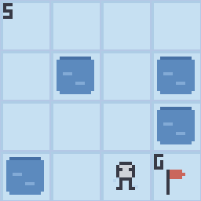

<h1 class="visually-hidden">Frozen Lake</h1>
<div class="gn-env-banner">
<canvas class="gn-pixel" data-text="FROZEN LAKE" data-scale="6" data-color="#fcfcfc" data-shadow="#f83800"></canvas>
<canvas class="gn-pixel" data-text="TOY TEXT  4 ACTIONS  16 OBSERVATIONS" data-scale="2" data-color="#f8b800"></canvas>
</div>

<p class="gn-env-lead">Walk across a frozen lake from the start to the goal without falling through a hole, on ice so slippery that a step goes where it was aimed only a third of the time. The env hands over its own transition table, which makes it the small world for planning and tabular learning.</p>

<aside class="gn-infobox" aria-label="Frozen Lake at a glance">
<video src="media/FrozenLake-v1.episode.mp4" poster="media/FrozenLake-v1.figure.png" autoplay muted loop playsinline disablepictureinpicture disableremoteplayback aria-label="FrozenLake-v1, seed 1: the plan shuffles the elf down the safe left column and along the bottom row into the goal in 41 steps"></video>
<p class="gn-infobox-caption">The whole episode <code>examples/FrozenLake</code> plays and records: value iteration over the env's transition table, seed 1, 41 steps, return 1.</p>
<table>
<tr><td>Ids</td><td><code>FrozenLake-v1</code> 100 steps<br><code>FrozenLake8x8-v1</code> 200 steps</td></tr>
<tr><td>Action space</td><td><code>Discrete(4)</code></td></tr>
<tr><td>Observation space</td><td><code>Discrete(16)</code></td></tr>
<tr><td>Reward</td><td>1 at the goal, 0 elsewhere · solved at 0.7 (FrozenLake-v1), 0.85 (FrozenLake8x8-v1)</td></tr>
<tr><td>Physics</td><td>the transition table <code>P</code>: on slippery ice the aimed move and each sideways slide 1/3</td></tr>
<tr><td>Render modes</td><td><code>human</code>, <code>ansi</code>, <code>rgb_array</code> · 256×256 · 4 fps</td></tr>
<tr><td>Make</td><td><code>Gymnasium.Make("FrozenLake-v1")</code></td></tr>
<tr><td>Class</td><td><a href="xref:Gym.Environments.Envs.ToyText.FrozenLakeEnv"><code>FrozenLakeEnv</code></a>, options <a href="xref:Gym.Environments.Envs.ToyText.FrozenLakeEnvOptions"><code>FrozenLakeEnvOptions</code></a>, info <a href="xref:Gym.Environments.Envs.ToyText.FrozenLakeInfo"><code>FrozenLakeInfo</code></a></td></tr>
<tr><td>Vector env</td><td>none of its own: <code>MakeVec</code> builds sync or async</td></tr>
<tr><td>Parity</td><td><span class="gn-badge gn-badge-ok">bit for bit</span><span class="gn-badge gn-badge-ok">pixel for pixel</span><br>with Gymnasium 1.4.0</td></tr>
<tr><td>Gymnasium</td><td><a href="https://gymnasium.farama.org/v1.4.0/environments/toy_text/frozen_lake/">Frozen Lake</a> in Gymnasium 1.4.0's docs</td></tr>
</table>
</aside>

## Description

The lake is a grid of ice with holes in it. The elf starts in the top-left corner and the goal, a flag, stands in the
bottom-right one. Each step the agent picks a direction, left, down, right or up, and the elf walks one cell that way,
or stays where it is at the lake's edge. The ice is slippery: the elf goes the way it was sent only a third of the time,
and otherwise slides a quarter turn to the left or to the right of it. A hole ends the episode with nothing; the goal
ends it with a reward of 1.

So the agent must find the moves that keep every slide away from the holes, often by aiming somewhere it does not mean to
go. Random moves fall in a hole almost every time: they reached the goal in 12 of 1,000 seeded episodes. The best plan
reaches it in three episodes of four (755 of 1,000), sometimes after a long wait for the right slide.

The env hands over its own model, the transition table `P`, which makes it the standard small world for dynamic
programming and tabular learning. Gym.NET's FrozenLake computes exactly what Gymnasium's does: the same table, the same
slides from the same seed, the same observations, rewards, infos, text and pixels.

## Quick start

# [C#](#tab/csharp)

[!code-csharp[](../../../tests/Gym.Tests/Docs/EnvPageSamples/FrozenLakeSamples.cs?range=1-4,35-41&dedent=12)]

# [Python (Gymnasium)](#tab/python)

```python
import gymnasium as gym

env = gym.make("FrozenLake-v1")
# the cell, row * 4 + col: 0 is the start
observation, info = env.reset(seed=42)
# 0 left, 1 down, 2 right, 3 up
action = env.action_space.sample()
observation, reward, terminated, truncated, info = env.step(action)
```

---

`dotnet add package Gym.NET.Environments`; the six longer examples are in [Code examples](#code-examples).

### Play it, or watch the agent

```bash
# from a clone of the repository: you walk the elf with the arrow keys (the ice still slips)
dotnet run --project examples/FrozenLake -c Release -- --play
# the agent in the video plays it in a window
dotnet run --project examples/FrozenLake -c Release -- --render
```

## How it works

<div class="gn-figure gn-figure-pixel">

<svg viewBox="0 0 512 512" font-family="system-ui, sans-serif" font-size="15" role="img" aria-label="Labels: every cell's number, 0 to 15, the observation; the start; a hole, which ends the episode with 0; the goal's +1; the elf on cell 14 aiming down, which can stay, slip left to 13 or slip right to 15, each with probability 1/3">
<defs><marker id="gn-fl-a" viewBox="0 0 10 10" refX="9" refY="5" markerWidth="5" markerHeight="5" orient="auto-start-reverse"><path d="M0,0 L10,5 L0,10 z" fill="#c2189b"/></marker><marker id="gn-fl-s" viewBox="0 0 10 10" refX="9" refY="5" markerWidth="5" markerHeight="5" orient="auto-start-reverse"><path d="M0,0 L10,5 L0,10 z" fill="#e8590c"/></marker></defs>
<text x="120" y="22" text-anchor="end" font-weight="700" fill="#1f2328" paint-order="stroke" stroke="#fff" stroke-width="4" stroke-linejoin="round">0</text>
<text x="248" y="22" text-anchor="end" font-weight="700" fill="#1f2328" paint-order="stroke" stroke="#fff" stroke-width="4" stroke-linejoin="round">1</text>
<text x="376" y="22" text-anchor="end" font-weight="700" fill="#1f2328" paint-order="stroke" stroke="#fff" stroke-width="4" stroke-linejoin="round">2</text>
<text x="504" y="22" text-anchor="end" font-weight="700" fill="#1f2328" paint-order="stroke" stroke="#fff" stroke-width="4" stroke-linejoin="round">3</text>
<text x="120" y="150" text-anchor="end" font-weight="700" fill="#1f2328" paint-order="stroke" stroke="#fff" stroke-width="4" stroke-linejoin="round">4</text>
<text x="248" y="150" text-anchor="end" font-weight="700" fill="#1f2328" paint-order="stroke" stroke="#fff" stroke-width="4" stroke-linejoin="round">5</text>
<text x="376" y="150" text-anchor="end" font-weight="700" fill="#1f2328" paint-order="stroke" stroke="#fff" stroke-width="4" stroke-linejoin="round">6</text>
<text x="504" y="150" text-anchor="end" font-weight="700" fill="#1f2328" paint-order="stroke" stroke="#fff" stroke-width="4" stroke-linejoin="round">7</text>
<text x="120" y="278" text-anchor="end" font-weight="700" fill="#1f2328" paint-order="stroke" stroke="#fff" stroke-width="4" stroke-linejoin="round">8</text>
<text x="248" y="278" text-anchor="end" font-weight="700" fill="#1f2328" paint-order="stroke" stroke="#fff" stroke-width="4" stroke-linejoin="round">9</text>
<text x="376" y="278" text-anchor="end" font-weight="700" fill="#1f2328" paint-order="stroke" stroke="#fff" stroke-width="4" stroke-linejoin="round">10</text>
<text x="504" y="278" text-anchor="end" font-weight="700" fill="#1f2328" paint-order="stroke" stroke="#fff" stroke-width="4" stroke-linejoin="round">11</text>
<text x="120" y="406" text-anchor="end" font-weight="700" fill="#1f2328" paint-order="stroke" stroke="#fff" stroke-width="4" stroke-linejoin="round">12</text>
<text x="248" y="406" text-anchor="end" font-weight="700" fill="#1f2328" paint-order="stroke" stroke="#fff" stroke-width="4" stroke-linejoin="round">13</text>
<text x="376" y="406" text-anchor="end" font-weight="700" fill="#1f2328" paint-order="stroke" stroke="#fff" stroke-width="4" stroke-linejoin="round">14</text>
<text x="504" y="406" text-anchor="end" font-weight="700" fill="#1f2328" paint-order="stroke" stroke="#fff" stroke-width="4" stroke-linejoin="round">15</text>
<text x="34" y="30" fill="#1f2328" paint-order="stroke" stroke="#fff" stroke-width="4" stroke-linejoin="round">start</text>
<text x="192" y="196" text-anchor="middle" fill="#fff">hole: 0,</text><text x="192" y="214" text-anchor="middle" fill="#fff">the end</text>
<text x="504" y="502" text-anchor="end" font-weight="700" fill="#2f9e44" paint-order="stroke" stroke="#fff" stroke-width="4" stroke-linejoin="round">+1</text>
<text x="264" y="406" font-weight="700" fill="#c2189b" paint-order="stroke" stroke="#fff" stroke-width="4" stroke-linejoin="round">aims down</text>
<text x="320" y="506" text-anchor="middle" fill="#c2189b" font-weight="700" paint-order="stroke" stroke="#fff" stroke-width="4" stroke-linejoin="round">1/3: stays</text>
<line x1="276" y1="448" x2="222" y2="448" stroke="#e8590c" stroke-width="3.5" marker-end="url(#gn-fl-s)"/><text x="249" y="438" text-anchor="middle" fill="#e8590c" font-weight="700" paint-order="stroke" stroke="#fff" stroke-width="4" stroke-linejoin="round">1/3</text>
<line x1="364" y1="448" x2="418" y2="448" stroke="#e8590c" stroke-width="3.5" marker-end="url(#gn-fl-s)"/><text x="391" y="438" text-anchor="middle" fill="#e8590c" font-weight="700" paint-order="stroke" stroke="#fff" stroke-width="4" stroke-linejoin="round">1/3</text>
</svg>
</div>
<p class="gn-figure-caption">Step 40 of the episode in the video, exactly as <code>Render()</code> returns it, shown at twice its size: the elf on cell 14 aims down, into the lake's edge. It can only stay, slide left back to 13, or slide right into the goal, each with probability 1/3, and never into a hole; this time it slides into the goal. 64 pixels to a cell.</p>

The observation is the elf's cell, $s = r \cdot n_{col} + c$ for row $r$ and column $c$, so the 4x4 lake's cells are 0
to 15. A step aims at the next cell in the chosen direction, held at the edges. On slippery ice, with success rate $p$
($1/3$ by default), it goes there with probability $p$ and to each of the two cells a quarter turn either side with
probability $(1 - p)/2$:

$$
P(s' \mid s, a) = p\,[s' = \text{aim}(s, a)] + \tfrac{1 - p}{2}\,[s' = \text{aim}(s, a - 1)] + \tfrac{1 - p}{2}\,[s' = \text{aim}(s, a + 1)]
$$

with the directions counted modulo 4. A hole or the goal ends the episode, and the reward depends only on the tile
reached. The env builds the whole table at construction: `P[s][a]` lists every `(probability, next state, reward,
terminated)` of action `a` in cell `s`, and a step draws one of them with the env's generator (NumPy's PCG64, so a
seed gives Gymnasium's slides).

| Tile | Map letter | Reward reaching it | Ends the episode |
|---|---|--:|---|
| Start | `S` | 0 | No |
| Frozen | `F` | 0 | No |
| Hole | `H` | 0 | Yes |
| Goal | `G` | 1 | Yes |

The rewards are `reward_schedule`'s, `(1, 0, 0)` by default: the goal, a hole, any other tile.

> [!WARNING]
> Frozen Lake numbers its actions 0 left, 1 down, 2 right, 3 up, and Cliff Walking 0 up, 1 right, 2 down, 3 left: an
> agent moved from one to the other turns the wrong way. With both `desc` and `map_name` null the env draws a random
> 8x8 map from fresh entropy at construction, which no reset seed reproduces; pass `GenerateRandomMap(size, seed: s)`
> as `desc` for a map you can make again.

## Action space

`Discrete(4)`: the direction the elf is sent.

| Action | Direction |
|---|---|
| 0 | Left |
| 1 | Down |
| 2 | Right |
| 3 | Up |

An action is looked up in the table as Python looks up a dict key, so `2.0` works as `2` does, and a value the table
lacks raises Python's `KeyError`, as in Gymnasium.

## Observation space

`Discrete(16)` on the 4x4 lake (`Discrete(64)` on 8x8): the elf's cell, `row * ncol + col`, a 0-d int64 `NDArray`.
FrozenLake-v1's holes are cells 5, 7, 11 and 12, and the goal is 15.

## Rewards

1 for the step that reaches the goal, 0 for every other step, a hole included: the return is 1 or 0. The registry
counts an average of 0.7 over 100 episodes as solved on the 4x4 lake, and 0.85 on the 8x8 one. `reward_schedule`
changes the three rewards.

## Starting state

Always the start, cell 0: the reset's seed seeds only the generator that draws the slides. The map itself is fixed by
`map_name` or `desc` when the env is made.

## Episode end

| Ends by | When |
|---|---|
| Termination | The elf falls into a hole, or reaches the goal |
| Truncation | 100 steps (FrozenLake-v1) or 200 (FrozenLake8x8-v1): the `TimeLimit` that `Make` wraps around the env |

## Arguments

By Gymnasium's name in `Make`'s kwargs, or by the C# name in the constructor and in
<xref:Gym.Environments.Envs.ToyText.FrozenLakeEnvOptions>.

| Argument | Type and default | Effect |
|---|---|---|
| `render_mode`<br>`renderMode` | `string?` or `RenderMode`<br>`null` | `"human"` opens a window, `"ansi"` makes `Render()` return text, `"rgb_array"` the frame |
| `desc`<br>`desc` | `IReadOnlyList<string>?`<br>`null` | A map of your own: rows of `S`, `F`, `H` and `G`, all of one length |
| `map_name`<br>`mapName` | `string?`<br>`"4x4"` | `"4x4"` or `"8x8"`, Gymnasium's two maps, used when `desc` is null |
| `is_slippery`<br>`isSlippery` | `bool`<br>`true` | Whether a step can slide sideways |
| `success_rate`<br>`successRate` | `double`<br>`1/3` | The probability of going the way the elf was sent on slippery ice |
| `reward_schedule`<br>`rewardSchedule` | `IReadOnlyList<double>?`<br>`null` | The rewards for the goal, a hole and any other tile; null is `(1, 0, 0)` |
| (Gym.NET)<br>`viewerFactory` | `EnvViewerFactory?`<br>`null` | The window for `human`: Avalonia, WinForms, or headless |

[!code-csharp[](../../../tests/Gym.Tests/Docs/EnvPageSamples/FrozenLakeSamples.cs#Arguments)]

## Info

<xref:Gym.Environments.Envs.ToyText.FrozenLakeInfo>, `{"prob": ...}` on every reset and step: the probability of the
transition just taken, 1 at a reset and 1/3 for a step on slippery ice (the success rate, or the sideways share, when
another is set). Read it as `info.Get<double>("prob")`, or through the typed record.

## Rendering

| Mode | What you get |
|---|---|
| `rgb_array` | `Render()` returns the frame: `(256, 256, 3)` uint8 on the 4x4 lake, `(512, 512, 3)` on 8x8, Gymnasium's pixels |
| `ansi` | `Render()` returns `RenderResult.Ansi`: the last move's name in parentheses over the map, the elf's cell in red |
| `human` | A window from the viewer factory, drawn after every reset and step, paced at 4 frames a second |
| none | `Render()` warns and returns nothing, as Gymnasium's does |

The frame is Farama's pixel art, embedded from Gymnasium: ice tiles with cracks, holes, the elf, the flag and the `S`
and `G` letters, on 64-pixel cells (a map wider than 8 cells shrinks them to fit 512 pixels). The elf disappears into a
hole it falls in.

## Episode anatomy

The whole episode, step by step, on the lake itself: every move the elf made, blue where it went as aimed and orange
where it slid, and a ring on the cell the video shows. Below, the move the plan chose at each step and the slides. The
plan aims left on cells 0 and 4, into the lake's edge, so the ice can only keep the elf there or slide it up and down
the left column, never right into the hole at 5. For 34 steps it shuffles between cells 0, 4 and 8, 23 of its 41 moves
slide, and from cell 9 it walks the bottom row to the goal.

<div class="gn-anatomy" data-trace="media/FrozenLake-v1.episode.json">
<div><video src="media/FrozenLake-v1.episode.mp4" poster="media/FrozenLake-v1.figure.png" autoplay muted loop playsinline disablepictureinpicture disableremoteplayback aria-label="FrozenLake-v1, seed 1, the episode the chart follows"></video><div class="gn-anatomy-readout" aria-live="off"></div></div>
<div><div class="gn-anatomy-chart"></div><div class="gn-anatomy-legend"></div></div>
<script type="application/json" class="gn-anatomy-spec">{"label":"FrozenLake-v1, seed 1: the elf's path on the lake, the moves the plan chose and the slides","bands":[{"height":220,"board":{"image":"media/FrozenLake-v1.board.png","size":[256,256],"origin":[0,0],"cell":[64,64],"row":"row","col":"col","path":{"column":"slipped","colors":{"0":"#1971c2","1":"#e8590c"}},"name":"the path: a move as aimed in blue, a slide in orange"}},{"label":"move","strip":{"column":"action","colors":{"0":"#adb5bd","1":"#3cbcfc","2":"#f8b800","3":"#ff7fe3"},"name":"the move chosen: left grey, down blue, right gold, up pink"}},{"label":"slide","strip":{"column":"slipped","colors":{"0":"#343a40","1":"#e8590c"},"name":"a slide"}}],"readout":[{"label":"step","column":"@step"},{"label":"cell","column":"state","digits":0},{"label":"aims","column":"action","map":{"0":"left","1":"down","2":"right","3":"up"}},{"label":"slides","column":"slipped","map":{"0":"no","1":"yes"}},{"label":"return so far","column":"@return","digits":0}]}</script>
</div>

## Code examples

### Run an episode

# [C#](#tab/csharp)

[!code-csharp[](../../../tests/Gym.Tests/Docs/EnvPageSamples/FrozenLakeSamples.cs#RunAnEpisode)]

# [Python (Gymnasium)](#tab/python)

```python
import gymnasium as gym

env = gym.make("FrozenLake-v1")
observation, info = env.reset(seed=42)
episode_return = 0.0
while True:
    action = env.action_space.sample()
    observation, reward, terminated, truncated, info = env.step(action)
    episode_return += reward
    if terminated or truncated:
        break
print(f"return {episode_return}")  # 1 at the goal, else 0
```

---

### Plan with the transition table

# [C#](#tab/csharp)

[!code-csharp[](../../../tests/Gym.Tests/Docs/EnvPageSamples/FrozenLakeSamples.cs#PlanWithTheTable)]

# [Python (Gymnasium)](#tab/python)

```python
import numpy as np

env = gym.make("FrozenLake-v1")
lake = env.unwrapped
n = lake.observation_space.n
v = np.zeros(n)


def q(s, a):
    # the expected discounted return of action a in state s, from P
    return sum(p * (r + (0 if t else 0.99 * v[ns])) for p, ns, r, t in lake.P[s][a])


delta = 1
while delta > 1e-10:
    delta = 0
    for s in range(n):
        best = max(q(s, a) for a in range(4))
        delta = max(delta, abs(best - v[s]))
        v[s] = best
# the greedy plan: the best action in every state, ties to the lowest
plan = []
for s in range(n):
    best = 0
    for a in range(1, 4):
        if q(s, a) > q(s, best) + 1e-12:
            best = a
    plan.append(best)

observation, info = env.reset(seed=1)
steps, episode_return = 0, 0.0
while True:
    observation, reward, terminated, truncated, info = env.step(plan[observation])
    steps, episode_return = steps + 1, episode_return + reward
    if terminated or truncated:
        break
print(f"{steps} steps, return {episode_return}")  # 41 steps, return 1.0
```

---

### A lake that does not slip

# [C#](#tab/csharp)

[!code-csharp[](../../../tests/Gym.Tests/Docs/EnvPageSamples/FrozenLakeSamples.cs#NotSlippery)]

# [Python (Gymnasium)](#tab/python)

```python
env = gym.make("FrozenLake-v1", is_slippery=False)
env.reset(seed=0)
total = 0.0
# right, right, down, down, down, right: around the holes to the goal
for move in (2, 2, 1, 1, 1, 2):
    cell, reward, terminated, truncated, info = env.step(move)
    total += reward
print(f"cell {cell}, return {total}")  # cell 15, return 1.0
```

---

### A random map

# [C#](#tab/csharp)

[!code-csharp[](../../../tests/Gym.Tests/Docs/EnvPageSamples/FrozenLakeSamples.cs#ARandomMap)]

# [Python (Gymnasium)](#tab/python)

```python
from gymnasium.envs.toy_text.frozen_lake import generate_random_map

# an 8x8 lake with a path from S to G, 80% frozen
lake_map = generate_random_map(size=8, seed=7)
env = gym.make("FrozenLake-v1", desc=lake_map)
print("\n".join(lake_map))  # SHFFFHFH ... HFHFFFFG
```

---

### The lake as text

# [C#](#tab/csharp)

[!code-csharp[](../../../tests/Gym.Tests/Docs/EnvPageSamples/FrozenLakeSamples.cs#AsText)]

# [Python (Gymnasium)](#tab/python)

```python
env = gym.make("FrozenLake-v1", render_mode="ansi")
env.reset(seed=0)
env.step(1)
text = env.render()
print(text)  # "  (Down)" over the map, the elf's cell in red
```

---

### Many lakes at once

# [C#](#tab/csharp)

[!code-csharp[](../../../tests/Gym.Tests/Docs/EnvPageSamples/FrozenLakeSamples.cs#ManyLakes)]

# [Python (Gymnasium)](#tab/python)

```python
# No vector env of its own: make_vec steps 8 envs in turn ("sync")
envs = gym.make_vec("FrozenLake-v1", num_envs=8, vectorization_mode="sync")
observations, infos = envs.reset(seed=42)
for t in range(100):
    actions = envs.action_space.sample()  # one per lake
    # finished lakes reset themselves
    observations, rewards, terminations, truncations, infos = envs.step(actions)
```

---

Every C# example is a test in `tests/Gym.Tests/Docs/EnvPageSamples`, compiled and run by the unit gate; where a
comment states a number, the test checks it.

## Agents and examples

- **The video's agent** is a plan: value iteration over the env's own transition table, with a discount of 0.99, then
  the best action in every cell. It reaches the goal from seed 1 in 41 steps. Over 1,000 seeded episodes it reached the
  goal in 755 and fell in a hole in 147; 98 ran out of their 100 steps while it waited for a safe slide. On the 8x8 lake
  it reaches the goal in 877 of 1,000.
- **[examples/FrozenLake](https://github.com/SciSharp/Gym.NET/tree/master/examples/FrozenLake)**
  ([`FrozenLakeProgram.cs`](https://github.com/SciSharp/Gym.NET/blob/master/examples/FrozenLake/FrozenLakeProgram.cs))
  plays that plan: `dotnet run --project examples/FrozenLake -c Release` plays seed 1 headless, `--seed N` another
  seed, `--episodes N` that many seeds and their mean, `--render` in a window.
  [examples/FrozenLake8x8](https://github.com/SciSharp/Gym.NET/tree/master/examples/FrozenLake8x8) does the same on the
  8x8 lake.
- **Play it yourself**: `--play` hands the elf to the keyboard: the arrow keys send it, and the ice still slips. The
  game is turn-based: it steps only while a key is held.
- **This page's videos and charts** are the examples' own episodes:
  `--record docs/environments/toy_text/media` records each with `RecordVideo` (one frame per step) and writes the step
  trace, the board and the figure beside it.

## Vectorized environment

Frozen Lake registers no vector env of its own. `Gymnasium.MakeVec("FrozenLake-v1", n)` builds a `SyncVectorEnv` that
steps `n` separate envs in turn, and `VectorizeMode.Async` an `AsyncVectorEnv` that steps them on worker threads; each env
resets itself after its episode ends (next-step autoreset), as Gymnasium's.

## Variants

<a id="8x8"></a>

### FrozenLake8x8-v1

The same game on Gymnasium's 8x8 map: ten holes, the goal at cell 63, 200 steps before the time limit, and 0.85 as the
registry's "solved". The same class builds it with `map_name = "8x8"`. Its frame is 512×512, and the plan's episode from
seed 2 reaches the goal in 63 steps:

<div class="gn-anatomy" data-trace="media/FrozenLake8x8-v1.episode.json">
<div><video src="media/FrozenLake8x8-v1.episode.mp4" poster="media/FrozenLake8x8-v1.board.png" autoplay muted loop playsinline disablepictureinpicture disableremoteplayback aria-label="FrozenLake8x8-v1, seed 2: the plan crosses the 8x8 lake in 63 steps"></video><div class="gn-anatomy-readout" aria-live="off"></div></div>
<div><div class="gn-anatomy-chart"></div><div class="gn-anatomy-legend"></div></div>
<script type="application/json" class="gn-anatomy-spec">{"label":"FrozenLake8x8-v1, seed 2: the elf's path on the 8x8 lake, the moves and the slides","bands":[{"height":240,"board":{"image":"media/FrozenLake8x8-v1.board.png","size":[512,512],"origin":[0,0],"cell":[64,64],"row":"row","col":"col","path":{"column":"slipped","colors":{"0":"#1971c2","1":"#e8590c"}},"name":"the path: a move as aimed in blue, a slide in orange"}},{"label":"move","strip":{"column":"action","colors":{"0":"#adb5bd","1":"#3cbcfc","2":"#f8b800","3":"#ff7fe3"},"name":"the move chosen: left grey, down blue, right gold, up pink"}},{"label":"slide","strip":{"column":"slipped","colors":{"0":"#343a40","1":"#e8590c"},"name":"a slide"}}],"readout":[{"label":"step","column":"@step"},{"label":"cell","column":"state","digits":0},{"label":"aims","column":"action","map":{"0":"left","1":"down","2":"right","3":"up"}},{"label":"slides","column":"slipped","map":{"0":"no","1":"yes"}},{"label":"return so far","column":"@return","digits":0}]}</script>
</div>

<p class="gn-figure-caption">The whole episode <code>examples/FrozenLake8x8</code> plays and records: value iteration, seed 2, 63 steps, return 1.</p>

## Parity with Gymnasium

Gymnasium 1.4.0 runs inside the test process and both are compared value by value:

| What is compared | How | Result |
|---|---|---|
| The transition table | `P` on both maps, slippery and not, other success rates and reward schedules | ✓ equal |
| Reset and episodes: observations, rewards, flags, infos | sampled episodes on slippery and solid ice, both maps | ✓ bit for bit |
| Actions | Python's dict and list lookups of every kind of action, and their errors | ✓ same values, same messages |
| Maps | `desc`, custom maps, `generate_random_map` from a seed | ✓ equal |
| Text and frames | `ansi` text; `rgb_array` frames on both maps | ✓ character for character, pixel for pixel |
| Spaces, metadata, `make`'s stack, goldens | both spaces, render modes, fps; the wrapper order through truncation; a golden on each map | ✓ |
| Gymnasium's own checkers on Gym.NET's env | `check_env`, `check_environments_match`, both ids | ✓ |

The tests: [FrozenLakeLiveParityTests](https://github.com/SciSharp/Gym.NET/blob/master/tests/Gym.Tests.Parity/Tests/Envs/FrozenLakeLiveParityTests.cs),
[EnvCoverageLiveParityTests](https://github.com/SciSharp/Gym.NET/blob/master/tests/Gym.Tests.Parity/Tests/Envs/EnvCoverageLiveParityTests.cs),
[GymnasiumToolsLiveParityTests](https://github.com/SciSharp/Gym.NET/blob/master/tests/Gym.Tests.Parity/Tests/Bridge/GymnasiumToolsLiveParityTests.cs).

## Performance

| | Steps a second | Bytes a step |
|---|--:|--:|
| Gym.NET | 213,280 | 4,283 |
| Gymnasium | 59,436 | |

3.6× faster. Random actions, observations disposed; .NET 10 in Release against CPython 3.12 with the pinned NumPy; the
medians of interleaved rounds on one machine (2026-11-11).

## Reference sources

- [gymnasium/envs/toy_text/frozen_lake.py](https://github.com/Farama-Foundation/Gymnasium/blob/8ba8c3a63bb4e000b7f33923f43d292acac07be1/gymnasium/envs/toy_text/frozen_lake.py),
  Gymnasium 1.4.0: the environment (the maps, `generate_random_map`, the transition table, the step's draw, reset,
  the `ansi` text and the frame).
- [gymnasium/envs/toy_text/img](https://github.com/Farama-Foundation/Gymnasium/tree/8ba8c3a63bb4e000b7f33923f43d292acac07be1/gymnasium/envs/toy_text/img):
  the Farama Foundation's pixel art, embedded in Gym.NET.Environments (`src/Gym.Environments/Assets/README.md` lists
  each file with its source and SHA-256).
- pygame-ce's [transform.c](https://github.com/pygame-community/pygame-ce/blob/2.5.8/src_c/transform.c) for `scale`
  and [draw.c](https://github.com/pygame-community/pygame-ce/blob/2.5.8/src_c/draw.c) for `rect`, in Gym.Rendering.
- [gymnasium/utils/seeding.py](https://github.com/Farama-Foundation/Gymnasium/blob/8ba8c3a63bb4e000b7f33923f43d292acac07be1/gymnasium/utils/seeding.py):
  the env's generator, NumPy's PCG64, which NumSharp reproduces for the slides and the random maps.

## Version history

| Version | Change |
|---|---|
| FrozenLake-v1 | Fixed the rewards; Gymnasium 1.3 added the reward customization, `reward_schedule` |
| FrozenLake-v0 | The first release |
| Gym.NET 1.0.0 | New: Gymnasium 1.4.0's FrozenLake-v1 and FrozenLake8x8-v1, bit for bit; 0.2.0 had no Frozen Lake |

## References

1. R. S. Sutton and A. G. Barto, *Reinforcement Learning: An Introduction*, 2nd edition, MIT Press, 2018, section 4.4,
   "Value Iteration": the algorithm the video's agent plans with. [The book](http://incompleteideas.net/book/the-book-2nd.html)

## External links

- [Frozen Lake on Gymnasium's site](https://gymnasium.farama.org/v1.4.0/environments/toy_text/frozen_lake/) (1.4.0)
- [FrozenLakeEnv.cs](https://github.com/SciSharp/Gym.NET/blob/master/src/Gym.Environments/Envs/ToyText/FrozenLakeEnv.cs) on GitHub
- [examples/FrozenLake](https://github.com/SciSharp/Gym.NET/tree/master/examples/FrozenLake) and
  [examples/FrozenLake8x8](https://github.com/SciSharp/Gym.NET/tree/master/examples/FrozenLake8x8)

## API reference

<xref:Gym.Environments.Envs.ToyText.FrozenLakeEnv> · <xref:Gym.Environments.Envs.ToyText.FrozenLakeEnvOptions> ·
<xref:Gym.Environments.Envs.ToyText.FrozenLakeInfo>
