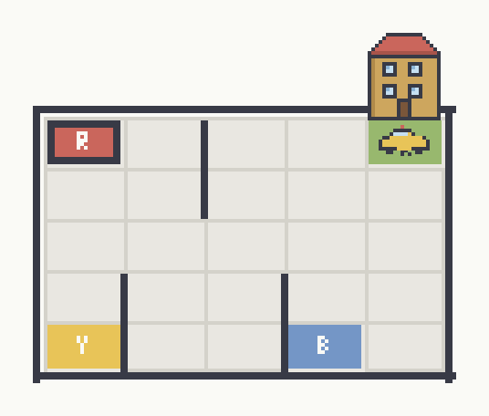

<h1 class="visually-hidden">Taxi</h1>
<div class="gn-env-banner">
<canvas class="gn-pixel" data-text="TAXI" data-scale="6" data-color="#fcfcfc" data-shadow="#f83800"></canvas>
<canvas class="gn-pixel" data-text="TOY TEXT  6 ACTIONS  500 OBSERVATIONS" data-scale="2" data-color="#f8b800"></canvas>
</div>

<p class="gn-env-lead">Drive a taxi through a small walled town: find the passenger waiting at one of four stands, pick them up and drop them at their destination, for 20 points less a point a step. The env hands over its whole 500-state transition table, which made it the classic small world for hierarchical and tabular reinforcement learning.</p>

<aside class="gn-infobox" aria-label="Taxi at a glance">
<video src="media/Taxi-v4.episode.mp4" poster="media/Taxi-v4.board.png" autoplay muted loop playsinline disablepictureinpicture disableremoteplayback aria-label="Taxi-v4, seed 12: the plan drives around the wall to the passenger at G, picks them up, and drives them back to R in 16 steps"></video>
<p class="gn-infobox-caption">The whole episode <code>examples/Taxi</code> plays and records: value iteration over the env's transition table, seed 12, 16 steps, return 5.</p>
<table>
<tr><td>Ids</td><td><code>Taxi-v4</code> 200 steps</td></tr>
<tr><td>Action space</td><td><code>Discrete(6)</code></td></tr>
<tr><td>Observation space</td><td><code>Discrete(500)</code></td></tr>
<tr><td>Reward</td><td>−1 a step, +20 for the delivery, −10 for a wrong pick-up or drop-off · solved at 8 · the best policy averages 7.93</td></tr>
<tr><td>Physics</td><td>the transition table <code>P</code>: every move certain; in the rain the aimed move 0.8, each side 0.1</td></tr>
<tr><td>Render modes</td><td><code>human</code>, <code>ansi</code>, <code>rgb_array</code> · 536×456 · 4 fps</td></tr>
<tr><td>Make</td><td><code>Gymnasium.Make("Taxi-v4")</code></td></tr>
<tr><td>Class</td><td><a href="xref:Gym.Environments.Envs.ToyText.TaxiEnv"><code>TaxiEnv</code></a>, options <a href="xref:Gym.Environments.Envs.ToyText.TaxiEnvOptions"><code>TaxiEnvOptions</code></a>, info <a href="xref:Gym.Environments.Envs.ToyText.TaxiInfo"><code>TaxiInfo</code></a></td></tr>
<tr><td>Vector env</td><td>none of its own: <code>MakeVec</code> builds sync or async</td></tr>
<tr><td>Parity</td><td><span class="gn-badge gn-badge-ok">bit for bit</span><span class="gn-badge gn-badge-ok">pixel for pixel</span><br>with Gymnasium 1.4.0</td></tr>
<tr><td>Gymnasium</td><td><a href="https://gymnasium.farama.org/v1.4.0/environments/toy_text/taxi/">Taxi</a> in Gymnasium 1.4.0's docs</td></tr>
</table>
</aside>

## Description

The town is a 5×5 grid with walls, and four stands, R, G, Y and B, three of them in its corners and one beside the
fourth. A passenger waits at one stand and wants to go to another. Each step the agent drives the taxi one cell south,
north, east or west, or picks the passenger up, or drops them off. A step costs 1, and so does a move into a wall or the
town's edge, which leaves the taxi where it is; a pick-up or drop-off where it cannot happen costs 10; delivering the
passenger at their destination pays 20 and ends the episode. After 200 steps the time limit cuts it short.

So the agent must find the passenger and then the destination, by the shortest way around the walls. Random driving
delivers within the 200 steps in 54 of 1,000 seeded episodes, for an average return of −772; drawn from the info's
action mask, which leaves out the actions that would change nothing, it delivers in 140 and averages −186. The best
plan delivers every time, in 13 steps on average.

The task comes from Thomas Dietterich's work on hierarchical reinforcement learning, the MAXQ value function
decomposition (2000), where it shows a task split into sub-tasks: get to the passenger, pick up, get to the destination,
drop off. The env also hands over its own transition table, `P`, so it can be planned exactly. Gym.NET's Taxi computes
exactly what Gymnasium's does: the same table, the same draws from the same seed, the same observations, rewards,
infos (the action mask among them), text and pixels.

## Quick start

# [C#](#tab/csharp)

[!code-csharp[](../../../tests/Gym.Tests/Docs/EnvPageSamples/TaxiSamples.cs?range=1-4,36-43&dedent=12)]

# [Python (Gymnasium)](#tab/python)

```python
import gymnasium as gym

env = gym.make("Taxi-v4")
# one of 500 states: the taxi's cell, the passenger, the destination
observation, info = env.reset(seed=42)
# 0 south, 1 north, 2 east, 3 west, 4 pick up, 5 drop off
action = env.action_space.sample()
observation, reward, terminated, truncated, info = env.step(action)
```

---

`dotnet add package Gym.NET.Environments`; the six longer examples are in [Code examples](#code-examples).

### Play it, or watch the agent

```bash
# from a clone of the repository: the arrow keys drive, P picks up, D drops off
dotnet run --project examples/Taxi -c Release -- --play
# the agent in the video plays it in a window
dotnet run --project examples/Taxi -c Release -- --render
```

## How it works

<div class="gn-figure gn-figure-medium">

<svg viewBox="0 0 536 456" font-family="system-ui, sans-serif" role="img" aria-label="Labels: state 84, which encodes the taxi's row 0 and column 4, the passenger at G = 1 and the destination R; the rows and columns 0 to 4; the walls, which block east and west moves; the destination's frame; the plan's pick-up on the passenger's stand">
<text x="14" y="30" font-size="15" font-weight="700" fill="#1f2328">state 84 = ((0·5 + 4)·5 + 1)·4 + 0</text>
<text x="14" y="52" font-size="13" fill="#1f2328">taxi row 0, col 4 · passenger at G = 1 · destination R = 0</text>
<text x="14" y="72" font-size="13" fill="#1f2328">stands R 0, G 1, Y 2, B 3; a passenger in the taxi is 4</text>
<text x="22" y="118" text-anchor="middle" font-size="12" fill="#495057">row</text>
<text x="22" y="161" text-anchor="middle" font-size="13" font-weight="700" fill="#1f2328">0</text>
<text x="22" y="217" text-anchor="middle" font-size="13" font-weight="700" fill="#1f2328">1</text>
<text x="22" y="273" text-anchor="middle" font-size="13" font-weight="700" fill="#1f2328">2</text>
<text x="22" y="329" text-anchor="middle" font-size="13" font-weight="700" fill="#1f2328">3</text>
<text x="22" y="385" text-anchor="middle" font-size="13" font-weight="700" fill="#1f2328">4</text>
<text x="22" y="438" text-anchor="middle" font-size="12" fill="#495057">col</text>
<text x="92" y="438" text-anchor="middle" font-size="13" font-weight="700" fill="#1f2328">0</text>
<text x="180" y="438" text-anchor="middle" font-size="13" font-weight="700" fill="#1f2328">1</text>
<text x="268" y="438" text-anchor="middle" font-size="13" font-weight="700" fill="#1f2328">2</text>
<text x="356" y="438" text-anchor="middle" font-size="13" font-weight="700" fill="#1f2328">3</text>
<text x="444" y="438" text-anchor="middle" font-size="13" font-weight="700" fill="#1f2328">4</text>
<line x1="224" y1="130" x2="224" y2="182" stroke="#e8590c" stroke-width="4" stroke-opacity="0.9"/>
<line x1="224" y1="186" x2="224" y2="238" stroke="#e8590c" stroke-width="4" stroke-opacity="0.9"/>
<line x1="136" y1="298" x2="136" y2="350" stroke="#e8590c" stroke-width="4" stroke-opacity="0.9"/>
<line x1="312" y1="298" x2="312" y2="350" stroke="#e8590c" stroke-width="4" stroke-opacity="0.9"/>
<line x1="136" y1="354" x2="136" y2="406" stroke="#e8590c" stroke-width="4" stroke-opacity="0.9"/>
<line x1="312" y1="354" x2="312" y2="406" stroke="#e8590c" stroke-width="4" stroke-opacity="0.9"/>
<text x="232" y="262" font-size="13" font-weight="700" fill="#e8590c" paint-order="stroke" stroke="#fff" stroke-width="3.5" stroke-linejoin="round">↖ walls: no east or west move across</text>
<text x="54" y="204" font-size="13" font-weight="700" fill="#1f2328" paint-order="stroke" stroke="#fff" stroke-width="3.5" stroke-linejoin="round">↑ destination, framed</text>
<text x="392" y="161" text-anchor="end" font-size="13" font-weight="700" fill="#c2189b" paint-order="stroke" stroke="#fff" stroke-width="3.5" stroke-linejoin="round">pick-up (4) here →</text>
</svg>
</div>
<p class="gn-figure-caption">Step 6 of the episode in the video, exactly as <code>Render()</code> returns it: the taxi on the passenger's stand, G, the passenger hidden under it, and the destination, R, framed. The plan picks the passenger up here. The info's action mask for this state is [1, 0, 0, 1, 1, 0]: south, west and the pick-up change the state, north and east would bump into the town's edge, and a drop-off would cost 10. The grid's cells are 88 by 56 pixels, from (48, 128).</p>

The observation packs the whole situation into one number: the taxi's row $r$ and column $c$ (0 to 4), the passenger's
place $p$ (0 to 3 for the stands R, G, Y and B, 4 in the taxi) and the destination $d$ (0 to 3):

$$
s = \big((5r + c) \cdot 5 + p\big) \cdot 4 + d
$$

so 500 states. A move goes one cell, unless a wall or the edge is in the way and the taxi stays. The rewards:

$$
\text{reward} = \begin{cases} +20 & \text{the delivery: a drop-off at the destination} \\ -10 & \text{a pick-up or drop-off that cannot happen} \\ -1 & \text{any other step} \end{cases}
$$

A pick-up cannot happen where the passenger is not, and a drop-off cannot happen with no passenger aboard or off the
stands; a drop-off at a stand other than the destination puts the passenger down there, for −1, to be picked up again.
In the rain (`is_rainy`) a move goes as aimed with probability 0.8 (`rainy_probability`) and a tenth of the time to
either side, a side blocked by a wall or the edge leaving the taxi in place; a move into a wall or the edge stays put,
without drifting. A fickle passenger (`fickle_passenger`) has a chance of 0.3 (`fickle_probability`), drawn at the
reset, of picking a new destination, one of the other three, on the taxi's first move with them aboard. The env builds the whole table at construction: `P[s][a]` lists every
`(probability, next state, reward, terminated)` of action `a` in state `s`, and a step draws one of them with the env's
generator (NumPy's PCG64, so a seed gives Gymnasium's draws).

| Stand | Cell (row, col) | Its number for $p$ and $d$ |
|---|---|--:|
| R | (0, 0) | 0 |
| G | (0, 4) | 1 |
| Y | (4, 0) | 2 |
| B | (4, 3) | 3 |
| In the taxi | wherever it is | 4, for $p$ only |

> [!WARNING]
> The registry counts an average return of 8 as solved, and no policy reaches it: the best one, the plan in the video,
> averages 7.93 over the 300 starting states the reset draws from (793/100, each start's shortest delivery counted;
> the "optimum = 8.46" in Gymnasium's registration no longer holds for v4), so only a lucky run of starts averages 8.
> Taxi numbers its moves 0 south, 1 north, 2 east, 3 west, in neither Frozen Lake's order nor Cliff Walking's.

## Action space

`Discrete(6)`: a move or a dealing with the passenger.

| Action | Does |
|---|---|
| 0 | Drive south (down) |
| 1 | Drive north (up) |
| 2 | Drive east (right) |
| 3 | Drive west (left) |
| 4 | Pick the passenger up |
| 5 | Drop the passenger off |

The info's `action_mask` marks which of the six would change the state, and `ActionSpace.Sample(mask)` draws among
them. An action is looked up in the table as Python looks up a dict key, so `2.0` works as `2` does, and a value the
table lacks raises Python's `KeyError`, as in Gymnasium.

## Observation space

`Discrete(500)`: the encoded state above, a 0-d int64 `NDArray`; `TaxiEnv.Decode(s)` returns the taxi's row and column,
the passenger's place and the destination, and `Encode` packs them again. 404 of the 500 ever occur: the passenger is
never at their destination during an episode (400 states), and the four states after a delivery, the taxi on the
destination with the passenger set down there, end it.

## Rewards

−1 a step, but +20 for the drop-off that delivers the passenger, and −10 for a pick-up where the passenger is not, or a
drop-off with no passenger aboard or away from every stand. A clean delivery in $n$ steps returns $21 - n$. The
registry counts 8 as solved, which no policy averages (see the warning above).

## Starting state

Uniform over the 300 states with the passenger at a stand that is not their destination: the taxi on any of the 25
cells, the passenger at any of the 4 stands, the destination any of the 3 others. A fickle passenger's reset draws one
more number, whether they will change their mind.

## Episode end

| Ends by | When |
|---|---|
| Termination | The passenger is dropped off at their destination |
| Truncation | 200 steps: the `TimeLimit` that `Make` wraps around the env |

## Arguments

By Gymnasium's name in `Make`'s kwargs, or by the C# name in the constructor and in
<xref:Gym.Environments.Envs.ToyText.TaxiEnvOptions>.

| Argument | Type and default | Effect |
|---|---|---|
| `render_mode`<br>`renderMode` | `string?` or `RenderMode`<br>`null` | `"human"` opens a window, `"ansi"` makes `Render()` return text, `"rgb_array"` the frame |
| `is_rainy`<br>`isRainy` | `bool`<br>`false` | A move may be blown to either side; picking up and dropping off stay certain |
| `fickle_passenger`<br>`ficklePassenger` | `bool`<br>`false` | The passenger may change their destination once, on the taxi's first move with them aboard |
| `rainy_probability`<br>`rainyProbability` | `double`<br>`0.8` | The chance, in the rain, that a move goes as aimed; each side has half of the rest |
| `fickle_probability`<br>`fickleProbability` | `double`<br>`0.3` | The chance, drawn at the reset, that a fickle passenger will change their mind |
| (Gym.NET)<br>`viewerFactory` | `EnvViewerFactory?`<br>`null` | The window for `human`: Avalonia, WinForms, or headless |


# [C#](#tab/csharp)

[!code-csharp[](../../../tests/Gym.Tests/Docs/EnvPageSamples/TaxiSamples.cs#Arguments)]

# [Python (Gymnasium)](#tab/python)

```python
env = gym.make("Taxi-v4", is_rainy=True, fickle_passenger=True,
               rainy_probability=0.9)
```

---

## Info

<xref:Gym.Environments.Envs.ToyText.TaxiInfo>, `{"prob": ..., "action_mask": ...}` on every reset and step: `prob`, the
probability of the transition just taken (1.0, or in the rain 0.8 or 0.1 for a move), and `action_mask`, an int8 array
of six 0s and 1s, 1 for each action that would change the state. The mask is the result's own array and goes with it
when the result is disposed: draw from it, or copy it, before that. Read the info as `info.Get<double>("prob")` and
`info["action_mask"]`, or through the typed record.

## Rendering

| Mode | What you get |
|---|---|
| `rgb_array` | `Render()` returns the frame: `(456, 536, 3)` uint8, Gymnasium's pixels |
| `ansi` | `Render()` returns `RenderResult.Ansi`: the map as text in ANSI colours, the taxi highlighted in yellow (green with the passenger aboard), the waiting passenger in blue, the destination in magenta, then the last action's name |
| `human` | A window from the viewer factory, drawn after every reset and step, paced at 4 frames a second |
| none | `Render()` warns and returns nothing, as Gymnasium's does |

The frame is the Farama Foundation's pixel art, embedded from Gymnasium: the town with its walls and four stands, a
house, the destination's frame, the waiting passenger, and the taxi, which faces its last move and shows the passenger
inside once they are aboard.

## Episode anatomy

The whole episode in the town: the taxi's path, blue while it drives empty and orange with the passenger aboard, and a
ring on the cell the video shows. Below, the action the plan chose at each step. A wall stands east of the taxi's start,
so the plan drives south first, around it, and up to G; it picks the passenger up at step 6, drives back west along the
third row, under the wall, and up to R, and drops them off at step 15: 16 steps, return 5.

<div class="gn-anatomy" data-trace="media/Taxi-v4.episode.json">
<div><video src="media/Taxi-v4.episode.mp4" poster="media/Taxi-v4.board.png" autoplay muted loop playsinline disablepictureinpicture disableremoteplayback aria-label="Taxi-v4, seed 12, the episode the chart follows"></video><div class="gn-anatomy-readout" aria-live="off"></div></div>
<div><div class="gn-anatomy-chart"></div><div class="gn-anatomy-legend"></div></div>
<script type="application/json" class="gn-anatomy-spec">{"label":"Taxi-v4, seed 12: the taxi's path through the town, empty and with the passenger, and the actions the plan chose","bands":[{"height":220,"board":{"image":"media/Taxi-v4.board.png","size":[536,456],"origin":[48,128],"cell":[88,56],"row":"row","col":"col","path":{"column":"aboard","colors":{"0":"#1971c2","1":"#e8590c"}},"name":"the path: empty in blue, with the passenger in orange"}},{"label":"action","strip":{"column":"action","colors":{"0":"#3cbcfc","1":"#ff7fe3","2":"#f8b800","3":"#adb5bd","4":"#40c057","5":"#cc5de8"},"name":"the action: south blue, north pink, east gold, west grey, pick-up green, drop-off violet"}}],"readout":[{"label":"step","column":"@step"},{"label":"state","column":"state","digits":0},{"label":"passenger","column":"passenger","map":{"0":"at R","1":"at G","2":"at Y","3":"at B","4":"in the taxi"}},{"label":"action","column":"action","map":{"0":"south","1":"north","2":"east","3":"west","4":"pick up","5":"drop off"}},{"label":"return so far","column":"@return","digits":0}]}</script>
</div>

## Code examples

### Run an episode

# [C#](#tab/csharp)

[!code-csharp[](../../../tests/Gym.Tests/Docs/EnvPageSamples/TaxiSamples.cs#RunAnEpisode)]

# [Python (Gymnasium)](#tab/python)

```python
import gymnasium as gym

env = gym.make("Taxi-v4")
observation, info = env.reset(seed=42)
episode_return = 0.0
while True:
    # only the moves that change something: the info's action mask
    action = env.action_space.sample(info["action_mask"])
    observation, reward, terminated, truncated, info = env.step(action)
    episode_return += reward
    if terminated or truncated:
        break
# -1 a step, 20 for the delivery: masked moves never cost 10
print(f"return {episode_return}")
```

---

### Plan with the transition table

# [C#](#tab/csharp)

[!code-csharp[](../../../tests/Gym.Tests/Docs/EnvPageSamples/TaxiSamples.cs#PlanWithTheTable)]

# [Python (Gymnasium)](#tab/python)

```python
import numpy as np

env = gym.make("Taxi-v4")
taxi = env.unwrapped
n = taxi.observation_space.n
v = np.zeros(n)


def q(s, a):
    # the expected discounted return of action a in state s, from P
    return sum(p * (r + (0 if t else 0.99 * v[ns])) for p, ns, r, t in taxi.P[s][a])


delta = 1
while delta > 1e-10:
    delta = 0
    for s in range(n):
        best = max(q(s, a) for a in range(6))
        delta = max(delta, abs(best - v[s]))
        v[s] = best
# the greedy plan: the best action in every state, ties to the lowest
plan = []
for s in range(n):
    best = 0
    for a in range(1, 6):
        if q(s, a) > q(s, best) + 1e-12:
            best = a
    plan.append(best)

observation, info = env.reset(seed=12)
steps, episode_return = 0, 0.0
while True:
    observation, reward, terminated, truncated, info = env.step(plan[observation])
    steps, episode_return = steps + 1, episode_return + reward
    if terminated or truncated:
        break
print(f"{steps} steps, return {episode_return}")  # 16 steps, return 5.0
```

---

### Encode and decode a state

# [C#](#tab/csharp)

[!code-csharp[](../../../tests/Gym.Tests/Docs/EnvPageSamples/TaxiSamples.cs#EncodeAndDecode)]

# [Python (Gymnasium)](#tab/python)

```python
taxi = gym.make("Taxi-v4").unwrapped
# row 0, col 4, the passenger at G (1), going to R (0)
state = taxi.encode(0, 4, 1, 0)  # ((0 * 5 + 4) * 5 + 1) * 4 + 0
row, col, passenger, destination = taxi.decode(state)
print(f"{state}: {row}, {col}, {passenger}, {destination}")  # 84: 0, 4, 1, 0
```

---

### Rain

# [C#](#tab/csharp)

[!code-csharp[](../../../tests/Gym.Tests/Docs/EnvPageSamples/TaxiSamples.cs#Rain)]

# [Python (Gymnasium)](#tab/python)

```python
env = gym.make("Taxi-v4", is_rainy=True)
taxi = env.unwrapped
# south from the middle, the passenger waiting at R, going to G
state = taxi.encode(2, 2, 0, 1)
for p, s, r, t in taxi.P[state][0]:
    row, col, _, _ = taxi.decode(s)
    print(f"{p:.1f} -> row {row}, col {col}")
# 0.8 -> row 3, col 2    south, as aimed
# 0.1 -> row 2, col 3    blown east
# 0.1 -> row 2, col 1    blown west
```

---

### The town as text

# [C#](#tab/csharp)

[!code-csharp[](../../../tests/Gym.Tests/Docs/EnvPageSamples/TaxiSamples.cs#AsText)]

# [Python (Gymnasium)](#tab/python)

```python
env = gym.make("Taxi-v4", render_mode="ansi")
env.reset(seed=12)
env.step(0)
# the map; the taxi in yellow, the passenger in blue, the
# destination in magenta, then the last action: "  (South)"
print(env.render())
```

---

### Many taxis at once

# [C#](#tab/csharp)

[!code-csharp[](../../../tests/Gym.Tests/Docs/EnvPageSamples/TaxiSamples.cs#ManyTaxis)]

# [Python (Gymnasium)](#tab/python)

```python
# No vector env of its own: make_vec steps 8 envs in turn ("sync")
envs = gym.make_vec("Taxi-v4", num_envs=8, vectorization_mode="sync")
observations, infos = envs.reset(seed=42)
for t in range(100):
    actions = envs.action_space.sample()  # one per taxi
    # finished taxis reset themselves
    observations, rewards, terminations, truncations, infos = envs.step(actions)
```

---

Every C# example is a test in `tests/Gym.Tests/Docs/EnvPageSamples`, compiled and run by the unit gate; where a
comment states a number, the test checks it.

## Agents and examples

- **The video's agent** is a plan: value iteration over the env's own transition table, with a discount of 0.99, then
  the best action in every state. Over 1,000 seeded episodes it delivered every passenger, in 13 steps on average, for
  an average return of 7.87; over all 300 starting states its average is 7.93, the best any policy can do.
- **[examples/Taxi](https://github.com/SciSharp/Gym.NET/tree/master/examples/Taxi)**
  ([`TaxiProgram.cs`](https://github.com/SciSharp/Gym.NET/blob/master/examples/Taxi/TaxiProgram.cs))
  plays that plan: `dotnet run --project examples/Taxi -c Release` plays seed 12 headless, `--seed N` another seed,
  `--episodes N` that many seeds and their mean, `--render` in a window.
- **Play it yourself**: `--play` hands the taxi to the keyboard: the arrow keys drive it, P picks the passenger up and D
  drops them off. The game is turn-based: it steps only while a key is held.
- **This page's videos and charts** are the example's own episode:
  `--record docs/environments/toy_text/media` records it with `RecordVideo` (one frame per step) and writes the step
  trace, the board and the figure beside it.

## Vectorized environment

Taxi registers no vector env of its own. `Gymnasium.MakeVec("Taxi-v4", n)` builds a `SyncVectorEnv` that steps `n`
separate envs in turn, and `VectorizeMode.Async` an `AsyncVectorEnv` that steps them on worker threads; each env resets
itself after its episode ends (next-step autoreset), as Gymnasium's.

## Parity with Gymnasium

Gymnasium 1.4.0 runs inside the test process and both are compared value by value:

| What is compared | How | Result |
|---|---|---|
| The transition table and the start | `P` dry and rainy, the start distribution | ✓ equal |
| Reset and episodes: observations, rewards, flags, infos | seeded sampled episodes, dry and rainy; a delivery driven to the end with a wrong pick-up and drop-off on the way | ✓ bit for bit |
| The fickle passenger | the new destination's draw after the first move aboard, and every case that draws nothing, at every taxi cell and destination | ✓ the same draws |
| `encode`, `decode`, `action_mask` | over every state, and `decode`'s error beyond the grid | ✓ equal |
| Actions | Python's dict and list lookups of every kind of action (`True`, NumPy scalars, floats equal to a key), and the ones it refuses, with their errors | ✓ same values, same messages |
| Text and frames | `ansi` text at every one of the 500 states; `rgb_array` frames after the reset, along episodes and with each of the eight taxi sprites | ✓ character for character, pixel for pixel |
| Spaces, metadata, `make`'s stack, goldens | both spaces, render modes and fps; the wrapper order through truncation; a golden | ✓ |
| Gymnasium's own checkers on Gym.NET's env | `check_env`, `check_environments_match` | ✓ |

The tests: [TaxiLiveParityTests](https://github.com/SciSharp/Gym.NET/blob/master/tests/Gym.Tests.Parity/Tests/Envs/TaxiLiveParityTests.cs),
[EnvCoverageLiveParityTests](https://github.com/SciSharp/Gym.NET/blob/master/tests/Gym.Tests.Parity/Tests/Envs/EnvCoverageLiveParityTests.cs),
[GymnasiumToolsLiveParityTests](https://github.com/SciSharp/Gym.NET/blob/master/tests/Gym.Tests.Parity/Tests/Bridge/GymnasiumToolsLiveParityTests.cs).

## Performance

| | Steps a second | Bytes a step |
|---|--:|--:|
| Gym.NET | 164,917 | 4,681 |
| Gymnasium | 36,414 | |

4.5× faster. Random actions, observations disposed; .NET 10 in Release against CPython 3.12 with the pinned NumPy; the
medians of interleaved rounds on one machine (2026-11-11).

## Reference sources

- [gymnasium/envs/toy_text/taxi.py](https://github.com/Farama-Foundation/Gymnasium/blob/8ba8c3a63bb4e000b7f33923f43d292acac07be1/gymnasium/envs/toy_text/taxi.py),
  Gymnasium 1.4.0: the environment (the map, the encoding, the dry and rainy tables, the fickle passenger, the action
  mask, reset, the `ansi` text and the frame).
- [gymnasium/envs/toy_text/utils.py](https://github.com/Farama-Foundation/Gymnasium/blob/8ba8c3a63bb4e000b7f33923f43d292acac07be1/gymnasium/envs/toy_text/utils.py):
  `categorical_sample`, the step's draw from the table.
- [gymnasium/envs/toy_text/img/taxi](https://github.com/Farama-Foundation/Gymnasium/tree/8ba8c3a63bb4e000b7f33923f43d292acac07be1/gymnasium/envs/toy_text/img/taxi):
  the Farama Foundation's pixel art, embedded in Gym.NET.Environments (`src/Gym.Environments/Assets/README.md` lists
  each file with its source and SHA-256).
- pygame-ce's [transform.c](https://github.com/pygame-community/pygame-ce/blob/2.5.8/src_c/transform.c) for `flip`,
  which turns the taxi's sprites, in Gym.Rendering.
- [gymnasium/utils/colorize.py](https://github.com/Farama-Foundation/Gymnasium/blob/8ba8c3a63bb4e000b7f33923f43d292acac07be1/gymnasium/utils/colorize.py):
  the `ansi` text's colours.
- [gymnasium/utils/seeding.py](https://github.com/Farama-Foundation/Gymnasium/blob/8ba8c3a63bb4e000b7f33923f43d292acac07be1/gymnasium/utils/seeding.py):
  the env's generator, NumPy's PCG64, which NumSharp reproduces for the start, the rain and the fickle passenger.

## Version history

| Version | Change |
|---|---|
| Taxi-v4 | Gymnasium 1.3.0: the rain and the fickle passenger fixed, and `rainy_probability` and `fickle_probability` added to tune them; 1.4.0 draws it in the Farama Foundation's new pixel art |
| Taxi-v3 | The map corrected; the action mask in the info from Gymnasium 0.25.0; `is_rainy` and `fickle_passenger` from 1.2.0, after Dietterich's section 7.1 |
| Taxi-v2 | The taxi no longer starts on the goal; the observations in the rollout updated; a new reward threshold |
| Taxi-v1 | (3, 2) removed from the stands, and a check that the passenger is at a stand |
| Taxi-v0 | The first release |
| Gym.NET 1.0.0 | New: Gymnasium 1.4.0's Taxi-v4, bit for bit; 0.2.0 had no Taxi |

## References

1. T. G. Dietterich, "Hierarchical Reinforcement Learning with the MAXQ Value Function Decomposition", *Journal of
   Artificial Intelligence Research* 13, pp. 227–303, 2000, [doi:10.1613/jair.639](https://doi.org/10.1613/jair.639):
   the taxi task, where it comes from.
2. R. S. Sutton and A. G. Barto, *Reinforcement Learning: An Introduction*, 2nd edition, MIT Press, 2018, section 4.4,
   "Value Iteration": the algorithm the video's agent plans with. [The book](http://incompleteideas.net/book/the-book-2nd.html)

## External links

- [Taxi on Gymnasium's site](https://gymnasium.farama.org/v1.4.0/environments/toy_text/taxi/) (1.4.0)
- [TaxiEnv.cs](https://github.com/SciSharp/Gym.NET/blob/master/src/Gym.Environments/Envs/ToyText/TaxiEnv.cs) on GitHub
- [examples/Taxi](https://github.com/SciSharp/Gym.NET/tree/master/examples/Taxi)

## API reference

<xref:Gym.Environments.Envs.ToyText.TaxiEnv> · <xref:Gym.Environments.Envs.ToyText.TaxiEnvOptions> ·
<xref:Gym.Environments.Envs.ToyText.TaxiInfo>
